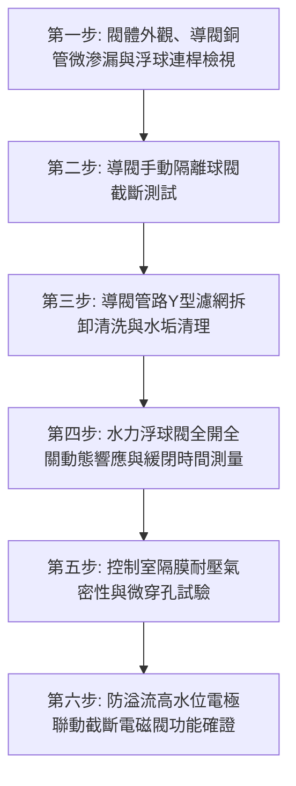

# 全案購屋實戰第七百四十八部_中古大樓社區地下室生活自來水受水箱進水水力浮球閥主閥隔膜微裂紋導閥濾網水垢淤塞洩壓孔堵塞與自來水狂流溢流淹水體檢工序全書

---

## 壹、核心體檢綱領與歷史案例借鏡

在中古大樓（屋齡 20 至 30 年以上）的公共給水系統架構中，位於地下室蓄水池（受水箱）之「進水水力控制浮球閥（Hydraulic Float Control Valve / Diaphragm Control Valve）」，是掌管整棟大樓每日數百噸自來水注入的第一道咽喉閥門。與傳統家庭水塔小型機械浮球閥不同，集合住宅大樓進水幹管管徑通常達 3 吋（DN80）至 6 吋（DN150），市政自來水進水水壓可達 $2.5 \sim 4.5\,\text{kg/cm}^2$。因此，大樓必須採用以水力自身壓力為動力源之**隔膜式水力控制閥（Diaphragm Operated Hydraulic Valve）**。

水力控制浮球閥之運作原理，係透過外部銅質或不鏽鋼導管系統、微型針閥（Needle Valve）、導閥濾網（Strainer）與水面不鏽鋼浮球導閥（Pilot Float Valve），精準控制主閥上方「隔膜控制室（Control Chamber）」之充水蓄壓與洩水洩壓，進而驅動主閥瓣之開啟與緩慢緊密閉合。

然而，中古大樓常年處於缺乏專業機電保養的狀態，該閥門普遍面臨「四大致命病態衰竭」：
1. **強化橡膠隔膜（EPDM / NBR Diaphragm）老化疲勞與微裂紋穿孔**：隔膜長年浸泡於含有消毒餘氯之自來水中，歷經數十萬次拉伸變形，橡膠分子鏈斷裂、硬化龜裂。一旦隔膜產生針孔級微穿孔，控制室內部壓力無法蓄積，主閥彈簧力無法抵抗自來水動態推力，導致主閥「永遠無法完全關死」。
2. **導閥管路微型濾網（Strainer）碳酸鈣水垢與鐵鏽淤塞**：自來水管道夾帶之細微泥沙與碳酸鈣結晶沉積於導閥濾網內，阻斷控制室補水水流。控制室無法進水建壓，主閥同樣呈現完全卡死全開狀態。
3. **主閥洩壓孔（Orifice / Bleed Port）水垢結石堵死**：當浮球下沉需要進水時，導閥開啟洩壓，但主閥控制室洩壓孔若遭水垢堵死，高壓水無法排出，造成「打不開閥門」，全社區無水可進、蓄水池乾涸大停水。
4. **自來水狂流直注與溢流淹沒地下變電室**：一旦主閥卡死無法關閉，自來水以每小時數十噸之驚人流量日夜無休灌入蓄水池。若同時遭遇地下室集水坑沉水泵浦故障或溢流管排水不及，冰冷自來水將漫過水箱人孔蓋，直接淹沒地下室停車場、梯廳甚至灌入高低壓變電室，造成全棟電力設備泡水短路、損失動輒數百萬元。

本工序全書旨在建立極致嚴謹的水力控制浮球閥解構體檢標準，守護社區自來水資源與地下機電資產之絕對安全。

---

## 貳、水力控制浮球閥水力學與材料病理深度剖析

### 一、水力控制閥隔膜室壓差平衡力學方程式
主閥瓣之開閉狀態取決於閥瓣受力之合力 $\sum F$：
$$\sum F = P_{\text{in}} \cdot A_{\text{seat}} - P_{\text{chamber}} \cdot A_{\text{diaphragm}} - F_{\text{spring}}$$
- $P_{\text{in}}$：自來水進口端壓力。
- $A_{\text{seat}}$：主閥座流通孔截面積。
- $P_{\text{chamber}}$：隔膜控制室水壓。
- $A_{\text{diaphragm}}$：隔膜有效受壓面積（通常 $A_{\text{diaphragm}} \approx 1.2 \sim 1.5 \times A_{\text{seat}}$）。
- $F_{\text{spring}}$：閥軸關閉輔助彈簧力。

**病理分析**：
- **正常關閉**：當浮球升至高水位時，導閥關閉，控制室蓄滿自來水且 $P_{\text{chamber}} = P_{\text{in}}$。由於 $A_{\text{diaphragm}} > A_{\text{seat}}$，向下之關閉力遠大於向上之推力，主閥緊密貼合閥座達到滴水不漏。
- **隔膜微裂紋破壞**：當隔膜產生裂孔時，水流由控制室洩漏至閥體出口低壓區，$P_{\text{chamber}}$ 驟降，向下壓緊力喪失，主閥瓣在進口水壓 $P_{\text{in}}$ 推動下被強行頂開，即使浮球高高浮起，主閥仍持續以最大口徑噴水。

### 二、導閥系統水垢結晶與空蝕剝落
- **針閥孔（Needle Orifice）微米級結石**：銅合金導閥針閥孔徑通常僅 $0.8 \sim 1.5\,\text{mm}$。自來水在閥孔局部高速節流處產生微壓降，水中游離之碳酸氫鈣 $\text{Ca(HCO}_3)_2$ 受擾動分解為不溶性碳酸鈣 $\text{CaCO}_3$，結晶附著於針閥錐面，使導閥無法關嚴或無法導通。
- **閥座密封面（Valve Seat）氣蝕拉溝**：主閥在微開關閉過渡期，高速自來水流（流速 $> 5\,\text{m/s}$）在金屬密封環周圍產生局部氣蝕拉溝，即使更換全新橡膠墊片，高壓水仍沿著拉溝金屬縫隙噴射洩漏。

---

## 參、實地體檢六大極致檢驗工序

### 工序一：閥體外觀、導閥管路與不鏽鋼浮球連桿盤查
1. **導閥銅管/不鏽鋼管檢視**：檢查主閥外掛之導壓控制管路是否有受壓扁塌、銅綠腐蝕穿孔、接頭微滲水痕跡。
2. **浮球（Float Ball）配重與密封**：檢查 SUS304 不鏽鋼浮球有無進水下沉（晃動浮球聽測內部是否有水聲）；浮球連桿轉軸關節處有無水垢卡阻，手動上下撥動手感應輕盈順暢。

### 工序二：導閥手動截斷球閥（Isolation Ball Valve）功能驗證
1. 檢視水力閥導管進出端是否配置有檢修專用小球閥。
2. **手動強迫關閉測試**：在主閥進水運轉狀態下，手動旋轉關閉導閥出水球閥，強迫控制室蓄水建壓。
   - 合格標準：主閥瓣必須在 **$3 \sim 6$ 秒內**緩慢、平穩且完全關閉，出水端管壁無水流噴射聲。
   - 故障判定：若手動關閉導閥後，主閥依然維持大流量進水，100% 確診為主閥內部隔膜破裂穿孔或閥瓣密封墊脫落。

### 工序三：Y型微型濾網（Strainer）拆解與針閥孔道疏通
1. 關閉進水前端閘閥，拆開導閥管路微型 Y 型過濾器端蓋。
2. **濾網清洗標準**：取出 60 目不鏽鋼濾網筒，使用黃銅鋼絲刷清除網孔內嵌之碳酸鈣結晶、鐵鏽砂粒；若濾網金屬絲鏽斷變形，必須立即換新。
3. **針閥節流孔疏通**：以 $0.5\,\text{mm}$ 不鏽鋼通針清理針閥與洩壓孔道，確保水流通暢無阻。

### 工序四：主閥動態開關性能與緩閉水錘防護實測
1. 手動壓下浮球模擬蓄水池缺水，主閥瓣應在 **$2 \sim 3$ 秒內**完全全開進水，指針壓力錶讀數穩定。
2. 鬆開浮球讓其自然浮起至水平高水位，使用碼錶量測主閥由全開至完全閉合之「關閉時間（Closing Time）」：
   - **標準緩閉時間：$5 \sim 10$ 秒**。
   - 關閉過快（$< 2$ 秒）：將引發進水管路強烈水錘衝擊，進水幹管跳動震顫、破壞水錶。
   - 關閉過慢或無法關死（$> 30$ 秒或持續流水）：代表隔膜微漏或彈簧衰退，判定為不合格。

### 工序五：隔膜控制室耐壓氣密性與微穿孔試驗
1. 將水力控制閥主閥蓋螺栓依對角線十字交叉順序拆卸，取出橡膠隔膜與主閥軸芯總成。
2. **隔膜外觀拉伸檢視**：在強光下將橡膠隔膜向外輕微拉伸，仔細檢查中心金屬夾板邊緣處有無放射狀微裂紋、老化白化、橡膠硬化（邵氏硬度 Shore A 應維持在 $60 \sim 70$，若硬度 $> 85$ 即已碳化脆裂）。
3. **氣密泡水測試**：將隔膜浸入清水中通入 $0.5\,\text{kg/cm}^2$ 壓縮空氣，觀察是否有微細氣泡冒出。

### 工序六：防溢流超高水位（HH）電極聯動緊急截斷電磁閥確證
1. 現代化優良大樓標配：在水力浮球閥進水管前端增設一只「常閉型電動防溢流緊急截斷閥（Solenoid Valve）」，由蓄水池獨立之超高水位電極棒（HH Level Electrode）控制。
2. **模擬溢流觸發**：將測試導線短接 HH 電極棒，模擬浮球閥失效池水即將溢流。
3. **考核標準**：緊急截斷電磁閥必須在 **$1$ 秒內**瞬間斷電閉鎖，強行切斷自來水進水水源，同時觸發管理室蜂鳴器高分貝警報，達到「機械+電氣雙重防溢流」之絕對安全。

---

## 肆、社區管委會維護與置產勘查避坑清單

| 檢查項目 | 良好合規狀態（安心置產） | 嚴重劣化徵兆（潛在巨額分攤） | 買方議價與防禦對策 |
| :--- | :--- | :--- | :--- |
| **水力浮球閥關閉密封性** | 水池水位達滿水位時，主閥徹底閉合，進水管完全靜止無水流聲 | 水位已漫至溢流口，浮球早已高高浮起，主閥仍轟轟狂流噴水，自來水不斷排入水溝 | 隔膜破裂卡阻，水費暴增且隨時淹水，更換大型水力控制閥費用約 3~6 萬元 |
| **閥體外觀與導管材質** | 閥體採用球狀石墨鑄鐵（FCD）或 SUS304，導閥管路為純銅或不鏽鋼，無生鏽 | 閥體外觀大面積鐵鏽剝落、導管被鐵絲捆綁固定，濾網蓋鏽死無法拆卸 | 閥門已超過 20 年未維護保養，隨時可能斷裂噴水，需全組總成換新 |
| **溢流管管徑與排放能力** | 溢流管徑比進水幹管「大一號至兩號」（例如 4 吋進水配 6 吋溢流），洩洪暢通 | 溢流管徑偏小或被雜物半堵，進水量遠大於溢流量，地下室地坪有積水水痕 | 設計嚴重瑕疵，一旦閥門故障必定淹沒地下室，列入公共安全重大扣分項 |
| **防溢流二次緊急保護** | 配備有獨立超高水位警報浮球及連鎖自動進水截斷電磁閥，雙重保險 | 毫無任何電氣防溢流保護，純靠一只老舊機械閥門撐著，管理室無水位顯示 | 管理水準低下，公設抗風險能力極其脆弱，需編列預算補裝智慧水位監控 |

---

## 伍、本手冊落地執行結論

水力控制浮球閥是地下室深處無聲運作的「總水掣守門人」。它終日面對高壓自來水的巨大衝擊，以精密的微米級水力壓差平衡，維繫著整棟社區的用水平衡。一組老化穿孔的隔膜、一顆被水垢堵死的針閥，就能在短短幾小時內釋放數百噸洪水，將社區的供電中樞與數百萬地下車輛化為汪洋澤國。

購屋者在勘驗大樓公共公設時，走入蓄水池機房，親眼觀察進水閥門在滿水時是否真正「滴水不漏」、親耳聆聽是否有異常暗流嘶嘶聲，是保障家庭免於分攤巨額公設水費與地下室淹水災難的至高實戰智慧。
