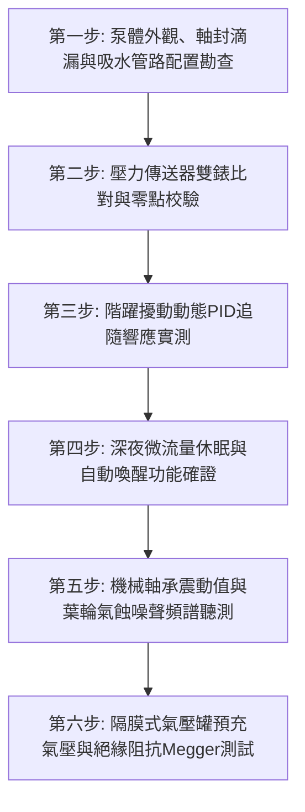

# 全案購屋實戰第七百四十六部_中古大樓社區地下室生活自來水二次加壓變頻泵浦PID控制恆壓傳送器漂移葉輪氣蝕剝落與機械軸封高溫乾磨體檢工序全書

---

## 壹、核心體檢綱領與歷史案例借鏡

在中古大樓（屋齡 20 至 30 年以上）的現代化給水架構中，位於地下室蓄水池旁之「二次加壓變頻給水泵浦機組（VFD Booster Water Pump System）」，是直接決定全社區住戶水龍頭水壓穩定、洗澡淋浴水溫舒適不忽冷忽熱的「動態心臟」。傳統定頻泵浦搭配頂樓水塔之供水方式，常因高低樓層落差產生壓差過大或頻繁啟動衝擊；而變頻供水系統則透過微電腦變頻器（Inverter / VFD）與管路壓力傳送器，實時進行 **PID（比例-積分-微分）** 閉迴路轉速自動調節，實現「用多少水、轉多少速」之恆壓節能供水。

然而，加壓泵浦常年處於 24 小時不間斷運轉、尖峰用水與深夜零流量劇烈交替之嚴苛工況中。中古大樓常年缺乏專業校驗與保養，變頻系統普遍面臨三大致命破壞：
1. **壓力傳送器（Pressure Transmitter）零點漂移與 PID 獵振（Hunting）**：安裝於出水幹管之 4~20mA 壓電或陶瓷壓力傳送器，長年受管路水垢附著與水錘微脈衝撞擊，電氣零點漂移、精度嚴重失準。變頻器接收到失真的動態反饋，PID 控制迴路陷入無休止的「超調與欠調」死循環振盪。泵浦轉速忽高忽低（在 20Hz 與 60Hz 之間狂甩），住戶端水流忽強忽弱，強烈水壓波動直接導致熱水器水盤微動開關頻繁跳脫、火焰反覆熄火，甚至引發管接頭疲勞脫膠。
2. **葉輪氣蝕空化（Cavitation）與流道金屬蜂窩狀剝落**：當地下室受水箱水位過低、吸入管程阻力過大或進口濾網被泥沙淤塞時，泵浦進口處局部壓力降至水之飽和蒸汽壓以下。水體瞬間氣化產生無數微氣泡，氣泡隨水流被帶入葉輪高壓區瞬間暴破破裂，產生高達數千大氣壓之局部微觀衝擊射流（Micro-jets）。不鏽鋼或青銅葉輪表面產生蜂窩狀蝕坑（Pitting），葉片邊緣撕裂斷裂，泵浦出水量暴跌 40% 以上，並發出如同「砂石在鐵桶內翻滾」之劇烈刺耳碎裂噪音。
3. **機械軸封（Mechanical Seal）高溫乾磨與碳化矽動靜環熱裂噴水**：當全社區深夜無人用水時，若變頻器未正確設定「微流量休眠模式（Sleep Mode）」或逆止閥存在微洩漏，泵浦將在封閉閥門狀態下持續以低轉速「打死水」。水體在封閉泵腔內因機械摩擦攪拌急速升溫至 $70^\circ\text{C} \sim 90^\circ\text{C}$ 以上。動靜環碳化矽（SiC）/碳化鎢端面缺乏潤滑水膜產生極端乾磨（Dry Running），橡膠 O 型環高溫碳化硬化脆裂，引發軸封全面爆開噴水，淹沒地下室變頻控制盤。

本工序全書旨在建立極致嚴謹的變頻二次加壓泵浦、壓力傳送器精度與氣蝕防護體檢標準，捍衛住戶供水品質與管路壽命。

---

## 貳、變頻恆壓供水水力學與葉輪氣蝕破壞力學分析

### 一、PID 恆壓閉迴路動態控制方程
變頻器輸出頻率 $f(t)$ 隨管網實測壓力誤差 $e(t) = P_{\text{target}} - P_{\text{actual}}(t)$ 進行連續調節：
$$f(t) = K_p \cdot e(t) + K_i \int_0^t e(\tau) \, d\tau + K_d \frac{de(t)}{dt}$$
- $K_p, K_i, K_d$：比例、積分、微分增益係數。

**控制系統失穩病理分析**：
當壓力傳送器阻尼孔被水垢堵塞時，反饋信號產生時間延遲 $\tau_d$（相位滯後）。系統閉迴路傳遞函數極點跨越虛軸進入右半平面，控制系統由臨界阻尼轉變為發散震盪，產生劇烈「獵振現象（Hunting）」。馬達在短時間內反覆加減速，逆變器 IGBT 功率模組承受巨大交變熱應力而擊穿燒毀。

### 二、淨吸入水頭（NPSH）與氣蝕空化破壞力學
泵浦不發生氣蝕之必要水力條件：
$$\text{NPSHa} = \frac{P_{\text{atm}} \pm P_{\text{static}} - P_v}{\rho \cdot g} - h_{\text{loss}} > \text{NPSHr} + 0.5\,\text{m}$$
- $\text{NPSHa}$：裝置有效淨吸入水頭。
- $\text{NPSHr}$：泵浦必需淨吸入水頭（由廠牌幾何設計決定）。
- $P_v$：水之飽和蒸汽壓（隨水溫急劇升高）。

**破壞演變**：
當夏季地下室水溫升高至 $35^\circ\text{C}$（$P_v$ 激增），若吸水管底閥濾網結垢使阻力水頭損失 $h_{\text{loss}}$ 增大，$\text{NPSHa}$ 跌破臨界值。氣泡崩潰衝擊頻率高達數萬赫茲，金屬表面遭受高達 $1000\,\text{MPa}$ 之疲勞拉應力，造成葉輪幾何型線徹底損毀。

---

## 參、實地體檢六大極致檢驗工序

### 工序一：泵體外觀、機械軸封滲漏與吸入端管路配置盤查
1. **軸封滴水目視檢查**：檢視泵浦軸承托架底部之洩水孔。機械軸封正常運轉時應維持微潤滑無明顯水珠滴漏（每分鐘滴水嚴禁 $> 3$ 滴）。若有連續流水或大量白色碳酸鈣結晶堆積，判定為軸封已失效。
2. **偏心異徑管（Eccentric Reducer）安裝方向**：檢查水平吸水管之漸縮管，必須採用「頂平底斜（Flat on Top）」之偏心接頭，嚴禁使用同心異徑管，避免管頂殘留氣囊引發氣蝕。

### 工序二：壓力傳送器精度比對與零點校正檢驗
1. 在傳送器取壓口旁加裝經合格標定之高精度甘油指針壓力錶（精度 0.4 級）。
2. **靜態與動態差值比對**：
   - 觀察變頻器面板顯示壓力值與指針錶實測值。
   - **合格標準**：兩者讀數誤差必須 **$\le \pm 0.1\,\text{kg/cm}^2$（$\pm 0.01\,\text{MPa}$）**。
   - 若誤差 $> 0.3\,\text{kg/cm}^2$，必須拆卸傳送器清洗內部微型阻尼孔，或重新校正 4mA 零點與 20mA 滿量程。

### 工序三：階躍大流量擾動（Step Load Disturbance）動態響應測試
1. 在變頻泵浦穩定恆壓運轉下，突然完全打開大口徑測試排水閥（模擬尖峰用水瞬態）。
2. **動態水壓恢復指標**：
   - 水壓瞬間跌落幅度嚴禁超過設定目標值的 **$15\%$**。
   - 變頻器必須在 **$3 \sim 5$ 秒內**平穩提升頻率，將出水壓力精準拉回設定恆壓值，無持續劇烈上下震盪。

### 工序四：深夜微流量休眠（Sleep Mode）與喚醒功能確證
1. 關閉測試放水閥，模擬全社區深夜完全無人用水之極限工況。
2. **休眠動作考核**：
   - 變頻器轉速必須在達到設定壓力後，逐漸降至休眠頻率（通常為 $25 \sim 30\,\text{Hz}$）。
   - 在設定的延時時間（如 30~60 秒）內，馬達必須**完全停止運轉（進入 Sleep 休眠狀態）**。
   - 嚴禁「永不休眠持續空轉」：若閉閥後馬達持續以 35Hz 以上運轉超過 5 分鐘，將使泵腔水溫飆高燒毀軸封，必須重新調校微流量停機參數。

### 工序五：軸承振動值與氣蝕金屬噪音聽測實測
1. **軸承振動均方根值（RMS）測量**：使用精密振動計量測馬達及泵浦軸承垂直與水平振動速度。
   - 合格標準（依 ISO 10816-3 規範）：振動速度值必須 **$\le 2.8\,\text{mm/s}$**。若 $> 4.5\,\text{mm/s}$ 判定為警示，$> 7.1\,\text{mm/s}$ 必須立即停機檢修聯軸器對心。
2. **金屬聽音棒聽測**：使用聽音棒緊貼葉輪外殼，運轉聲應均勻低沉；若聽見如同碎石摩擦之尖銳爆裂聲，即為嚴重葉輪氣蝕。

### 工序六：隔膜氣壓罐（Diaphragm Pressure Tank）預充氣壓校驗
1. 在系統停機排空管路水壓後，使用數位胎壓計量測氣壓罐頂部氣嘴氣壓。
2. **氣壓標準核算**：
   - 預充氮氣或空氣壓力必須維持在系統設定恆壓值的 **$70\% \sim 80\%$**。
   - 按壓氣閥頂針，若有水噴出，代表內部橡膠隔膜已破裂穿孔，氣壓罐已完全失效，喪失休眠保壓機能，必須換新。

---

## 肆、社區管委會維護與置產勘查避坑清單

| 檢查項目 | 良好合規狀態（安心置產） | 嚴重劣化徵兆（潛在巨額分攤） | 買方議價與防禦對策 |
| :--- | :--- | :--- | :--- |
| **泵浦運轉噪聲與震動** | 變頻運轉平順無聲，進出水管安裝雙球型橡膠防震接頭，無金屬摩擦音 | 站在地下室停車場即可聽見金屬撕裂轟鳴聲，管路劇烈震顫，地腳螺栓震斷 | 泵浦內部葉輪已氣蝕剝落且軸承散珠，更換整組泵浦葉輪與馬達需 8~15 萬元 |
| **變頻器運作型態** | 變頻器品牌知名（Danfoss/ABB/Yaskawa），液晶顯示正常，深夜能平穩休眠 | 變頻器早已故障燒毀，被管委會便宜行事改成「定頻全開+洩壓閥常態噴水」 | 喪失恆壓節能效益且電費暴增數倍，水壓衝擊劇烈，要求折讓公共機電整修費 |
| **水壓穩定度體驗** | 住戶洗澡淋浴水流強勁恆定，熱水器火焰穩定，無忽冷忽熱現象 | 洗澡時水流忽大忽小、熱水器反覆熄火，水龍頭關閉時發出強烈低頻震響 | 壓力傳送器已漂移且 PID 迴路嚴重獵振，需整組重新校正更換感知器 |
| **機械軸封與泵體外觀** | 軸承托架乾燥無滴水，泵體油漆完整無銹斑，銘牌標記清晰 | 軸承座下方大面積漏水積水成池，金屬外殼滿是黃褐色厚重鐵鏽結晶 | 機械軸封即將全面崩潰噴水，隨時面臨泵浦電機燒毀跳電，列為重大扣分項 |

---

## 伍、本手冊落地執行結論

二次加壓變頻泵浦機組，是現代都會生活品質的「無形守護心臟」。它在無聲無息的頻率升降中，精準呵護著全家人沐浴與烹飪的水流舒適；而一枚漂移的壓力感知晶片、一段被氣蝕啃噬的葉輪，就能在日常生活中引發無窮無盡的水壓震盪與設備損毀之災。

購屋者在實地驗屋評估大樓公共公設時，走入地下室加壓泵房，親耳聆聽其運轉聲響是否平順如絲、親手觸摸泵頭是否有過熱燙手，是看穿社區機電管理實力、確保家庭居住品質與財富穩固的至尊實戰智慧。
