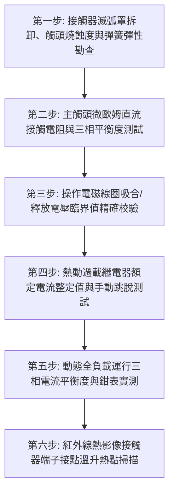

# 全案購屋實戰第七百四十四部_中古大樓社區低壓配電盤電磁接觸器主觸頭氧化電弧熔焊熱動過載繼電器失準與動力設備缺相燒毀體檢工序全書

---

## 壹、核心體檢綱領與歷史案例借鏡

在中古大樓（屋齡 20 至 30 年以上）的公共動力配電盤（Motor Control Center, MCC）中，掌控整座大樓動能血脈運轉的關鍵執行開關，即為**電磁接觸器（Magnetic Contactor, MC）**與**熱動過載繼電器（Thermal Overload Relay, TH-RY）**組合而成之電磁開關（Magnetic Starter, MS）。全社區的生活給水揚水泵浦、二次加壓變頻雙泵、地下室污水沉水絞碎泵浦、緊急火警排煙風機與機械停車昇降馬達，日夜皆仰賴電磁開關進行高頻次的通斷啟閉控制。

交流感應電動機在全壓直接啟動（Direct-On-Line, DOL）或降壓啟動瞬間，承受高達額定電流 5 至 7 倍之極限湧浪電流（Inrush Current）。電磁接觸器的主觸頭必須在強烈電磁吸力驅動下，克服彈簧反作用力，在毫秒之間迅速咬合導通。

然而，中古大樓常年處於高溫、高濕與震動環境中，電磁接觸器普遍面臨四大致命破壞：
1. **主觸頭（Main Contacts）電弧燒蝕氧化與金屬熔焊（Contact Welding）**：電磁接觸器在經過數萬次負載通斷後，銀合金觸頭（AgCdO 或 AgSnO₂）表面被數千度電弧反覆燒灼，產生嚴重的金屬轉移與海綿狀氧化發黑。當動靜觸頭吸合彈簧疲勞無力、造成接點閉合瞬間劇烈彈跳（Bouncing）時，強烈電弧瞬間將動靜接點局部高溫融化並牢牢焊接（熔焊）。此時即使控制迴路已發出停止信號，接觸器依然被物理咬死導通，馬達持續狂轉打死水、引發泵浦乾磨爆管或機械車台衝撞邊柱！
2. **三相接觸電阻嚴重不平衡引發「缺相（Single-Phasing）」運行**：接觸器三相主觸頭中，只要任一相接點因氧化積碳嚴重、彈簧斷裂或機械卡阻導致無法導通，三相感應馬達即陷入極度危險之「單相運行（缺相）」。此時其餘兩相繞組電流瞬間暴增 $\sqrt{3} \approx 1.73$ 倍，馬達定子繞組內部磁場嚴重畸變扭曲，產生巨大振盪與異常低頻蜂鳴噪音，漆包線絕緣層在短短數分鐘內高溫碳化熔燬，馬達直接冒濃煙報廢。
3. **熱動過載繼電器（TH-RY）雙金屬片熱疲勞蠕變與保護拒動**：傳統熱動過載繼電器內部之雙金屬片（Bimetallic Strips）在長達數十年的交變熱循環下產生晶格微觀蠕變，跳脫特性曲線嚴重右移（遲鈍）；加之許多非專業機電維護工在遇到頻繁跳脫時，未徹查馬達過載原因，反而私自將整定電流旋鈕調大至額定電流的 150% 以上，導致馬達在嚴重缺相或堵轉時，過載繼電器紋絲不動，喪失保護跳脫功能。
4. **電磁操作線圈（Operating Coil）老化絕緣擊穿與鐵芯分流環（Shading Ring）斷裂**：電磁線圈在長年通電溫升下絕緣漆皮脆化開裂，線圈匝間微短路導致電磁吸力大幅衰減；動靜鐵芯吸合面之純銅分流環震斷脫落，交流吸力過零點時產生巨大劇烈的 60Hz 金屬敲擊蜂鳴巨響，震碎周邊塑膠卡扣。

本工序全書旨在建立極致嚴謹的動力配電盤電磁接觸器、熱動過載保護與缺相防護體檢工序，捍衛大樓公共動力心臟之絕對安全。

---

## 貳、電磁接觸器接點電弧力學與馬達缺相燒毀物理機制

### 一、動靜觸頭閉合彈跳與電弧熔焊力學方程式
接觸器動鐵芯在電磁吸力 $F_{\text{mag}}$ 驅動下高速撞擊靜鐵芯，動觸頭撞擊靜觸頭時之動能轉換：
$$m_{\text{contact}} \cdot \frac{d^2 x}{dt^2} + c \cdot \frac{dx}{dt} + k_{\text{spring}} \cdot x = F_{\text{mag}}(t) - F_{\text{reaction}}$$
- 彈跳時間（Bounce Duration）$\Delta t_{\text{bounce}}$ 依設計必須嚴格控制在 **$\le 2.0\,\text{ms}$** 內。
- 若彈簧剛度 $k_{\text{spring}}$ 衰減，彈跳時間延長至 $> 5.0\,\text{ms}$，在動靜觸頭微脫開之空氣間隙中產生高能量燃弧：
$$Q_{\text{arc}} = \int_0^{\Delta t_{\text{bounce}}} V_{\text{arc}}(t) \cdot I_{\text{inrush}}(t) \, dt$$
當瞬間熱量 $Q_{\text{arc}}$ 超過銀合金熔化熱 $\Delta H_{\text{fusion}}$ 時，液態金屬在觸頭閉合時相互凝固，形成極高抗拉強度的金屬熔焊點（Welding Spot），電磁釋放彈簧根本無法將其拉開。

### 二、三相感應馬達缺相（Single-Phasing）熱崩潰力學
三相星形（Y）或角形（$\Delta$）接法馬達在運行中突發缺相時：
- 缺相後之等效負序旋轉磁場在轉子鼠籠條中感應出高達 $2f = 120\,\text{Hz}$ 之雙倍頻渦流。
- 運轉相電流 $I_{\text{single}} \approx \sqrt{3} \cdot I_{\text{rated}}$。
- 繞組焦耳發熱量激增：
$$P_{\text{loss}} \propto I^2 R \approx (\sqrt{3} I_{\text{rated}})^2 R = 3 \cdot P_{\text{rated\_loss}}$$
馬達內部溫升速率高達 **$5^\circ\text{C} \sim 10^\circ\text{C} / \text{秒}$**，B 級或 F 級絕緣漆（極限耐溫 $130^\circ\text{C} \sim 155^\circ\text{C}$）在 30 至 60 秒內即刻碳化短路，引發整台泵浦馬達燒毀。

---

## 參、實地體檢六大極致檢驗工序

### 工序一：接觸器滅弧罩拆卸、觸頭燒蝕度與機械回彈手感檢視
1. **主觸頭外觀微觀檢查**：在斷電狀態下，拆卸電磁接觸器滅弧罩，持強光放大鏡檢視三組主觸頭動靜接點。
   - 合格標準：銀合金表面均勻磨損，剩餘厚度必須 $\ge$ 原始厚度的 **$50\%$**。
   - 報廢標準：觸頭表面出現深層熔坑、邊緣有熔融金屬球滴珠、露出紅色純銅基底金屬，判定為立即更換全組接觸器。
2. **手動按壓復位手感**：手動手動下壓觸頭支架，下壓行程應平順無阻力，放手後動觸頭必須在復位彈簧作用下**瞬間彈回初始斷開位置**，聲音清脆無拖泥帶水。

### 工序二：三相主觸頭直流微歐姆接觸電阻（Contact Resistance）實測
1. 使用數位式微歐姆計（DLRO），在接觸器強迫閉合狀態下，分別測量 R、S、T 三相主觸點之接觸電阻。
2. **阻抗指標標準**：
   - 額定 50A 以下接觸器接觸電阻應 **$< 5\,\text{m}\Omega$**；100A 以上大型接觸器應 **$< 500\,\mu\Omega$**。
   - **三相不平衡度極限**：三相接觸電阻最大值與最小值之差值比例嚴禁超過 **$15\%$**。若單相電阻過大，預示該相隨時可能接觸不良引發缺相事故。

### 工序三：電磁操作線圈吸合（Pick-up）與釋放（Drop-out）電壓測試
1. 使用自耦調壓變壓器（Variac）對接觸器線圈輸入端精準調整 AC 電壓。
2. **動作電壓法規標準（依 IEC 60947-4-1）**：
   - **吸合電壓（Pick-up Voltage）**：線圈必須在額定控制電壓的 **$85\% \sim 110\%$** 範圍內可靠、迅速完全吸合，無鐵芯抖動聲。
   - **釋放電壓（Drop-out Voltage）**：當電壓緩慢下調至額定電壓的 **$20\% \sim 75\%$** 時，接觸器必須可靠完全釋放跳開。若釋放電壓低於 10% 仍吸住不放，代表鐵芯表面有油垢黏連或剩磁過大，存在斷電拒開極限風險。

### 工序四：熱動過載繼電器（TH-RY）整定電流核對與手動脫扣驗證
1. **整定電流旋鈕核對**：核對 TH-RY 電流刻度盤設定值 $I_{\text{setting}}$，必須精確設定為馬達銘牌全載額定電流（FLA）的 **$1.0 \sim 1.05$ 倍**，絕對嚴禁超過 $1.15$ 倍。
2. **手動跳脫測試桿（Test Lever）動作**：以絕緣螺絲起子推動跳脫測試連桿。
   - 考核標準：常閉輔助接點（95-96 NC）必須瞬間斷開，常開故障信號接點（97-98 NO）必須可靠閉合，跳脫指示旗標（Trip Indicator）彈出紅色。

### 工序五：全負載運轉三相電流平衡度（Current Unbalance）實測
1. 在揚水泵浦或變頻泵浦全速運轉時，使用精密真有效值（True-RMS）鉗形電流表量測二次側 R、S、T 三相線電流。
2. **三相不平衡率計算與考核**：
   $$\text{電流不平衡率 (\%)} = \frac{|I_{\text{max}} - I_{\text{avg}}|}{I_{\text{avg}}} \times 100\%$$
   - 合格標準：電流不平衡率必須 **$\le 5.0\%$**。
   - 若不平衡率 $> 10\%$，馬達溫升將飆高 $25^\circ\text{C}$ 以上，必須立即停機排查接觸器觸頭與電纜接頭。

### 工序六：滿載運轉紅外線熱影像熱點與端子接線扭力校驗
1. 在滿載連續運轉 30 分鐘後，使用紅外線熱像儀掃描電磁開關一次側電源端子、主觸頭外殼與熱動過載繼電器進出線端。
2. **熱像判定標準**：
   - 相鄰兩相溫差 $\Delta T$ 嚴禁超過 **$5^\circ\text{C}$**；端子絕對溫度嚴禁超過 **$70^\circ\text{C}$**。
   - 使用絕緣扭力起子對接線端子螺絲進行校緊（M4 螺絲扭力標準 $1.2 \sim 1.5\,\text{N}\cdot\text{m}$），確保接觸緊實無發熱虛接。

---

## 肆、社區管委會維護與置產勘查避坑清單

| 檢查項目 | 良好合規狀態（安心置產） | 嚴重劣化徵兆（潛在巨額分攤） | 買方議價與防禦對策 |
| :--- | :--- | :--- | :--- |
| **電磁開關運轉噪音** | 吸合時「喀」一聲清脆有力，運轉期間安靜無聲，無任何 60Hz 交流蜂鳴 | 控制盤內發出刺耳震耳之「嗡嗡」震動嘶吼，盤門摸起來有強烈麻手震顫感 | 鐵芯接觸面不平或分流環已震斷，隨時吸合不實燒毀線圈，要求全數更換新品 |
| **熱動過載繼電器保護型式** | 採用具備「差動欠相保護（Phase Loss Protection, 3E/2E）」之現代化過載繼電器 | 採用 30 年前老式陽春型號，旋鈕外殼已焦黑變形，甚至輔助接點被電線直接短接跳過 | 嚴重違反電工法規，馬達隨時因單相斷線直接燒毀，更換全組電磁開關需數萬元 |
| **控制盤線路整理與標示** | 盤內配線走線槽整齊，接線端子套有清楚號碼管，無任何私拉臨時明線 | 盤內電線如蜘蛛網雜亂無章，線皮焦黑硬化，露出裸露銅線與多處電工黑膠布 | 電氣火災風險極高，隨時引發盤內短路爆炸，要求出賣人提供機電整修憑證 |
| **備用泵浦電磁開關狀況** | 1號與2號泵電磁開關規格一致，兩組開關成色均勻，自動交替輪替正常 | 其中一組電磁開關已被燒毀拆除，線路吊掛半空中，全靠單邊單組硬撐 | 社區公設備援機能喪失，管委會長年怠於修繕，列入公共設施重大扣分項 |

---

## 伍、本手冊落地執行結論

動力配電盤內的電磁接觸器與熱動過載繼電器，是大樓機電神經網絡中最忠實、卻也承受最高電氣應力的「第一線重裝步兵」。它終日面對強烈電弧火花的烈焰洗禮，在數萬次的開閉循環中，精準掌控著給水、排污與通風動力的心跳節奏；而一對磨損熔焊的觸頭、一只被私自調大的過載繼電器，隨時能在無聲無息中引發馬達缺相燒毀、管路爆裂與控制盤起火之巨大災難。

購屋者在勘驗大樓公共公設時，走入地下室泵浦控制室，親耳聽測接觸器吸合時是否有異常蜂鳴震顫、親眼檢視熱動過載繼電器整定旋鈕是否符合額定規範，是看穿管委會公共機電管理深度、守護家庭安居資產不受無妄之災牽連的至尊實戰智慧。
