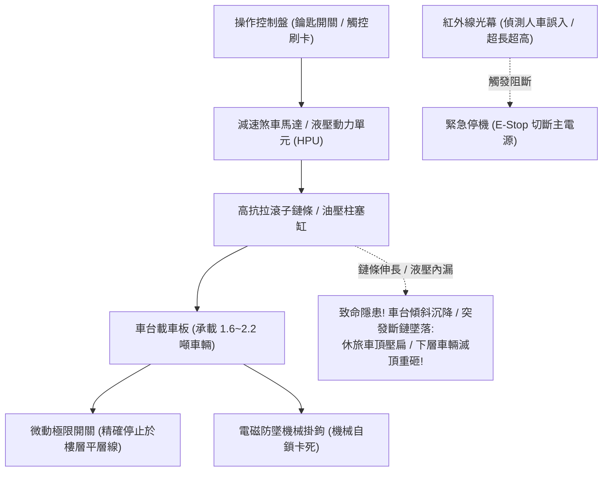

# 全案購屋實戰第三百一十一部：中古大樓社區地下室機械停車設備微動極限開關失調滾子鏈條伸長疲勞油壓防爆閥卡塞與沉降體檢工序全書

## 壹、核心查驗宗旨與前言

在都會區高房價與基地面積受限的中古集合住宅中，配備「機械停車設備（Mechanical Parking System，包含二層升降橫移、三層多列升降、沉箱式雙層等規格）」的車位極為普及。在本次鎖定的四大核心候選物件中，**「長億南園 8 樓 (`PROP_106`)」**、**「歌德堡 8 樓」**與**「靜園 A 區 11 樓」**均配置了機械車位；唯獨**「大安紫金城 13 樓 (`PROP_10`)」**擁有極度稀有且無可替代的「B2 獨立大平車」。

機械停車設備是地下室機電系統中運轉頻率最高、載重負荷最大（每台承載 $1.6 \sim 2.2\text{ 噸}$ 休旅車），且直接攸關人命安全與車輛防墜的「重型動態特種設備」。然而，在屋齡 15 至 30 年的中古社區中，機械車位常年處於「管委會維修預算不足、保養廠商走馬看花、零組件嚴重金屬疲勞」的高危險邊緣：
1. **控制升降行程之「微動極限極限開關（Micro Limit Switch）」接點氧化、定位推桿鬆脫走位**，造成車台板上升或下降時無法準確停靠定位，發生「嚴重錯位高低差」甚至「機械硬碰撞爆頂」；
2. **傳動多排滾子鏈條（Roller Chain）金屬疲勞塑性伸長超過 $2\%$**，鏈目咬合齒輪跳齒、鏈條劇烈下垂刮擦地面，甚至發生突發性「斷鏈墜落」慘劇；
3. **液壓動力單元之「油壓防爆破裂閥（Velocity Fuse / Hose Burst Valve）」閥芯水垢油泥卡塞**，一旦高壓油管爆裂，防爆閥無法在 0.1 秒內鎖死油路，車台板伴隨滿載車輛自由落體墜落砸毀；
4. **液壓油缸內漏（Internal Cylinder Leakage）**，停放數小時後車台板因重力緩慢下沉（沉降量超過 $10\text{cm}$），造成休旅車頂直接被上方大樑或水管硬生生壓扁壓爛。

本手冊為買方打造一套極具穿透力的「機械停車設備全維度動態實地體檢工序」，結合現場尺寸量測、鏈條伸長規檢測、沉降測試技巧、商務砍價話術及特約條款保障，徹底防範車輛毀損天坑與維修責任糾紛。

---

## 貳、機械停車設備構造原理與四大常見致命病灶

### 一、集合住宅升降橫移機械停車設備技術規格
1. **承載車台板（Car Pallet Platform）**：
   - 採用花紋熱浸鍍鋅鋼板折彎成型，配置前後輪定位檔車擋板、防滑導流槽及防落鎖定掛鉤。
2. **動力傳動機構（Drive Mechanism）**：
   - **鏈條傳動式（Chain Driven）**：採用三相減速煞車馬達（Brake Motor），帶動雙排或三排高強度滾子鏈條（如 ANSI 60/80 規格，抗拉強度達數萬牛頓）。
   - **液壓缸升降式（Hydraulic Direct Acting）**：採用高壓液壓柱塞缸、液壓泵浦單元（Hydraulic Power Unit, HPU，工作壓力 $140 \sim 210\text{ bar}$）及耐高壓耐磨液壓油管。
3. **安全防墜保護裝置（Safety Catch Device）**：
   - 機械式電磁防墜落掛鉤（Solenoid Safety Lock），在車台板上升至頂端定位時自動彈出卡入安全銷槽，機械鎖定防止下滑。
4. **極限與連鎖感測系統（Limit & Interlock Sensors）**：
   - 包含「上限極限開關」、「下限極限開關」、「超行程極限開關（Over-travel Switch）」、「車輛超長超高紅外線光電開關」及「人車誤入光電阻斷感應器」。

### 二、中古社區常見之四大致命病灶
1. **微動極限開關移位導致「平層落差與衝頂卡死」**：
   - 機械震動使得極限開關固定支架螺栓震鬆，觸碰滾輪槓桿角度偏移。車台下降時未能及時切斷電源，車台底部硬生生砸擊坑底水泥地；或者上升時超行程，車頂直接撞擊天花板上的消防泡沫管或排煙風管，引發全層大淹水與車身全毀。
2. **滾子鏈條疲勞伸長（Chain Elongation）引發跳齒與傾斜**：
   - 鏈條長年承受車輛動態重載，銷軸（Pin）與套筒（Bush）磨損產生塑性伸長。當伸長率超過原廠極限 **$2\%$** 時，鏈節與鏈輪齒形無法精準吻合，運轉時發出「喀嗒、喀嗒」劇烈跳齒震響；左右兩側鏈條伸長不均更會導致車台板嚴重歪斜（傾斜超過 $3^\circ$），車輛隨時滑落翻覆。
3. **油壓防爆閥油泥卡死引發「瞬間斷管墜落」**：
   - 液壓油長年未換，油質氧化劣化呈黑褐色黏稠油泥，懸浮金屬碎屑將安裝於液壓缸進油口的「防爆破裂閥」閥芯卡死在常開狀態。一旦高壓耐油橡膠軟管因脈動疲勞爆管，液壓油以每秒數十公升之噴湧速度外洩，車台板毫無緩衝地以自由落體速度向下猛墜，下層停放之車輛瞬間被重重壓成鐵餅。
4. **液壓缸活塞內漏引發「隱形慢速沉降（Cylinder Drift）」**：
   - 液壓缸內部聚氨酯 U 型油封老化磨損，高壓油越過活塞密封圈洩漏至低壓腔。車主將休旅車停入並上升到位後離開，數小時後車台板悄然向下沉降 $10 \sim 20\text{cm}$，當下層車主操作橫移時，下層車頂與上層車底在無死角處直接劇烈撕裂對刮。

---

## 參、買方現場看屋之機械車位五步實戰體檢工序

### 一、步驟一：車台板尺寸量測與休旅車容納極限核查
- **長寬高實測（捲尺必備）**：手持捲尺實地量測目標機械車位尺寸：
  - **淨寬度（Clear Width）**：車台板兩側導軌內緣淨寬，標準現代休旅車（如 RAV4、CR-V）車寬含後照鏡通常達 $1,850 \sim 1,900\text{mm}$，車台淨寬必須 $\ge 2,000\text{mm}$（若小於 $1,900\text{mm}$，上下車極易刮破鋁圈與卡門）；
  - **淨高度（Clear Height）**：測量車台板至上方樑底或消防管下緣淨高，必須 $\ge 1,800\text{mm}$（長億南園等早期機械車位常限高 $1,550\text{mm}$，僅能停轎車，**現代休旅車完全停不進去**！）；
  - **銘牌最大容許載重（Max Load）**：檢視車台柱銘牌，載重標準必須 $\ge 2,000\text{ kg}$（若標示為 $1,600\text{ kg}$，純電車如 Model Y 或大型休旅車直接超載無法停放）。

### 二、步驟二：滾子鏈條磨損與伸長率實物檢測
- **鏈條下垂度與外觀檢驗**：手電筒照射垂直升降鏈條：
  - 檢視鏈條表面是否覆蓋厚重乾涸油泥或赤褐色金屬鐵鏽；
  - 檢視左右兩側鏈條張力是否均勻，有無單側下垂鬆弛（弛度超過 $20\text{mm}$）；
  - 檢視鏈片表面是否有微裂痕、銷軸是否有旋轉外突變形。

### 三、步驟三：極限開關與防墜電磁掛鉤動作檢核
- **現場操作升降試車（需請仲介或管委會操作）**：插入鑰匙將車台板上升至頂層：
  - **平層停靠精準度**：觀察車台板停止時，與車道地坪之平層落差是否小於 **$10\text{mm}$**；
  - **電磁防墜掛鉤彈出咬合驗收**：車台板上升到位後，側耳聆聽並目視上方機械掛鉤是否能「喀噠」一聲清脆彈出並牢固卡入安全擋塊；切斷動力時，車台板應由安全鉤穩穩托住無任何微幅下溜。

### 四、步驟四：液壓單元漏油與「靜態重力沉降測試」
- **液壓站外觀與油溫**：檢視地下室角落之液壓油箱（HPU）：
  - 觀察油位計是否在標準刻度，油質是否透亮黃色；油箱底部有無大面積漏油積油；
  - 觸摸高壓油管接頭，確認完全乾燥無高壓滲油。
- **靜態沉降量測技巧**：若車台板上有車輛停放，以粉筆在垂直導柱與車台導靴交接處畫一條水平基準線：
  - 看屋 30 分鐘後再次回到車位檢視，粉筆線落差必須小於 **$5\text{mm}$**；若下沉超過 $10\text{mm}$，代表液壓缸內部嚴重內漏！

### 五、步驟五：管委會特種設備定期檢驗合格證覆核
委請仲介向管委會調閱：
1. **建築物機械停車設備使用許可證（Safety Certificate）**：核對由內政部營建署認可之「中華民國立體停車場協會」或合格檢查機構核發之許可證，有效期限必須在有效期內，**確認無「逾期未檢」之違法黑牌狀態**！
2. **年度重大零件抽換紀錄**：確認鏈條、鋼索、油管與防墜器最近一次更換年份（鏈條/鋼索標準壽命為 **5 年**，高壓油管為 **3 至 5 年**）。

---

## 肆、商務談判博弈：機械車位瑕疵殺價 20 萬元實戰話術

在四大候選物件中，長億南園 8 樓配置機械車位（且有停不下休旅車之致命抗性），而大安紫金城則配備 B2 獨立大平車。買方應將此嚴重的車位缺陷轉化為砍價 200 萬的重磅核彈級籌碼。

> **實戰談判對話劇本（針對長億南園屋主與周小姐）：**
> 「屋主您好、周小姐您好：
> 長億南園這間室內空間雖然大，但我們帶著捲尺與專業規格實地勘驗後，發現這組機械車位存在致命的機能缺陷：車位限高只有 155 公分、限重只有 1,600 公斤，我們家常用的休旅車與未來的電動車根本完全停不進去，停進去車頂直接削掉；而且鏈條已明顯伸長下垂，現場升降停靠時高低差超過 5 公分，隨時有跳齒斷鏈與車身沉降的巨大安全風險！
> 相反地，信義建宇手上的大安紫金城配備的是極度稀有、無可挑剔的 B2 獨立大平車，休旅車、大型休旅隨便停，完全沒有機械維護費與卡梯墜落的恐懼。
> 如今台中市區一個獨立大平車行情動輒 180 萬至 200 萬元，而這種 20 年以上的老舊機械車位市場殘值根本連 40 萬都不到，且未來管委會全面更新機械設備每戶動輒分攤 10 萬至 20 萬元；更別提一樓大廳還有 4 階非無障礙台階對老人家極不友善。
> 如果我們要承接這間長億南園，我們必須在外面額外花錢月租平車，並承擔日後機械車位故障墜車的無限賠償責任。
> 因此，我們主張在總價中直接扣減 **200 萬元**（車位劣勢扣 150 萬 + 大廳無障礙台階抗性扣 50 萬），出價 720 萬元！如果屋主堅持不降，我們明天毫不猶豫直接下斡旋大安紫金城的大平車！」

---

## 伍、買賣契約特約防守條款專用字軌

為杜絕買方交屋後承擔機械車位損壞、砸車糾紛與昂貴公設設備更新債務，《不動產買賣契約書》應增列下列防禦條款：

> **【機械停車設備安全合格保證與車型容納規格特約條款】**
> 1. **機械車位法定合格與安全運作保證**：賣方保證配置予買方之停車位（包含升降橫移機構、車台板、滾子鏈條、液壓動力單元、微動極限開關、防墜電磁掛鉤及控制盤），於交屋日前具備合法有效之「建築物機械停車設備使用許可證」，運轉順暢平穩，無任何鏈條疲勞伸長、液壓缸內漏沉降、平層錯位卡死或安全防墜機構失效之瑕疵，且無遭主管機關勒令停用或處以罰鍰之情事。
> 2. **車位規格承載保證與瑕疵解約權**：賣方保證本買賣標的車位之實測淨寬度不得小於 2,000mm、淨高度不得小於 1,800mm、最大載重不得小於 2,000kg，足以正常停放現代標準休旅車輛。若交屋點交時經實測規格不符或無法正常停入標準休旅車者，買方得主張按市場平車差價減少買賣總價新台幣 **壹佰伍拾萬元整**，或得無條件單方解除契約並要求賣方退還全部已付價金。
> 3. **交屋前機械車位重大整修工程款清償責任**：若於交屋日（含）前，本社區管委會或區分所有權人會議已決議辦理地下室機械停車設備全面更新、控制盤改裝、鏈條鋼索抽換等工程者，其所需之一切工程款或特別徵收分攤費用，概由賣方於交屋尾款結算時全額負擔扣抵，買方不負任何清償責任。
