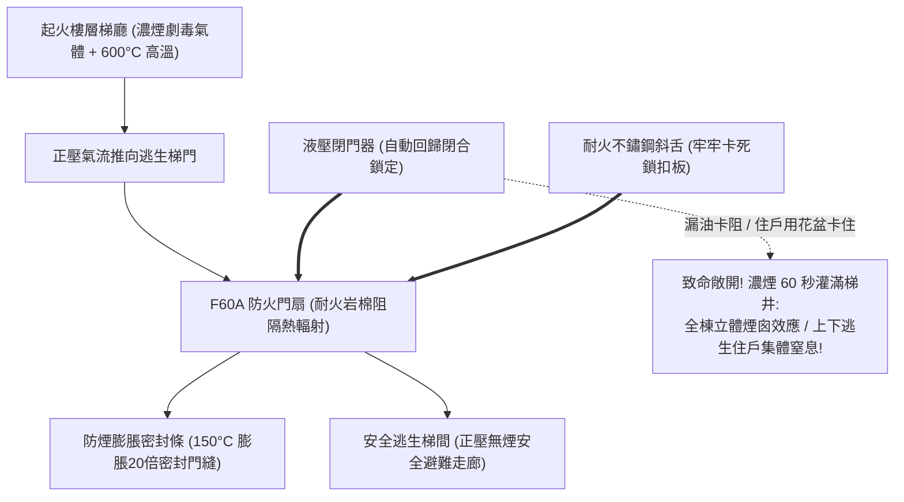

# 全案購屋實戰第三百一十七部：中古大樓社區各樓層管道間常閉式防火門門縫超標防煙條脆化地彈簧回歸失效與梯間濃煙隔絕體檢工序全書

## 壹、核心查驗宗旨與前言

在集合住宅的建築防火區劃與火災垂直逃生安全體系中，分隔各樓層梯廳走廊與垂直管道間、安全逃生梯間的**「常閉式防火門（Normally Closed Fire Door，包含甲種/乙種防火門、F60A/F60B 防火防煙門）」**，是火災發生時阻擋數百度高溫熱氣與致命有毒濃煙侵入逃生動線的「最後一道生命防火閘」。

高樓火災的統計數據顯示，超過 $80\%$ 的火場罹難者並非被大火直接燒死，而是在逃生梯間吸入濃煙中高濃度之一氧化碳（CO）、氰化氫（HCN）在數分鐘內窒息身亡。一旦逃生梯門無法百分之百完全緊密閉合，垂直梯井將瞬間轉變為強力抽吸高溫有毒濃煙的「立體煙囪（Stack Effect Chimney）」，將整棟大樓各樓層的避難路線徹底封死。

然而，在屋齡 15 至 30 年的中古大樓中，各樓層防火門常年處於「住戶私自以擋門器/花盆卡住、閉門器回歸力衰減、防煙膨脹條脆化脫落」的完全不設防狀態：
1. **地彈簧（Floor Hinge）或油壓閉門器（Door Closer）內部液壓油漏光、阻尼失效**，防火門開門後懸在半空無法自動回歸閉合，火警時濃煙直接長驅直入逃生梯；
2. **門框四周的「高溫膨脹型防煙氣密條（Intumescent Smoke Seals）」受潮老化、脆化粉化脫落**，火災時門縫無法自發膨脹密封，毒煙以每秒 3 至 5 米的極速沿著門縫瘋狂倒灌；
3. **門扇與門框底邊縫隙嚴重超標（大於法規極限 3mm 至 5mm）**，甚至因地坪沉降導致門扇與地磚卡阻摩擦，閉門器無法推動門扇關閉；
4. **防火鎖具（Fire Exit Hardware）內部滾珠鎖舌卡死生鏽**，門扇雖看似碰上，但未被鎖舌卡掣咬死，火場正壓氣流一衝瞬間彈開。

本手冊為買方打造一套極具深度的「各樓層常閉式防火門、防煙氣密條與閉門器全系統實地體檢工序」，結合現場塞尺測隙、回歸閉門秒數實測、營建署防火門合格標籤覆核、商務砍價話術及特約條款保障，徹底杜絕交屋後承擔公共安全重罰與火場逃生無門之悲劇。

---

## 貳、常閉式防火門構造原理與四大常見致命病灶

### 一、集合住宅建築防火防煙門技術架構
1. **防火門扇與防火板芯材（Fire Door Leaf & Core）**：
   - 門扇厚度通常為 $45\text{mm} \sim 55\text{mm}$，外覆 $1.0\text{mm} \sim 1.6\text{mm}$ 鍍鋅鋼板或不鏽鋼板，內部填充高密度抗高溫岩棉（Rockwool）或發泡矽酸鈣陶瓷板。
   - 防火等級標準：依建築技術規則需具備 **F60A（具備 60 分鐘防火時效與 60 分鐘阻熱性）** 及通過 CNS 15038 遮煙性能認證。
2. **防煙膨脹密封條（Intumescent Fire & Smoke Seals）**：
   - 嵌入門框或門扇四周槽內，常溫下為耐磨橡膠彈性體（阻絕冷煙）；遭遇火警升溫至 $150^\circ\text{C}$ 時，石墨材料在數秒內膨脹 10 至 20 倍，形成堅硬碳化海綿體，將門縫完全密封阻絕高溫毒煙。
3. **可調式液壓閉門器 / 地彈簧（Hydraulic Door Closer）**：
   - 配備雙段速度調節閥（閉門速度 Valve 1、上鎖閉合速度 Valve 2），能在住戶鬆手後在 **3 至 5 秒內平順回歸**，並在最後 $10^\circ$ 施加足夠鎖舌推力（Latching Action）。
4. **耐火防爆鎖具與不鏽鋼三環鉸鏈（Fire-Rated Mortise Lock & Hinges）**：
   - 鎖體與鎖舌全部採用耐高溫融點（$>1,000^\circ\text{C}$）之鑄鋼或純不鏽鋼材質，嚴禁使用低熔點鋅合金或鋁合金配件。

### 二、中古社區常見之四大致命病灶
1. **住戶私用「擋門器、磁吸或花盆」強行常開防火門**：
   - 為求通風涼爽或搬運包裹方便，各樓層住戶常年用滅火器、紅磚或重型花盆將逃生防火門死死卡在全開位置，或者裝潢時私自加裝電磁鐵吸住。一旦發生暗夜火警，整棟大樓的防火區劃形同虛設，起火層的濃煙如狂潮般直接倒灌進逃生梯間，逃生梯瞬間淪為奪命毒氣室。
2. **液壓閉門器漏油「失去鎖扣力」導致門縫大開**：
   - 閉門器使用超過 10 年，液壓油沿著調節螺絲密封圈漏光，阻尼力完全消失。防火門開合時如同自由擺鐘「砰！」重重砸上，或在最後關閉角度（$10^\circ$ 以內）阻力過大停滯在半途，無法將鎖舌推入門扣板，形成一道長年敞開的幾公分微縫，遮煙性能徹底歸零。
3. **防煙膨脹條風化碎裂致使「高溫毒煙狂噴」**：
   - 門框四周的防煙膨脹條受紫外線照射與清潔劑擦拭，橡膠老化發硬、龜裂脫膠。火災發生時，防煙條無法正常膨脹發泡，門縫四周狂噴數百度的劇毒濃煙，直接引燃梯間內的裝潢飾板。
4. **門扇下垂卡阻地面磨擦「推不開也關不上」**：
   - 鉸鏈軸心長年承受重型金屬門扇自重而磨損下垂，門扇底邊直接與梯廳地磚嚴重刮擦。老人家與孩童在驚慌中根本推不開門，逃生受阻；而平時開門後，閉門器微弱的回歸力更是無法克服地磚摩擦阻力，門扇直接卡在半開位置。

---

## 參、買方現場看屋之防火門與防煙條五步實戰體檢工序

### 一、步驟一：目標戶梯廳逃生梯防火門靜態閉合目視
- **門扇關閉常態檢核**：走至看屋物件門外梯廳，檢視通往安全梯與管道間之防火門：
  - **嚴格檢視是否處於「完全緊閉」狀態**！若被任何物品擋住、加裝腳踏式擋門器或地吸卡住，屬於重大公共安全違規；
  - 檢視門扇表面是否張貼有紅色「常閉式防火門，請隨手關門」之醒目警示標籤。
- **門扇材質與標籤查驗**：檢視門框鉸鏈側側面是否釘有內政部營建署合格認可之**「建築技術規則防火門金屬銘牌（標示 F60A / CNS 11227 認可字號）」**；若無任何認可標籤，通常為建商劣質普通鐵門充數。

### 二、步驟二：門縫間隙塞尺測量（精確專業驗屋絕技）
- **門縫標準塞尺檢測（手持間隙規或 50 元硬幣）**：
  1. 檢視門扇頂邊、左右兩側與門框的縫隙：標準必須小於 **$3.0\text{mm}$**；
  2. 檢視門扇底邊與地面完成面的縫隙：
     - 若為一般防火門，底縫標準必須小於 **$8.0\text{mm}$**；
     - 若為具備「遮煙性能（Smoke Control）」之高級防火門，底縫必須配置自動升降防煙密封條（Drop-Down Seal），底縫間隙必須小於 **$3.0\text{mm}$**（若塞尺量測超過 10mm 甚至看得見對面燈光，火警時濃煙直接穿透）。

### 三、步驟三：防煙膨脹氣密條完整度手摸檢核
- **防煙條彈性與黏著度**：將防火門完全推開至 $90^\circ$，用手指指腹沿著門框四周的防煙膨脹條滑動檢查：
  - 防煙條表面應飽滿富有彈性，輕壓能俐落回彈；
  - 檢視防煙條是否有脫膠、斷裂、缺角或被油漆工整條噴滿油漆硬化（油漆包覆會嚴重破壞膨脹發泡反應）。

### 四、步驟四：液壓閉門器自動回歸與鎖舌卡掣實動測試
- **閉門器全行程回歸測試技巧**：
  1. 將防火門手動推開至 **$90^\circ$ 處徹底鬆手**：觀察門扇能否在 **3 至 5 秒內** 平順平穩自動滑回；
  2. **在最後 $10^\circ$ 閉合階段**，觀察閉門器是否具備足夠的鎖扣加速力，將鎖舌**「咔嗒」一聲俐落推入鎖槽卡死**；
  3. **微幅開門回歸測試（極限測試）**：將門扇微推開約 **$15^\circ$（約 15 公分）隨即鬆手**：合格的閉門器仍能靠彈簧蓄力順利將門完全關死；若門扇停滯在半途無法上鎖，代表閉門器扭力严重衰減！

### 五、步驟五：管委會公安申報書防火門列管項目覆核
委請仲介向管委會調閱最新一期由建築物公共安全檢查專業機構簽證之《公共安全檢查申報書》：
1. **防火區劃與防火門檢查表**：核對全棟各樓層防火門檢查結果，確認無「閉門器損壞無法回歸」、「門扇破損變形」之列管待修項目。
2. **消防安全設備檢修申報書**：確認特別安全梯前室排煙閘門與防火門連鎖是否合格。

---

## 肆、商務談判博弈：全棟防火門老化殺價 15 萬元實戰話術

整棟大樓若需將各樓層逃生梯常閉式防火門全面更換合格耐火液壓閉門器、更換原廠防煙膨脹密封條並校正下垂門扇（每樘防火門維修調整連工帶料約需 5,000 至 8,000 元，全棟數十樘），總工程款高達 **新台幣 25 萬至 40 萬元**；且逃生梯門無法緊閉對全家老小在暗夜火災時更是隨時窒息的滅頂死穴。買方應將此嚴重的公共安全瑕疵轉化為砍價殺手鐧。

> **實戰談判對話劇本：**
> 「屋主您好、周小姐您好：
> 我們在實地勘查目標樓層的逃生動線時，親自測試了安全梯口的常閉式防火門，發現非常危險的公共安全死穴：閉門器液壓油早已漏光，開門後根本無法自動回歸鎖死，門扇懸在半空，且門框上的防煙氣密條早已脆化脫落，門縫甚至能直接看透對面梯間！更嚴重的是，我們走訪各樓層，發現好幾層樓的防火門都被住戶直接用滅火器和花盆卡死長開！
> 逃生梯防火門是全棟火災時唯一的『救命防毒面具』。火災罹難者有八成都是在梯間被濃煙嗆死，防火門關不上代表一旦其他樓層起火，致命濃煙會在 60 秒內把整條逃生梯井灌成通天毒煙囪，全家人根本無法逃生下樓，直接被困死在火場裡；且這屬於建管處與消防局重點開罰的重大公共安全違規，管委會隨時面臨每期 6 萬至 30 萬元的連續重罰。
> 社區管委會若要徹底更換全棟老舊閉門器、抽換防煙條並強制拆除所有違法卡門裝置，整棟每戶勢必得分攤大筆修繕特別公費；且買方全家每天出入都要承擔逃生無門的心理恐懼。
> 為了承擔這項重大的公共消防安全風險與全家人生命安全的防護補貼，我們堅持在買賣總價中直接扣除 **15 萬元** 作為公共防火逃生修復折讓款，否則面對一個火災時逃生梯可能灌滿毒煙的物業，我們實在不敢拿全家人的性命冒險簽約。」

---

## 伍、買賣契約特約防守條款專用字軌

為杜絕買方交屋後承擔公共安全檢查受罰責任與逃生設備大修攤派費，《不動產買賣契約書》應增列下列防禦條款：

> **【公共逃生通道常閉式防火門安全合格保證與修繕工程清償條款】**
> 1. **逃生防火門設備正常運作保證**：賣方保證本買賣標的專有部分門口及所屬大樓各樓層安全梯、垂直管道間之常閉式防火門（包含門扇板體、液壓閉門器、防煙膨脹密封條及耐火鎖具），於交屋日前具備正常自動回歸閉合與密合防煙功能，外觀完整無變形破損，門扇無人為阻礙常開情事，且符合建築技術規則建築設計施工編防火區劃規定，無遭建管或消防主管機關列管限期改善或處以罰鍰。
> 2. **交屋前防火門整修工程款清償義務**：若於交屋日（含）前，本社區管委會或區分所有權人會議已決議、或經主管機關通知限期辦理全棟逃生梯防火門閉門器全面抽換、防煙條重貼或門扇校正等重大工程者，其所需之一切工程款、檢查申報費或特別徵收分攤費用，不論請款單開立於交屋日前或交屋日後，概由賣方於交屋尾款結算時全額負擔扣抵，買方不負任何清償責任。
