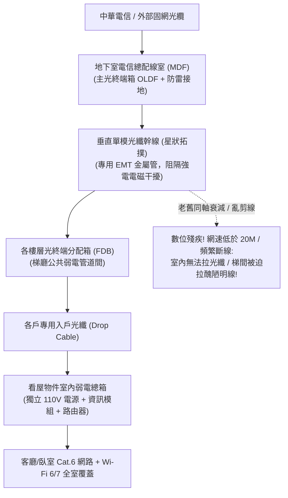

# 全案購屋實戰第三百一十三部：中古大樓社區各樓層弱電管道間同軸電纜信號嚴重衰減光纖到戶垂直星狀拓撲引進與弱電箱雜亂跳線短路體檢工序全書

## 壹、核心查驗宗旨與前言

在現代高度數位化與智慧家庭的生活型態下，高速穩定的光纖寬頻網路（FTTH）、無延遲的高畫質電視訊號、遠端居家辦公（WFH）視訊會議，以及各戶智慧對講保全聯鎖，已與水電瓦斯同等重要，成為不可或缺的「第四大基礎生活設施」。

然而，在屋齡 15 至 30 年的中古大樓中，梯廳的公共弱電管道間（Low-Voltage Telecommunication Shaft）與各戶戶內弱電總配線箱，往往是管委會最不願花錢整頓、電信外包工程隊任意胡亂拉線的「數位垃圾場」：
1. **各樓層公共弱電管道間仍沿用三十年前的「老舊同軸電纜（RG-6 Coaxial Cable）與大對數電話銅絞線（Cat.3/Cat.5）」**，線路長年受潮氧化、高頻衰減（Attenuation）高達數十 dB，造成家中寬頻網路頻繁斷線、爆 Ping、第四台電視畫面雪花橫紋；
2. **缺乏合法垂直「光纖到戶（FTTH, Fiber to the Home）管道與引進配線」**，各戶若想申裝 500M/1G 現代超高速光纖網路，必須委由中華電信外包工班在梯廳外牆「明管走線打洞」，引發鄰損抗議與破壞梯間防火區劃；
3. **各戶室內弱電總箱（Home Distribution Box）內部「雜亂跳線如盤絲洞」**，早期未配置 110V 專用電源插座，強電弱電混雜交織，造成嚴重的 60Hz 交流電磁干擾（EMI），甚至引發弱電短路火花走火；
4. **管道間弱電垂直貫穿樓板處未施作「防火泥填塞」**，在火災時化身為加速濃煙擴散的「引信通道」。

本手冊為買方打造一套極具深度的「公共弱電管道間、光纖垂直拓撲與各戶弱電箱全系統體檢工序」，結合現場線路外觀檢視、光衰減分貝測試標準、弱電箱電源與佈線查驗、商務砍價話術及特約條款保障，徹底杜絕交屋後遭遇網路龜速、明線破壞裝潢與分攤數十萬元全棟光纖重拉之困擾。

---

## 貳、大樓弱電通訊系統技術構造與四大常見致命病灶

### 一、集合住宅建築弱電通訊與光纖架構技術規範
1. **地下一樓/一樓電信總配線室（MDF Room, Main Distribution Frame）**：
   - 銜接中華電信等固網業者之外來大容量光纜，配置主光終端箱（OLDF）及電話主配線架。
2. **垂直弱電管道間幹線（Vertical Telecommunication Riser Shaft）**：
   - 依法規應配置專用弱電鍍鋅金屬線槽（Cable Tray）或金屬導線管（EMT Conduit），垂直敷設單模 12 芯至 24 芯光纜（Single-Mode Optical Fiber Cable）。
3. **各樓層光分配箱（Floor FDB, Fiber Distribution Box）**：
   - 採用「垂直星狀拓撲（Star Topology）」，將主光纜分流至各戶專用雙芯微簇型引進光纜（Drop Cable）。
4. **各戶智慧住宅弱電配線總箱（Smart Home Distribution Panel）**：
   - 箱體尺寸標準建議 $\ge 400\text{mm} \times 500\text{mm} \times 120\text{mm}$，內置資訊插座模組、同軸分配器、電話端子排，並強制配置 **一組以上獨立 110V 接地電源插座**，供光纖數據機（ONU / 小烏龜）及 Wi-Fi 路由器供電。

### 二、中古社區常見之四大致命病灶
1. **老舊同軸電纜外皮氧化脆化引發「高頻嚴重衰減」**：
   - 社區早期鋪設之發泡同軸電纜，使用超過 15 年後外層 PVC 硬化龜裂，銅編織屏蔽網被潮氣侵蝕氧化發黑，屏蔽率（Shielding Effectiveness）大幅下滑。數位電視訊號衰減超過 $15\text{ dB}$，寬頻數據機信噪比（SNR）急遽惡化，引發網頁開啟停滯、視訊通話不斷轉圈圈。
2. **垂直弱電管內「廢線死線塞滿」無法穿引新光纖**：
   - 數十年來不同第四台、寬頻業者來來去去，歷代廢棄之同軸線、電話黑皮線從未抽除，整條垂直 PVC 導管被塞得水洩不通、完全抱死。買方交屋後向中華電信申裝 1G 光纖，外包裝機師傅到場後用引線鋼絲嘗試數小時，宣稱「管路完全塞死堵住，無法引進光纖，只能在梯廳天花板拉明線！」，破壞住宅門面與裝潢質感。
3. **戶內弱電箱「無電源配置」導致數據機掛在牆外**：
   - 早期建商並未預見現代光纖數據機與 Wi-Fi 路由器需要吃電，弱電鐵箱內僅有金屬跳線排，未預留 110V 插座。住戶搬入後，被迫將數據機掛在玄關鞋櫃外，從客廳牆角拉一條醜陋的延長線供電，電線交錯凌亂，極易踢到斷電。
4. **管道間弱電電磁干擾（EMI）引發「網路封包大量丟失」**：
   - 水電工為了施工便利，將高壓配電幹線與電話網路線同穿一管，或無金屬隔板緊貼敷設。大電流流經產生的 60Hz 強大交變電磁場，在網路雙絞線中感應出高頻雜訊電流，造成路由器封包丟失率（Packet Loss）飆破 5%，連線極其不穩。

---

## 參、買方現場看屋之弱電系統五步實戰體檢工序

### 一、步驟一：目標戶門外梯廳公共弱電箱開箱目視
- **弱電管道間位置尋訪**：在電梯走廊牆面找到標示「電信箱」或「弱電箱」之金屬門。
- **開啟檢視門（需仲介陪同開啟鎖扣）**：
  - **線路雜亂度檢驗**：內部是整齊卡入金屬理線架，還是如「盤絲洞」般大量裸露飛線、膠帶亂纏；
  - **光纖接續盒（Fiber Splice Tray）確認**：檢視箱內是否已安裝白色或灰色的「光纖分配盒（FDB）」，箱內有無黃色單模光纖跳線（Patch Cord），**確認社區是否具備「FTTH 光纖到戶」現況**！

### 二、步驟二：管路穿線餘裕與廢線死線核查
- **垂直穿線管口目測**：手電筒照射弱電箱上下兩側的穿線導管口：
  - 檢視管口管徑填滿率（Conduit Fill Ratio）：管內標準空間佔用率應小於 **$40\%$**；
  - 若管口已被發黑的老舊同軸線與電話線塞得死實、管口邊緣無任何縫隙，代表**未來極難重新穿入新光纖**。

### 三、步驟三：目標戶室內弱電配線總箱開箱檢核
- **玄關弱電箱位置與尺寸**：在看屋物件室內大門玄關或走道牆壁下方，找到戶內弱電總箱：
  - 打開箱門，檢視內部空間是否足以容納光纖數據機與小型交換機；
  - **【關鍵致命點】檢視箱內是否有配置「專用 110V 電源插座」**！若箱內空無一物無任何電源，代表必須另外花錢打牆引電。
- **各房間網路線規格核查**：檢視從弱電箱通往各臥室與客廳之網路線外皮印字：
  - 標準應為 **Cat.5e 或 Cat.6（Gigabit 傳輸規格）**；若印字為早期的「Cat.3」或無印字之普通電話花線，代表全室無法實現高速有線網路連線。

### 四、步驟四：實地寬頻訊號與 Wi-Fi 連線阻抗檢測（現場快篩技巧）
- **手機 Wi-Fi 分析儀 App 實測**：使用手機下載 Wi-Fi Analyzer App 站在看屋物件客廳與臥室：
  1. 檢視社區公共區域是否有 5GHz 乾淨頻段；
  2. 若屋主仍在室內居住且有通網，使用 Speedtest App 進行測速，檢視 Ping 延遲是否在 **$10\text{ ms}$ 以內**、下載與上傳速度是否對稱無異常大幅衰減。

### 五、步驟五：管委會光纖到戶（FTTH）改裝紀錄覆核
委請仲介向管委會或中華電信客服確認：
1. **大樓 FTTH 引進完成證明**：確認該社區是否已被中華電信列入「光纖到府服務已開通」名冊，最大可申裝速率是否達 **500M / 1G / 2G bps**。
2. **大樓弱電垂直管道拉線公約**：確認社區管委會是否嚴格禁止梯廳走明線，防範未來被強制停裝的困境。

---

## 肆、商務談判博弈：弱電設備落後殺價 10 萬元實戰話術

整棟大樓若需委託電信工程廠商進行垂直弱電管道間廢線抽除、重新穿引主幹光纜、增設各樓層光分配盒，並自費在室內打牆增設弱電箱 110V 專用電源與抽換全室 Cat.6 網路線，工程款動輒高達 **新台幣 2 萬至 4 萬元**；若全棟無法引進光纖，其數位抗性對房價轉手更帶來隱形折損。買方應將此嚴重的機能缺陷作為砍價籌碼。

> **實戰談判對話劇本：**
> 「屋主您好、周小姐您好：
> 我們在實地勘查門外弱電管道間與打開室內弱電箱時，發現非常嚴重的通訊機能落後問題：這棟大樓的垂直弱電管內塞滿了三十年前的老舊同軸線與廢棄電話線，根本沒有引進現代標準的 FTTH 光纖到戶；且室內弱電總箱內部連一組 110V 電源插座都沒有預留，各房間穿的還是只能通話的老舊電話細線！
> 在現代家庭與居家辦公的生活中，高速光纖與穩定網路是跟水電一樣重要的命脈。如今弱電管塞死無法穿光纖，中華電信師傅根本無法進屋安裝高速網路，我們入住後勢必得被迫在梯廳牆上拉醜陋的明線，引發鄰居抗議；且我們必須自費找水電工班打牆洗孔重新引電進弱電箱，並花費數萬元把各房間線路全部抽換成 Cat.6 網路線。
> 社區若要全面進行全棟光纖改造，管委會勢必發動大筆公設通訊特別徵收款；這項數位機能缺陷直接折損了本戶的生活便利性與未來轉手價值。
> 為了承擔這項嚴重的通訊線路改造費用與室內水電重新拉線成本，我們堅持在買賣總價中直接扣除 **10 萬元** 作為弱電通訊修復折讓款，否則面對一個連高速網路都無法順暢申裝的物業，我們實在難以放心簽約。」

---

## 伍、買賣契約特約防守條款專用字軌

為杜絕買方交屋後承擔通訊管路堵塞無法申裝光纖之風險，《不動產買賣契約書》應增列下列防禦條款：

> **【室內通訊管線順暢與光纖引進無阻礙保證條款】**
> 1. **弱電管路暢通與線路合格保證**：賣方保證本買賣標的專有部分自室內弱電總箱通往所屬樓層公共弱電管道間之導線管路完整暢通，無任何管路壓扁變形、水泥泥漿灌入堵塞或廢線卡死無法穿引新線之重大瑕疵，買方得順利向固網電信業者（如中華電信）申裝現代寬頻光纖線路引接入戶。
> 2. **交屋前通訊修繕責任擔保**：若交屋點交時，因管路堵塞致固網業者無法完成光纖穿線入戶者，賣方應於交屋日起 14 日內自費委託專業水電通管工班完成管路通孔或排除阻礙；若逾期無法排除致買方必須改走梯廳明管施工者，賣方應補償買方室內配管美化工程款新台幣 **伍萬元整**，並由交屋尾款中直接扣除。
