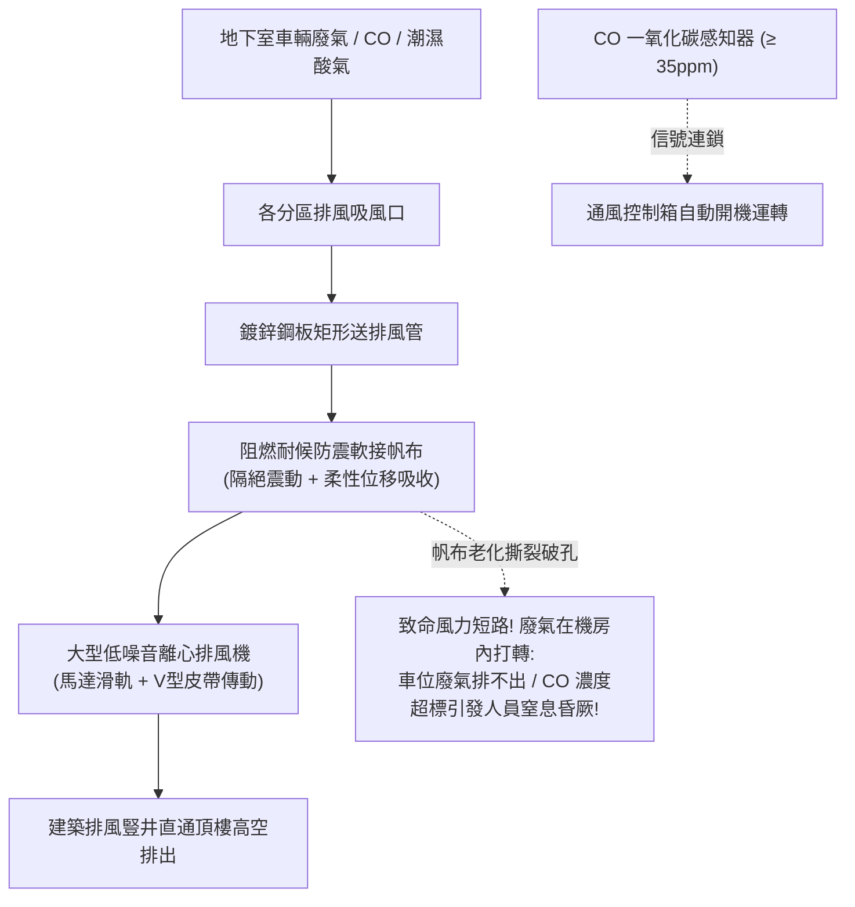

# 全案購屋實戰第三百一十九部：中古大樓社區地下室機械通風送排風機皮帶張力衰減軸承缺油異音與風管法蘭軟接帆布破損體檢工序全書

## 壹、核心查驗宗旨與前言

在現代集合住宅地下停車場的空氣品質維持與防災通風體系中，「機械通風換氣系統（Mechanical Ventilation System，包含平時強制送風機、強制排風機與誘導式噴流風機）」是維持地下二至四層停車空間氧氣充足、排出汽機車燃油廢氣、以及稀釋高濃度致死一氧化碳（CO）與揮發性有機物（VOCs）的「地下呼吸肺葉」。

然而，在屋齡 15 至 30 年的中古大樓中，地下室通風機組常年處於「管委會為省公電常年不開、一開機噪音震耳欲聾、零組件嚴重老化」的崩潰邊緣：
1. **大型雙吸離心風機或軸流風機之「傳動 V 型三角皮帶（V-Belts）」嚴重鬆弛打滑、龜裂毛邊**，傳動效率大幅衰減 40% 以上，伴隨刺耳尖叫聲與橡膠燒焦味，排風量完全無法達到法規規定的換氣次數；
2. **馬達與風機葉輪之重載滾珠軸承長年缺油乾磨、滾道剝落金屬疲勞**，運轉時發出如同火車進站般的「隆隆」金屬碾壓巨響與強烈結構低頻共振，引發 1 至 3 樓低樓層住戶客廳地面與臥室床頭常年遭受震動折磨；
3. **風機與鍍鋅鐵皮風管之間的「可撓性防震軟接帆布（Flexible Canvas Connector）」因老化水解、老鼠啃咬或震動拉扯大面積撕裂破孔**，高達一半以上的風量在機房內部短路循環（Short-Circuit Airflow），真正需要排風的車道與車位底層空氣停滯、一氧化碳濃度超標；
4. **一氧化碳感知聯鎖控制系統（CO Sensing & Demand Control）感測頭中毒漂移失準**，就算地下室廢氣瀰漫煙霧繚繞，通風機依然毫無反應靜止不動。

本手冊為買方打造一套極具深度的「地下機械通風機組、傳動皮帶、軸承與帆布軟接全系統實地體檢工序」，結合現場皮帶張力計量測、聽音棒軸承診斷、風速計實測、商務砍價話術及特約條款保障，徹底杜絕交屋後承擔一氧化碳中毒危機與數十萬元公設換氣設備修繕分攤債務。

---

## 貳、地下室機械通風系統技術構造與四大常見致命病灶

### 一、集合住宅地下停車場機械通風技術規範
1. **強制送排風機組（Forced Supply & Exhaust Fan Units）**：
   - 包含前傾/後傾式雙吸離心風機（DIDW Centrifugal Fan）或直結式軸流風機（Axial Fan），耐溫等級 F 級，三相感應馬達配置皮帶輪傳動或直聯傳動。
2. **傳動三角皮帶與張力調整滑軌（V-Belts & Motor Slide Base）**：
   - 採用防靜電耐油之三ツ星（Mitsuboshi）或 BANDO A/B/C 型三角膠帶，標準張力需維持在手指垂直施力 2 至 3 公斤時撓度（Deflection）落於 **$10\text{mm} \sim 15\text{mm}$** 之間。
3. **耐熱阻燃軟接帆布（Fire-Resistant Flexible Canvas Joint）**：
   - 連接於風機吸排風口與建築風道之間，採用矽膠包覆玻璃纖維布（Silicone Coated Fiberglass Fabric），具備隔絕機械震動傳導至建築結構之功能。
4. **一氧化碳自動聯鎖控制盤（CO Demand Controlled Ventilation Panel）**：
   - 分區佈設電化學 CO 感測頭，當地下室 CO 濃度達到 **$35\text{ ppm}$** 時自動啟動第 1 段低速換氣，達到 **$50\text{ ppm}$（法規警戒值）** 時強制全開高速排風。

### 二、中古社區常見之四大致命病灶
1. **傳動皮帶嚴重鬆弛老化引發「轉速暴跌 40% 與高頻尖叫」**：
   - 三角皮帶使用超過 5 年，橡膠老化硬化、內側纖維抗拉層斷裂。皮帶鬆弛垂掛在皮帶輪上，啟動瞬間由於巨大摩擦熱發出如同殺豬般的「唧——唧——」尖銳刺耳長叫，伴隨濃烈橡膠焦臭味。風機葉輪實際轉速跌破額定轉速之 60%，地下室完全感受不到任何空氣流動。
2. **風機軸承缺油乾磨引發「120Hz 結構低頻共振」**：
   - 雙吸離心風機兩端之連座滾珠軸承（Pillow Block Bearing），常年未打入耐高溫鋰基潤滑脂（Grease）。滾珠在無油高溫下發生點蝕剝落（Spalling），轉子失去動平衡。巨大的不平衡離心力帶動整座混凝土基座劇烈震顫，震動波沿著地下室承重剪力柱一路向上傳遞，造成 1 至 3 樓低樓層住戶室內地板常年處於震動狀態。
3. **軟接帆布老化撕裂破孔致使「風量短路全無效」**：
   - 早期使用的普通氯丁橡膠帆布，長年受高風壓抽吸與空氣震動拉扯，上下兩側接縫處全面裂開直徑達數十公分的巨大開口。排風機運轉時，強大負壓直接從機房門窗大量吸入空氣，形成「機房內部假循環」，而管網末端停放車輛的車道與車位，排風口抽吸風速直接歸零。
4. **一氧化碳感知器老化失準淪為「盲人控制」**：
   - 電化學 CO 感測元件有效壽命僅約 **3 至 5 年**。中古大樓超過 10 年未校正更換，感測電極早已乾涸失效。地下室每逢傍晚下班時間數十輛車進出、廢氣瀰漫刺眼嗆鼻，感知器讀數依然顯示為 0 ppm，換氣馬達死寂不動，住戶下車取物極易引發急性一氧化碳中毒與頭暈嘔吐。

---

## 參、買方現場看屋之機械通風系統五步實戰體檢工序

### 一、步驟一：地下機械通風機房外觀與環境巡檢
- **機房門外手感震動與噪音初篩**：行至地下室標示「排風機房」或「排煙兼通風機房」門口：
  - 手掌緊貼門面與周邊水泥牆，感受有無明顯高頻顫抖或沈悶的低頻共振；
  - 側耳聆聽是否有規律的金屬金屬撞擊聲或刺耳尖叫聲。
- **門下進氣百葉通暢度**：檢視機房門上的進風百葉（Louver）是否被紙箱、落葉堵死。

### 二、步驟二：離心排風機機組靜態目視（需機電人員開啟）
- **傳動皮帶外觀與撓度實測**：手電筒照射馬達與風機輪之間的 V 型皮帶：
  - 檢視皮帶是否有橫向裂紋、邊緣脫線起毛球、皮帶輪槽內是否有黑色磨損膠粉；
  - **手指按壓張力檢驗**：用拇指在兩輪跨距中央用力垂直下壓（約 3kg 力道），下壓位移量應在 **$10\text{mm} \sim 15\text{mm}$** 之間；若下壓超過 $30\text{mm}$ 甚至能輕易扭轉 $90^\circ$，代表**皮帶已嚴重鬆弛打滑**！
- **軸承外觀與潤滑油嘴（Grease Nipple）**：檢視風機兩側軸承座，外殼是否有高溫變色焦黑，油嘴周圍是否有新鮮黃油溢出，還是乾涸發黑發硬。

### 三、步驟三：防震軟接帆布撕裂與短路漏風核查
- **手電筒 $360^\circ$ 照射軟接接頭**：檢視風機進出風口與金屬風管交接處之柔性帆布：
  - 檢視帆布頂面、底面與死角處是否有裂開長條形開口；
  - 檢視金屬壓條螺栓是否有鏽蝕脫落；
  - **強開通風運轉手摸檢驗**：在風機運轉時，用手掌靠近帆布接合面感受是否有強大氣流向外噴出或向內狂吸；若漏風劇烈，代表帆布已破裂失效。

### 四、步驟四：看屋目標車位排風口實地「抽吸風速實測」
- **車位上方排風格柵吸力檢核**：走至買方考慮購買之車位（或周邊車道）天花板排風格柵下方：
  1. 在通風機運轉狀態下，將一張輕薄的 A4 影印紙或面紙舉起靠近排風格柵；
  2. **合格標準**：紙張應能被**強烈吸力穩穩吸附在格柵表面**不掉落；
  3. 若紙張完全不被吸附、甚至緩慢飄落，代表該分區通風管道完全沒有抽力，風力早已在機房帆布處短路漏光！

### 五、步驟五：管委會通風設備維護工單與 CO 感測器校正單覆核
委請仲介向管委會調閱：
1. **通風風機定期皮帶更換與軸承注油保養單**：核對皮帶更換年份（皮帶標準更換週期為 **2 至 3 年**，軸承潤滑油補充為每半年一次）。
2. **地下室一氧化碳感知器校正檢驗報告**：確認感測器最近一次校正日期，確認讀數準確度（零點校正與跨度校正紀錄）。

---

## 肆、商務談判博弈：通風設備老化故障殺價 15 萬元實戰話術

整棟大樓地下室通風機房若需進行全區傳動皮帶全面更新、風機軸承拆卸更換重做動平衡、重新訂製換裝阻燃矽膠軟接帆布，並全面抽換各分區老舊一氧化碳感測頭與微電腦控制盤，工程款高達 **新台幣 25 萬至 40 萬元**；且通風不良引發的一氧化碳蓄積與低頻噪音更直接危害人體健康。買方應將此嚴重的公共機電缺陷轉化為砍價殺手鐧。

> **實戰談判對話劇本：**
> 「屋主您好、周小姐您好：
> 我們在實地勘查社區地下室通風機房並在車位實測吸力時，發現非常嚴重的公設通風與空氣品質死穴：地下室大排風機的傳動皮帶嚴重鬆弛打滑，運轉發出震耳欲聾的尖叫與皮帶焦臭味；且風機進出風口的防震帆布早已大面積撕裂破孔，高達一半以上的風量在機房內部短路打轉，我們車位上方的排風口連一張面紙都吸不住！更危險的是，地下室的一氧化碳感知器早已過期十年完全失準！
> 地下機械通風是全體車主進出地下室唯一的『人體保命肺臟』。通風完全失效代表每天數百輛車排放的劇毒一氧化碳與致癌廢氣全部沉積在車位周圍，全家人停好車下車走進電梯的幾分鐘都在狂吸致命毒氣，長期下來嚴重危害中樞神經與孩童大腦健康；且風機軸承缺油發出的劇烈低頻震動，更會日夜沿著大樓結構柱傳導至低樓層住戶室內，引發嚴重的失眠共振困擾。
> 社區管委會若要全面抽換老舊皮帶、軸承重做動平衡並更換阻燃耐候帆布與全套 CO 智能控制盤，整棟每戶勢必得分攤大筆修繕特別公費。
> 為了承擔這項重大的公共通風衛生風險與全家人進出地下室的健康保障成本，我們堅持在買賣總價中直接扣除 **15 萬元** 作為通風設備修復與折讓基金，否則面對一個地下室廢氣排不出的物業，我們實在不敢貿然簽約。」

---

## 伍、買賣契約特約防守條款專用字軌

為杜絕買方交屋後承擔地下室通風機組大修攤派責任與一氧化碳中毒風險，《不動產買賣契約書》應增列下列防禦條款：

> **【公共地下室機械通風換氣系統正常運作保證條款】**
> 1. **機械通風設備正常運作保證**：賣方保證本買賣標的所屬大樓地下室之機械強制送排風機組、傳動機構、防震軟接帆布、排風風管網及一氧化碳自動聯鎖控制系統，於交屋日前運作健全，排風量符合建築技術規則建築設備編通風換氣標準，無任何皮帶打滑尖叫、軸承異常低頻震動、帆布撕裂短路漏風或 CO 感知器失效之重大瑕疵，且無遭環保、消防或工務主管機關列管限期改善。
> 2. **交屋前通風設備整修工程款清償義務**：若於交屋日（含）前，本社區管委會或區分所有權人會議已決議辦理地下室排風機軸承更換、傳動皮帶抽換、軟接帆布翻新、風管清潔或一氧化碳感知系統全面更新等重大工程者，其所需之一切工程款、零件費或特別徵收分攤費用，不論請款單開立於交屋日前或交屋日後，概由賣方於交屋尾款結算時全額負擔扣抵，買方不負任何清償責任。
