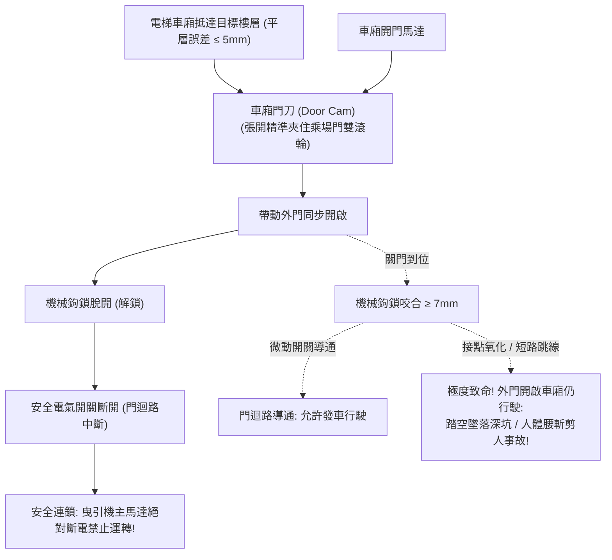

# 全案購屋實戰第三百一十二部：中古大樓社區各樓層電梯昇降路乘場門門鎖電氣連鎖開關接點氧化卡阻門刀間隙走位與防剪人安全體檢工序全書

## 壹、核心查驗宗旨與前言

在集合住宅的垂直交通動線中，電梯是全體住戶老小每日上下樓層使用頻率最高、載運全家人生命的重型特種載具。而在電梯所有安全迴路中，守護乘客防止「踏空跌落數十公尺深坑」以及「車廂移動剪切人體（剪人事故）」最關鍵的生命防線，就是安裝於各樓層電梯外門上的**「乘場門門鎖電氣連鎖開關裝置（Landing Door Interlock & Safety Contacts）」**與車廂門上的**「門刀機構（Door Cam / Retiring Cam）」**。

然而，在屋齡 15 至 30 年的中古大樓中，電梯乘場門系統常年承受住戶推車撞擊、落塵粉屑侵入與金屬疲勞磨損，極易演變為暗藏致命墜落與剪人傷亡的「公設安全黑洞」：
1. **各樓層乘場門機械鎖鉤（Mechanical Lock Hook）咬合深度嚴重不足（小於法規標準 7mm）**，外門稍微用力推撞即可被強行扒開，住戶誤以為車廂已到，一腳踏空跌落深坑粉身碎骨；
2. **門鎖電氣安全微動開關（Door Safety Switch）接點表面銅綠氧化碳化**，電阻過高導致電梯經常性「突發急停關人困人（Entrapment）」；更致命的是，少數不肖維修技師為了省事，竟私自用跳線將故障樓層的門鎖安全迴路「短路（Short-Circuit Bypass）」，導致電梯在「外門開啟狀態下依然能夠行駛」，引發慘絕人寰的剪人慘劇；
3. **車廂門刀與各樓層乘場門鎖滾輪（Lock Roller）之間的動態嚙合間隙（Clearance）鬆脫走位**，車廂高速行經中途樓層時，門刀誤刮門鎖滾輪發出「匡噹、匡噹」刺耳巨響，引發電梯高空緊急煞車停擺；
4. **乘場門門軌（Door Sill）地槽積滿砂石硬幣、滑塊（Door Guide Shoes）磨損脫軌**，導致外門閉合不順、卡在半途，整棟電梯被迫癱瘓罷工。

本手冊為買方打造一套極具深度的「電梯乘場門門鎖、門刀機構與防剪人安全全系統體檢工序」，結合現場徒手推拉測試、門刀間隙量測、管委會昇降設備許可證與保養紀錄覆核、商務砍價話術及特約條款保障，徹底杜絕交屋後承擔數十萬元電梯大修分攤款與家人搭梯意外風險。

---

## 貳、電梯乘場門鎖與門刀構造原理與四大常見致命病灶

### 一、集合住宅電梯乘場門安全連鎖技術架構
1. **乘場門機械門鎖與重力/彈簧自動復位機構（Landing Door Lock Assembly）**：
   - 每層樓外門均配備重錘（Counterweight）或拉伸彈簧，確保在外力鬆開時外門能自動靠重力滑順關閉。
   - 機械鉤鎖咬合深度（Engagement Depth）：法規強制要求鎖鉤嚙合深度必須大於 **$7\text{mm}$** 以上，方能承受 $1,000\text{ 牛頓}$ 之正面撞擊力而不脫扣。
2. **電氣安全開關接點（Electrical Safety Contact）**：
   - 雙斷點強制分離式微動開關（Positive Break Contact），機械鎖鉤完全鎖定後，接點方能閉合導通。只要全棟任何一層外門未鎖好，整串串聯之「安全門迴路（Safety Door Circuit）」立即斷路，主機馬達完全無法送電運轉。
3. **車廂主動門刀機構（Car Door Vane / Driving Cam）**：
   - 安裝於電梯車廂門上方，分為雙門刀固定式或電動收縮式（Retiring Cam）。當車廂平層停靠時，門刀張開夾住該樓層乘場門之雙滾輪，藉由車廂門馬達帶動外門同步開啟與關閉。
4. **緊急外門開鎖孔與安全鑰匙（Emergency Triangle Key Hole）**：
   - 設於乘場門上方，供救護人員在斷電受困時使用三角鑰匙手動解鎖。

### 二、中古社區常見之四大致命病灶
1. **門鎖安全迴路被維修工「違法短路跳線（Bypass）」**：
   - 某樓層外門因地槽卡石子或門鎖氧化接觸不良，電梯頻繁跳故障停機。劣質電梯保養工為了應付住戶投訴且不願花時間更換門鎖零件，竟然在控制主板上將該樓層的門鎖安全點直接「用銅線跳線短接」！導致外門即使大開，電腦仍誤判門已關好，電梯照常啟動行駛，住戶進出時瞬間被車廂垂直剪切身亡。
2. **機械鎖鉤磨損咬合深度不足導致「扒門墜坑」**：
   - 青銅或鑄鐵鎖鉤長年撞擊磨損，咬合深度由原本的 10mm 磨損至不足 3mm。住戶稍有用力倚靠或孩童玩耍推撞外門，鎖鉤瞬間滑脫脫扣，門扇彈開，眼前卻是深達數十公尺黑漆漆的垂直電梯井，極易失足跌落致死。
3. **門刀與滾輪間隙走位引發「行駛中撞鎖急停」**：
   - 車廂導靴磨損或門刀固定支架螺栓鬆脫，門刀與乘場門滾輪之間的水平間隙（標準為 **$5 \sim 8\text{mm}$**）嚴重縮小至 $1\text{mm}$。當電梯滿載高速通過中途樓層時，車廂晃動導致門刀直接金屬硬撞門鎖滾輪，整棟電梯劇烈震晃並觸發安全掣子緊急煞車，住戶受困於半空中。
4. **門導靴（Door Shoes）碎裂外門脫軌卡死**：
   - 乘場門下方深入地槽的尼龍導靴，因使用超過 10 年塑膠老化脆裂脫落。外門底部失去限位導向，關門時傾斜卡死在地槽中，開門馬達過載拉扯導致鋼索崩斷，整部電梯停擺罷工。

---

## 參、買方現場看屋之電梯乘場門五步實戰體檢工序

### 一、步驟一：目標戶梯廳乘場門外觀與密合度目視
- **門扇縫隙均勻度檢核**：走至看屋物件門外電梯廳，檢視緊閉狀態之電梯外門：
  - 雙扇門交接處之防夾橡膠條是否平整垂直、無大面積開口（門縫間隙應小於 **$5\text{mm}$**）；
  - 檢視門扇下緣與地面不鏽鋼地槽（Sill）之縫隙，地槽內是否有碎石、厚重灰塵或積水油污。
- **緊急開鎖三角孔（Triangle Hole）檢驗**：確認外門上方之三角解鎖孔金屬飾蓋完好，無被廣告貼紙封死或外力破壞痕跡。

### 二、步驟二：乘場門機械鎖鉤徒手「扒門防墜測試」
- **外門徒手扒門實測技巧**：當電梯車廂停在其他樓層時（目標樓層無車廂狀態下）：
  - 站在目標戶梯廳外門前，雙手手掌貼住雙扇門中央縫隙，以正常成年人之力道**向左右兩側嘗試平推扒開**；
  - **合格標準**：門扇晃動間隙不得超過 **$15\text{mm}$**，且機械鎖鉤應牢固咬死、絕對無法徒手扒開！
  - **致命危險警報**：若雙手一扒外門即能輕易推開一道超過 $10\text{cm}$ 之縫隙、甚至整扇門被拉開，代表**機械鎖鉤嚴重磨損或已失效**，存在隨時墜坑的滅頂危險！

### 三、步驟三：平層停靠精度與車廂防剪安全檢核
- **平層高低差量測（Leveling Accuracy）**：按電梯呼梯鈕叫梯，待車廂抵達並完全開啟大門後：
  - 站在門口低頭檢視車廂地坪與梯廳地坪之交接線；
  - **標準高低差必須小於 $\pm 5\text{mm}$ 以內**（若落差超過 $15\text{mm}$，老人家與孩童進出極易被絆倒跌傷，代表平層感測器微動開關已嚴重走位老化）。
- **乘場門防夾光幕與安全觸板檢測**：
  - 在車廂門即將關閉瞬間，伸出手掌遮擋門框兩側之紅外線安全光幕（Multi-Beam Light Curtain）：
  - 車門應在 **0.1 秒內** 感應並立即自動反轉重新開啟，無任何夾人遲滯現象。

### 四、步驟四：搭乘全程「門刀刮碰聽音與微震檢測」
- **全行程搭乘實測**：走入電梯車廂，按下最頂樓與最底層按鈕，進行全程垂直搭乘：
  1. 將耳朵貼近車門內側，在電梯高速通過各樓層時，仔細聆聽是否有「喀啦、匡噹」的金屬刮削碰撞聲；
  2. 觀察車廂門扇是否有不正常的規律抖動跳動（若有異音，代表門刀與某樓層之門鎖滾輪間隙過小發生刮碰）。

### 五、步驟五：管委會昇降設備使用許可證與保養紀錄覆核
委請仲介向管委會調閱：
1. **建築物昇降設備使用許可證（Elevator License）**：檢視許可證是否張貼於車廂內顯眼處，核對檢查機構（如中華民國昇降設備安全檢查協會）蓋章，**確認仍在有效法定檢驗年限內**。
2. **電梯月保養紀錄單與零件更換歷史**：核對最近半年之保養維護工單，確認各樓層乘場門鎖開關、門刀間隙及鋼索磨損是否有被技師註記「安全迴路異常待修」之列管項目。

---

## 肆、商務談判博弈：電梯乘場門系統老化殺價 15 萬元實戰話術

整棟大樓若需將全棟各樓層電梯乘場門機械鎖鉤、電氣連鎖微動開關、地槽導靴全面更換，並重新校正車廂門刀間隙與安全光幕，工程款動輒高達 **新台幣 25 萬至 40 萬元**；若涉及到電梯老舊控制主板更換與安全迴路重拉，費用更高達數十萬元。買方應將此致命的人命安全盲點轉化為砍價殺手鐧。

> **實戰談判對話劇本：**
> 「屋主您好、周小姐您好：
> 我們在實地勘查目標樓層的電梯乘場門並全程試搭電梯時，發現極度危險的特種設備人命安全隱患：我們考慮的這層樓電梯外門在車廂沒到時，徒手稍微用力一扒居然就能拉開縫隙，機械鎖鉤咬合深度嚴重不足；且電梯車廂在高速運行通過中途樓層時，門刀與外門滾輪發生劇烈的金屬碰撞刮碰聲，平層停靠落差更超過 2 公分！
> 電梯門鎖與門刀是防止全家人『踏空跌落十幾層深坑』與『車廂行駛中剪人腰斬』的唯一保命防線。外門鎖鉤鬆脫代表老人家或孩童稍不注意推到門，就可能直接跌落深坑粉身碎骨；而門刀刮碰更隨時會引發電梯高空卡梯急停、甚至造成外門被扯落的毀滅性重大工安事故！
> 社區管委會若要委託合格電梯大廠進行全棟各樓層門鎖全面翻新、抽換全新電氣安全開關並校正門刀間隙，整棟每戶勢必得分攤大筆修繕特別公費；且買方全家每天搭乘都要承擔極高的人身安全恐懼。
> 為了承擔這項致命的公共交通安全風險與家庭生命防護保障，我們堅持在買賣總價中直接扣除 **15 萬元** 作為電梯系統安全折讓與修繕補償款，否則面對一個隨時可能發生墜落意外的物業，我們實在不敢拿全家人的生命冒險簽約。」

---

## 伍、買賣契約特約防守條款專用字軌

為杜絕買方交屋後承擔電梯設備安全事故與大修攤派責任，《不動產買賣契約書》應增列下列防禦條款：

> **【公共昇降設備乘場門安全合格保證與修繕工程清償條款】**
> 1. **電梯設備安全運作保證**：賣方保證本買賣標的所屬大樓之電梯設備（包含車廂主機、鋼索、各樓層乘場門機械鎖鉤、門鎖電氣連鎖開關、車廂門刀、平層感測器及紅外線防夾光幕），於交屋日前具備合法有效之「建築物昇降設備使用許可證」，運轉平順無劇烈抖動刮碰，外門機械鎖鉤咬合牢固無外力輕扒即開之情事，安全連鎖迴路正常有效，且無遭主管機關列管限期改善、勒令停用或處以罰鍰。
> 2. **交屋前電梯重大整修工程款清償義務**：若於交屋日（含）前，本社區管委會或區分所有權人會議已決議、或經昇降設備檢查機構通知限期辦理電梯乘場門鎖全面抽換、門刀機構翻新、控制電腦盤更新或鋼索更換等重大工程者，其所需之一切工程款或特別徵收分攤費用，不論請款單開立於交屋日前或交屋日後，概由賣方於交屋尾款結算時全額負擔扣抵，買方不負任何清償責任。
