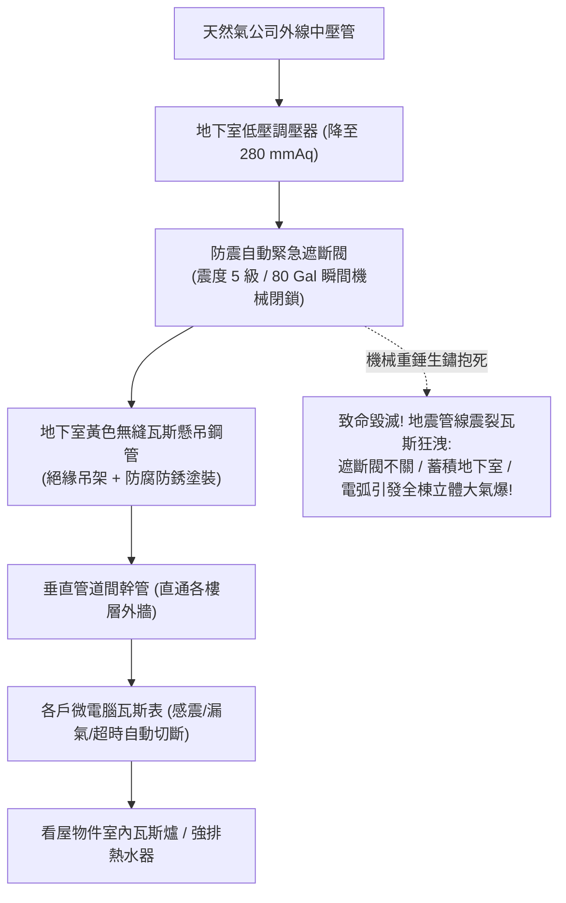

# 全案購屋實戰第三百一十五部：中古大樓社區地下室天然氣瓦斯管線防震自動緊急遮斷閥微電腦瓦斯表壓降管壁電化腐蝕漏氣體檢工序全書

## 壹、核心查驗宗旨與前言

在現代集合住宅大樓的生活能源體系中，供應全棟數百戶居民每日明火烹飪、強排熱水器洗浴與乾衣機運轉的「天然氣公用管線系統（Natural Gas Piping System）」，是隱蔽於地下停車場頂板、垂直管道間及梯廳外牆的「高能量燃氣動脈」。天然氣主要成分為高濃度的易燃易爆甲烷氣體（CH₄，爆炸極限為 $5\% \sim 15\%$），一旦在通風不良的地下室或管道間發生微量滲漏與氣體蓄積，遇靜電、電梯門刀火花或配電箱電弧，極易引發整棟大樓立體毀滅性氣爆大火。

然而，在屋齡 15 至 30 年的中古大樓中，地下室天然氣管網往往常年處於「管委會不敢碰、瓦斯公司只抄表、防震保護形同虛設」的極度危險邊緣：
1. **大樓地下室總引進管之「防震自動緊急遮斷閥（Earthquake Automatic Gas Shut-Off Valve）」閥芯水垢生鏽抱死、感震感應器（Seismic Sensor）水銀開關或微動開關失靈**，遭遇強烈地震時根本無法在 0.5 秒內自動切斷總氣源；
2. **懸吊於地下車道潮濕天花板的鍍鋅碳鋼瓦斯黑鐵管，長年受車輛冷氣冷凝水、廢氣酸霧侵蝕，產生嚴重的「電化腐蝕（Galvanic Corrosion）」與管壁坑蝕薄化**，螺紋絞牙接頭微裂漏氣；
3. **各戶配置之老舊傳統機械瓦斯表，缺乏「微電腦智慧感震遮斷、五級以上地震自動閉氣與超額流量漏氣切斷」功能**；
4. **瓦斯幹管未加裝「氣密絕緣由令（Insulating Flange）」**，外部雜散電流（Stray Current）竄入管壁引發電化穿孔，形成暗藏巨災的「地底引信」。

本手冊為買方打造一套極具深度的「地下室天然氣管網、防震遮斷閥與微電腦瓦斯表全系統實地體檢工序」，結合現場可燃氣體檢漏儀檢測、壓降肥皂水測試、瓦斯公司防震申報書覆核、商務砍價話術及特約條款保障，徹底防範氣爆滅頂之災與爭取大筆房屋折讓款。

---

## 貳、天然氣管網與防震遮斷閥構造原理與四大常見致命病灶

### 一、集合住宅天然氣燃氣管網技術規範
1. **中低壓調壓站與總進氣引進管（Gas Governor Station & Service Riser）**：
   - 瓦斯公司外線中壓管（約 $1.0 \sim 3.0\text{ kgf/cm}^2$）經調壓閥降至低壓（約 $200 \sim 280\text{ mmAq}$，約 $0.02 \sim 0.028\text{ kgf/cm}^2$）後引入大樓。
2. **防震自動緊急遮斷閥（Earthquake Shut-Off Valve, EQ-Valve）**：
   - 安裝於總進氣管源頭，具備感震機械重錘球體或電子感震儀（感測震度達 **5 級弱（加速度 $\ge 80\text{ Gal}$）** 時瞬間重力釋放彈簧閉閥），手動復位必須具備防呆機制。
3. **無縫碳鋼管與塗裝防蝕體系（ASTM A53 Carbon Steel Pipe）**：
   - 依瓦斯法規，室內及地下室管線必須採用經防銹底漆及黃色面漆識別之無縫鍍鋅碳鋼管，吊架具備絕緣膠皮墊，防止金屬異種接觸電化腐蝕。
4. **微電腦瓦斯表（Microcomputer Gas Meter）**：
   - 內置微處理器、超音波流量感知器、感震晶片及自帶電磁遮斷閥（具備壓力異常驟降遮斷、大漏氣 3 秒遮斷、微漏氣 30 天慢速累積報警功能）。

### 二、中古社區常見之四大致命病灶
1. **防震遮斷閥內部生鏽抱死致使「大震完全不遮斷」**：
   - 社區完工 20 年從未進行感震開關人工跳脫演練。防震閥內部的純銅滑閥與不鏽鋼彈簧受潮氣水垢卡死，感震鋼球被蜘蛛網厚灰包裹。一旦遭遇類似 921 或花蓮 6 級以上強烈地震，地下室瓦斯管被地層剪力震斷狂噴瓦斯，防震閥依然大開無動於衷，整座地下室充斥高濃度甲烷氣體，釀成全棟氣爆毀滅。
2. **黑鐵管壁電化腐蝕（Pitting Corrosion）導致「暗室慢速漏氣」**：
   - 地下室排風不良且多處反潮，瓦斯管與鍍鋅角鐵吊架直接接觸未加絕緣橡膠墊片，產生電位差引發嚴重的「雙金屬電化腐蝕」。管身局部產生深達管壁厚度一半以上的凹坑鏽蝕，管螺紋接合處微漏氣，在車位後方形成隱蔽的氣體聚集口袋。
3. **老舊傳統機械表「無感震遮斷防護」淪為危險缺口**：
   - 中古大樓絕大多數住戶仍沿用早期的「機械膜式瓦斯表（Traditional Diaphragm Meter）」。這類老表毫無電腦晶片、無感震能力亦無電磁切斷閥，一旦強震震斷熱水器進氣軟管，瓦斯持續外洩直至大火爆發。
4. **管道間天然氣管與電線「無防爆區劃混擠」**：
   - 早期中古大樓將天然氣瓦斯立管與大樓動力電纜緊緊捆綁於同一個狹窄垂直管道間內。瓦斯管接頭一旦微漏，比重較空氣輕的甲烷向上飄升充滿管道間頂端，遇到高壓電表跳脫或電線短路火花，瞬間引爆整條垂直管道間，將各樓層管道間防火門炸飛。

---

## 參、買方現場看屋之天然氣管網與防震遮斷閥五步實戰體檢工序

### 一、步驟一：地下室瓦斯總調壓站與防震遮斷閥外觀核查
- **總進氣管位置確認**：走入地下室，尋找瓦斯公司進氣總表與黃色粗管（口徑通常為 2 至 4 吋）：
  - 檢視總進氣管上是否安裝有紅色或黃色標示之「防震緊急自動遮斷閥」；
  - 檢視遮斷閥本體是否生鏽發黑、手動復位扳柄（Reset Lever）是否有鉛封、封印是否完好無被鐵絲私自綁死。
- **感震器（Seismic Sensor）狀態**：檢視閥體旁的感震重錘或電磁箱，指針是否位於「正常監視（Ready）」綠色區域。

### 二、步驟二：地下車道懸吊瓦斯管線與吊架防腐檢核
- **風管與瓦斯管間距**：抬頭檢驗懸吊於天花板之黃色瓦斯管線：
  - 瓦斯管與電線、排水管標準應保持 **$15\text{cm}$ 以上** 安全淨距；
  - 檢視瓦斯管表面黃色油漆是否有嚴重起泡脫落、管壁底部是否有赤褐色鐵鏽點；
  - 檢視支撐吊架（Pipe Hanger）與管身接觸面是否有墊入黑色絕緣橡膠墊圈（絕不能金屬直接摩擦）。

### 三、步驟三：手持可燃氣體檢漏儀（Gas Detector）實地探測
- **接頭肥皂水與氣體檢漏儀快篩（必備專業驗屋技巧）**：手持便攜式可燃氣體探測器（如微量甲烷檢測儀）：
  1. 沿著看屋車位上方之瓦斯管螺紋接頭、法蘭與由令接頭移動探測；
  2. 若探測器發出急促嗶嗶警報聲、液晶顯示濃度大於 **$50\text{ ppm}$**，代表該接頭**存在微量漏氣（Micro-leakage）**；
  3. 可使用發泡檢漏劑（肥皂水）噴灑於可疑接頭，觀察 30 秒內是否有持續冒出氣泡。

### 四、步驟四：目標戶室內瓦斯表型式與壓降檢核
- **瓦斯表外觀與晶片識別**：在看屋物件後陽台檢視專用瓦斯表：
  - **機械老表（危險）**：表身全金屬、僅有機械滾輪數字，無任何電池盒與液晶螢幕（無防震遮斷功能）；
  - **微電腦智慧表（優良合格）**：表頭上方配有液晶顯示螢幕、黑色復位按鈕與鋰電池倉，面板清楚標示「超震遮斷、漏氣遮斷、超時遮斷」。
- **熱水器排氣與瓦斯開關閥檢驗**：檢視陽台熱水器是否為「強制排氣型（FE式）」、熱水器瓦斯進氣考克（Gas Cock）開關扳動阻尼是否順暢無卡死。

### 五、步驟五：瓦斯公司定檢紀錄與防震演練紀錄調閱
委請仲介向管委會調閱：
1. **天然氣公司大樓公共管線二年定期檢驗紀錄單**：依法規規定，瓦斯公司每 **2 年** 應派員對大樓地下公共管線進行高壓氣密試驗與防震閥動作測試，確認工單上無「待改善微漏」紅字。
2. **大樓住戶微電腦瓦斯表換裝率**：確認該社區是否已有半數以上住戶完成安全微電腦表之換裝普及。

---

## 肆、商務談判博弈：瓦斯管老化防震失效殺價 15 萬元實戰話術

整棟大樓地下室瓦斯管網若需進行全區除鏽重漆、抽換老舊防震緊急自動遮斷閥並更換各戶微電腦智慧瓦斯表，連同氣密壓力測試，工程款高達 **新台幣 30 萬至 50 萬元**；且瓦斯管線微漏對全家生命財產更是隨時引爆的滅頂隱憂。買方應將此嚴重的公共安全瑕疵轉化為議價砍價的重磅武器。

> **實戰談判對話劇本：**
> 「屋主您好、周小姐您好：
> 我們在實地勘查社區地下室瓦斯主幹管並以專業氣體檢漏儀檢測時，發現非常恐怖的公共安全與氣爆隱患：地下室黃色瓦斯鋼管表面嚴重起泡鏽蝕，車道上方的螺紋管接頭已有微量甲烷滲漏警報；更致命的是，地下室進氣總端的防震緊急自動遮斷閥重錘早已嚴重生鏽抱死，調閱紀錄發現二十年來從未做過跳脫遮斷測試！而後陽台掛的依然是毫無感震防護的老舊機械瓦斯表！
> 天然氣管線是整棟大樓的『隱形炸藥庫』。防震遮斷閥卡死代表一旦台中發生大地震，地下室瓦斯管震裂狂噴瓦斯，大樓根本無法在第一時間切斷氣源，數百立方公尺的瓦斯在地下室蓄積，遇到任何微弱電火花就會引發整棟大樓立體大氣爆，全家人的人身安全與千萬資產將在瞬間化為灰燼；且瓦斯管微漏更隨時可能造成住戶慢性一氧化碳中毒或突發著火。
> 社區管委會若要全面委託欣中天然氣重新進行全棟管線氣密試壓、更換工業級防震電磁遮斷閥並強制換裝微電腦瓦斯表，每戶都要分攤大筆工程費用；且我們入住後必須自費在室內廚房與陽台全面加裝瓦斯漏氣自動遮斷系統與智慧報警器。
> 為了承擔這項致命的公共燃氣安全風險與全家人生命安全的自衛成本，我們堅持在買賣總價中直接扣除 **15 萬元** 作為燃氣安全折讓與防爆修復基金，否則面對一個隨時可能引發氣爆的物業，我們實在不敢拿全家人的性命冒險簽約。」

---

## 伍、買賣契約特約防守條款專用字軌

為杜絕買方交屋後承擔瓦斯管線漏氣氣爆責任與昂貴整修分攤費，《不動產買賣契約書》應增列下列防禦條款：

> **【公共天然氣燃氣系統安全合格保證與修繕工程清償條款】**
> 1. **天然氣管線與防震遮斷設備正常運作保證**：賣方保證本買賣標的專有部分瓦斯管線及所屬大樓地下室、公共管道間之天然氣管網、防震自動緊急遮斷閥、瓦斯表及分歧閥門，於交屋日前具備正常氣密與供氣功能，無任何瓦斯滲漏、管壁嚴重電化鏽蝕穿孔或防震遮斷機構卡死失效之重大瑕疵，符合天然氣事業法及用戶用氣設備安全規範，且無遭瓦斯主管機關或公用天然氣事業列管限期改善或處以停氣處分。
> 2. **交屋前瓦斯公設整修工程款清償義務**：若於交屋日（含）前，本社區管委會或區分所有權人會議已決議、或經公用瓦斯事業通知限期辦理地下公共瓦斯管線除鏽防腐更換、防震遮斷閥更新、全棟立管氣密加壓試驗或微電腦瓦斯表全面改裝等重大工程者，其所需之一切工程款、試驗費或特別徵收分攤費用，不論請款單開立於交屋日前或交屋日後，概由賣方於交屋尾款結算時全額負擔扣抵，買方不負任何清償責任。
