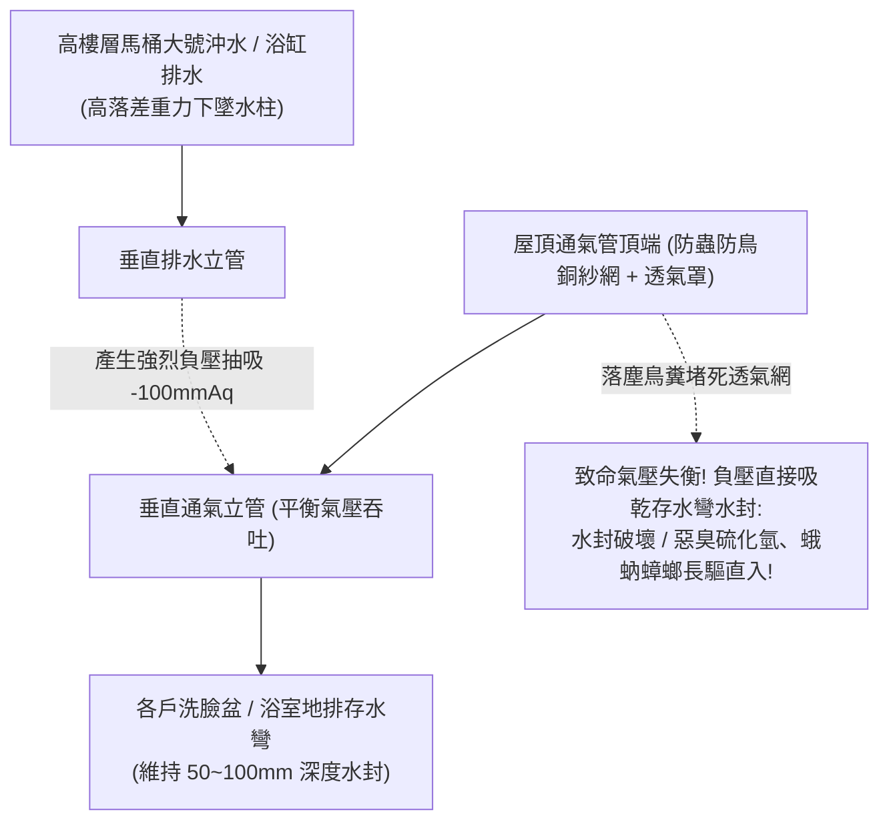

# 全案購屋實戰第三百一十八部：中古大樓社區各樓層管道間污水幹管透氣管頂端防蟲鳥網淤塞正負氣壓震盪水封乾涸與臭氣小黑蚊倒灌體檢工序全書

## 壹、核心查驗宗旨與前言

在集合住宅的建築排水水力學與室內空氣品質安全體系中，維繫全棟數百戶家庭衛浴廁所「無異味、無沼氣、水封不破壞」的最關鍵幕後功臣，就是自地下室一路貫穿至建築物屋頂高空的**「垂直排水通氣立管系統（Drainage Vent Stack System，包含主通氣管、結合通氣管與副通氣管）」**。

建築排水管網在大量住戶同時沖馬桶或浴缸放水時，數十公升的污水與糞便在立管內呈螺旋下墜，會產生極強大的「正壓氣湧（Positive Pressure Transient）」與「負壓抽吸（Negative Pressure Induced Siphonage）」。若通氣管路暢通，空氣會自由吞吐調節氣壓；反之，若屋頂通氣管頂端發生堵塞，整棟大樓的排水管道間將演變為一座暗藏惡臭病毒與蚊蟲入侵的「立體生化毒氣罐」：
1. **屋頂通氣管頂端之「防蟲防鳥銅紗網（Bird/Insect Screen）」因多年落塵、油煙與鳥糞毛屑黏附淤塞，通氣孔徑完全封死**；
2. **高樓層大量排水時引發強烈負壓抽吸，將鄰近住戶洗臉盆、地排與浴缸存水彎（P-Trap）內的「防臭水封（Water Seal）」硬生生吸乾（Induced Siphonage）**；低樓層排水時則引發正壓逆湧，將馬桶內的糞水與惡臭氣體直接「氣泡噴湧冒出（Blow-out）」；
3. **喪失水封屏障後，暗藏於下水道之劇毒硫化氫（H₂S）、沼氣、大腸桿菌及高傳染性病毒氣膠（Aerosol，如諾羅病毒、退伍軍人菌）順著管道倒灌入室內**，引發住戶集體腹瀉感染與全家人呼吸道病變；
4. **小黑蚊、蛾蚋（Drain Flies）、美洲大蠊（蟑螂）順著乾燥地排源源不絕爬入臥室與廚房**，徹底摧毀家庭居住品質。

本手冊為買方打造一套極具深度的「頂樓通氣管、各戶排水水封抗負壓與防臭全系統實地體檢工序」，結合現場透氣管頂端目視、水封深度抽吸測試、管道煙霧檢漏、商務砍價話術及特約條款保障，徹底防範惡臭倒灌與避免數十萬元公設通氣改管之高額支出。

---

## 貳、通氣立管水力構造原理與四大常見致命病灶

### 一、集合住宅建築排水通氣水力技術架構
1. **主通氣立管（Main Vent Stack）**：
   - 垂直穿過建築物屋頂伸出屋面至少 **$30\text{cm} \sim 50\text{cm}$ 以上**，管徑標準通常為 75mm 至 100mm，頂端配置防鳥防蟲金屬透氣帽（Vent Cap）。
2. **存水彎水封保護機制（P-Trap Water Seal）**：
   - 馬達沖水後，洗手台、地排與馬桶存水彎內常時維持 **$50\text{mm} \sim 100\text{mm}$ 水深之水封**，藉由水體重力阻斷下水道氣體侵入。
3. **結合通氣管（Yoke Vent）與環狀通氣（Circuit Vent）**：
   - 高層建築每隔 5 至 8 層樓，通氣立管與排水立管之間必須以 $45^\circ$ 斜角設置結合通氣管，平衡落水時產生的局部高壓與負壓。
4. **吸氣閥 / 空氣感應閥（Air Admittance Valve, AAV）**：
   - 部分現代大樓或改管戶別安裝之單向機械閥，僅允許空氣吸入平衡負壓，並在正壓時緊密閉合防止臭氣外洩。

### 二、中古社區常見之四大致命病灶
1. **屋頂防蟲銅網被「落塵鳥糞水垢」糊成鐵板一塊**：
   - 台灣都會區空氣懸浮微粒（PM2.5）與酸雨嚴重，頂樓通氣管頂端的細孔銅紗網使用超過 10 年，表面被油污灰塵黏附並碳酸鈣結晶，透氣孔隙率由 80% 降至不足 5%。通氣管實質上被「封死封頂」，排水立管在住戶用水時無法吸入空氣，整棟大樓形成封閉真空抽吸系統。
2. **負壓誘導吸乾水封（Induced Siphonage）導致「暗室臭氣熏天」**：
   - 由於頂樓無法吸氣，樓上住戶一沖馬桶，強大負壓瞬間將樓下住戶洗面盆與浴缸存水彎裡的水封「咕嚕」一聲抽得精光。存水彎空空如也，管道間內積累的陳年有機腐敗臭味、氨水味、劇毒硫化氫氣體在半分鐘內瀰漫整個主臥套房，住戶開冷氣睡覺時被臭醒。
3. **正壓逆湧噴發（Backpressure Blow-out）引發「馬達噴糞水」**：
   - 在大樓 1 至 3 樓低樓層，垂直下墜的污水柱在底層轉彎處受到阻力急劇減速，形成「水躍（Hydraulic Jump）」並產生強大正壓氣波。若通氣管排氣受阻，正壓氣體直接從低樓層馬桶水封底部向上「啵！啵！啵！」劇烈冒泡噴濺，馬桶內骯髒的糞水飛濺到地磚與毛巾上。
4. **小黑蚊與蛾蚋（Psychodidae）把乾涸地排當產卵溫床**：
   - 地排存水彎一旦水封蒸發或被吸乾，下水道化糞池內的百萬隻蛾蚋、斑蚊幼蟲順著乾燥管壁大量飛入室內，在磁磚縫隙停落產卵。住戶天天用殺蟲劑噴灑依然無法根絕，形成不可逆的衛生公害。

---

## 參、買方現場看屋之排水通氣與水封五步實戰體檢工序

### 一、步驟一：登上大樓屋頂通氣管出口目視
- **通氣管高度與防鳥罩檢核**：登上大樓最高處屋頂平台，尋找伸出水泥地面之 PVC 或不鏽鋼排氣立管：
  - 管口高度是否高出屋頂女兒牆或地面至少 **$30\text{cm}$ 以上**；
  - 管口周圍 $3\text{ 米}$ 內嚴禁設有生活自來水塔之通氣孔或進水孔（防止排出的臭氣被自來水塔吸入污染水質）。
- **管口金屬防蟲銅網透光檢驗**：手電筒照射透氣帽下方之防蟲細網：
  - 檢視網面是否被灰塵、鳥糞或蜘蛛網徹底糊死；
  - 伸手輕拂，網孔應通透通暢無硬化板結。

### 二、步驟二：目標戶室內衛浴存水彎「負壓抽吸聽音實測」
- **極限排水抽吸測試技巧**：
  1. 走入看屋物件主衛浴，先將洗面盆水龍頭開啟放水 10 秒，確保存水彎水封完全補滿；
  2. 將馬桶水箱蓄滿水，隨後**按下大號沖水按鈕**；
  3. **將耳朵緊貼洗臉台落水口或地排格柵**，全神貫注聆聽：
     - 若沖水時地排發出「咕嚕、咕嚕、嘶——」之急促抽吸空氣聲，且水封液面劇烈晃動下降，代表**通氣管嚴重堵塞、正在產生破壞性負壓抽吸**！

### 三、步驟三：水封深度量測與手電筒反光檢測
- **地排存水彎水封深度檢驗**：用螺絲起子挑開浴室地面排水孔之不鏽鋼格柵：
  - 手電筒直射地排管內，檢視存水彎底部是否有「清澈積水的水面反光」；
  - 使用細竹籤或量尺垂直探入量測水深：
  - **標準安全水封高度必須維持在 $50\text{mm} \sim 100\text{mm}$**；
  - **若手電筒照射下去深不見底、完全沒有任何水面反光且直接看到乾枯管壁**，代表水封已徹底乾涸破壞！

### 四、步驟四：管道間微量氣體嗅聞與密封度核查
- **暗室氣味盲測**：在看屋物件室內，將所有衛浴門緊閉 10 分鐘，隨後推門進入：
  1. 站在馬桶與地排旁，深吸一口氣，嗅聞空氣中是否有淡淡的下水道腥臭味、沼氣臭雞蛋味（硫化氫）或發酵酸臭；
  2. 檢視天花板抽風機維修孔內部的管道間水泥牆面，排風軟管穿牆處是否有以發泡劑或水泥嚴密封堵，無臭氣逆灌。

### 五、步驟五：管委會管道通氣維護紀錄與歷史住戶臭氣投訴覆核
委請仲介向管委會調閱：
1. **大樓排水通氣管定期通管保養紀錄**：確認社區是否曾委託專業包通水電工班進行屋頂通氣管高壓氣體吹通或更換防蟲透氣帽。
2. **各樓層衛浴臭氣反冒投訴紀錄**：核對社區總幹事工作日誌，確認低樓層（1~3樓）與高樓層住戶是否頻繁反映「廁所天天聞到別戶大便味或煙味」之公害投訴。

---

## 肆、商務談判博弈：通氣立管堵塞水封破壞殺價 15 萬元實戰話術

整棟大樓若需進行屋頂通氣管全面高壓水刀清淤、換裝全新防蟲鳥透氣帽、在各樓層加裝專業空氣感應吸氣閥（AAV），並在專有部分全面換裝防臭防蟲磁吸式地排，連工帶料工程款動輒高達 **新台幣 20 萬至 35 萬元**；且室內長期反冒硫化氫與下水道惡臭更嚴重折損居住健康與房產價值。買方應將此嚴重的公共衛生瑕疵作為砍價殺手鐧。

> **實戰談判對話劇本：**
> 「屋主您好、周小姐您好：
> 我們在實地勘查頂樓通氣管並在室內實測沖水時，發現極具殺傷力的公共衛生與排水瑕疵：屋頂污水通氣管頂端的防蟲銅網早已被鳥糞油垢完全糊死封頂；我們在室內一按馬桶沖水，地排和洗臉台立刻發出恐怖的『咕嚕』抽吸巨響，存水彎水封直接被吸乾破壞！打開浴室門滿屋子都是下水道硫化氫與腐敗惡臭，地排裡甚至能看到小黑蚊在飛！
> 排水通氣管堵塞是高樓大樓最可怕的『生化感染漏洞』。水封被吸乾代表整座大樓下水道的劇毒氣體、病毒氣膠與蟑螂害蟲每天 24 小時直灌室內，全家人天天被迫吸入致命的硫化氫與大便臭氣，嚴重毒害全家呼吸道並大幅增加傳染病風險；且通氣立管堵塞屬於全棟性的大工程，整棟管網氣壓失衡非一戶之力能解決。
> 社區管委會若要全面開挖疏通屋頂通氣立管並加裝各樓層氣壓平衡吸氣閥，整棟每戶勢必得分攤昂貴的通管工程款；且我們入住後必須自費在全室衛浴砸錢更換高規機械式逆止水封防臭地排與深層除臭設備。
> 為了承擔這項嚴重的室內空氣公害風險與全家人健康衛生的防護補貼，我們堅持在買賣總價中直接扣除 **15 萬元** 作為排水通氣修復與除臭折讓款，否則面對一個天天倒灌下水道臭氣與病毒的物業，我們實在難以放心簽約。」

---

## 伍、買賣契約特約防守條款專用字軌

為杜絕買方交屋後承擔室內水封破壞惡臭倒灌與通氣管路修繕之責任，《不動產買賣契約書》應增列下列防禦條款：

> **【公共排水通氣立管水力平衡與水封防臭合格保證條款】**
> 1. **排水通氣系統正常運作保證**：賣方保證本買賣標的專有部分衛浴、廚房排水管路及所屬大樓垂直污水幹管、屋頂通氣管網，於交屋日前具備正常氣壓調節與防臭水封保護功能，全室衛浴存水彎無任何因管路通氣不良引發之負壓吸乾水封、正壓噴濺冒泡、下水道惡臭沼氣倒灌或蛾蚋小黑蚊孳生之重大瑕疵，且屋頂通氣管頂端暢通無堵塞。
> 2. **交屋前通氣管路修繕工程款清償義務**：若於交屋日（含）前，本社區管委會或區分所有權人會議已決議辦理全棟污水排水通氣立管疏通清理、更換防蟲透氣罩、增設管路吸氣閥（AAV）等重大改善工程者，其所需之一切工程款、規費或特別徵收分攤費用，不論請款單開立於交屋日前或交屋日後，概由賣方於交屋尾款結算時全額負擔扣抵，買方不負任何清償責任。
