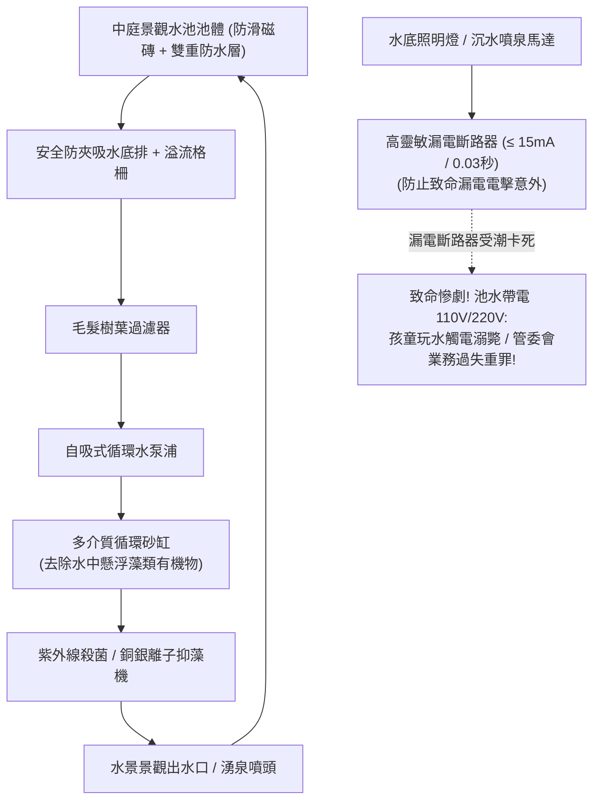

# 全案購屋實戰第三百一十六部：中古大樓社區中庭景觀水池循環過濾系統泵浦漏電斷路器失效池底防水破裂結構掏空與青苔滑倒體檢工序全書

## 壹、核心查驗宗旨與前言

在集合住宅的社區公共空間景觀規劃中，中庭或迎賓大廳外的「景觀水池、生態水景、人工瀑布與鏡面噴泉（Landscape Water Feature & Fountain System）」，常年被房仲業者視為營造高檔氣派質感、提升物件第一印象的「視覺行銷門面」。

然而，在屋齡 15 至 30 年的中古大樓中，中庭景觀水池往往是管委會最不願編列經常性維護預算、機電設備最隱蔽且暗藏致命公安風險的「美麗毒蘋果」：
1. **水景沉水馬達或水底高壓照明燈（Underwater Lights）之「漏電斷路器（Residual Current Circuit Breaker, RCCB / GFCI）」老化跳脫線圈受潮卡死**，一旦馬達絕緣擊穿漏電，整座景觀水池水體瞬間帶上高達 110V/220V 的致命電壓，孩童玩水嬉戲或長輩洗手極易引發「集體觸電痙攣溺水死亡」慘劇；
2. **水池結構底板與防水層（Waterproofing Membrane）因地震沉陷破裂**，高達數十噸的池水日夜沿著裂縫持續下滲，將大樓中庭地基土壤掏空（Soil Erosion & Cavity），甚至沿著樓板接縫直接灌入地下室停車場天花板，引發地下室大樑鋼筋鏽蝕鏽脹；
3. **循環過濾砂缸（Sand Filter）內部石英砂板結、水質發黑優養化（Eutrophication）滋生厚重青苔藻類**，池邊大理石與池底磁磚濕滑如抹油，住戶散步踏踩極易引發滑倒骨折重傷之公共安全侵權賠償訴訟；
4. **溢流管與補水管控制閥故障**，池水滿溢漫流中庭步道，引發一樓住戶大門進水災情。

本手冊為買方打造一套極具深度的「中庭景觀水池、循環過濾與防漏電防掏空全系統實地體檢工序」，結合現場三用電表漏電電壓實測、結構裂縫抓漏、管委會機電申報書覆核、商務砍價話術及特約條款保障，徹底防範公共安全意外侵權責任與避免數十萬元公設修繕分攤款。

---

## 貳、景觀水池循環系統技術構造與四大常見致命病灶

### 一、集合住宅中庭景觀水池水電技術規範
1. **RC 水泥水池槽體與雙重防水層（RC Basin & Dual Waterproofing）**：
   - 包含結構抗滲混凝土、聚氨酯（PU）或聚脲（Polyurea）彈性防水膜、高黏結抗裂水泥砂漿保護層及防滑磁磚飾面。
2. **水循環過濾與水質淨化系統（Circulation & Filtration Unit）**：
   - 包含池底落水吸水口（防毛髮吸入安全防夾格柵）、毛髮過濾器（Hair & Lint Strainer）、自吸式循環離心泵浦及石英砂/矽藻土過濾器。
3. **特種水底照明與超高靈敏漏電保護體系**：
   - 依法規規定，水下照明燈必須採用 **$12\text{V} \sim 24\text{V}$ 安全超低電壓（SELV）**，經由隔離安全變壓器供電；
   - 迴路必須配置高靈敏度高速型漏電斷路器（感度電流必須 $\le 15\text{ mA}$，動作時間必須 $\le 0.03\text{ 秒}$）。
4. **水位平衡控制與自動溢流補水閥組**：
   - 包含電極棒水位感知器（61F-G）、液壓自動補水電磁閥及防倒灌溢流管。

### 二、中古社區常見之四大致命病灶
1. **漏電斷路器老化受潮致使「池水帶電變成死刑水池」**：
   - 位於戶外配電箱內的漏電斷路器長年受潮，內部微動脫扣機構生鏽卡死。水底嵌燈橡膠接線防水套因紫外線老化龜裂，220V 高壓生水直接接觸銅線。斷路器毫無跳脫反應，整池水瞬間充滿高壓電流，住戶或孩童手指一碰池水瞬間觸電心室顫動溺斃，全棟管委會與所有區權人面臨高達千萬元之刑事與民事連帶賠償責任。
2. **池底裂縫漏水掏空中庭地基引發「塌陷危機」**：
   - 景觀水池多坐落於地下室頂板（即地下停車場天花板正上方）。歷經地震拉扯，水池底板防水層開裂。數十噸池水日夜向下方土壤滲漏，將覆土層的泥沙沖刷帶走，形成直徑數公尺的地下空洞（Cavity）。天花板樑柱出現密集鐘乳石狀白華結晶與鋼筋爆裂，隨時有覆土層坍塌砸毀地下室車輛之重大結構危險。
3. **循環砂缸長期不反洗引發「藻類毒水狂生」**：
   - 社區管理員完全不知如何反洗水池砂缸。過濾器完全失去效能，池水變成一灘死水，日光照射下綠藻、藍綠藻狂暴繁殖，水色混濁發臭呈墨綠色。藻類在池邊大理石步道分泌黏滑多醣體，住戶踩過如同溜冰，屢屢引發長輩摔倒頭部著地重大骨折。
4. **防吸入格柵脫落引發「水下抽吸卡人溺斃」**：
   - 循環水泵底排吸水口的防夾保護蓋板（Anti-Vortex Drain Cover）螺栓鏽斷脫落，形成一個裸露的大口徑吸水孔。循環泵運轉時產生極強大的水下負壓吸力，孩童手臂或頭髮一旦靠近瞬間被強力抽吸死死卡住，在水深僅 30 公分的水池中活活溺水身亡。

---

## 參、買方現場看屋之景觀水池五步實戰體檢工序

### 一、步驟一：水池外觀水質清澈度與防滑步道目視
- **水質成色與氣味檢驗**：走至中庭景觀水池邊：
  - 檢視池水是否清澈透亮、能清晰看見池底磁磚接縫；若水質呈現「墨綠色、發黃渾濁或漂浮死魚藻華」，代表循環系統早已廢棄停擺；
  - 嗅聞水體是否有刺鼻發酵臭氣或死水腥味。
- **池邊步道防滑度**：穿鞋底較平之鞋子輕輕踩踏池邊邊界石材，檢驗是否有滑膩黏手之厚重綠色青苔；水池周圍是否設有防滑標示與防墜矮護欄。

### 二、步驟二：水下照明與沉水泵浦漏電安全實測（專業驗屋絕技）
- **景觀控制箱與漏電斷路器開箱**：尋找中庭花圃旁的「景觀水電控制箱」：
  - 檢視控制箱內部是否乾燥、有無壁虎死屍或積水；
  - 找到標示「景觀泵浦」與「水底照明」之漏電斷路器（RCCB），手指按下測試鈕（TEST），開關必須在 **0.1 秒內「啪」一聲迅速彈開跳脫**；若按下後毫無反應，代表斷路器已死透！
- **三用電表/測電筆水體電壓快篩**：
  - 將數位三用電表切至交流電壓檔（AC 200V），黑色表筆接地，紅色表筆浸入池水中：
  - **安全標準**：水體感應電壓必須 **$< 1.0\text{V}$**；
  - **致命危險警報**：若量測出 **$> 12\text{V}$ 甚至高達數十伏特之交流電壓**，代表水中有設備嚴重漏電，屬於極度致命之殺人陷阱！

### 三、步驟三：池底落水防夾格柵與設備固定核查
- **水底吸水口防夾蓋板檢驗**：手電筒直射池底循環泵吸水孔：
  - 確認吸水孔上方是否牢固安裝金屬或高強度塑料「圓拱形防夾格柵（Anti-Entrapment Cover）」；
  - 嚴禁出現「裸露管孔直抽水流」的違規安裝！
- **水下電纜密封度**：檢視水下燈具之橡膠電纜，外皮是否有破損脫膠、接頭處是否灌滿環氧樹脂防水膠。

### 四、步驟四：地下室對應位置頂板漏水與掏空巡檢
- **地下室天花板定位查驗**：走到地下最上層（B1 或地下停車場），找到**對應中庭景觀水池正下方**之天花板區域：
  1. 抬頭檢視水泥頂板與大樑是否有大面積深色水漬、持續滴水或鐘乳石狀碳酸鈣白華結晶；
  2. 檢視梁柱交接處是否有因土壤掏空重力不均引發的垂直開裂；若地下室頂板漏水嚴重，代表**水池底板防水層已全面破裂**！

### 五、步驟五：管委會水質定期消毒維護工單覆核
委請仲介向管委會調閱：
1. **中庭水景定期維修合約單據**：確認社區是否每月委託合格水景維護廠商進行水質投藥抑藻、砂缸反洗與漏電檢測。
2. **社區公共意外責任險保單（Public Liability Insurance）**：核對保單是否在有效期限內，確認水景設施是否列入承保範圍，每一個人體傷保額是否達新台幣 **300 萬至 600 萬元以上**。

---

## 肆、商務談判博弈：景觀水池漏電漏水殺價 15 萬元實戰話術

整棟大樓中庭若需進行景觀水池池底全面敲除重施高規聚脲防水層、更換全套安全低壓 12V 水底燈、抽換工業級循環砂缸與高敏度漏電斷路器，總工程款高達 **新台幣 30 萬至 50 萬元**；且水池漏電更對全體住戶構成致命的侵權賠償風險。買方應將此嚴重的公共安全隱患作為議價砍價的重磅籌碼。

> **實戰談判對話劇本：**
> 「屋主您好、周小姐您好：
> 我們在實地勘查社區中庭景觀水池並走到地下室對應位置時，發現非常嚴重的公共安全與結構漏水隱患：水景控制箱內的漏電斷路器早已受潮故障卡死，按下測試鈕根本毫無跳脫反應；且走到地下室停車場一看，水池正下方的天花板長滿了密密麻麻的白華鐘乳石結晶，持續在滴漏銹水，池底防水層早已全面開裂破孔！更危險的是，水池長年不循環長滿厚重青苔，走在邊上極易滑倒骨折！
> 景觀水池是社區最危險的『隱形殺手』。漏電斷路器失效代表一旦水下燈具或馬達漏電，整座池水帶上高壓電，全家小孩在旁邊玩水失足就可能直接觸電身亡，全體區權人都要被連帶起訴業務過失重大刑責；且池底日夜漏水更在持續掏空中庭地基土壤，引發地下室頂板大樑鋼筋鏽蝕鏽斷，嚴重危及建築物結構壽命。
> 社區管委會若要徹底敲除重做防水層並全面抽換安全低壓水電設備，整棟每戶勢必得分攤數萬至十幾萬元的龐大修繕特別公費；這項公設瑕疵嚴重削弱了物業的安全性與市場評價。
> 為了承擔這項嚴重的公共安全責任風險與地基掏空修繕成本，我們堅持在買賣總價中直接扣除 **15 萬元** 作為公共水景安全補償與修復基金，否則面對一個可能電死人與地下漏水的物業，我們實在難以放心簽約。」

---

## 伍、買賣契約特約防守條款專用字軌

為杜絕買方交屋後承擔公共水景觸電意外賠償責任與高額防水重做分攤款，《不動產買賣契約書》應增列下列防禦條款：

> **【公共景觀水景設施安全合格保證與修繕工程清償條款】**
> 1. **水景設施防漏電與結構防滲合格保證**：賣方保證本買賣標的所屬大樓中庭景觀水池、噴泉水景及其水電循環設施（包含水下照明、循環泵浦、漏電斷路器及防夾安全底排），於交屋日前具備正常運作與防漏電保護功能，漏電斷路器跳脫靈敏正常，水池槽體無任何結構破裂漏水掏空中庭地基、或滲漏至地下室頂板之重大瑕疵，且無遭主管機關列管限期改善或處以罰鍰之情事。
> 2. **交屋前景觀水池修繕工程款清償義務**：若於交屋日（含）前，本社區管委會或區分所有權人會議已決議、或經主管機關通知限期辦理中庭水池全面敲除重做防水層、更換低壓照明、水電線路全面更新等重大工程者，其所需之一切工程款或特別徵收分攤費用，不論請款單開立於交屋日前或交屋日後，概由賣方於交屋尾款結算時全額負擔扣抵，買方不負任何清償責任。
