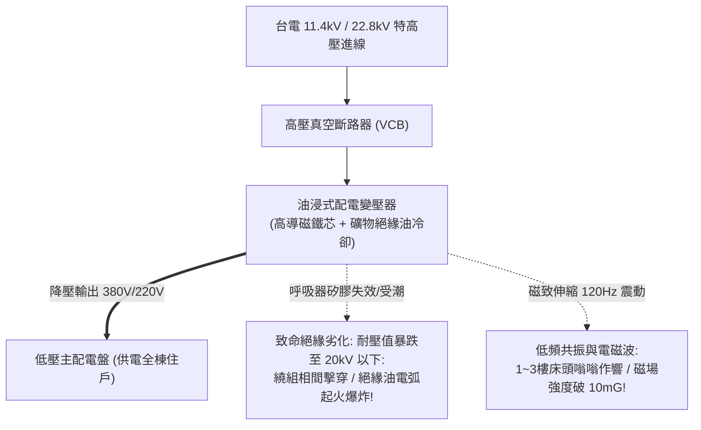

# 全案購屋實戰第三百一十四部：中古大樓社區地下室變電室油浸式變壓器絕緣油耐壓劣化油泥碳化PCB多氯聯苯殘留與低頻電磁波體檢工序全書

## 壹、核心查驗宗旨與前言

在現代集合住宅高層建築的受電配電體系中，由台電引入之高達 $11.4\text{ kV}$ 或 $22.8\text{ kV}$ 的特高壓電源，必須經過大樓地下室總變電室（Main Electrical Substation）內的「高壓配電變壓器（Distribution Transformer）」，降壓至 $380\text{V}/220\text{V}$ 或 $110\text{V}$，方能輸送給全棟各住戶及公設機電設備使用。

在屋齡 15 至 30 年的中古大樓中，建商為節省成本，絕大多數配置了**「油浸式變壓器（Oil-Immersed Transformer）」**。這類以礦物絕緣油（Mineral Insulating Oil）進行冷卻與絕緣的重型電氣設備，若常年運轉於地下室密閉通風不良、高溫潮濕的環境中，極易淪為暗藏毀滅性火災爆炸與人體健康危害的「公設核彈」：
1. **絕緣油耐壓強度（Dielectric Breakdown Voltage）嚴重劣化衰減、油泥碳化沉積**，在夏季全棟開冷氣滿載時，高壓繞組間極易發生「相間絕緣擊穿短路」，引發數千度電弧瞬間引燃絕緣油，引發整座地下室爆炸大火；
2. **早期 1980~1995 年代出廠之老舊油浸變壓器，絕緣油可能含有被國際列為一級致癌物之「多氯聯苯（PCB, Polychlorinated Biphenyls）」**，長期微漏揮發毒害地下室空氣；
3. **變壓器硅鋼片鐵芯（Silicon Steel Core）夾緊螺栓鬆動老化、磁致伸縮（Magnetostriction）引發強烈「120Hz 低頻電磁噪聲與共振」**，經由建築剪力牆與樓板向上穿透，造成 1 樓至 3 樓低樓層住戶客廳地面與臥室床頭常年感受到微幅震動與低頻蜂鳴；
4. **極低頻電磁波（ELF Magnetic Field）防護屏蔽層（Mu-Metal / Aluminum Shielding）偷工減料**，變電室正上方或相鄰住戶室內磁場強度飆破 $10 \sim 50\text{ mG}$（國際公認安全長期暴露標準為 **$\le 2.0\text{ mG}$**），長期暴露大幅增加住戶罹患白血病與神經系統病變風險。

本手冊為買方打造一套極具深度的「地下變電室油浸式變壓器與電磁波全系統實地體檢工序」，結合絕緣油耐壓報告審查、低頻電磁波高斯計現場量測、商務砍價話術及特約條款保障，徹底杜絕交屋後遭受變壓器爆炸停電浩劫、低頻噪音折磨與高強度電磁輻射危害。

---

## 貳、油浸變壓器電氣構造原理與四大常見致命病灶

### 一、集合住宅油浸式配電變壓器技術架構
1. **鐵芯與高低壓繞組（Core & Windings）**：
   - 採用高導磁冷軋取向硅鋼片疊積而成，繞組採用無氧銅線（OFC），高壓側通常為 Delta（$\Delta$）接法，低壓側為 Wye（$\text{Y}$）帶中性點接地接法。
2. **鋼板油箱與礦物絕緣油（Transformer Tank & Insulating Oil）**：
   - 油箱外部焊有波紋散熱片（Corrugated Radiator Fins），內部注入數百公升通過 IEC 60296 規範之未抑制或已抑制環烷基絕緣油，兼具「絕緣介質」與「導熱冷卻介質」雙重功能。
3. **儲油櫃與呼吸器（Conservator & Silica Gel Breather）**：
   - 吸收油溫熱脹冷縮之體積變化，呼吸器內裝變色矽膠乾燥劑，過濾吸入空氣中之水份。
4. **安全防爆保護裝置**：
   - **布氏繼電器（Buchholz Relay）**：裝於油箱與儲油櫃連通管間，感測內部電弧產生的微量瓦斯氣體或油流衝擊，觸發高壓 VCB 跳脫。
   - **機械防爆釋壓閥（Pressure Relief Valve, PRV）**：內部超壓時瞬時彈開釋壓，防止油箱炸裂。

### 二、中古社區常見之四大致命病灶
1. **呼吸器矽膠粉化受潮致使絕緣油「水分超標耐壓暴跌」**：
   - 地下室濕度常年超過 85%，呼吸器內的藍色矽膠顆粒早已吸飽水份轉為粉紅色甚至粉化泥濘，管委會數年未曾更換。潮濕空氣直接被吸入油箱，絕緣油微量水分（Water Content）飆破 $40\text{ ppm}$，耐壓擊穿電壓由出廠時的 **$50\text{ kV}$ 暴跌至不足 $20\text{ kV}$**。遇到雷擊突波或大樓用電突加，絕緣油瞬間擊穿導電，整台變壓器轟然爆炸。
2. **多氯聯苯（PCB）劇毒油料殘留歷史黑洞**：
   - 早期部分變壓器採用含有多氯聯苯（Aroclor）的抗燃油。台灣自 1988 年起全面禁用，但 30 年左右中古大樓變壓器若曾委託地下無照油行更換或濾油，極易混入殘留 PCB 之回收廢油。多氯聯苯為國際公認持久性有機污染物（POPs），熱解時產生劇毒戴奧辛（Dioxin），對住戶構成不可逆的致癌威脅。
3. **鐵芯夾件鬆脫引發「120Hz 低頻結構共振」**：
   - 變壓器長年處於 60Hz 交流磁場中，鐵芯交變磁化產生每秒 120 次的微幅伸縮（Magnetostriction）。固定鐵芯的穿心螺栓絕緣套管碳化碎裂、夾緊力下降，鐵芯產生劇烈蜂鳴共振。若變壓器底座未安裝重型低頻阻尼彈簧防震器，震動直接傳入地下室地坪與柱體，造成 1 至 3 樓低樓層住戶夜夜飽受低頻噪音折磨。
4. **低頻磁場洩漏導致正上方住戶「輻射超標數十倍」**：
   - 變電室天花板與周圍牆壁未施作「導磁鋼板或高導電鋁板磁場屏蔽（Magnetic Shielding）」。大電流流經變壓器低壓銅排產生高達數百微特司拉（$\mu\text{T}$）的強烈極低頻磁場，直接穿透 15cm 混凝土樓板。一樓住戶客廳沙發或臥室床頭實測磁場高達 $10 \sim 35\text{ mG}$，住戶長期處於超標電磁環境，引發慢性頭痛與免疫系統低下。

---

## 參、買方現場看屋之地下變電室五步實戰體檢工序

### 一、步驟一：變電室環境氣味與外圍防護巡檢
- **變電室位置確認**：走入地下室，尋找標示「高壓變電室」或「電氣機房」之防護鐵門：
  - 檢視門口是否有高壓危險警告標誌、門檻是否設置防鼠擋板（高度 $\ge 40\text{cm}$）；
  - **氣味嗅聞**：在門口深嗅空氣，是否有刺鼻酸臭的焦油味（絕緣油過熱碳化分解之氣味）。

### 二、步驟二：油浸變壓器外觀與油位呼吸器目視（需機電人員陪同開啟）
- **油箱外殼滲漏檢驗**：在保持安全防護距離下，手電筒照射變壓器波紋散熱片與高低壓套管（Bushing）：
  - 檢視散熱片焊道邊界是否有深黑油漬凝結、地面有無滴油接油盤；
  - 檢視高壓瓷瓶套管表面是否有厚重灰塵油垢（灰塵在高濕下極易引發沿面放電沿面跳火）。
- **油位計與呼吸器成色確認**：
  - **油位計（Oil Level Gauge）**：油位指針應位在正常環境溫度（$20^\circ\text{C} \sim 40^\circ\text{C}$）之刻度線內；若指針歸零或看不到油面，代表嚴重漏油！
  - **呼吸器矽膠（Silica Gel）**：乾燥顆粒應為深藍色；若已全面轉為**「粉紅色、淡白色或混濁發黑」**，代表水分早已灌入油箱，絕緣嚴重受潮！

### 三、步驟三：低頻電磁波高斯計實地現場量測（核心自衛神器）
- **高斯計量測點位規劃**：攜帶三軸極低頻電磁波檢測儀（ELF Gaussmeter，如 Lutron EMF-828）：
  1. 在變電室正門外 1 米處量測；
  2. **走到看屋物件室內（特別是 1 樓或 2 樓正對變電室上方之戶別）**，在客廳地面、沙發坐處、臥室床頭進行全面貼地與懸空量測：
  - **安全標準**：室內長期活動空間磁場強度必須 **$\le 2.0\text{ mG}$**（毫高斯）；
  - **超標危險警報**：若量測數值超過 **$4.0\text{ mG}$**，甚至逼近 **$10 \sim 30\text{ mG}$**，代表該物件受到地下變壓器強烈電磁波直射，屬於重大環境健康抗性！

### 四、步驟四：看屋室內 120Hz 低頻共振聽音與震動感應
- **低樓層靜止聽音**：在看屋室內緊閉所有門窗與電源：
  - 將耳朵緊貼室內地板或承重柱面，仔細感應是否有規律沉悶的「嗡——嗡——」持續性蜂鳴音；
  - 用手掌撫摸臥室床頭牆體，感受有無微細酥麻之低頻震顫感。

### 五、步驟五：管委會變壓器絕緣油檢驗報告與機電工單覆核
委請仲介向管委會調閱由經濟部檢驗認可之高壓檢驗機構出具的最新一期報告：
1. **絕緣油耐壓試驗（Dielectric Breakdown Voltage, ASTM D877）**：合格耐壓值必須 **$\ge 30\text{ kV}$**（新油應 $\ge 40\text{ kV}$，若低於 $25\text{ kV}$ 必須強制濾油或換油）。
2. **多氯聯苯（PCB）檢測報告**：必須檢附「PCB 含量未檢出（$\le 2.0\text{ ppm}$）」之合格報告，杜絕劇毒污染。
3. **油中溶解氣體分析（DGA, Dissolved Gas Analysis）**：核對乙炔（C₂H₂）、氫氣（H₂）含量，確認內部無局部放電或電弧放電徵兆。

---

## 肆、商務談判博弈：變壓器老化與電磁超標殺價 20 萬元實戰話術

整棟大樓地下變電室若需將老舊油浸式變壓器全面抽換為現代高安全之「難燃型模鑄式乾式變壓器（Cast Resin Dry-Type Transformer）」，並施作頂板低頻導磁合金防護屏蔽，工程款高達 **新台幣 50 萬至 80 萬元以上**；且若室內電磁波超標，更對房價帶來永久性的折價打擊。買方應將此致命的公共安全與健康隱患轉化為砍價殺手鐧。

> **實戰談判對話劇本：**
> 「屋主您好、周小姐您好：
> 我們在實地勘查社區地下室總變電室並以專業高斯計量測室內環境時，發現極具威脅的電力與健康瑕疵：地下室油浸式變壓器呼吸器矽膠早已粉化受潮死透，絕緣油滲漏嚴重，最新檢驗報告顯示耐壓值跌破 25kV 危險紅線；且我們手持高斯計測量，室內地板磁場強度飆破 12 毫高斯，遠遠超過國際安全標準 2 毫高斯達六倍以上，臥室更能清楚聽到變壓器 120Hz 傳導上來的低頻嗡鳴共振！
> 油浸變壓器耐壓劣化是地下室最大的『定時炸彈』。一旦夏季用電高峰發生相間擊穿，數百公升絕緣油會在地下室引發毀滅性大爆炸與大火，整棟大樓將面臨數週全面停電停水的癱瘓災難；而超標的低頻電磁波與低頻噪音更會日夜侵蝕全家老小的中樞神經與免疫系統，大幅增加罹病風險，這種重大的環境健康瑕疵在未來轉手時更是人人避之唯恐不及的致命抗性！
> 社區管委會若要將老舊油浸變壓器全面淘汰、換裝乾式防火變壓器並施作樓板防磁屏蔽，每戶勢必得分攤高達數萬至十幾萬元的龐大公設工程款。
> 為了承擔這項嚴重的電氣安全風險與全家人長期的健康折損，我們堅持在買賣總價中直接扣除 **20 萬元** 作為電磁波防護與變電設備安全補償款，否則面對一個隨時可能爆炸且電磁波超標的物業，我們實在不敢拿全家人的生命健康冒險簽約。」

---

## 伍、買賣契約特約防守條款專用字軌

為杜絕買方交屋後承擔變電室設備爆炸修繕與電磁輻射超標之損害，《不動產買賣契約書》應增列下列防禦條款：

> **【公共高壓變電設備安全合格與室內極低頻磁場安全保證條款】**
> 1. **變壓器設備安全運作保證**：賣方保證本買賣標的所屬大樓地下室之高壓配電變壓器及變電設備，於交屋日前運作健全，絕緣油耐壓數值符合國家電氣標準（實測耐壓值 $\ge 30\text{ kV}$，無多氯聯苯 PCB 毒害殘留），無任何油箱嚴重滲漏油、呼吸器失效、異常局部放電或結構性低頻共振之重大瑕疵，且無遭主管機關列管限期改善或處以停電處分。
> 2. **專有部分電磁場強度安全保證**：賣方保證本買賣標的專有部分室內長期活動空間（客廳、臥室），於交屋日前經實測極低頻電磁波（60Hz）磁場強度均符合環境保護與自住安全標準（全室平均磁場強度不大於 **$4.0\text{ mG}$**）。若交屋點交時經雙方指定之專業檢驗單位量測，室內臥室空間磁場強度持續超過 $10\text{ mG}$ 者，買方得主張按瑕疵比例減少買賣總價新台幣 **貳拾萬元整**，或得無條件單方解除契約並請求返還全部已付價金。
> 3. **交屋前變電設備更新工程款清償責任**：若於交屋日（含）前，本社區管委會或區分所有權人會議已決議辦理變電室變壓器全面更換、乾式變壓器改裝或防磁屏蔽工程者，其所需之一切工程款或特別徵收分攤費用，概由賣方於交屋尾款結算時全額負擔扣抵，買方不負任何清償責任。
