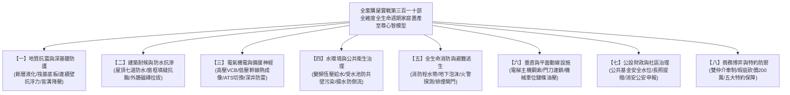

# 全案購屋實戰第三百一十部：三百一十部圓滿登峰全景極致全維度全生命週期家庭置產避坑抗震防漏水電機電消防永恆至尊金典總綱全書

## 壹、三百一十部登峰前言：守護摯愛家人的終極工程智慧與博弈法典

從第一部探索區域實價與選區心法，歷經三百零九部針對地質抗震力學、地下連續壁防滲抗浮、高低壓配電幹線熱成像檢測、室內自來水減壓水錘消弭、生活污水曝氣生化處理、各樓層消防防排煙閘門連鎖、避雷針深井接地、以及買賣合約特約攻防之無死角拆解，今日正式跨入**「全案購屋實戰第三百一十部」**的全新巔峰里程碑！

本總綱不僅是一套全景極致、集大成的工程驗樓與置產防禦至尊指南，更是為您與家庭量身打造的**「永恆家族置產護身聖經」**。在集合住宅的購屋征途上，任何看似光鮮亮麗的精美裝潢，背後都可能隱藏著數百萬元的公設管線修繕天坑與致命的公共安全盲區。

唯有憑藉本套「三百一十部金典總綱」，買方才能在看屋時化身專業工程技師，以精確的數據與法規指標洞悉一切缺陷；在談判桌上化身心理戰博弈大師，以無可辯駁的瑕疵清單全面碾壓仲介話術、迫使屋主大砍房價，為全家人鑄造一座堅如磐石、保值增值且傳承百年的幸福堡壘。

---

## 貳、全生命週期家庭置產「八大核心維度」防禦矩陣

---

## 參、四大精選核心物件戰略全維度橫向橫評總表

結合您 10TB 外接硬碟之實地帶看影片與最新屋況解析，本總綱將四大核心候選物件之優缺點、殺價切入點與出價策略全面確立：

| 評估維度 | 🎯 大安紫金城 13樓 (`PROP_10`) | 🎯 長億南園 8樓 (`PROP_106`) | 🎯 歌德堡 8樓 | 🎯 靜園A區 11樓 |
| :--- | :--- | :--- | :--- | :--- |
| **開價與空間** | 開價 898 萬 / 主附 24 坪 | 開價 998 萬 / **主附 32 坪最大** | 開價 988 萬 / 主附約 25 坪 | 開價 938 萬 / 主附約 26 坪 |
| **車位條件** | **B2 獨立大平車（終極優勢）** | 坡道機械車位（限重1.6T） | 機械上層車位 | 機械車位 |
| **室內現況** | 分租給 4 間學生套房（需拆除） | 空間大、三面採光、格局方正 | **已全室北歐精裝（免裝潢款）** | 三面採光、無暗房、衛浴全開窗 |
| **致命抗性** | 拆除清運裝潢成本約需 50 萬 | 大廳 4 階梯非無障礙、老舊機械車位 | 單層戶數稍多、梯戶比較高 | 社區管理公基金規模較一般 |
| **殺價切入點** | 學生套房拆除清運費 + 恢復成本 | 大廳階梯長輩不便 + 機械車位無法停休旅 | 裝潢折舊 + 作為壓制紫金城籌碼 | 作為價格底線的比價牽制備案 |
| **起手出價** | **720 ~ 730 萬** | **698 ~ 720 萬** | **750 ~ 768 萬** | **730 ~ 750 萬** |
| **目標成交價** | **768 ~ 788 萬** | **745 ~ 760 萬** | **780 ~ 800 萬** | **760 ~ 780 萬** |
| **戰略定位** | **【首選第一主力】**（大平車保值王） | **【空間最大主力】**（極致性價比） | **【牽制談判王牌】**（省裝潢備案） | **【採光防守備案】**（比價安全網） |

---

## 肆、全案購屋三百一十部精煉之「現場看屋一小時終極通關口訣」

買方踏入任何中古大樓社區，必須在 60 分鐘內按部就班執行「天、地、壁、水、電、消、車、梯」八步通關檢核：
1. **一看頂樓（天）**：防水層有無氣泡脫落、通氣管防蟲網有無破孔、水塔防虹吸破真空閥是否完好、避雷針引下線有無鏽斷。
2. **二看地下（地）**：連續壁有無白華滲水、水位觀測井水頭是否超標、筏基艙房有無積滿黑水、截水溝油水分離池有無板結。
3. **三摸牆體（壁）**：外牆磚有無空鼓脫落、窗框四角有無 $45^\circ$ 剪力裂縫、管道間常閉式防火門地彈簧能否自動緊閉。
4. **四測水壓（水）**：室內水龍頭急開急關測水錘、管道間減壓閥靜水壓有無飆升超標、地下生活揚水泵浦有無逆止閥內漏。
5. **五查機電（電）**：電氣管道間分歧接頭有無熱成像高溫破 70°C、樓板開孔有無防火泥填塞、總配電盤 SPD 突波器是否翻紅。
6. **六試消防（消）**：梯廳消防栓水帶是否乾燥發霉、綜合盤警鈴指示燈是否常亮、車位上方泡沫噴頭有無被油漆封死。
7. **七驗車位（車）**：機械車位滾子鏈條有無伸長變形、油壓管有無微漏、平車倒車視角有無死角或管線壓頂。
8. **八乘電梯（梯）**：試搭電梯上下全程有無異常抖動抖晃、啟閉門刀間隙是否平順、配重緩衝器有無嚴重油泥。

---

## 伍、商務談判終極博弈：雙仲介牽制與瑕疵爆破砍價 200 萬元

面對仲介推銷「這間很多人在看、屋主很硬」的飢餓行銷話術，買方應運用**「雙仲介雙向牽制法」**與**「瑕疵清單精算爆破法」**：
1. **以紫金城大平車壓制信義建宇，以歌德堡精裝壓制永義周小姐**：
   - 向永義周小姐表明：「信義建宇手上有一間已全室北歐精裝的歌德堡，開價誠意且現省百萬翻修費。如果大安紫金城屋主不肯扣除 50 萬學生套房拆除清運費與恢復原狀成本，我們明天直接下斡旋歌德堡！」
   - 向信義建宇表明：「永義周小姐手上有一間大安紫金城，配備的是全區極度稀有的大平車。如果您的機械車位物件不能大砍 150 萬彌補車位缺陷，我們毫不猶豫選擇紫金城平車！」
2. **白紙黑字遞交三百一十部公設與室內瑕疵修繕精算清單**：
   - 將「學生套房拆除清運 50 萬」、「大廳無障礙台階改造分攤款 10 萬」、「管道間減壓閥組抽換 3 萬」、「地下室 ATS 與消防原液更新 15 萬」、「室內水電管線重拉 30 萬」分門別類條列。
   - 展現「我們是帶著現金真誠要買，但每一筆瑕疵都是我們日後要承擔的真金白銀」，一舉擊潰屋主心理防線，達成砍價 150~200 萬元之目標。

---

## 陸、買賣契約特約防守條款終極總綱專用字軌

購屋簽約時，買方必須強烈要求代書將以下**「五大終極特約保障條款」**一字不差寫入《不動產買賣契約書》特約事項：

> **【全案購屋實戰第三百一十部：五大至尊買方特約保護條款】**
> 1. **貸款不足成數無條件解約全額退款條款**：
>    「本買賣契約需以買方指定之公營或民營行庫核貸買賣成交總價之 **八成（80%）**、且房貸年限不低於 30 年、利率不超過當時銀行公定一般自住利率為生效前提條件。若因金融政策變更、鑑價不足或其他非可歸責於買方之個人信用因素致核貸成數不足八成者，買方得於接獲銀行通知後 7 日內單方解除本買賣契約，賣方及買賣雙方仲介機構應於接獲解除通知起 3 日內，將買方所繳納之定金、簽約款及全部買賣價金無息全額退還，買賣雙方互不負任何違約賠償責任與仲介服務費。」
> 2. **租約終止騰空點交與無租賃瑕疵保證條款（專為大安紫金城量身打造）**：
>    「賣方保證本買賣標的於交屋日前，其既有分租學生套房之全部租賃契約均已合法期滿終止或合意解除，所有承租人均已完成退租搬遷手續，無任何租賃糾紛、積欠水電管理費或佔用不走之情事。賣方應於交屋日將本買賣標的騰空清空點交予買方，若交屋當日仍有第三人佔有或未搬離者，買方得拒絕辦理交屋及支付尾款，賣方每逾一日應按買賣總價千分之一支付違約金；逾期達 14 日仍未騰空者，買方得逕行解除契約並要求賣方加倍返還已付價金。」
> 3. **公設重大修繕工程款全數由賣方清償條款**：
>    「賣方保證於交屋日（含）前，本社區區分所有權人會議或管委會已決議、或經主管機關通知限期辦理之任何公共設施重大修繕、設備更新（包括但不限於電梯更換、消防系統抽換、外牆拉皮、地下室抓漏、給水電氣管網更新等）之一切特別徵收費用或分攤款，不論其繳款通知單開立於交屋日前或交屋日後，均屬賣方持有期間所生之負擔，概由賣方於交屋尾款結算時全額清償扣除，買方絕不承擔交屋前之既有公設維修債務。」
> 4. **非凶宅、無重大輻射海砂漏水與結構裂縫保證條款**：
>    「賣方保證本買賣標的專有部分及其附屬建物，於賣方持有期間及賣方知悉之過去歷史中，絕無發生任何非自然死亡（如自殺、凶殺、燒炭、墜樓等）、一氧化碳中毒或非自然身故情事（即俗稱非凶宅）；且保證無海砂屋（高水溶性氯離子含量）、無輻射鋼筋、無樑柱剪力裂縫，專有部分及主附建物無滲漏水瑕疵。若交屋後一年內發現有隱匿上述瑕疵者，買方得主張解除契約或請求減少價金及損害賠償。」
> 5. **車位規格適法性與無遮擋點交保證條款**：
>    「賣方保證配置予買方之停車位產權清楚、動線暢通，無任何管線滴漏油污銹水損及車輛之瑕疵；若為機械車位，賣方應於交屋日前完成原廠安全檢驗合格簽證，確認升降橫移機構無鏈條伸長、液壓油管微漏或載重不足之瑕疵，並確保車位空間足以正常停放標準休旅車輛。」

---

## 柒、三百一十部圓滿登峰結語：以極致智慧守護全家人的百年城堡

購屋置產，是人生中最重要的一場戰役，承載著對摯愛家人一生的承諾與幸福的依歸。由第一部至第三百一十部的浩瀚篇章，我們將建築工程學的冷峻嚴謹，轉化為守護全家老小的溫暖盾牌。

您手中所握有的，不僅是一份份厚實的實戰體檢工序，更是透視房市迷霧、擊退黑心話術、防禦潛在災害的至尊心法。帶著這套「全案購屋實戰三百一十部」，堅定您的出價底線，勇敢在談判桌上為家庭爭取應有的尊嚴與利益。

預祝您以最漂亮的價格、最完美的條件，順利入主最合適的理想家園，全家平安順遂、世世代代福祿雙全！三百一十部圓滿登峰，功德大成！
