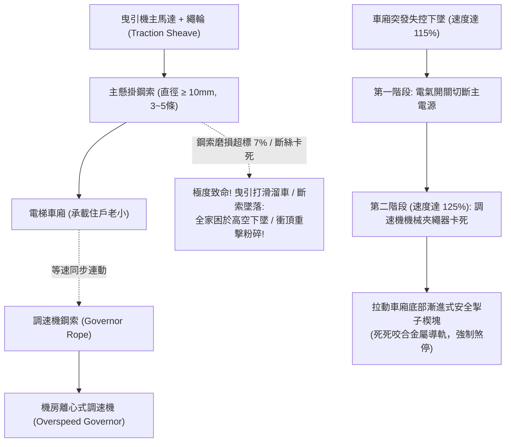

# 全案購屋實戰第三百二十一部：中古大樓社區各樓層電梯昇降路鋼索磨損直徑縮減繩槽V型底刻磨耗調速機夾繩器鈍化與防超速安全掣子體檢工序全書

## 壹、核心查驗宗旨與前言

在集合住宅的垂直交通核心體系中，電梯是每天承載全家老小數十次上下樓層的特種承載設備。而支撐電梯車廂與對重平衡、確保電梯不致於發生失控下墜或極速衝頂慘劇的最關鍵「機械物理防線」，正是懸掛於機房主機與車廂之間的**「主鋼索（Main Hoisting Ropes）」**、**「調速機（Overspeed Governor）」**以及車廂底部的**「安全掣子（Safety Gear / Wedge Clamp）」**。

在屋齡 15 至 30 年的中古大樓中，電梯主機與鋼索懸掛系統常年處於「管委會缺乏重件更新預算、保養廠商僅點油擦拭、金屬疲勞隱蔽衰退」的高危險邊緣：
1. **電梯主懸掛鋼索（通常為 3 至 5 條複合鋼索）長期受摩擦拉伸，直徑磨損縮減超過原廠直徑的 7% 至 10%**，鋼索內部麻芯失油乾枯、外層鋼絲大量斷絲（Broken Wires），極易在滿載時發生突發性崩斷；
2. **曳引機鑄鐵繩輪（Traction Sheave）之 V 型/半圓形繩槽（Rope Grooves）不均勻偏磨硬化**，各鋼索張力嚴重失衡，部分鋼索發生嚴重「打滑打溜（Slipping）」，引發煞車煞不住或高空溜車；
3. **機房超速調速機之離心甩塊受油泥卡阻、夾繩機械鉗口（Rope Gripper）鈍化**，當車廂超速下墜時無法在第一時間夾死調速鋼索；
4. **安裝於車廂底部的漸進式/瞬時式安全掣子楔形制動塊（Safety Wedges）長年鏽蝕咬死**，調速鋼索拉動提拉連桿時，掣子無法順利卡死於主導軌上，失去最後一道防墜煞車防線。

本手冊為買方打造一套極具深度的「電梯鋼索磨損、繩輪槽、調速機與防墜安全掣子全系統實地體檢工序」，結合游標卡尺量測標準、斷絲判讀法規、調速機跳脫測試核查、商務砍價話術及特約條款保障，徹底杜絕交屋後承擔數十萬元電梯大修分攤款與家人搭梯失控之恐懼。

---

## 貳、電梯鋼索防墜與調速掣子構造原理與四大常見致命病灶

### 一、集合住宅電梯主懸掛與超速防墜技術架構
1. **曳引鋼索與曳引輪（Hoisting Ropes & Traction Sheave）**：
   - 採用 $8 \times 19$ 或 $8 \times 25$ 高抗拉複合鋼索（直徑通常為 $10\text{mm} \sim 12\text{mm}$），內含浸油劍麻繩芯（Sisal Core），安全係數依法規必須達 **10 以上**。
2. **超速調速機（Centrifugal Overspeed Governor）**：
   - 透過封閉環狀的調速鋼索隨車廂同步運轉。當車廂下行速度超過額定速度的 **$115\%$** 時，首先觸發電氣超速開關切斷馬達電源；若速度繼續攀升達到 **$125\%$** 時，機械棘爪咬死夾繩器，迫使調速鋼索停止。
3. **安全掣子連動機構（Safety Gear & Lifting Linkage）**：
   - 包含漸進式安全掣子（Progressive Safety Gear），利用調速鋼索拉力拉動連桿，將兩側高硬度合金楔塊楔入導軌與車廂底樑之間，藉由極大的摩擦阻力在數公尺內將滿載車廂平穩卡死在導軌上。
4. **對重側反向防衝頂保護（Ascending Car Overspeed Protection, ACOP）**：
   - 防止對重塊重力拉扯引發車廂失控向上極速「衝頂撞毀」。

### 二、中古社區常見之四大致命病灶
1. **主鋼索「斷絲起毛球、直徑縮減」瀕臨斷裂邊緣**：
   - 中古大樓鋼索運轉超過 15 年，麻芯潤滑油完全乾涸，鋼絲之間乾磨產生「赤色氧化鐵粉（紅銹）」。外層鋼絲在一個節距內斷裂超過 10 根以上，鋼絲末端翹起如同毛球，鋼索直徑由原本的 $12\text{mm}$ 縮減至不足 $10.5\text{mm}$（直徑縮減超過 $7\%$ 即達法定強制報廢標準）。滿載時安全係數跌破危險邊緣，隨時有崩斷危險。
2. **曳引輪繩槽磨損深度不均導致「曳引力喪失打溜」**：
   - 繩輪繩槽鑄鐵硬度退化，各繩槽磨損深淺不一，造成各鋼索受力極度不均。部分鋼索懸空、部分受力過載。電梯在滿載下行煞車時，鋼索在繩槽中如同溜冰般持續打滑，煞車距離大幅拉長，車廂越過平層線硬砸底坑緩衝器。
3. **調速機夾繩鉗口卡滿乾硬油泥「夾不住鋼索」**：
   - 機房常年通風不良、粉塵堆積，調速機的離心飛錘與夾繩鉗齒（Jaws）被厚重老舊油泥黏死。當車廂發生溜車超速時，飛錘無法及時甩開，夾繩器無法咬死調速鋼索，整個防墜煞車聯鎖程序全面癱瘓。
4. **安全掣子連桿與導軌導靴鏽死「拉不動楔塊」**：
   - 電梯底坑潮濕或受地下水微滲影響，車廂底部的安全掣子連動轉軸與回復彈簧生鏽抱死。就算上方調速鋼索死命向上拉扯，底部生鏽的連桿紋絲不動，楔塊無法滑入導軌間隙，車廂直接高速撞擊底坑。

---

## 參、買方現場看屋之電梯鋼索與防墜機構五步實戰體檢工序

### 一、步驟一：電梯機房主機與主懸掛鋼索目視（需管委會或機電陪同）
- **鋼索表面潤滑與紅銹檢驗**：手電筒照射曳引機上方之懸掛鋼索：
  - 鋼索表面應呈現微薄的均勻油光、無積存黏稠黑泥；
  - **嚴格檢視是否有「大量紅褐色鐵鏽粉末（Red Rust Dust）」噴灑在機房地板或主機基座上**！若有大量紅銹，代表內部麻芯已徹底乾死、鋼絲正處於內部摩擦自毀狀態；
  - 檢視鋼索外層是否有細小鋼絲「斷裂翹起（起刺）」現象。
- **鋼索直徑游標卡尺量測標準**：
  - 標準鋼索直徑磨損縮減極限：不得小於原公稱直徑的 **$93\%$**（例如 $12\text{mm}$ 鋼索實測小於 **$11.16\text{mm}$** 必須強制報廢）。

### 二、步驟二：曳引輪繩槽（Sheave Grooves）磨耗落差核查
- **繩槽不均勻沉陷檢測技巧**：
  - 檢視各條鋼索埋入繩輪槽體的深度是否一致；
  - 以直尺水平橫跨在所有鋼索頂端，檢視是否有某條鋼索深陷凹落、高低差超過 **$1.5\text{mm}$**；
  - 檢視繩槽底部是否有金屬刮削剝落的銀色碎屑。

### 三、步驟三：調速機（Governor）外觀與手動甩塊靈活度核查
- **調速機外觀成色**：檢視機房地面之超速調速機：
  - 離心旋轉盤上的兩只平衡重錘與拉簧表面是否乾淨、無厚重黑油泥黏滯；
  - 檢視調速機鉛封（Lead Seal）是否完好，確認原廠校正未被私自調整；
  - 手動輕輕撥動離心重錘，手感應輕盈順暢且能被彈簧俐落拉回。
- **電氣超速開關（Governor Switch）**：確認微動開關外殼無破碎、導線接頭牢固。

### 四、步驟四：看屋室內與搭乘時「鋼索打滑抖晃實測」
- **極限煞車與平層頓挫感體驗**：
  1. 走入車廂搭乘至高樓層，在車廂高速煞車平層停靠瞬間，體會腳底是否有二次「微幅彈跳（Bouncing）」或「上下晃動沉陷」；
  2. 聆聽車廂運行過程中，井道內是否有鋼索拍打導軌的「啪、啪」抽打異音（代表鋼索張力嚴重不平衡）。

### 五、步驟五：管委會特種設備定期檢驗合格證與鋼索報告覆核
委請仲介向管委會調閱：
1. **電梯年度安全檢驗申報書（昇降設備安全檢查表）**：核對「懸掛鋼索」檢查項目：
   - 鋼索直徑實際量測數據；
   - 鋼索一個節距內斷絲數量（依規定 $8\times 19$ 鋼索在一個節距內斷絲超過 12 根即判定不合格）；
   - 調速機動作速度與安全掣子動作試驗合格章。
2. **鋼索抽換歷史紀錄**：電梯主鋼索標準使用壽命為 **8 至 10 年**，若大樓已運轉超過 15 年從未換過全套主鋼索，買方必須承擔大修分攤款。

---

## 肆、商務談判博弈：電梯鋼索老化殺價 15 萬元實戰話術

整棟大樓若需將電梯主懸掛鋼索全套抽換（4至5條進口鋼索）、曳引機繩輪重新車削或更換全新繩輪組，並重新校正調速機與安全掣子，工程款動輒高達 **新台幣 25 萬至 40 萬元**；且鋼索嚴重磨損對全家人每天上下樓更是隨時致命的人命盲點。買方應將此嚴重的公設特種設備缺陷作為砍價殺手鐧。

> **實戰談判對話劇本：**
> 「屋主您好、周小姐您好：
> 我們在實地勘查電梯機房並調閱電梯年度安檢報告時，發現極度危險的人命安全與重大修繕隱患：電梯主懸掛鋼索已經使用超過十五年從未更換，鋼索表面大量冒出紅色鐵鏽粉末，游標卡尺量測直徑磨損已逼近 7% 的法定報廢極限，且多處鋼絲已經斷裂起刺；曳引機繩輪槽體磨損嚴重不均，電梯在高速煞車時有明顯的打滑頓挫晃動！
> 電梯鋼索是全家老小每天懸在半空中的『唯一生命懸線』。鋼索麻芯乾枯嚴重磨損代表隨時有斷絲崩斷的巨大危險，一旦高速打滑溜車或安全掣子卡死，整台車廂將在垂直井道失控下墜砸向底坑，造成車內老小粉身碎骨的滅頂慘劇；且這項重大特種設備缺陷屬於檢查機構隨時勒令停用的列管項目。
> 社區管委會若要委託原廠大廠全面抽換全套主懸掛鋼索、重車曳引輪並做全負載防墜落煞車演練，整棟每戶勢必得分攤大筆修繕特別公費；且買方全家每天搭乘都要承擔墜梯卡梯的巨大心理恐懼。
> 為了承擔這項致命的公共交通安全風險與家庭生命防護保障，我們堅持在買賣總價中直接扣除 **15 萬元** 作為電梯鋼索大修折讓與安全補償款，否則面對一個隨時可能失控墜落的物業，我們實在不敢拿全家人的性命冒險簽約。」

---

## 伍、買賣契約特約防守條款專用字軌

為杜絕買方交屋後承擔電梯主機大修停擺與安全事故之責任，《不動產買賣契約書》應增列下列防禦條款：

> **【公共昇降設備主鋼索與防墜防超速安全合格保證條款】**
> 1. **電梯懸掛與防墜系統合格保證**：賣方保證本買賣標的所屬大樓之電梯設備主懸掛鋼索、曳引輪、超速調速機及安全掣子防墜機構，於交屋日前具備合法有效之「建築物昇降設備使用許可證」，鋼索磨損直徑縮減率在法定安全容許範圍內（直徑磨損小於 $7\%$，無嚴重斷絲起毛或紅銹腐蝕），調速防墜連鎖反應靈敏，無任何打滑溜車或煞車頓挫之重大瑕疵，且無遭主管機關列管限期更換鋼索或處以停用處分。
> 2. **交屋前電梯重大大修工程款清償義務**：若於交屋日（含）前，本社區管委會或區分所有權人會議已決議、或經昇降設備安全檢查協會通知限期辦理電梯主鋼索全套更換、曳引輪翻新更換、調速機安全掣子大修等重大工程者，其所需之一切工程款、零件費或特別徵收分攤費用，不論請款單開立於交屋日前或交屋日後，概由賣方於交屋尾款結算時全額負擔扣抵，買方不負任何清償責任。
