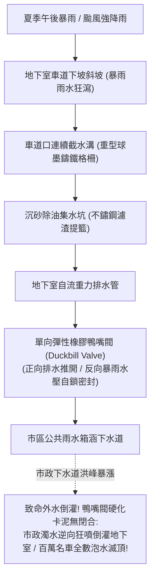

# 全案購屋實戰第三百二十七部：中古大樓社區地下室截水溝重油污泥沉積堵塞防回湧鴨嘴閥橡膠硬化與高壓水刀清淤體檢工序全書

## 壹、核心查驗宗旨與前言

在現代集合住宅地下停車場的排水防洪與車道地坪維護體系中，設置於坡道出入口下方、地下各層停車迴車道轉折處以及垃圾冷藏處理室外的**「車道截水溝（Trench Drain System）」**與排出口端的**「單向防倒灌鴨嘴閥（Duckbill Backflow Check Valve）」**，是大樓抵禦突發性短時暴雨雨水倒灌、收集車輛底盤滴漏重油，以及防範外部市政雨水下水道洪峰倒噴的「地下第一道防波堤」。

然而，在屋齡 15 至 30 年的中古大樓中，地下室截水溝常年淪為物業清潔的「掃地垃圾桶」與長年不見天日的「污泥盲區」：
1. **車輛底盤滴漏之機油、煞車油與地表灰塵細砂長年混合發生皂化反應，在溝底硬化沉積成「深黑如瀝青之堅硬油膏塊」**，有效過水深度由原先 20cm 驟降至不足 3cm，每逢夏季突發性強降雨，雨水漫過鑄鐵格柵直沖地下二樓及三樓；
2. **排出口配置之「三元乙丙（EPDM）或氯丁橡膠防倒流鴨嘴閥」長年浸泡在化學酸油廢水中，橡膠嚴重水解硬化脆裂、閥嘴被硬化碎石泥膏永久撐開無法密合**；
3. **當外部市政排水溝因颱風暴雨水位暴漲時，道路黃泥濁水沿著排水管「逆向狂噴倒灌（Back-Siphonage Flooding）」回大樓地下室**，短短二十分鐘內將停放百萬休旅車與電動車的地下停車場淹成水庫，造成數千萬元之車輛滅頂與公共財產毀滅；
4. **截水溝熱浸鍍鋅格柵固定角鋼基座鏽蝕斷裂**，重車輾壓時發出震耳欲聾的金屬碰撞巨響，甚至格柵斷裂翻轉刺破輪胎引發翻車意外。

本手冊為買方打造一套極具深度的「地下車道截水溝底泥硬化、防倒灌鴨嘴閥橡膠老化與高壓水刀清淤工序全系統實地體檢工序」，結合現場溝槽探針測泥、鴨嘴閥唇口密合檢核、防汛擋水演練單據覆核、商務砍價話術及特約條款保障，徹底杜絕交屋後承擔地下室泡水滅頂之災與數十萬元公設防汛修繕攤派債務。

---

## 貳、地下截水溝與防倒灌鴨嘴閥構造原理與四大常見致命病灶

### 一、集合住宅地下車道截水溝與防洪排澇技術規範
1. **重型車道截水溝槽（Heavy-Duty Trench Drain System）**：
   - 溝槽深度通常為 $200\text{mm} \sim 350\text{mm}$，寬度為 $300\text{mm} \sim 450\text{mm}$，溝底具備 $1.0\% \sim 2.0\%$ 之洩水縱坡（Slope），上方覆蓋具備耐受 20 噸以上輪壓之球墨鑄鐵重型格柵（Ductile Iron Grating）。
2. **防倒灌單向橡膠鴨嘴閥（Rubber Duckbill Check Valve）**：
   - 全橡膠複合構造（無任何活動機械鉸鏈與金屬彈簧，免除生鏽卡塞），利用正向微水壓（約 $25 \sim 50\text{ mmAq}$）即可推開唇口自然排水；遭遇反向外部高水壓時，水壓反向擠壓外部錐形唇壁，達成 $100\%$ 嚴密自鎖密封，耐受反向水壓達 $1.0 \sim 3.0\text{ kgf/cm}^2$。
3. **沉砂除油收集坑（Catch Basin & Sump Pit）**：
   - 配置不鏽鋼活動式提籃濾網（Removable Stainless Strainer Basket），攔截大顆粒砂石泥塊，防止砂泥直接衝入地下提升排澇泵浦。
4. **電動防汛擋水閘門連鎖（Motorized Flood Gate）**：
   - 位於車道出入口，當截水溝高水位浮球感應淹水時，連鎖聲光報警並自動升起鋁合金防汛擋板。

### 二、中古社區常見之四大致命病灶
1. **重油污泥硬化板結致使「有效過水深度剩不到 3 公分」**：
   - 社區物業清潔工日常拖地直接將黑水倒入截水溝，車輛底盤滴漏的機油、防凍液與泥沙長年沉澱。油泥在溝底發生高溫氧化聚合反應，硬化板結成堅硬的「黑色石油瀝青膏」，將原本深達 25 公分的溝槽填平了 22 公分。遇瞬間豪大雨時，截水溝瞬間滿溢，暴雨水如瀑布般直接越過截水溝灌入地下二樓與三樓停車位。
2. **鴨嘴閥唇瓣橡膠老化硬化被石塊「死死卡住門戶大開」**：
   - 排出口端的純橡膠鴨嘴閥，在地下室潮濕與廢機油化學侵蝕下，橡膠完全喪失原有之柔韌回彈力，硬化變脆。被車流帶入的細碎石塊或樹枝順水衝入，正好卡在扁平的鴨嘴唇口中央，將閥門硬撐開一道幾公分寬的空隙。當外圍市政道路積水倒灌時，鴨嘴閥完全喪失反向自鎖密封功能，外部道路的滾滾黃泥水夾帶下水道垃圾，以每秒數噸之流量逆向狂噴倒灌入大樓地下室。
3. **鑄鐵格柵基座角鋼腐蝕斷裂「輪胎輾過瞬間翻翻塌陷」**：
   - 預埋於混凝土溝沿的鍍鋅角鐵，在長年雨水與洗車清潔劑浸泡下電化腐蝕殆盡，角鋼生鏽斷裂脫落。重型休旅車每次開過，鑄鐵格柵發出震耳的金屬撞擊悲鳴，格柵在溝內左右滑移；一旦重車輾壓邊緣，格柵瞬間翹起翻轉，鋒利的鑄鐵角直接刺破汽車輪胎甚至造成底盤懸吊斷裂。
4. **沉砂坑不鏽鋼提籃被垃圾堵死引發「泵浦空轉過載燒毀」**：
   - 截水溝末端沉砂坑內的不鏽鋼濾網提籃超過一年無人清理，被落葉、塑膠袋與爛抹布徹底包覆糊死。排水水流無法流入抽水坑，整座沉砂池滿溢漫流；而抽水坑內的排澇泵浦在無水冷卻狀態下頻繁啟停乾磨，機械軸封燒熔短路。

---

## 參、買方現場看屋之截水溝與防倒灌鴨嘴閥五步實戰體檢工序

### 一、步驟一：地下車道出入口截水溝外觀與踩踏檢核
- **格柵表面與平整度目視**：步行走下地下室車道口坡道最下緣轉折處：
  - 檢視球墨鑄鐵格柵表面是否有斷裂裂紋、嚴重變形下陷；
  - 檢視格柵與周邊柏油地坪是否有超過 **$10\text{mm}$ 之落差**。
- **踩踏穩固度與金屬異音檢測**：雙腳用力踏踩每塊格柵：
  - 格柵應緊密平穩服貼於溝沿，無任何晃動或翹起；
  - **嚴格檢視是否有「金屬強烈碰撞鏘鏘巨響」**！若有巨響或晃動，代表底座角鋼已鏽蝕斷裂。

### 二、步驟二：截水溝內部淤泥厚度探針實測（專業驗屋絕技）
- **手電筒照射與深溝探針量測**：透過格柵縫隙，手電筒垂直照射溝底：
  1. 檢視溝底是否有肉眼可見的水泥底面與平順水流；
  2. 使用金屬探針或長螺絲起子穿過格柵孔洞插向溝底油泥層：
     - **合格標準**：淤泥厚度應小於 **$20\text{mm}$**，探針應能直抵堅硬的水泥溝底；
     - **嚴重堵塞警報**：若探針插入深度超過 **$100\text{mm}$** 依然是黏稠阻力、甚至格柵下方已被黑色厚重油泥填滿，代表**該溝槽早已喪失防洪導流機能**！

### 三、步驟三：沉砂池不鏽鋼提籃濾網開蓋核查
- **沉砂集水井人孔開啟**：在車道轉折處找到截水溝匯流之沉砂井蓋：
  - 開啟蓋板，檢視內部不鏽鋼攔污網籃是否完好懸掛於支架上；
  - 檢視網籃內部是否清理乾淨、無堆積如山的落葉與爛泥；
  - 檢視沉砂池底是否有超過 $30\text{cm}$ 以上的淤沙沉澱。

### 四、步驟四：排出口防倒灌橡膠鴨嘴閥物理狀態實檢
- **鴨嘴閥安裝位置尋訪**：至地下室外圍排出口排水陰井處，找到安裝於出水管口的綠色或黑色橡膠鴨嘴閥：
  - **唇口閉合緊密度檢驗**：用手輕捏橡膠閥體，橡膠應富有彈性；目視扁平的「雙唇吻合線（Sealing Lips）」是否在無水流時完全密貼閉合；
  - **卡石清除檢驗**：**嚴格確認唇口內是否有碎石塊、泥餅卡住**！若唇口被異物撐開一道裂縫，代表防倒灌防護完全失守。

### 五、步驟五：管委會高壓水刀通溝紀錄與防汛演練工單覆核
委請仲介向管委會調閱：
1. **截水溝高壓水刀清淤工單**：依法規與防汛標準物業規範，大樓在每年梅雨與颱風汛期前（約 4 至 5 月），應委託專業高壓水刀清淤廠商對車道截水溝進行一次徹底的「高壓水刀除油沖洗通管」（清洗水壓通常達 $150 \sim 250\text{ bar}$）。
2. **防汛擋水閘門組裝演練紀錄**：確認社區每年是否進行車道口電動/手動擋水閘門安裝測試，防水膠條是否完好未老化。

---

## 肆、商務談判博弈：截水溝嚴重淤泥卡阻殺價 15 萬元實戰話術

整棟大樓地下室若需委託水刀工程團隊進行車道口與地下各層截水溝全線高壓水刀深層除油清淤、重新焊接更換鏽斷之鍍鋅基座角鋼、抽換全新進口單向橡膠鴨嘴閥並翻新沉砂坑不鏽鋼提籃，工程款動輒高達 **新台幣 25 萬至 40 萬元**；且截水溝淤塞與鴨嘴閥卡死代表暴雨天地下室隨時面臨滅頂泡車之巨大財產損失。買方應將此嚴重的公共防汛機電瑕疵轉化為砍價殺手鐧。

> **實戰談判對話劇本：**
> 「屋主您好、周小姐您好：
> 我們在實地勘查社區地下車道截水溝並用探針量測時，發現非常嚴重的公設防汛與淹水死穴：車道出入口下方的截水溝底已被瀝青狀黑油膏徹底封死，淤泥厚度居然超過十五公分，過水深度只剩不到五公分；格柵基座角鋼早已鏽爛，車子開過發出巨大金屬碰撞聲；更致命的是，排出口的單向防倒灌橡膠鴨嘴閥早已硬化脆裂，唇口被大石塊死死卡住門戶大開，完全沒有任何防倒灌功能！
> 車道截水溝與防倒灌鴨嘴閥是地下室唯一的『防洪防波堤』。截水溝淤死加上鴨嘴閥卡死，代表只要台中遇到午後強降雨或颱風暴雨，外面馬路的滾滾黃泥水會直接從排出口逆向狂噴倒灌回大樓地下室，短短二十分鐘內整個地下室車道就會變成汪洋一片，我們停在裡面的百萬名車會瞬間變成滅頂泡水車，造成全家人難以承受的財產巨損；且基座角鋼斷裂更隨時可能刺破進出輪胎引發嚴重事故！
> 社區管委會若要徹底調派超高壓水刀車全面清管除油泥、重新開挖焊接基座角鋼並換裝全新工業級橡膠防倒灌閥，整棟每戶勢必得分攤大筆修繕特別公費；這項防汛缺陷嚴重威脅了物業的安全評價。
> 為了承擔這項致命的地下淹水滅頂風險與全家人財產安全的防護補貼，我們堅持在買賣總價中直接扣除 **15 萬元** 作為地下截水防汛修復折讓款，否則面對一個下大雨隨時可能泡水滅頂的物業，我們實在不敢貿然簽約。」

---

## 伍、買賣契約特約防守條款專用字軌

為杜絕買方交屋後承擔地下室淹水泡車損害與防汛設備大修攤派責任，《不動產買賣契約書》應增列下列防禦條款：

> **【公共地下車道截水排水與防倒灌防汛合格保證條款】**
> 1. **截水溝與防倒流設備正常防汛功能保證**：賣方保證本買賣標的所屬大樓地下車道出入口及各層停車場之截水溝槽、球墨鑄鐵格柵、沉砂坑不鏽鋼提籃及排出口防倒灌橡膠鴨嘴閥，於交屋日前具備正常導水、防洪排澇及有效阻斷外水逆灌功能，溝底無嚴重油泥沉積板結堵塞、格柵平整牢固無翻轉斷裂、防倒流鴨嘴閥唇口閉合緊密無卡塞失效，且無因截水溝失效引發地下室淹水之重大瑕疵。
> 2. **交屋前防汛截水整修工程款清償義務**：若於交屋日（含）前，本社區管委會或區分所有權人會議已決議辦理全棟地下室截水溝高壓水刀清淤除油、格柵基座角鋼重新焊接翻新、防倒灌鴨嘴閥抽換更換等重大工程者，其所需之一切工程款、零件費或特別徵收分攤費用，不論請款單開立於交屋日前或交屋日後，概由賣方於交屋尾款結算時全額負擔扣抵，買方不負任何清償責任。
