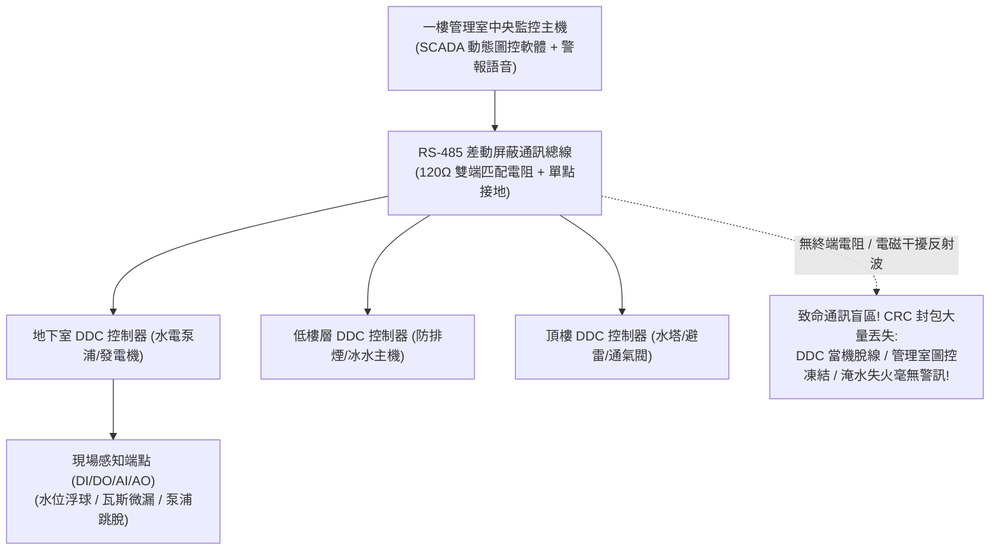

# 全案購屋實戰第三百二十三部：中古大樓社區地下室中央監控系統DDC直接數位控制器主板老化當機RS-485通訊迴路雜訊阻抗失配與消防警報跳線屏蔽體檢工序全書

## 壹、核心查驗宗旨與前言

在現代集合住宅高層建築的智慧化管理與機電防災大腦中，「中央監控與建築自動化系統（Building Automation System, BAS / Central Monitoring System, CMS）」是負責將全棟地下室泵浦、給排水位、發電機狀態、各樓層火警移報、機械防排煙風機以及門禁監控連鎖，整合顯示於管理室中控電腦的「電子中樞神經系統」。

這套系統的核心運作基石，是分散安裝於地下機房與各樓層弱電箱內的**「DDC 直接數位控制器（Direct Digital Controller）」**，並透過**「RS-485 / Modbus / BACnet 工業級通訊總線迴路」**將現場數千點數位輸入（DI）、數位輸出（DO）、類比輸入（AI）訊號實時回傳至防災監控主機。

然而，在屋齡 15 至 30 年的中古大樓中，中央監控系統往往常年處於「主機當機藍屏、螢幕滿江紅警報、管委會完全放棄維修」的腦死狀態：
1. **DDC 控制器主機板之微處理器（MCU）與電解電容長年處於地下高溫高濕環境中老化漏液，頻繁無預警「當機死機（Freezing / Watchdog Trip）」**，導致現場泵浦溢水或高架水塔見底時，管理室毫無警訊；
2. **RS-485 串列通訊雙絞線未採用專用遮蔽線（Shielded Twisted Pair, STP）、末端未配置「$120\,\Omega$ 終端電阻（Terminating Resistor）」造成嚴重阻抗失配（Impedance Mismatch）與信號反射波（Signal Reflection）**，通信封包錯誤率（CRC Error）高達 30% 以上，圖控螢幕上的開關狀態「群魔亂舞、忽亮忽滅」；
3. **更駭人聽聞的是，部分中古大樓因老舊感知器常態性誤報引發警報狂叫，總幹事或外包廠商竟私自將火警與設備警報之輸入接點「用銅線跨接跳線或在軟體設定中遮蔽屏蔽（Bypass / Masking）」**，使監控主機陷入「盲人裝睡」的極度危險假象；
4. **控制訊號線與高壓電線同穿一管，強烈電磁脈衝在訊號線中感應出破壞性突波電壓，將 DDC 通訊晶片（RS-485 Transceiver）直接打穿燒毀**。

本手冊為買方打造一套極具深度的「中央監控系統、DDC 控制板、RS-485 通訊與防跳線假警報全系統實地體檢工序」，結合管理室圖控畫面診斷、DDC 控制箱硬體檢核、通訊信號示波分析原理、商務砍價話術及特約條款保障，徹底防範機電全盲風險與避免數十萬元公設智慧監控系統重置分攤債務。

---

## 貳、中央監控 BAS 與 DDC 控制系統技術構造與四大常見致命病灶

### 一、集合住宅中央監控與建築自動化技術架構
1. **中央防災監控主機（Central Workstation & SCADA Server）**：
   - 配置於一樓警衛室或防災中心，安裝動態圖控軟體，提供 24 小時設備運轉監控、歷史警報趨勢紀錄（Event Log）與遠端排程控制。
2. **DDC 直接數位控制器（Direct Digital Controller）**：
   - 內置 32 位元工業級微處理器、RTC 即時時鐘、SRAM 備援電池及光電隔離 I/O 模組（DI/DO/AI/AO），具備脫機獨立運作（Stand-alone Control）能力。
3. **RS-485 工業級通訊總線（RS-485 Industrial Bus Network）**：
   - 採用半雙工平衡差動傳輸（Differential Signaling），線路必須使用 $120\,\Omega$ 特性阻抗之雙絞屏蔽電纜，於幹線最遠兩端並聯 $120\,\Omega$ 終端匹配電阻，總線長度最長可達 1,200 米。
4. **現場感知與執行元件（Field Sensors & Actuators）**：
   - 包含水塔超高低水位電極、泵浦過載乾接點（Auxiliary Contact）、發電機運轉信號、防火閘門極限微動開關及電動閥門比例致動器。

### 二、中古社區常見之四大致命病灶
1. **DDC 主板濾波電容乾涸爆漿引發「看門狗頻繁當機」**：
   - 地下室機房環境溫度常年高達 $35^\circ\text{C} \sim 40^\circ\text{C}$，DDC 模組電源電路上的鋁電解電容壽命急劇縮減，電容頂部防爆閥鼓起漏液，紋波電壓暴增。微處理器因電源不穩頻繁觸發看門狗重置（Watchdog Reset）或直接鎖死當機。現場即便地下室受水池早已暴溢淹水，DDC 卻因當機完全無法向管理室送出中斷警報。
2. **通訊總線缺少 $120\,\Omega$ 終端電阻引發「信號反射震盪」**：
   - 早期水電工不諳高頻傳輸線理論，認為「只要線通了就能動」，在數百公尺長的 RS-485 總線末端未加裝 $120\,\Omega$ 匹配電阻，甚至拉出多個星狀分歧死線（T-Taps）。信號在傳輸線末端發生強烈反射，與原發信號相互疊加抵消，形成嚴重的信號反射畸變，圖控螢幕上所有水泵狀態頻繁「離線（Offline）與上線（Online）」交替跳動。
3. **警報點被維修工「違法軟體屏蔽或硬體短路」**：
   - 某棟高架水塔的超高水位電極老化生鏽，每晚持續誤報「水塔溢水」，蜂鳴器響徹管理室。夜班保全因無法入睡，私自要求機電外包技師在 DDC 接線端子上「用迴紋針直接短路跳線」，或在圖控軟體後台將該點位直接打勾「屏蔽停用（Point Disabled）」。整棟大樓從此失去該公設的即時守護，水塔真正爆裂大漏水時管理室毫無動靜。
4. **遮蔽層雙端接地引發「地迴路雜訊電流燒毀晶片」**：
   - 遮蔽電纜的接地金屬屏蔽層（Shielding），法規嚴格要求只能在「中央主機端單點接地（Single-Point Grounding）」。水電工便宜行事在各樓層 DDC 箱內皆隨意搭鐵接地，引發兩端地電位差產生高達數安培的地迴路循環電流（Ground Loop Current），在雷雨天直接將 DDC 主板上的 MAX485 通訊晶片擊穿炸裂。

---

## 參、買方現場看屋之中央監控與 DDC 系統五步實戰體檢工序

### 一、步驟一：一樓管理室中央監控主機動態圖控畫面核查
- **螢幕運轉狀態檢驗**：在看屋時藉故進入一樓管理室，目視中央監控電腦螢幕：
  - **圖控動態更新確認**：檢視螢幕右下角系統時間是否正在秒數跳動（防止畫面實質上早已「死機凍結」）；
  - **設備離線率判讀**：檢視圖控總覽畫面，全棟泵浦、風機、水塔圖標是呈現正常的「綠色（待機/運轉）」，還是大面積閃爍代表通訊中斷的**「灰色/紅色離線（Offline / Comm Error）」**；若離線率超過 $20\%$，代表中央監控通訊網絡早已實質癱瘓！
- **歷代警報日誌（Alarm Event Log）調閱**：點開「即時警報清單」：
  - 檢視是否有大量「連續未清除的誤報警報」被長期忽略；
  - 檢視是否有被紅字標記為「Disabled（已屏蔽/停用）」之關鍵消防或給排水端點。

### 二、步驟二：地下室 DDC 控制箱硬體外觀開箱核查
- **DDC 控制箱位置尋訪**：在地下室揚水泵浦機房或總變電室牆面，找到標示「DDC 控制箱」之金屬烤漆箱體。
- **開箱目視（需機電人員開啟）**：
  - **電源與運轉指示燈（PWR & RUN LED）**：綠色電源燈必須常亮，「RUN」運轉指示燈應規律均勻閃爍（代表微處理器正在正常執行邏輯循環）；若 RUN 燈長亮不閃或熄滅，代表**微處理器早已死機當機**！
  - **通訊燈號（TX / RX LED）**：通訊傳送（TX）與接收（RX）指示燈應高速密集閃爍，代表正在與管理室進行即時數據交換；
  - **主板電容外觀**：檢視印刷電路板上的圓柱狀電解電容，頂部是否有凸起鼓脹或底部淡黃色漏液痕跡。

### 三、步驟三：RS-485 差動通訊電纜接線與終端電阻檢核
- **屏蔽電纜規格核查**：檢視接入 DDC 通訊埠（A+、B-、COM）之電線：
  - 標準必須採用金屬鋁箔與銅編織雙重遮蔽之專用通訊電纜（外皮印有 RS-485 或 Belden 9841 等字樣）；
  - **嚴格檢視是否用「普通電話花線或紅白普通電線」隨意串接**！普通無遮蔽電線抗干擾能力極差。
- **終端電阻（$120\,\Omega$）存在性查驗**：檢視位於總線最末端之最後一台 DDC 控制器，其通訊端子 A 與 B 之間是否並聯了一顆標稱值為 **$120\,\Omega$（色環為棕紅棕金）的金屬皮膜電阻**。

### 四、步驟四：現場手動啟停設備與管理室圖控「連鎖回傳實測」
- **極限聯鎖回傳測試技巧（需仲介或機電配合）**：
  1. 在地下室給水機房，手動按下 1 號生活給水泵浦之「強制啟動」按鈕；
  2. 立即透過手機通話向管理室確認：管理室圖控螢幕上的 1 號泵圖標能否在 **1 至 2 秒內** 即時由灰色變為「綠色旋轉運轉」，並跳出「泵浦運轉」之狀態紀錄；
  3. 手動關閉泵浦，觀察圖控能否同步恢復靜止；若現場馬達已狂轉數分鐘，管理室螢幕依然顯示靜止離線，代表**該迴路訊號完全中斷**！

### 五、步驟五：管委會中央監控軟硬體維護合約與點位清單覆核
委請仲介向管委會調閱：
1. **BAS 建築自動化系統年度維護保養合約單據**：確認社區是否與專業弱電系統整合商簽訂常態性維護合約，維護範圍是否涵蓋「DDC 主板更換與點位校正」。
2. **全棟監控點位表（I/O Point List）**：核對全棟設計之點位總數（如 128 點或 256 點），確認實際在線點位比例是否達 **$90\%$ 以上**。

---

## 肆、商務談判博弈：中央監控系統腦死癱瘓殺價 15 萬元實戰話術

整棟大樓若需將全棟老化當機之 DDC 控制器全面更換為現代 BACnet/IP 工業級控制器、重新敷設雙重遮蔽通訊電纜並重新校正中央圖控軟體點位，工程款動輒高達 **新台幣 30 萬至 60 萬元**；且中央監控系統實質癱瘓代表全棟公設處於「機電全盲、火警失靈」的極度危險盲區。買方應將此嚴重的公共機電缺陷轉化為砍價殺手鐧。

> **實戰談判對話劇本：**
> 「屋主您好、周小姐您好：
> 我們在實地勘查管理室中央監控電腦並打開地下室 DDC 控制箱時，發現非常嚴重的公共機電腦死缺陷：一樓管理室的圖控電腦螢幕上大面積閃爍離線紅字，系統時間早已凍結當機；且地下室 DDC 控制板的微處理器運轉燈完全不閃、電容嚴重鼓脹漏液，通訊線上連一顆基本的 120 歐姆終端電阻都沒有裝，現場抽水馬達開了管理室根本完全不知道！甚至好幾個關鍵的消防與水塔警報點位在軟體後台都被直接遮蔽屏蔽！
> 中央監控是大樓所有公設的『大腦神經』。中央監控癱瘓代表整棟大樓的大火、淹水與跳電防護全部失靈，地下室受水池爆裂淹水或高架水塔見底，管理室完全看不到半點警報；一旦發生火災，排煙閘門與加壓風機無法即時自動聯鎖連線，全體住戶都將被困在濃煙中！這種『假智慧、真全盲』的公設缺陷，隨時引發數百萬元的公設泡水滅頂災難。
> 社區管委會若要全面重置全棟 DDC 控制板、重拉通訊幹線並重新委託軟體工程師撰寫圖控系統，整棟每戶勢必得分攤數萬至十幾萬元的龐大機電特別公費；這項缺陷嚴重削弱了物業的管理品質與市場評價。
> 為了承擔這項嚴重的公共機電失控風險與全棟自動化重置成本，我們堅持在買賣總價中直接扣除 **15 萬元** 作為中央監控系統修復與智慧化重置補貼款，否則面對一個機電隨時失控且無人知曉的物業，我們實在不敢貿然簽約。」

---

## 伍、買賣契約特約防守條款專用字軌

為杜絕買方交屋後承擔中央監控系統大修重置之高額分攤費與機電失控風險，《不動產買賣契約書》應增列下列防禦條款：

> **【公共中央監控與建築自動化系統正常運作保證條款】**
> 1. **中央監控與 DDC 系統功能正常保證**：賣方保證本買賣標的所屬大樓之一樓管理室中央防災監控主機、動態圖控軟體、各樓層 DDC 直接數位控制器及 RS-485/BACnet 通訊迴路網，於交屋日前具備正常連線與即時信號回傳功能，無任何 DDC 控制板嚴重當機壞死、通訊大面積離線中斷、火警或給排水關鍵警報點位人為短路屏蔽之重大瑕疵，圖控在線率達法規及原廠設計標準。
> 2. **交屋前中央監控整修工程款清償義務**：若於交屋日（含）前，本社區管委會或區分所有權人會議已決議辦理全棟中央監控主機更新、DDC 控制板全面抽換、通訊線路重新穿線或圖控系統重置等重大工程者，其所需之一切工程款、軟體授權費或特別徵收分攤費用，不論請款單開立於交屋日前或交屋日後，概由賣方於交屋尾款結算時全額負擔扣抵，買方不負任何清償責任。
