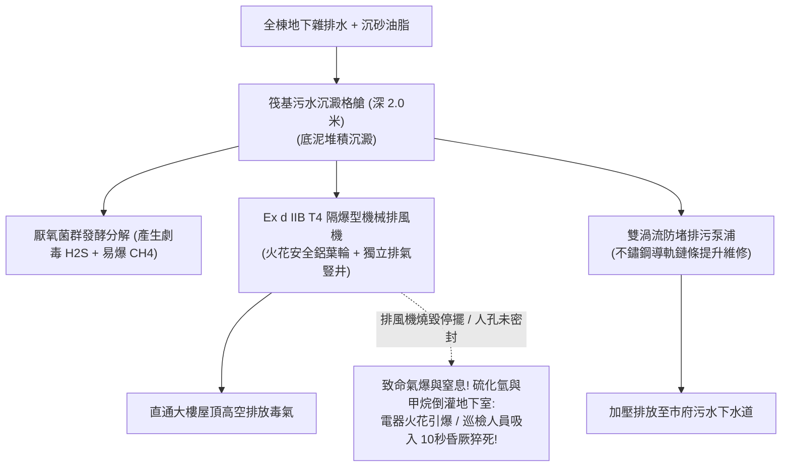

# 全案購屋實戰第三百二十二部：中古大樓社區地下室筏基污水沉澱池底泥板結厭氧發酵沼氣溢出與防爆型排風機故障體檢工序全書

## 壹、核心查驗宗旨與前言

在現代集合住宅高層建築的深基礎結構與公共衛生排污體系中，設置於地下最底層、深入筏式基礎地樑格艙之內的**「筏基污水沉澱收集池（Basement Raft Foundation Sewage Sedimentation Pit）」**，是匯集全棟數百戶居民每日衛浴雜排水、地下室洗車污水與公共排廢的「地下終極沉積槽」。

沉積於池底的泥沙、菜渣、毛髮與油脂，在長期密閉、缺氧的環境中，會產生劇烈的生化反應。然而，在屋齡 15 至 30 年的中古大樓中，筏基污水沉澱池常年深埋於黑暗地下室死角，往往成為管委會最不願花錢清淤抽泥、管理員最害怕接近的「致命沼氣地獄」：
1. **池底無機細砂與凝固油脂混合沉積，硬化板結成深達數十公分厚之「堅硬固化油泥層」**，佔據池體超過 $60\%$ 的有效蓄水容積，沉水排污泵浦吸入口被泥膏硬生生埋死，排水機能徹底癱瘓；
2. **固化底泥在無氧環境下被厭氧菌瘋狂分解發酵，持續產生大量具備「極高爆炸性」的甲烷氣體（CH₄，爆炸極限 5%~15%）與具備「急性神經劇毒性」的硫化氫氣體（H₂S，致死濃度僅需 500ppm）**，沿著混凝土微裂縫與未密封人孔瘋狂逸出；
3. **專用於排放地下沉殿池毒氣之「防爆型軸流排風機（Explosion-Proof Exhaust Fan）」馬達線圈進水受潮燒毀、防爆控制開關跳脫**，抽風完全停擺；
4. **高濃度腐蝕性酸氣將地下室配電盤銅排、電纜外皮與周邊金屬水管電化腐蝕殆盡**，更暗藏機電人員巡檢開啟開關時產生電弧火花引發地下室大氣爆的滅頂危機。

本手冊為買方打造一套極具深度的「地下筏基污水沉澱池底泥板結、沼氣濃度與防爆排風全系統實地體檢工序」，結合便攜式四合一氣體探測器實測、底泥探針厚度量測、防爆排風機手動測試、商務砍價話術及特約條款保障，徹底防範致命沼氣中毒與避免數十萬元公設清淤修繕分攤債務。

---

## 貳、筏基污水沉澱池與沼氣防爆排風技術架構與四大常見致命病灶

### 一、集合住宅筏基污水沉澱與防爆通風技術架構
1. **鋼筋混凝土筏基地樑沉澱格艙（Raft Foundation Sump Cell）**：
   - 利用筏基結構樑自然分隔之深格艙（深通常為 $1.5\text{m} \sim 2.5\text{m}$），內壁塗刷耐酸鹼環氧樹脂（Epoxy）防腐層，池底設置 $45^\circ$ 導流斜面與沉砂坑。
2. **重載無堵塞型污水泵浦（Non-Clog Submersible Sewage Pumps）**：
   - 採用半開式或渦流式（Vortex）葉輪，配置雙重碳化矽（SiC）機械軸封及耐腐蝕不鏽鋼導軌升降系統（Guide Rail System）。
3. **防爆型機械通風抽氣系統（Explosion-Proof Ventilation System）**：
   - 排風機馬達必須具備 **Ex d IIB T4 防爆認證**（隔爆型防爆等級），葉輪採用防火花鋁合金或黃銅材質，防止摩擦產生機械火花；配置防爆穿線管與防爆密封接線盒。
4. **密閉式鑄鐵人孔蓋與防臭氣密迫緊（Air-Tight Sump Access Hatch）**：
   - 人孔蓋邊框嵌入耐油耐酸之氟橡膠（FKM）或氯丁橡膠密封墊圈，以不鏽鋼螺栓緊固，防止劇毒氣體外洩。

### 二、中古社區常見之四大致命病灶
1. **底泥固化板結厚達 1 米致使「水泵吸入口完全活埋」**：
   - 中古大樓自交屋以來超過 15 年從未委託清底水刀清淤。沉澱池底的細泥砂、毛髮與油脂鈣化成黑如瀝青之堅硬泥塊，池深 2 米的格艙被固化油泥塞滿 1.2 米以上。沉水泵浦葉輪被死死咬在泥膏中，送電瞬間馬達堵轉過熱燒燬，地下廢水滿溢至地下室車道。
2. **防爆排風機軸承卡死致使「毒氣在地下室悶成炸藥庫」**：
   - 負責排除沉澱池毒氣的防爆軸流風機，因常年抽吸高濃度濕腐硫化氫氣體，外殼螺栓生鏽、鋁合金葉輪被油泥包裹失衡，防爆馬達軸承抱死燒毀。管理室控制盤警報長鳴，總幹事不諳電氣直接將警報音關閉。沉澱池內產生的甲烷與硫化氫無處宣洩，順著未封嚴的人孔縫隙滲入地下三樓停車場，空氣中甲烷濃度飆升逼近 $5\%$ 爆炸下限。
3. **劇毒硫化氫氣體引發「巡檢人員急性閃電型猝死」**：
   - 硫化氫氣體密度高於空氣，常年沉積在地下室低窪處與筏基孔洞。當濃度超過 $100\text{ ppm}$ 時，人體嗅覺神經瞬間被麻痺，反而聞不到臭味；一旦濃度飆升至 $500 \sim 1,000\text{ ppm}$，任何人探頭吸入一口氣，呼吸中樞神經在 10 秒內麻痺昏厥，心臟驟停猝死（即工安史上最駭人的閃電型窒息）。
4. **酸性沼氣腐蝕地下室大樑鋼筋與配電盤導線**：
   - 硫化氫與空氣中水氣結合成稀硫酸，將地下室天花板水泥中性化，混凝土大面積酥鬆剝落、鋼筋生鏽暴脹爆開；相鄰的低壓配電箱銅排表面結滿厚重黑色硫化銅（CuS），接觸電阻劇增引發電器起火。

---

## 參、買方現場看屋之筏基沉澱池五步實戰體檢工序

### 一、步驟一：地下最底層環境氣味與空氣品質初篩
- **極度關鍵嗅聞鑑別**：走至地下最底層（如 B3 或 B4 停車場角落或洗車區）：
  - 嗅聞空氣是否有刺鼻的「臭雞蛋味、臭下水道泥腥味或爛白菜酸腐味」；
  - 檢視靠牆角地面與水溝邊是否有白粉狀結晶或發黑油泥滲出痕跡。
- **金屬銅件氧化成色檢核**：檢視附近配電箱或弱電箱內的黃銅接地排：
  - 正常銅排應為亮黃色或微暗；
  - **若黃銅表面呈現「煤炭般的焦黑色（硫化反應）」**，代表地下室長期籠罩高濃度腐蝕性硫化氫毒氣！

### 二、步驟二：便攜式四合一氣體探測器實地探測（核心自衛神器）
- **手持四合一氣體檢測儀檢測（專業驗屋絕技）**：手持開機校正完成之氣體檢測儀（監測 O₂、CO、H₂S、LEL 可燃氣）：
  1. 走到筏基沉澱池人孔蓋接縫處與排風豎井周邊；
  2. **安全標準**：
     - 可燃氣體（LEL / 甲烷）：必須為 **$0\%$**；
     - 硫化氫（H₂S）：必須為 **$0\text{ ppm}$**（長期容許上限 $\le 10\text{ ppm}$）；
     - 氧氣濃度（O₂）：必須維持在 **$20.9\%$ 正常水平**；
  3. **致命危險警報**：若探測器發出劇烈紅光警報、H₂S 數值超過 **$15\text{ ppm}$** 或 LEL 超過 **$5\%$**，代表**環境存在急性中毒與氣爆風險，應立即退避**！

### 三、步驟三：筏基人孔密封橡膠圈與螺栓緊固核查
- **人孔蓋物理狀態檢核**：
  - 檢視沉澱池金屬人孔蓋邊緣是否有厚實的黑色橡膠密封迫緊墊圈；
  - 檢視四周緊固螺栓是否全數鎖緊對稱固定（嚴禁出現人孔蓋隨意虛掩或留有數公分開口的危險違規）；
  - 檢視人孔蓋表面是否有嚴重鏽穿孔洞。

### 四、步驟四：防爆排風機機房與手動運轉測試
- **防爆標識與外觀檢驗**：尋找地下室之「污廢水專用排風機房」：
  - 檢視排風機本體銘牌，確認是否清楚鑄有「Ex」防爆標誌與防爆等級（Ex d IIB T4）；
  - 檢視馬達穿線金屬管是否有防爆隔離密封防爆盒（Sealing Fitting）。
- **手動強啟運轉聽音**：在控制盤將排風機旋鈕短暫切至「手動（MANUAL）」啟動：
  - 觀察排風機葉輪能否在 **2 秒內** 順暢高速旋轉，出風口應有強烈排風風流；
  - 聆聽馬達與葉輪運轉聲，聲音應為平順氣流風聲，嚴禁有金屬刮擦異音或軸承卡阻嗡鳴聲。

### 五、步驟五：管委會筏基清淤工程合約與危險作業申報書覆核
委請仲介向管委會調閱：
1. **筏基污水池定期水刀高壓清淤清運工單**：依法規與常規物業維護，大樓應每 **1 至 2 年** 委託合法抽泥環保公司進行一次深層水刀抽泥作業（需檢附合法廢棄物清運聯單）。
2. **局限空間作業安全演練日誌**：確認社區在清淤與檢修時，是否落實強制通風與氣體監測之工安標準。

---

## 肆、商務談判博弈：筏基沉澱池底泥板結殺價 15 萬元實戰話術

整棟大樓地下最底層若需進行筏基沉澱池全區高壓水刀深層清淤、抽除數十噸硬化黑油泥、全面更換防爆型排風機組與重施防爆電氣迴路，工程款動輒高達 **新台幣 25 萬至 45 萬元**；且致命沼氣蓄積對全體車主與大樓結構更暗藏隨時氣爆的滅頂隱患。買方應將此嚴重的公共安全瑕疵轉化為砍價殺手鐧。

> **實戰談判對話劇本：**
> 「屋主您好、周小姐您好：
> 我們在實地勘查社區地下最底層並攜帶專業氣體檢測儀檢測時，發現極度恐怖的工安與致命沼氣隱患：地下室角落的筏基沉澱池人孔蓋螺栓鬆脫，儀器實測居然測出微量硫化氫毒氣與可燃性甲烷氣體！且地下排風機房的防爆排風機早已燒毀停擺長達數年，沉澱池底泥沉積板結深達一米以上，沉水排污泵浦根本已經被油泥活埋！
> 筏基污水沉澱池底泥板結是整棟大樓的『地下毒氣炸彈』。厭氧發酵產生的硫化氫只要濃度稍微升高，任何人在地下室走動都可能瞬間神經麻痺昏厥猝死；而甲烷氣體如果持續在密閉地下室蓄積，遇到車輛發動電火花或電表箱跳電，瞬間就會引發整座地下室大氣爆，把整棟大樓的地基底板震裂炸毀！更別提強酸沼氣正在日夜腐蝕地下室大樑鋼筋，嚴重危及建築物結構壽命。
> 社區管委會若要徹底清抽數十噸固化底泥、重裝隔爆型排風機並重新做好全池氣密防爆工程，整棟每戶勢必得分攤大筆修繕特別公費。
> 為了承擔這項致命的公共安全與人命防護風險，我們堅持在買賣總價中直接扣除 **15 萬元** 作為地下防爆修復與深層清淤折讓款，否則面對一個地下室可能隨時氣爆與溢出毒氣的物業，我們實在不敢拿全家人的性命冒險簽約。」

---

## 伍、買賣契約特約防守條款專用字軌

為杜絕買方交屋後承擔地下室沼氣氣爆、工安意外責任與高額清淤攤派費，《不動產買賣契約書》應增列下列防禦條款：

> **【公共筏基污水沉澱設施安全合格與防爆排風保證條款】**
> 1. **筏基污水池與防爆排風正常運作保證**：賣方保證本買賣標的所屬大樓地下室之筏基污水沉澱池、排污泵浦、防爆排風機及氣密人孔蓋設施，於交屋日前具備正常排污與安全通風功能，無任何底泥嚴重板結淤塞、泵浦燒毀、硫化氫劇毒氣體或甲烷易燃氣體超標外洩之重大瑕疵，空氣品質符合職業安全衛生法規及室內空氣品質標準，且無遭環保、消防或工務主管機關列管限期改善或處以罰鍰。
> 2. **交屋前筏基清淤與防爆整修工程款清償義務**：若於交屋日（含）前，本社區管委會或區分所有權人會議已決議辦理地下筏基沉澱池高壓清淤抽泥、防爆排風機更換、防爆電氣系統整修等重大工程者，其所需之一切工程款、廢棄物清運費或特別徵收分攤費用，不論請款單開立於交屋日前或交屋日後，概由賣方於交屋尾款結算時全額負擔扣抵，買方不負任何清償責任。
