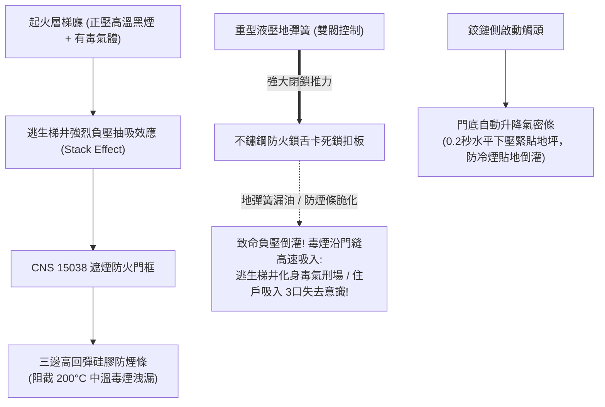

# 全案購屋實戰第三百二十五部：中古大樓社區各樓層管道間常閉式防火門遮煙性能老化漏煙地彈簧阻尼失效與梯間負壓抽吸毒煙倒灌體檢工序全書

## 壹、核心查驗宗旨與前言

在集合住宅的建築防火區劃與高樓火災垂直避難安全體系中，分隔各樓層梯廳走廊與安全逃生梯間的**「常閉式遮煙防火門（Normally Closed Smoke Barrier Fire Door，具備 CNS 15038 遮煙性能認證）」**，是阻絕火場高溫劇毒氣體侵入避難走道的「絕對屏障」。

高層建築火災水力學與煙氣流體力學（Smoke Dynamics）表明，火災發生時，整棟大樓的垂直逃生梯井（Stairwell）如同一個高達數十公尺的巨大空心煙囪。受熱空氣上升浮力與室外冷空氣對流影響，會在大樓中低樓層的梯門處產生極強大的**「熱煙囪效應負壓抽吸力（Stack Effect Negative Pressure）」**。

若常閉式防火門的「遮煙密封構件」或「自動回歸地彈簧」存在微小瑕疵，強大的梯井負壓差會硬生生將起火層梯廳內數百度的高溫一氧化碳（CO）、氰化氫（HCN）與致死黑煙，以每秒數公尺的高速「抽吸倒灌（Smoke Ingress）」進逃生梯內，將原本作為安全避難島的逃生梯瞬間轉化為「高溫毒氣刑場」。

然而，在屋齡 15 至 30 年的中古大樓中，各樓層防火門系統常年處於「外表看似完好、實則遮煙與閉合機能全面死亡」的危險盲區：
1. **門框四周之「硅橡膠/三元乙丙（EPDM）冷煙密封條」經年累月受紫外線與氧化硬化，彈性疲乏永久壓縮變形（Compression Set）**，失去阻隔冷煙與中溫煙之能力；
2. **門底隱蔽式「重力/機械聯鎖升降防煙條（Automatic Drop-Down Bottom Seal）」內部連桿斷裂、橡膠刮片磨損懸空**，門底形成高達 $10\text{mm} \sim 15\text{mm}$ 的巨大貫穿孔洞，毒煙貼地狂灌；
3. **地彈簧（Floor Spring）內部凸輪齒軸磨損、雙閥液壓油乳化漏光**，門扇回歸在最後 $15^\circ$ 失去阻尼加速力，無法克服梯井氣壓差將鎖舌推入鎖槽卡死，門扇被梯間負壓氣流微微吸開一道縫隙；
4. **門扇受火場高溫輻射單側受熱膨脹，門板產生「三維扭曲熱翹曲（Thermal Warping）」**，若鉸鏈固定強度不足，門角瞬間向外掀開爆縫。

本手冊為買方打造一套極具深度的「常閉式防火門遮煙性能、門底自動升降條、地彈簧阻尼與負壓抗倒灌全系統實地體檢工序」，結合現場透光測漏法、負壓風阻回歸測試、CNS 遮煙合格標籤覆核、商務砍價話術及特約條款保障，徹底杜絕交屋後承擔公共安全重罰與全家逃生梯間窒息之悲劇。

---

## 貳、遮煙防火門構造原理與四大常見致命病灶

### 一、集合住宅常閉式遮煙防火門技術規格
1. **複合結構防煙門扇（Smoke Barrier Composite Door Leaf）**：
   - 採用內外 $1.2\text{mm}$ 鍍鋅鋼板，內部填充高密度無毒耐火膨脹珍珠岩板或高密陶瓷纖維，通過 CNS 11227-1（防火時效 F60A）及 CNS 15038（在常溫 $20^\circ\text{C}$ 及中溫 $200^\circ\text{C}$、壓差 10Pa/25Pa 下之洩煙量檢驗）。
2. **三邊磁吸/機械嵌入式耐候防煙條（Three-Sided Perimeter Smoke Seals）**：
   - 安裝於門框頂部與左右側止口槽內，由高回彈硅橡膠（Silicone）製成，具備優異耐高低溫與耐老化特性，關門時壓縮量達 $30\% \sim 40\%$ 達成氣密。
3. **門底自動升降機械氣密條（Automatic Drop-Down Seal）**：
   - 隱蔽安裝於門扇底邊槽內。當門扇完全關閉、鉸鏈側銅按鈕（Plunger）被門框擠壓時，內部聯動剪式連桿在 **0.2 秒內** 將底部硅膠刮片水平向下推出緊壓地坪；開門時彈簧瞬間彈回縮入槽內，防止刮傷地磚。
4. **重型承載地彈簧 / 凸輪閉門器（Heavy-Duty Floor Spring / Cam-Action Closer）**：
   - 埋設於地面水泥內，承重可達 150kg 以上，具備兩段獨立閥門精確控制「關門速度（$180^\circ \sim 15^\circ$）」與「閉鎖力道（$15^\circ \sim 0^\circ$）」，並具備機械自鎖防強風衝擊阻尼（Backcheck）。

### 二、中古社區常見之四大致命病灶
1. **門底升降氣密條內部連桿斷裂導致「下門縫大開長年虛設」**：
   - 中古大樓門底升降條常年經受數萬次開關衝擊，內部細小的鋅合金連桿疲勞斷裂，或彈簧脫鉤。開門時刮片拖地磨爛，關門時刮片根本無法向下彈出。門扇底邊與地磚之間形成一道高達 $10\text{mm} \sim 20\text{mm}$ 的巨大透光空隙，火場地面的低溫濃煙順著地表負壓差以每秒數公尺之極速灌滿逃生梯。
2. **地彈簧液壓油乳化漏光致使「被負壓抽吸吸開一道縫」**：
   - 埋在地下的地彈簧鐵箱長年受清潔拖地水滲漏浸泡，密封蓋板生鏽穿孔，水份滲入液壓油引發嚴重乳化，液壓油沿軸封漏光。地彈簧在最後 $15^\circ$ 的「閉鎖衝擊力（Latch Action）」完全喪失，門扇無法將斜舌推入鎖槽卡死。當火災時逃生梯井內產生強烈負壓抽吸時，脆弱的門扇直接被氣流「往梯內吸開一道縫隙」，濃煙肆無忌憚灌入。
3. **硅膠防煙條氧化發硬龜裂致使「中溫洩煙量超標百倍」**：
   - 門框四周的防煙膠條使用超過 10 年，在日常通風氧化與灰塵侵蝕下，橡膠完全喪失彈性、發硬發脆，手指輕掐直接碎成粉末。門扇關閉時金屬直接碰金屬，四邊縫隙均勻漏氣。火災時即使高溫膨脹條尚未起作用的「中低溫初期階段（$50^\circ\text{C} \sim 150^\circ\text{C}$）」，大量致命的一氧化碳早已穿透門縫封死逃生路。
4. **地彈簧轉軸中心走位引發「門扇與地面嚴重卡死摩擦」**：
   - 地彈簧水泥基座鬆動，轉軸軸心偏移，門扇尾端下垂。關門時門底金屬直接摩擦地坪地磚，發出刺耳的刮擦聲，阻力劇增。閉門器無法克服地面摩擦力，防火門常年卡在開度 $20^\circ$ 處無法關閉，成為整棟大樓的重大安全缺口。

---

## 參、買方現場看屋之遮煙防火門五步實戰體檢工序

### 一、步驟一：逃生梯遮煙防火門外觀標章與常閉狀態核查
- **遮煙標識與防煙標籤查驗**：走至看屋物件門外安全逃生梯門口：
  - 檢視門扇側面鉸鏈側之金屬銘牌，確認是否明確標示**「具備遮煙性能」**或**「CNS 15038 遮煙試驗合格」**字樣；
  - 檢視門扇外觀是否平整無凹陷扭曲、無住戶私自加裝的磁鐵吸門器或腳踏式擋門器。
- **常閉狀態確認**：檢視防火門是否在無外力作用下「自然完全緊閉鎖死」。

### 二、步驟二：門縫透光測漏與三邊防煙條彈性手摸檢核
- **暗室手電筒透光測漏（專業驗屋絕技）**：
  1. 請陪同人員走進逃生梯間內並關閉梯間電燈，將防火門完全緊閉；
  2. 買方在門外梯廳使用強光手電筒沿著門框四周與底縫照射；
  3. **合格標準**：梯間內部應**「完全漆黑、看不到任何微弱光線洩漏」**；
  4. 若梯間內能清晰看見一道道亮光光縫，代表防煙氣密條早已失效漏氣！
- **三邊防煙條彈性滑動檢查**：用手指指腹滑動按壓門框四周的硅膠密封條，橡膠應飽滿柔軟無發硬脆化、無缺角脫膠。

### 三、步驟三：門底自動升降氣密條（Drop Seal）動作實動檢測
- **門底刮片升降連動檢驗技巧**：
  1. 緩慢開啟防火門約 $30^\circ$：低頭目視門扇底邊槽內，橡膠刮片應**完全收縮縮入金屬槽內**，底邊與地磚保持至少 $5\text{mm}$ 間隙無摩擦拖地；
  2. 緩慢關閉門扇至接近鎖定位置（約 $5^\circ$）：側耳聆聽並目視，當鉸鏈側銅柱碰觸門框時，門底橡膠條應**「啪」一聲迅速水平彈出、緊緊平貼地坪**；
  3. 用一張薄名片或紙張嘗試插入門底縫隙：合格的升降條應死死壓住名片，**完全無法插入名片**！

### 四、步驟四：地彈簧雙閥阻尼與負壓閉鎖力實測
- **極限全行程自動回歸閉合測試**：
  1. 將防火門手動推開至 **$90^\circ$ 徹底鬆手**：觀察門扇能否在 **3 至 5 秒內** 平穩滑回，在前段速度均勻；
  2. **在最後 $15^\circ$ 閉鎖階段**，地彈簧應施加明顯的「加速推力」，將門扇連動門底升降條壓下、並將鎖舌**「咔嗒」一聲堅定推入鎖孔咬死**；
  3. **微幅推門測試**：將門微推開約 **$10^\circ$（約 10 公分）隨即鬆手**：地彈簧必須仍能靠自身彈簧蓄力順利將門完全關死；若門扇卡在半途停滯，代表地彈簧力道嚴重衰退。

### 五、步驟五：建築物公安檢查申報書「遮煙性能檢查表」覆核
委請仲介向管委會調閱最新一期由建築物公共安全檢查機構簽證之《公安檢查申報書》：
1. **昇降機道與特別安全梯遮煙設備檢查項**：核對全棟逃生梯門之遮煙性能簽證合格章，確認備註欄無「門底防煙條損壞」、「門扇無法自動閉合」之列管限期改善紅字。
2. **特別安全梯正壓送風防排煙連鎖紀錄**：確認火警警報觸發時，正壓送風機啟動下，防火門回歸力是否足以克服風壓順利緊閉。

---

## 肆、商務談判博弈：全棟防火門遮煙失效殺價 15 萬元實戰話術

整棟大樓若需將各樓層逃生梯防火門全面重新換裝進口 CNS 15038 認證之三邊耐高溫硅膠密封條、拆修更換門底自動升降氣密條，並將地下生鏽漏油之地彈簧全套挖除換裝重型液壓閉門器（每樘門全套整修連工帶料約需 8,000 至 12,000 元，全棟數十樘），總工程款高達 **新台幣 30 萬至 50 萬元**；且防火門喪失遮煙性能對全家人在火災逃生時更是隨時窒息的滅頂死穴。買方應將此嚴重的公共安全瑕疵轉化為砍價殺手鐧。

> **實戰談判對話劇本：**
> 「屋主您好、周小姐您好：
> 我們在實地勘查目標樓層的逃生動線並以手電筒透光測試時，發現極度恐怖的公共避難與防煙死穴：安全梯口的防火門遮煙機能早已徹底死亡！三邊防煙膠條全部硬化脆裂成粉末，門底的自動升降防煙條連桿斷裂懸空，門底透光縫隙居然超過一公分，名片隨便都能塞過去；更致命的是，地彈簧漏油完全沒有閉鎖力道，門扇卡在半途根本無法自動鎖死！
> 遮煙防火門是全棟火災時唯一的『救命防毒面具』。高樓火災有八成罹難者都是在逃生梯被濃煙活活嗆死，當火災發生時逃生梯井產生的強大熱煙囪效應，會形成巨大的負壓抽吸，這種門縫大開的防火門根本擋不住毒煙，致命的一氧化碳與劇毒黑煙會在幾分鐘內被強力倒灌抽進整條安全梯，全家人在梯間只要吸入三口濃煙就會瞬間昏厥喪命！且這屬於建管與消防公安檢查每年必查的重大缺失，管委會隨時面臨連續數十萬元的巨額罰鍰。
> 社區管委會若要全面挖除更換重型地彈簧、重做門底升降條並更換全套耐高溫遮煙膠條，整棟每戶勢必得分攤大筆修繕特別公費。
> 為了承擔這項致命的公共消防逃生風險與全家人生命安全的防護保障，我們堅持在買賣總價中直接扣除 **15 萬元** 作為公共遮煙防毒修復折讓款，否則面對一個火災時逃生梯可能灌滿毒煙的物業，我們實在不敢拿全家人的性命冒險簽約。」

---

## 伍、買賣契約特約防守條款專用字軌

為杜絕買方交屋後承擔公共安全檢查受罰責任與逃生設備大修攤派費，《不動產買賣契約書》應增列下列防禦條款：

> **【公共逃生通道常閉式遮煙防火門安全合格保證條款】**
> 1. **逃生防火門遮煙與自動回歸功能保證**：賣方保證本買賣標的專有部分門口及所屬大樓各樓層安全逃生梯間之常閉式防火門（包含門扇板體、液壓地彈簧/閉門器、三邊硅膠防煙密封條、門底自動升降氣密條及耐火鎖具），於交屋日前具備正常自動回歸鎖死與有效阻絕煙氣之遮煙功能，門扇外觀完整無變形翹曲，四邊縫隙符合 CNS 15038 遮煙性能規範標準（門底無透光且氣密條確實緊貼地坪），無人為阻礙常開情事，且無遭建管或消防主管機關列管限期改善或處以罰鍰。
> 2. **交屋前防火門遮煙整修工程款清償義務**：若於交屋日（含）前，本社區管委會或區分所有權人會議已決議辦理全棟逃生梯防火門地彈簧抽換、門底自動升降氣密條翻新、防煙條全面重貼或遮煙性能改善等重大工程者，其所需之一切工程款、檢查申報費或特別徵收分攤費用，不論請款單開立於交屋日前或交屋日後，概由賣方於交屋尾款結算時全額負擔扣抵，買方不負任何清償責任。
