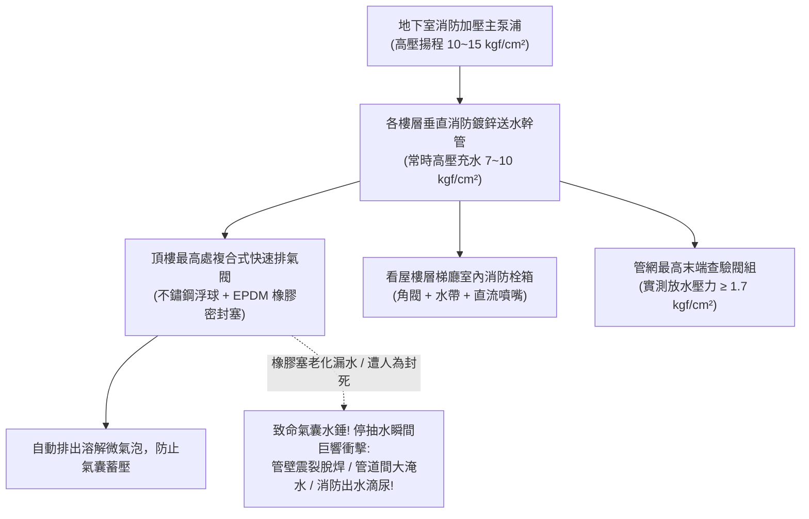

# 全案購屋實戰第三百二十六部：中古大樓社區各樓層消防送水幹管排氣閥橡膠塞老化洩漏立管水錘震盪與末端放水試驗壓力體檢工序全書

## 壹、核心查驗宗旨與前言

在現代高層集合住宅的建築消防給水與高空滅火安全體系中，垂直貫穿各樓層管道間、承受數十公尺水頭重力靜壓的**「消防立管與自動撒水送水幹管系統（Fire Standpipe & Sprinkler Riser System）」**，是火災發生時消防車自地面送水口加壓注水、或地下室消防主泵浦全力推升數百噸高壓水柱直達高樓層起火點的「消防救命水動脈」。

在高達數十公尺的封閉垂直水柱系統中，當系統注水、放水檢測或消防主泵浦啟動時，管內殘留的空氣若無法即刻排出，會被高壓水流壓縮成具備毀滅性彈性衝擊力的「氣囊水錘（Air Pocket Water Hammer）」。而肩負著自動排氣、消除水錘、維持滿水狀態的核心關鍵微型配件，就是安裝於垂直幹管頂端或管道間最高轉折處的**「消防專用自動快速排氣閥（Automatic Air Release Valve / Air Vent）」**。

然而，在屋齡 15 至 30 年的中古大樓中，消防幹管排氣閥常年深埋於頂樓管道間昏暗死角，缺乏專人巡檢保養，極易淪為暗藏水錘爆管與管道間暗漏的「致命隱患」：
1. **自動排氣閥內部之「三元乙丙橡膠浮球/橡膠密封塞（Rubber Orifice Plug）」因長年承受高水壓與自來水水垢侵蝕，橡膠硬化脆裂、閥座碳酸鈣結晶卡塞**，導致高壓消防水日夜長流沿著排氣孔微滴滲漏，順著管道間樓板縫隙滲漏侵蝕各樓層低壓配電幹線與光纖纜線；
2. **更常見的是，物業或水電工發現排氣閥微漏水後，因不願花錢更換，竟然私自用鐵塞頭（Plug）將排氣口直接「旋緊封死」或關閉排氣閥前端隔離閥**，使整條垂直幹管喪失排氣功能；
3. **管頂封死後，每次消防泵浦試車或啟動，管內截留的壓縮空氣產生強烈氣壓震盪，引發高達數十公斤的「金屬敲擊水錘（Water Hammer）」**，將整條鍍鋅消防鋼管吊架震脫、法蘭螺栓震斷，甚至震裂低樓層消防栓角閥引發大淹水；
4. **各樓層配置之「消防栓末端放水查驗管（Inspector's Test Connection）」放水壓力與出水量衰減**，火災時水柱噴射無力，無法有效壓制火勢。

本手冊為買方打造一套極具深度的「消防送水幹管、排氣閥橡膠塞密封、水錘消除與末端放水試驗全系統實地體檢工序」，結合管道間暗漏檢核、排氣閥浮球動作查驗、末端放水壓力表讀數判讀、商務砍價話術及特約條款保障，徹底杜絕交屋後承擔高額消防管網大修攤派債務與火場無水滅火之絕境。

---

## 貳、消防送水幹管水力構造原理與四大常見致命病灶

### 一、集合住宅消防送水幹管與排氣消錘技術規範
1. **垂直消防送水幹管與配水立管（Fire Water Supply Riser）**：
   - 採用內外熱浸鍍鋅無縫鋼管（ASTM A53 Schedule 40）或雙層不鏽鋼管，口徑通常為 100mm 至 150mm，常時承受高達 **$7.0 \sim 12.0\text{ kgf/cm}^2$** 之高壓靜水頭。
2. **複合式快速進排氣閥（Combination Air Release & Vacuum Valve）**：
   - 閥體採用球墨鑄鐵（Ductile Iron）或不鏽鋼，內部配置耐油耐壓不鏽鋼浮球與 EPDM 橡膠密封塞。具備「大排氣（系統初次充水快速排出巨量空氣）」、「微排氣（系統工作加壓時持續排出溶解微氣泡）」及「快速進氣（管網洩水時瞬間吸入空氣防真空吸癟爆管）」三重功能。
3. **末端查驗閥與放水壓力表組（Inspector's Test & Drain Valve）**：
   - 設於各分區或頂樓最高層管網末端，配置口徑 25mm 測試閥、銅噴嘴（Orifice 相當於一顆撒水頭流量）及耐震充油壓力表。
4. **法規出水壓力與流量標準（NFPA / 消防安全設備設置標準）**：
   - 消防栓放水壓力必須維持在 **$1.7 \sim 7.0\text{ kgf/cm}^2$** 之間；
   - 出水量必須達到第一種消防栓 **$\ge 130\text{ L/min}$**、第二種消防栓 **$\ge 60\text{ L/min}$**。

### 二、中古社區常見之四大致命病灶
1. **排氣閥橡膠塞老化漏水致使「管道間長期陰暗滲漏」**：
   - EPDM 橡膠密封塞經年累月承受 10 公斤高水壓擠壓，橡膠產生永久凹陷變形，且自來水中的碳酸鈣與鐵鏽雜質卡在排氣孔唇口。浮球即便浮起，密封塞亦無法完全封死排氣孔，高壓生水以每分鐘數十滴之速度持續外洩。水流順著管道間外壁漫延下滲，引發管道間牆體大面積發霉、白華，甚至滴落至下層電氣配電盤引發線路短路走火。
2. **水電工便宜行事「私加鐵塞頭將排氣閥封死」**：
   - 社區管理員發現頂樓排氣閥微漏水，為求省事不花錢換新，找水電工直接在排氣閥出氣口旋入一顆六角實心鐵螺塞（Iron Plug）。整條立管的「排氣呼吸閥」被徹底封死。管內蓄積的大量壓縮氣體無處宣洩，每逢地下室消防泵浦每月例行發動測試時，管內產生強烈氣錘衝擊波，整座管道間發出如同炸彈爆炸般的「咚！！」金屬撞擊巨響，震裂高樓層水管接頭。
3. **管頂負壓吸癟（Vacuum Collapse）引發「立管焊道撕裂」**：
   - 消防幹管在定期檢修洩水時，若排氣閥被封死無法自動吸入空氣，整條立管內部瞬間形成接近絕對真空的負壓環境（$-1.0\text{ kgf/cm}^2$）。高達數十公尺的大口徑薄壁鋼管在大氣壓力外部擠壓下，管身被壓癟凹陷，法蘭焊道直接被撕裂開縫，下一次重新注水時瞬間爆管噴水。
4. **末端放水壓力不足致使「火災時出水形同水槍滴尿」**：
   - 由於管道間減壓閥故障、管壁內部嚴重鐵鏽結瘤（Tuberculation）縮小過水截面積，加上地下消防主泵浦葉輪磨損，高樓層末端查驗閥放水壓力實測跌破 **$1.0\text{ kgf/cm}^2$**（遠低於法規標準 $1.7\text{ kgf/cm}^2$）。一旦住戶室內起火，拉開消防栓水帶，噴嘴噴出的水流射程不足 3 米，根本無法壓制火舌，全家陷入絕望火海。

---

## 參、買方現場看屋之消防幹管與排氣閥五步實戰體檢工序

### 一、步驟一：頂樓公共管道間最高處自動排氣閥靜態目視
- **排氣閥安裝位置尋訪**：登上大樓最高樓層梯廳或屋頂機械室，找到垂直消防立管頂部之排氣閥組：
  - 檢視排氣閥是否安裝於立管最高轉折點之上方；
  - 檢視排氣閥前端之小型不鏽鋼隔離球閥（Isolation Valve）是否處於**「常開（Normally Open）」**狀態；若閥門被緊緊關閉，代表該閥早已損壞被廢棄停用！
- **排氣孔外觀與漏水痕跡檢驗**：
  - 檢視排氣閥排氣出氣口是否有持續水滴滲漏、銅綠結晶或水垢結塊；
  - **嚴格檢視出氣口是否被加裝「實心鐵塞頭」封死**！若被封死，屬於嚴重破壞管網安全之重大違規。

### 二、步驟二：管道間外壁與底板暗漏巡檢
- **管道間暗門開啟巡檢（需仲介陪同開啟）**：
  - 手電筒照射管道間內垂直消防立管（紅色鋼管）：
  - 檢視每層樓管身法蘭（Flange）接頭與管道間樓板穿透處是否有潮濕發黑、深褐色鐵鏽流痕或鐘乳石狀白色碳酸鈣結晶；
  - 檢視管道間底板是否有積水泥濘（確認排氣閥或管身無微量暗漏）。

### 三、步驟三：目標戶所在樓層消防栓箱壓力表靜態讀數核查
- **消防栓箱開箱檢核**：打開看屋物件門外梯廳之室內消防栓箱門：
  - 檢視箱內角閥出水端或立管上配置之耐震充油壓力表；
  - **靜態壓力標準判讀**：
    - 中低樓層標準靜水壓應維持在 **$3.5 \sim 7.0\text{ kgf/cm}^2$**（若超過 $7.0\text{ kgf/cm}^2$ 必須配置減壓孔板，防止爆管傷人）；
    - 高樓層靜水壓必須 **$\ge 2.5\text{ kgf/cm}^2$**；
    - 若指針歸零或低於 $1.5\text{ kgf/cm}^2$，代表**管網存在嚴重漏水失壓或消防泵浦停擺**！

### 四、步驟四：末端查驗閥放水試驗與動態壓力實測（專業驗屋絕技）
- **高樓層末端查驗閥放水測試（需管委會或機電配合）**：
  1. 行至頂樓或最高樓層梯廳之「末端查驗閥（Inspector's Test Connection）」；
  2. 轉開放水球閥，觀察水流噴射動態：
     - 水流噴射必須充沛有力，出水在 3 秒內排盡空氣形成飽滿柱狀；
     - 檢視放水時壓力表之**「動態放水壓力（Residual Flow Pressure）」**：指針必須**穩穩維持在 $\ge 1.7\text{ kgf/cm}^2$（約 25 psi）以上**；
     - 若放水時壓力雪崩式跌破 $1.0\text{ kgf/cm}^2$、出水呈現斷續噴射喘振，代表管網嚴重氣阻或泵浦揚程衰退。

### 五、步驟五：消防安全設備檢修申報書「水系統壓力流量表」覆核
委請仲介向管委會調閱最新一期由消防設備師簽證之《消防安全設備檢修申報書》：
1. **室內消防栓設備檢查表**：核對全棟各樓層放水壓力實測值（必須 $\ge 1.7\text{ kgf/cm}^2$）與放水量實測值（必須 $\ge 130\text{ L/min}$）。
2. **自動撒水設備末端放水壓力紀錄**：末端撒水頭放水壓力必須 $\ge 1.0\text{ kgf/cm}^2$。
3. **缺失改善清單**：確認備註欄有無「消防立管排氣閥漏水待修」、「末端放水壓力不足」之列管限期改善紅字。

---

## 肆、商務談判博弈：消防立管水錘與排氣閥失效殺價 15 萬元實戰話術

整棟大樓若需將頂樓與各分區老舊漏水排氣閥全面抽換為進口複合式防水錘排氣閥、重配各樓層法蘭密封墊片並更換高壓減壓孔板與末端放水壓力表組，工程款動輒高達 **新台幣 25 萬至 40 萬元**；且消防立管氣囊水錘隨時引發管道間焊道震裂、數十噸高壓水直沖各樓層電梯與梯廳的淹水浩劫。買方應將此嚴重的公共消防機電瑕疵轉化為砍價殺手鐧。

> **實戰談判對話劇本：**
> 「屋主您好、周小姐您好：
> 我們在實地勘查頂樓消防管道間並檢視消防栓壓力表時，發現非常嚴重的公共消防與水錘安全死穴：頂樓消防送水立管的自動排氣閥橡膠塞早已老化爛掉，為了不漏水，水電工居然直接用一顆鐵塞頭把排氣口死死封死！這導致整條立管完全無法排氣，管內積存大量高壓壓縮空氣，每次消防試水都引發劇烈的水錘重擊震盪，管道間法蘭接頭已經有明顯的白華滲水痕跡；且我們實測最高層末端放水壓力，居然跌破 1.2 公斤，遠低於法規規定的 1.7 公斤標準！
> 消防送水立管是火災時全棟全家唯一的『救火動脈』。排氣閥被封死引發的氣囊水錘，隨時會把管道間的高壓鋼管焊道直接震爆，一旦在高樓層爆裂，每分鐘數百公升的高壓水會在半小時內灌滿管道間與電梯井，把整棟大樓的電梯電腦板全泡爛、電線短路全棟斷電，造成數百萬元的重大鄰損災難；且放水壓力不足更意味著萬一我們這層樓發生火災，消防水帶噴出來的水軟弱無力，根本滅不了火，全家人生命安全直接暴露在火海絕境中！
> 社區管委會若要全面更換高規格複合式防微漏排氣閥、重做全棟管道間法蘭防滲密封並重新校正末端放水壓力，整棟每戶勢必得分攤大筆修繕特別公費。
> 為了承擔這項致命的公共消防安全風險與家庭生命防護保障，我們堅持在買賣總價中直接扣除 **15 萬元** 作為消防送水幹管安全修復折讓款，否則面對一個消防管隨時可能震爆與火災無水可滅的物業，我們實在不敢貿然簽約。」

---

## 伍、買賣契約特約防守條款專用字軌

為杜絕買方交屋後承擔消防幹管爆裂淹水責任與消防設備大修攤派費，《不動產買賣契約書》應增列下列防禦條款：

> **【公共消防送水幹管水力安全與排氣閥健全保證條款】**
> 1. **消防立管與排氣設備正常運作保證**：賣方保證本買賣標的所屬大樓垂直消防送水幹管、自動撒水管網、各樓層排氣閥及室內消防栓設備，於交屋日前具備正常高壓耐壓與排氣消錘功能，自動排氣閥暢通無人為封死、無滲漏滴水痕跡，管網無異常水錘震盪劇烈異音，末端放水壓力及流量符合各類場所消防安全設備設置標準（末端放水壓力 $\ge 1.7\text{ kgf/cm}^2$），且無遭消防主管機關列管限期改善或處以罰鍰。
> 2. **交屋前消防幹管整修工程款清償義務**：若於交屋日（含）前，本社區管委會或區分所有權人會議已決議辦理全棟消防送水幹管更換、排氣閥全面抽換更新、水錘吸收器加裝或消防泵浦揚程改善等重大工程者，其所需之一切工程款、零件費或特別徵收分攤費用，不論請款單開立於交屋日前或交屋日後，概由賣方於交屋尾款結算時全額負擔扣抵，買方不負任何清償責任。
