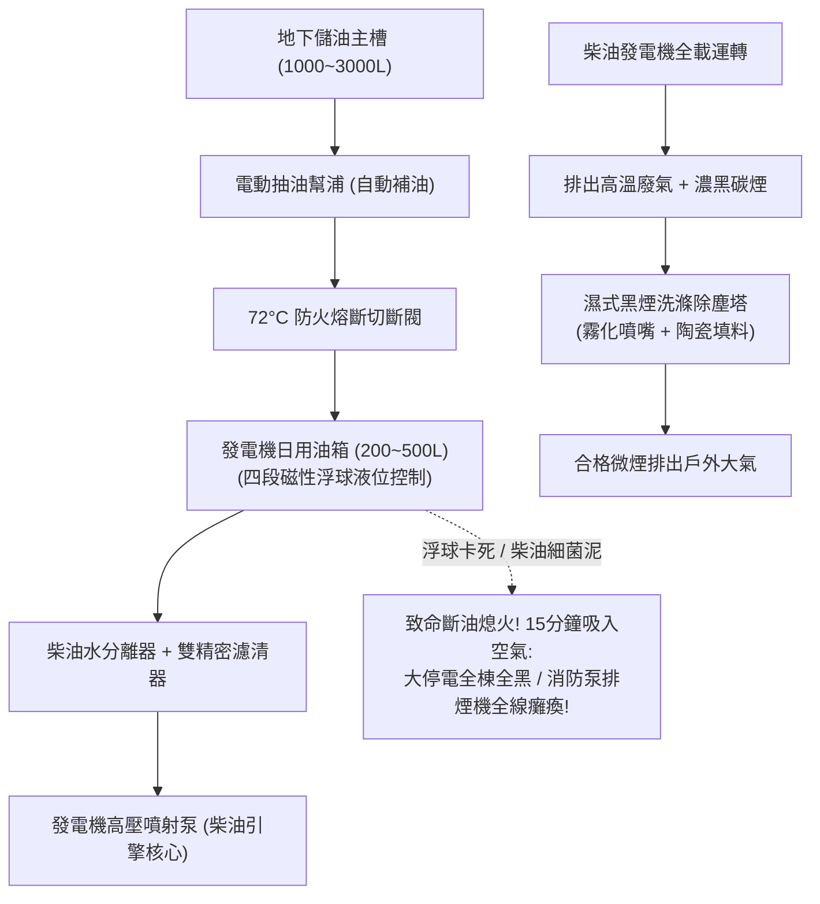

# 全案購屋實戰第三百二十四部：中古大樓社區地下室柴油緊急發電機雙迴路燃油日用油箱油位計浮球卡死油管銅管硬化滲漏與負載突加黑煙洗滌塔堵塞體檢工序全書

## 壹、核心查驗宗旨與前言

在集合住宅的建築電氣與大停電備援防災體系中，整棟大樓遭遇台電跳電、颱風電網崩潰或火災初期切斷市電時，維持全棟緊急電梯運轉、消防加壓泵浦噴水、排煙風機抽風以及逃生照明的「終極生命引擎」，就是配置於地下最底層的**「柴油緊急發電機組（Diesel Emergency Generator Set）」**。

而維繫這具鋼鐵巨獸能夠在市電中斷後 10 秒內順利發動、並持續滿載供電數小時乃至數天不斷電的核心動力泉源，正是機房內的**「燃油供應系統（Fuel Supply System，包含地下主油槽、日用油箱、供回油管網與黑煙洗滌過濾塔）」**。

然而，在屋齡 15 至 30 年的中古大樓中，發電機的燃油與排煙系統常年處於「平時無載試車沒問題、真正大停電滿載突加瞬間暴斃」的危險盲區：
1. **日用油箱（Day Tank）之「液位浮球感應器（Level Float Sensor）」受重油污泥黏滯卡阻**，油箱明明見底，感應器卻誤報滿油，導致發電機運轉不到 15 分鐘即因燃油吸乾「吸入空氣斷油熄火（Air Binding）」，整棟大樓陷入永夜；
2. **柴油輸送銅管與耐油高壓軟管長年受熱脹冷縮與機械震動影響，橡膠硬化龜裂、銅喇叭口接頭微漏**，高燃點柴油微滴於高達數百度的排氣歧管表面，引發地下發電機房毀滅性燃油大火；
3. **機房尾氣「黑煙洗滌除塵塔（Wet Scrubber / Smoke Filtration System）」內部噴淋噴嘴鈣化堵塞、陶瓷拉西環（Rasching Rings）被碳粒焦油封死**，高達數百馬力的柴油機滿載運轉時排氣背壓（Exhaust Backpressure）嚴重超標，發電機直接悶死跳脫；
4. **柴油儲存超過 3 年未添加防腐防藻劑，油品受潮乳化水解、孳生厭氧柴油細菌（Diesel Bug）**，膠狀黑色菌膜直接封死柴油精濾清器，發電機在滿載突加時供油不足劇烈喘振熄火。

本手冊為買方打造一套極具深度的「地下室發電機燃油日用油箱、供油管網、柴油品質與排煙洗滌塔全系統實地體檢工序」，結合現場油箱浮球手動拉拔檢測、銅管接頭檢漏、排氣背壓表讀數、商務砍價話術及特約條款保障，徹底防範大停電失能危機與避免數十萬元發電機燃油系統大修分攤債務。

---

## 貳、發電機燃油供油與黑煙淨化技術構造與四大常見致命病灶

### 一、集合住宅柴油發電機燃油與排氣技術規範
1. **雙迴路重力/泵送燃油系統（Dual-Circuit Fuel System）**：
   - 包含 **地下大型主油槽（Bulk Storage Tank，容積通常為 1,000L ~ 3,000L）** 與 **機房日用油箱（Day Tank，容積通常為 200L ~ 500L，法規要求滿足全載連續運轉 2 小時以上）**。
2. **自動供油電磁閥與四段液位浮球控制器（Magnetic Float Switch）**：
   - 具備「低水位自動補油（Low-Level Auto-Fill）」、「高水位停止補油（High-Level Stop）」、「超低油位警報（Low-Low Fuel Alarm）」及「超高油位防溢流警報（High-High Alarm）」。
3. **金屬雙層耐火供回油管網（Double-Wall Fuel Piping）**：
   - 採用無縫紫銅管（Copper Tubing）或厚壁鋼管，配置耐熱快速關斷閥（Thermal Shut-Off Fire Valve，遇 72°C 火災瞬間重力熔斷切斷油路）。
4. **濕式黑煙洗滌過濾塔（Wet Smoke Scrubber System）**：
   - 包含耐高溫不鏽鋼塔體、循環洗滌水泵浦、旋流霧化噴嘴（Mist Nozzles）、高溫耐熱陶瓷填料層及自動加藥中和槽，去除排煙中 95% 以上之碳煙顆粒（Soot）與氮氧化物（NOx）。

### 二、中古社區常見之四大致命病灶
1. **日用油箱浮球被膠質油泥黏死致使「假滿油真斷油」**：
   - 柴油長期靜置氧化產生黃褐色膠質（Gum），日用油箱內壁結滿黏稠油膏。四段式不鏽鋼導桿上的磁性浮球被黏死在最高點「滿油位置」。當大停電來臨發電機啟動，油箱內的柴油迅速消耗，主油槽補油泵浦因沒有收到「低油位信號」完全不啟動補油。15 分鐘後日用油箱抽乾，高壓油泵吸入空氣，發電機瞬間劇烈咳嗽幾聲後徹底熄火，全棟陷入絕望永夜。
2. **柴油管路銅管喇叭口疲勞微裂引發「機房燃油大火」**：
   - 連接引擎本體的供回油管，常年承受柴油機高達 1,800 RPM 的強烈機械震動。紫銅管兩端之喇叭口接頭或軟管壓接處金屬疲勞龜裂。柴油在 3 至 5 公斤壓力下呈微細霧狀向外噴射，一旦噴濺到高達 $500^\circ\text{C}$ 的渦輪增壓器（Turbocharger）排氣隔熱套上，瞬間引燃數百公升燃油，地下室化身為熊熊火海。
3. **黑煙洗滌塔噴嘴鈣化堵塞致使「排氣背壓超標憋死引擎」**：
   - 濕式洗滌塔常年使用自來水循環，水中碳酸鈣在排氣高溫烘烤下迅速結垢，將不鏽鋼螺旋霧化噴嘴徹底封死；洗滌塔內的陶瓷拉西環被未燃燒的碳煙與重油污泥包裹板結成實心硬塊。發電機排氣通道被截斷，排氣背壓飆破原廠容許極限（$>75\text{ mmAq}$），發電機功率急劇暴跌 50% 以上，隨後觸發過熱高溫保護強制跳機。
4. **柴油受潮水解孳生「柴油細菌（Diesel Bug）」封死濾清器**：
   - 台灣氣候高溫潮濕，油箱金屬內壁在日夜溫差下產生冷凝水滴落沉入箱底。水油交界面成為厭氧細菌與真菌的絕佳溫床。細菌以碳氫化合物為食，排泄出黑色黏稠酸性生物膜（Bio-sludge）。發電機平時每月無載試車僅運轉 3 分鐘看不出異樣；一旦真正斷電突加 80% 負載，大流量抽油瞬間將池底黑色菌泥吸入濾清器，柴油濾芯在 5 分鐘內完全堵死，發電機劇烈失速熄火。

---

## 參、買方現場看屋之發電機燃油與排煙系統五步實戰體檢工序

### 一、步驟一：發電機房環境氣味與日用油箱外觀核查
- **機房氣味與地面檢驗**：走入地下室緊急發電機房：
  - 嗅聞空氣是否有濃烈的生柴油刺鼻味（若氣味濃烈，代表管網必定存在油氣滲漏）；
  - 檢視發電機基座周圍與日用油箱下方防溢堤（Bund Wall），水泥地面有無大面積深黑油漬或積存柴油。
- **日用油箱容積銘牌核查**：檢視油箱側面銘牌：
  - 容量標示標準通常需達 **$200\text{L} \sim 500\text{L}$**；
  - 檢視透明管式液位計（Sight Level Gauge），油位是否維持在 $80\%$ 以上綠線。

### 二、步驟二：日用油箱液位浮球感應器手動拉拔檢核
- **磁性浮球上下滑動測試（需機電人員開啟檢修孔）**：
  - 檢視四段浮球開關不鏽鋼導桿表面是否有黏稠黑膠；
  - 手動輕輕向上托起與向下撥動浮球：
  - **合格標準**：浮球應手感輕盈、能靠自重自由順暢滑落；
  - **致命危險警報**：若浮球被油膠卡死、推上去後停留在半空無法自然滑落，代表**斷油盲區早已形成**！

### 三、步驟三：供回油紫銅管與 72°C 防火熔斷閥核查
- **供油銅管接頭檢漏**：手電筒照射從油箱通往引擎之紫銅管路與高壓耐震金屬編織軟管：
  - 檢視喇叭口螺帽接頭是否有黃褐色油滴滲出；
  - 觸摸軟管表面，橡膠應富有彈性，無發硬龜裂或金屬網斷絲。
- **防火安全切斷閥（Thermal Fire Valve）檢驗**：
  - 檢視油箱出油口處是否安裝有重錘式或彈簧式防火切斷閥；
  - 檢視易熔金屬片是否完好跨接，確認未被鐵絲私自固定綁死。

### 四、步驟四：柴油油質水分與油泥透視快篩
- **油箱底部排污閥取樣（專業驗屋絕技）**：請機電人員轉開日用油箱最底部的排水排污閥，以乾淨透明寶特瓶承裝約 100mL 燃油：
  1. **分層檢驗**：靜置 30 秒，檢視底部是否有清澈的水滴沉澱（水比油重，水分超標代表已產生水解）；
  2. **顏色成色判讀**：合格柴油應呈現**「清澈透亮的琥珀色或淡黃色」**；若呈現**「黑褐色、混濁發綠且漂浮黑色絮狀菌膜」**，代表油品已嚴重劣化且孳生柴油細菌！

### 五、步驟五：黑煙洗滌塔外觀與運轉背壓表覆核
- **洗滌塔噴淋水泵與水質核查**：檢視安裝於機房旁的不鏽鋼立式黑煙洗滌塔：
  - 檢視循環水箱內的水質是否清澈，噴淋水泵手動啟動時能否正常噴水；
  - 檢視排煙管路上的微壓計（Magnehelic Gauge）或 U 型水柱差壓計，全載排氣背壓是否低於原廠安全上限（通常為 **$\le 50 \sim 75\text{ mmAq}$**）。
- **管委會發電機年度帶載測試（Load Bank Test）報告覆核**：
  - 確認報告中是否有進行 **$75\% \sim 100\%$ 全負載持續試車 1 小時以上** 的真實紀錄（杜絕僅空載發動 3 分鐘的敷衍假檢驗）。

---

## 肆、商務談判博弈：發電機燃油設備老化殺價 15 萬元實戰話術

整棟大樓地下室若需進行柴油日用油箱拆解除膠清洗、更換四段不鏽鋼磁性浮球液位計、重配全套防震耐火供油銅管、黑煙洗滌塔拆卸更換陶瓷拉西環與疏通噴嘴，並將地下主油槽數千公升劣化柴油抽乾換新，工程款動輒高達 **新台幣 30 萬至 50 萬元**；且發電機燃油系統故障代表大停電時全棟公設全面癱瘓。買方應將此嚴重的公共安全隱患轉化為砍價殺手鐧。

> **實戰談判對話劇本：**
> 「屋主您好、周小姐您好：
> 我們在實地勘查社區地下室緊急柴油發電機房並取樣柴油時，發現極具威脅的電力備援與燃油安全死穴：發電機日用油箱內的四段液位浮球早已被黏稠油膠死死卡在滿油位置，主油槽根本無法自動補油，大停電時發電機運轉不到二十分鐘就會吸入空氣斷油熄火！且現場取樣的柴油混濁發黑長滿黑色菌膜，柴油濾清器隨時堵死；更致命的是，供油銅管接頭有明顯柴油滲漏痕跡，黑煙洗滌塔噴嘴嚴重鈣化堵塞，排氣背壓超標隨時憋死引擎！
> 緊急發電機是全棟大樓面臨天災大停電與火災時唯一的『生命引擎』。燃油浮球卡死與柴油變質代表一旦發生大停電，全棟電梯瞬間斷電卡在高空、排煙風機不轉、消防泵浦無法加壓，整棟大樓陷入完全癱瘓的無防護絕境；且滲漏的柴油噴濺到數百度的排氣管上，更隨時引發地下室毀滅性燃油大火！
> 社區管委會若要徹底清洗全棟油箱、抽換全套供油銅管與防爆浮球、疏通黑煙洗滌塔並抽換數千公升合格柴油，整棟每戶勢必得分攤大筆修繕特別公費。
> 為了承擔這項嚴重的公共電力安全風險與發電機燃油系統重置成本，我們堅持在買賣總價中直接扣除 **15 萬元** 作為發電機供油安全修復與維護折讓款，否則面對一個大停電時隨時斷電與暗藏火災隱患的物業，我們實在不敢貿然簽約。」

---

## 伍、買賣契約特約防守條款專用字軌

為杜絕買方交屋後承擔發電機燃油系統故障與大修攤派責任，《不動產買賣契約書》應增列下列防禦條款：

> **【公共緊急柴油發電機供油系統安全合格保證條款】**
> 1. **發電機燃油與備援供電正常運作保證**：賣方保證本買賣標的所屬大樓地下室之緊急柴油發電機組、日用油箱、自動供油系統、防震燃油管路及黑煙洗滌除塵塔，於交屋日前具備正常帶載運轉與自動補油功能，日用油箱浮球感應靈敏無卡阻、供油管網無任何柴油洩漏、油品品質合格無嚴重水解乳化菌泥雜質，停電時能在法定時限內（10至12秒）自動發動並平穩帶載，且無遭工務或消防主管機關列管限期改善或處以罰鍰。
> 2. **交屋前發電機燃油設備整修工程款清償義務**：若於交屋日（含）前，本社區管委會或區分所有權人會議已決議辦理發電機燃油管線重拉、日用油箱清洗更換、黑煙洗滌塔拉西環抽換清洗、或柴油油料全面更新等重大工程者，其所需之一切工程款、油料費或特別徵收分攤費用，不論請款單開立於交屋日前或交屋日後，概由賣方於交屋尾款結算時全額負擔扣抵，買方不負任何清償責任。
