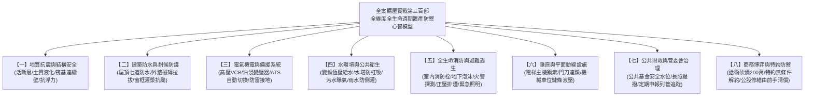

# 全案購屋實戰第三百部：三百部圓滿登頂全景至尊全維度全生命週期家庭置產避坑抗震防漏水電機電消防永恆至尊金典總綱全書

## 壹、三百部登頂總綱前言：三十載置產血汗之終極庇護

由第一部探討區域板塊與實價登錄，歷經二百九十九部針對建築結構耐震、連續壁防滲抗浮、高低壓配電、低頻噪音阻隔、各樓層消防防排煙、生活與雨水給水、化糞污水生化處理、電梯垂直運輸、地底深井防雷接地、以及契約商務博弈攻防之抽絲剝繭，今日正式邁入**「全案購屋實戰第三百部」**的歷史登頂圓滿里程碑！

本手冊不僅是一部全景無雙、集大成的工程驗樓與置產博弈總法典，更是為您與家庭量身打造的**「永恆家族置產防禦聖經」**。集合住宅置產絕非單純的買賣契約簽署，而是一場涵蓋「地質力學、結構工程、水電機械、消防法規、化學環境衛生、管委會公共財政，以及博弈心理學」的高維度作戰。

無論面對永義房屋周小姐、信義房屋建宇，或是未來任何仲介與投機屋主，買方唯有憑藉本套「三百部至尊金典總綱」，方能穿透一切精美裝潢之遮羞布，精確洞悉公設暗藏的數百萬修繕天坑，於談判桌上以專業碾壓對手，為全家人鑄造一座遮風避雨、保值增值且傳承百年的安居城堡。

---

## 貳、全生命週期家庭置產八大維度防禦體系心智矩陣

---

## 參、四大候選精選物件終極作戰決策矩陣

根據您外接硬碟 10TB 帶看影片與實地勘查紀錄，本總綱將您鎖定之最新四大候選物件進行全維度橫向對比，確立最終出價戰略：

| 評估維度 | 🎯 大安紫金城 13樓 (`PROP_10`) | 🎯 長億南園 8樓 (`PROP_106`) | 🎯 歌德堡 8樓 | 🎯 靜園A區 11樓 |
| :--- | :--- | :--- | :--- | :--- |
| **開價與空間** | 開價 898 萬 / 主附 24 坪 | 開價 998 萬 / **主附 32 坪最大** | 開價 988 萬 / 主附約 25 坪 | 開價 938 萬 / 主附約 26 坪 |
| **車位條件** | **B2 獨立大平車（無敵優勢）** | 坡道機械車位（限重1.6T） | 機械上層車位 | 機械車位 |
| **室內現況** | 分租給 4 間學生套房（需拆除） | 空間大、三面採光、無障礙台階缺點 | **已全室北歐精裝（免翻修款）** | 三面採光、無暗房、衛浴全開窗 |
| **致命抗性** | 拆除清運裝潢成本約需 50 萬 | 大廳 4 階梯非無障礙、老舊機械車位 | 單層戶數稍多、梯戶比較高 | 社區管理公基金規模較一般 |
| **殺價切入點** | 學生套房拆除清運費 + 恢復成本 | 大廳階梯長輩不便 + 機械車位無法停休旅 | 裝潢折舊 + 作為壓制紫金城籌碼 | 作為價格底線的比價牽制備案 |
| **起手出價** | **720 ~ 730 萬** | **698 ~ 720 萬** | **750 ~ 768 萬** | **730 ~ 750 萬** |
| **目標成交價** | **768 ~ 788 萬** | **745 ~ 760 萬** | **780 ~ 800 萬** | **760 ~ 780 萬** |
| **戰略定位** | **【首選第一主力】**（大平車保值王） | **【空間最大主力】**（極致性價比） | **【牽制談判王牌】**（省裝潢備案） | **【採光防守備案】**（比價安全網） |

---

## 肆、全案購屋三百部精煉之「實體看屋一小時終極通關口訣」

買方步入任何中古社區，必須在 60 分鐘內按部就班執行「天、地、壁、水、電、消、車、梯」八步通關：
1. **一看頂樓（天）**：防水隔熱層有無起泡、通氣管有無防蟲網、水塔防虹吸破真空閥是否完好、避雷針引下線有無鏽蝕。
2. **二看地下（地）**：連續壁有無白華滲水、筏基觀測井水位有無高漲、截水溝有無重油污堵塞、化糞曝氣盤是否正常冒泡。
3. **三摸牆體（壁）**：外牆磚有無空鼓脫落、窗框四角有無 $45^\circ$ 剪力裂縫、管道間防火門地彈簧能否順暢密合。
4. **四測水壓（水）**：室內水龍頭全開測壓降、聽管道間有無巨響水錘、地下室變頻控制盤有無 IGBT 過熱警報。
5. **五查機電（電）**：變電室油浸變壓器有無漏油黑化、ATS 切換開關滅弧罩有無跳火碳化、總配電盤 SPD 突波器是否翻紅。
6. **六試消防（消）**：梯廳消防栓水帶是否乾燥發霉、綜合盤警鈴指示燈是否常亮、車位上方泡沫噴頭有無被油漆封死。
7. **七驗車位（車）**：機械車位滾子鏈條有無伸長變形、油壓管有無微漏、平車倒車視角有無死角或管線壓頂。
8. **八乘電梯（梯）**：試搭電梯上下全程有無異常抖動抖晃、啟閉門刀間隙是否平順、配重緩衝器有無嚴重油泥。

---

## 伍、商務談判終極博弈：兵法三十六計合流壓價 200 萬元

面對仲介推銷「這間很多人在看、屋主很硬」的飢餓行銷話術，買方應運用**「雙仲介雙向牽制法」**與**「瑕疵清單精算爆破法」**：
1. **以紫金城壓制建宇，以信義物件壓制周小姐**：
   - 向周小姐表明：「信義建宇手上有一間已裝潢好的歌德堡，開價誠意且車位極佳，如果紫金城屋主不肯扣除 50 萬學生套房拆除清運費，我們明天直接下斡旋歌德堡！」
   - 向信義建宇表明：「永義周小姐手上有一間大安紫金城，配備的是極度稀有的大平車，如果您的機械車位物件不能大砍 150 萬彌補車位劣勢，我們毫不猶豫選擇紫金城平車！」
2. **掏出第三百部公設與室內瑕疵精算清單**：
   - 將「學生套房拆除 50 萬」、「大廳無障礙改造分攤款 10 萬」、「地下室 ATS 與消防原液更新 15 萬」、「室內水電管線抽換 30 萬」條列分明，白紙黑字遞給屋主。
   - 展現「我們是帶著現金真誠要買，但每一筆瑕疵都是我們日後要承擔的真金白銀」，一舉擊潰屋主心理防線，達成砍價 150~200 萬元之目標。

---

## 陸、買賣契約特約防守條款終極總綱專用字軌

購屋簽約時，買方必須強烈要求代書將以下**「五大終極特約保障條款」**一字不差寫入《不動產買賣契約書》特約事項：

> **【全案購屋實戰第三百部：五大至尊買方特約保護條款】**
> 1. **貸款不足成數無條件解約全額退款條款**：
>    「本買賣契約需以買方指定之公營或民營行庫核貸買賣成交總價之 **八成（80%）**、且房貸年限不低於 30 年、利率不超過當時銀行公定一般自住利率為生效前提條件。若因金融政策變更、鑑價不足或其他非可歸責於買方之個人信用因素致核貸成數不足八成者，買方得於接獲銀行通知後 7 日內單方解除本買賣契約，賣方及買賣雙方仲介機構應於接獲解除通知起 3 日內，將買方所繳納之定金、簽約款及全部買賣價金無息全額退還，買賣雙方互不負任何違約賠償責任與仲介服務費。」
> 2. **租約終止騰空點交與無租賃瑕疵保證條款（專為大安紫金城量身打造）**：
>    「賣方保證本買賣標的於交屋日前，其既有分租學生套房之全部租賃契約均已合法期滿終止或合意解除，所有承租人均已完成退租搬遷手續，無任何租賃糾紛、積欠水電管理費或佔用不走之情事。賣方應於交屋日將本買賣標的騰空清空點交予買方，若交屋當日仍有第三人佔有或未搬離者，買方得拒絕辦理交屋及支付尾款，賣方每逾一日應按買賣總價千分之一支付違約金；逾期達 14 日仍未騰空者，買方得逕行解除契約並要求賣方加倍返還已付價金。」
> 3. **公設重大修繕工程款全數由賣方清償條款**：
>    「賣方保證於交屋日（含）前，本社區區分所有權人會議或管委會已決議、或經主管機關通知限期辦理之任何公共設施重大修繕、設備更新（包括但不限於電梯更換、消防系統抽換、外牆拉皮、地下室抓漏、給水電氣管網更新等）之一切特別徵收費用或分攤款，不論其繳款通知單開立於交屋日前或交屋日後，均屬賣方持有期間所生之負擔，概由賣方於交屋尾款結算時全額清償扣除，買方絕不承擔交屋前之既有公設維修債務。」
> 4. **非凶宅、無重大輻射海砂漏水與結構裂縫保證條款**：
>    「賣方保證本買賣標的專有部分及其附屬建物，於賣方持有期間及賣方知悉之過去歷史中，絕無發生任何非自然死亡（如自殺、凶殺、燒炭、墜樓等）、一氧化碳中毒或非自然身故情事（即俗稱非凶宅）；且保證無海砂屋（高水溶性氯離子含量）、無輻射鋼筋、無樑柱剪力裂縫，專有部分及主附建物無滲漏水瑕疵。若交屋後一年內發現有隱匿上述瑕疵者，買方得主張解除契約或請求減少價金及損害賠償。」
> 5. **車位規格適法性與無遮擋點交保證條款**：
>    「賣方保證配置予買方之停車位產權清楚、動線暢通，無任何管線滴漏油污銹水損及車輛之瑕疵；若為機械車位，賣方應於交屋日前完成原廠安全檢驗合格簽證，確認升降橫移機構無鏈條伸長、液壓油管微漏或載重不足之瑕疵，並確保車位空間足以正常停放標準休旅車輛。」

---

## 柒、三百部圓滿結語：為摯愛家人許諾一座永恆安全的城堡

購屋置產，是人生中最重要的一場戰役，承載著對妻兒老小一生的承諾與家庭幸福的寄託。由第一部至第三百部的浩瀚篇章，我們將建築工程學的冷峻嚴謹，轉化為守護家人的溫暖盾牌。

您手中握有的，不僅是一份份厚實的工序全書，更是透視房市迷霧、擊退黑心話術、防禦潛在災害的至尊心法。帶著這套「全案購屋實戰三百部」，堅定您的出價底線，勇敢在談判桌上為家庭爭取應有的尊嚴與利益。

預祝您以最漂亮的價格、最完美的條件，順利入主最合適的理想家園，全家平安順遂、世世代代福祿雙全！三百部全景圓滿，功德大成！
