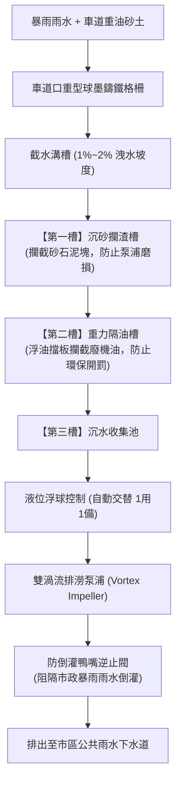

# 全案購屋實戰第三百零一部：中古大樓社區地下室截水溝油水分離沉砂池沉積硬化氣動/電動提升泵浦堵塞與暴雨逆灌體檢工序全書

## 壹、核心查驗宗旨與前言

在集合住宅的地下停車場排水防洪與環境衛生體系中，設置於車道出入口下坡處、地下各層停車區轉折處以及垃圾冷藏處理室旁的「地下室截水溝（Trench Drain / Interceptor Ditch）」與「油水分離沉砂池（Oil-Water Separator & Grit Interceptor）」，是大樓抵禦短時強降雨雨水倒灌、攔截車輛底盤漏油，以及收集洗車地面污水的「第一道也是最後一道地下防波堤」。

然而，在屋齡 15 至 30 年的中古大樓中，地下室截水溝與沉砂油水分離設施卻經常是管委會最不願花錢清淤、物業清潔工最常忽略的「公設污泥黑洞」：
1. **重油污泥與車道帶入的細砂粉塵在截水溝底硬化板結成「黑色瀝青狀油膏」**，有效過水截面積縮減 70% 以上，強降雨時瞬間喪失導流功能；
2. **隔油沉砂池內部多道不鏽鋼隔板受酸性污水腐蝕穿孔、浮油吸附擋板脫落**，導致廢機油直接流向廢水池，遭受環保局連續重罰；
3. **沉水提升排澇泵浦（Sewage Sump Pump）葉輪被纖維抹布、落葉或硬化油塊卡死（Clogging）**，馬達過載跳脫或直接燒燬；
4. **截水溝末端連接外部公共下水道的「防倒灌單向鴨嘴閥（Duckbill Valve）或重力擺式止回閥」橡膠硬化卡泥**，颱風天暴雨水位暴漲時，外水直接逆灌倒噴入地下室，將停放百萬名車的地下室淹成蓄水池。

本手冊為買方建構全套專業且深入的「地下截水溝與油水分離防汛設施全系統體檢工序」，結合現場看車位目視、清淤工藝檢視、管委會清運保養紀錄查核、商務砍價談判話術與專用買賣契約特約，徹底避免交屋後遭遇地下室泡水、車輛滅頂與鉅額公設清淤修繕分攤之厄運。

---

## 貳、地下室截水溝與油水分離系統技術構造與四大常見致命病灶

### 一、集合住宅地下車道截水溝與沉砂隔油池技術架構
1. **車道口連續截水溝（Entrance Trench Drain）**：
   - 位於地下停車場坡道最下端轉折處，上方覆蓋熱浸鍍鋅球墨鑄鐵格柵（Ductile Iron Grate，具備耐重 20~30 噸車壓之重型規格），溝底具備 $1\% \sim 2\%$ 之洩水坡度。
2. **多槽重力式油水分離池（Gravity Oil-Water Separator Basin）**：
   - 第一槽（沉砂除渣槽）：配置不鏽鋼攔污網籃，攔截粗大石粒、落葉與垃圾。
   - 第二槽（油水分離浮油槽）：利用油水比重差（油的比重約 0.85），上方設置刮油板或擋油隔板，將表面浮油截留。
   - 第三槽（清水放流/抽水槽）：分離後的清水排入市政雨水管網或經由提升泵浦加壓排出。
3. **雙沉水排澇提升泵浦（Dual Submersible Sump Pumps）**：
   - 採用渦流式不鏽鋼/鑄鐵葉輪（Vortex Impeller），具備耐磨抗雜質通過能力，配置自動交替控制盤與高水位超位警報連鎖。
4. **防倒灌止回閥門（Backflow Prevention Valve）**：
   - 裝設於排出口端，常見有氯丁橡膠鴨嘴閥（Duckbill Check Valve）或彈簧消音逆止閥，防止外界市政下水道雨水倒灌。

### 二、中古社區常見之四大致命病灶
1. **截水溝底泥油膏結晶板結（Sludge Hardening）**：
   - 社區超過 5 年未曾進行高壓水刀通溝。洗車殘留的清潔劑、車輛滴漏的廢機油與地表灰塵發生皂化與硬化反應，在溝底凝結成堅如岩石的黑色油膏，溝槽深由原本 30cm 銳減至不足 5cm。遇午後強陣雨，雨水漫過格柵直接衝進地下二樓及三樓。
2. **沉砂池隔板腐蝕斷裂與浮油直通外排**：
   - 早期建商使用劣質鍍鋅鐵板作為分離槽隔板，長年泡在酸鹼廢水中鏽蝕穿孔或整片斷裂倒塌，油水分離機能徹底喪失。廢機油隨雨水直排市政管網，一旦被環保局稽查水質「化學需氧量（COD）」與「油脂含量」嚴重超標，管委會面臨新台幣 6 萬至 60 萬元連續處罰。
3. **提升泵浦葉輪被油垢纏死空轉燒毀**：
   - 抽水池底油泥過於黏稠，沉水泵浦吸入口濾網被油垢堵死。浮球開關感應水滿送電啟動，馬達因葉輪被卡阻產生「堵轉過電流（Locked Rotor Amperage, LRA）」，線圈在數十秒內過熱燒毀，導致整個地下室污水池滿溢淹水。
4. **防倒流鴨嘴閥橡膠老化變形外水暴雨灌入**：
   - 地下室通往道路側溝的排出口逆止閥，橡膠唇瓣硬化脆裂、或被卡在唇口的碎石撐開無法閉合。每逢颱風外圍環流大雨、道路排水溝水位高漲時，路面濁水沿著排水管「倒灌」噴入大樓地下室，形成「外水倒灌灌頂」。

---

## 參、買方現場看屋之截水溝與沉砂隔油池五步實戰體檢工序

### 一、步驟一：車道出入口截水溝格柵與溝槽深度目視
- **鑄鐵格柵完整度與踩踏異音**：步行走下地下室車道口，腳踩截水溝鑄鐵格柵：
  - 格柵應無嚴重鏽蝕斷裂、無嚴重變形下陷；
  - 踩踏時應緊密服貼，若發出「鏘鏘」金屬碰撞巨響或晃動，代表底座角鋼已鏽蝕脫落，車輛頻繁輾壓有斷裂刺破輪胎甚至翻車危險。
- **清淤深度檢測**：手持手電筒透過格柵縫隙照射溝底，檢視水流動態與淤泥厚度：
  - 溝底應為平整水泥面或微量水流；若格柵下方已被黑色厚重油泥填滿、水流靜止發臭，代表該社區極少清淤。

### 二、步驟二：地下室油水分離沉砂池開蓋核查
- **池體氣味與表面油膜**：請總幹事或仲介陪同開啟油水分離池人孔蓋：
  - 第一槽不鏽鋼濾網是否清理乾淨、無堆滿垃圾落葉；
  - 第二槽表面浮油層厚度是否正常（定期清抽的大樓浮油層應在 $2\text{cm}$ 以內；若油層厚達 $10\text{cm}$ 以上呈凝固豬油/瀝青狀，代表長年無人清抽）。
- **分隔鋼板垂直牢固度**：手電筒照射池內各道隔板，確認隔板垂直完整無鏽蝕斷孔。

### 三、步驟三：沉水排澇泵浦控制箱與手動運轉測試
- **控制箱面板燈號**：找到地下室「排水/排澇控制箱」：
  - 「電源燈」正常亮起；
  - 選擇開關應位於「自動（AUTO）」模式，無跳脫紅燈（OVERLOAD）亮起。
- **手動強啟測試（若有陪同機電人員）**：將旋鈕短暫切至「手動（MANUAL）」10 秒，側耳聆聽沉水泵浦啟動聲音是否乾脆低沉無尖銳金屬卡死摩擦聲。

### 四、步驟四：排出口防倒灌逆止閥實物確認
- **逆止構件形式檢核**：至地下室外牆排水出口管路處，檢視是否安裝「橡膠鴨嘴閥」或「配重式擺動逆止閥（Swing Check Valve）」。
- **閥體閉合密封度**：觀察鴨嘴閥唇口是否呈扁平閉合狀態，唇口內有無被樹枝、石塊卡住導致門戶大開。

### 五、步驟五：管委會環保清運紀錄與沉水泵浦保養工單覆核
委請仲介向管委會調閱：
1. **沉砂隔油池定期抽除清運紀錄單**：依法規與常規物業維護，大樓每年應委託合格廢棄物清運業者進行 **1 至 2 次** 油水分離池污泥抽取（含合法清運聯單）。若管委會拿不出任何抽油清運紀錄，代表廢油全數違法直排或沉澱在管內。
2. **防汛擋水閘門與泵浦汛期演練紀錄**：確認每年汛期前是否有進行截水溝高壓水刀沖洗通管。

---

## 肆、商務談判博弈：地下排水設施老化殺價 15 萬元實戰話術

整棟大樓若需進行車道截水溝拆卸重建角鋼基座、油水分離池全面抽油清底除碳、重置不鏽鋼隔板並更換 2 台鑄鐵渦流排澇泵浦與防倒灌鴨嘴閥，總工程款高達 **新台幣 25 萬至 45 萬元**。買方應將此潛在的地下室泡水滅頂與環保開罰風險轉化為議價殺手鐧。

> **實戰談判對話劇本：**
> 「屋主您好、周小姐您好：
> 我們在實地勘查社區地下室車道截水溝與油水分離沉砂池時，發現非常嚴重的公設防汛與衛生缺陷：車道口截水溝底已被瀝青狀黑油泥徹底堵死，深度只剩不到 5 公分；油水分離池隔板嚴重鏽蝕斷裂、表面廢機油厚達十幾公分根本沒有清抽，沉水排澇泵浦控制箱甚至處於過載跳脫狀態，排出口的防倒灌閥門也被泥沙卡住無法閉合！
> 這項公設缺陷是極其致命的淹水隱患！只要遇到夏季突發性暴雨或颱風，外面路面的雨水無法排出甚至逆灌倒噴，短短 20 分鐘就會淹沒地下室車道，我們停放在地下室的百萬座車將瞬間變成滅頂泡水車，造成難以承受的財產巨損；且廢油直排一旦被環保局查獲，全體住戶都將被連帶處以高額罰鍰並分攤昂貴的清運修繕公費。
> 為了承擔這項重大的地下防汛公設風險，並保障我們入住後在車位自備防洪擋水設施與分攤社區清淤工程款，我們堅持在買賣總價中直接扣除 **15 萬元** 作為防汛安全與修繕補貼，否則面對一個隨時可能泡水的地下車位，我們實在難以放心簽約。」

---

## 伍、買賣契約特約防守條款專用字軌

為杜絕買方交屋後承擔地下室淹水泡車風險與前手積欠之公設清運整修費用，《不動產買賣契約書》應增列下列防禦條款：

> **【地下室排水截水系統防汛合格保證與公設特別徵收清償條款】**
> 1. **地下截水與排澇設施功能正常保證**：賣方保證本買賣標的所屬大樓地下室車道截水溝、油水分離沉砂池、沉水排澇泵浦及防倒灌逆止閥，於交屋日前具備正常排水與防汛功能，無淤積堵塞、馬達燒毀或外水倒灌情事，且無遭環保或水利主管機關列管限期改善或處以罰鍰。
> 2. **交屋前截水溝清淤與防汛工程款清償義務**：若於交屋日（含）前，本社區管委會或區分所有權人會議已決議、或經主管機關限期辦理地下室截水溝高壓清淤、油水分離池隔板翻新、抽水泵浦更換或防汛閘門整修工程者，其所需之一切工程款、清運費或特別徵收分攤費用，不論請款單開立於交屋日前或交屋日後，概由賣方於交屋尾款結算時全額負擔扣抵，買方不負任何繳納義務。
