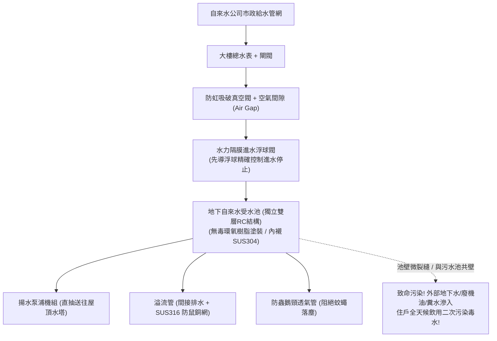

# 全案購屋實戰第三百零七部：中古大樓社區地下室生活自來水受水池進水浮球閥卡阻防虹吸破真空閥失效與池壁滲漏體檢工序全書

## 壹、核心查驗宗旨與前言

在集合住宅的日常自來水供水鏈條中，自來水公司幹管經由總表輸送至大樓的第一站，就是位於大樓地下最底層或筏基之內的「地下生活自來水受水池（Basement Potable Water Cistern）」。這座大型混凝土水池肩負著全棟住戶每日烹煮飲用、洗滌衛浴與刷牙漱口之生活飲用水的戰略儲備。

然而，在屋齡 15 至 30 年的中古大樓中，地下受水池常年深埋於黑暗潮濕的地下機房或筏基底層，缺乏透明監管，極易淪為暗藏重大衛生感染、水質二次污染與淹水爆池的「公共衛生死穴」：
1. **機械式或液壓式進水浮球閥（Float Control Valve）閥桿水垢生鏽卡阻**，當水池蓄滿時無法完全閉合，造成百噸自來水日夜長流從溢流管狂瀉入水溝，引發管委會每月虛耗數萬至數十萬元之天價水費；
2. **市政進水管路上的「防虹吸破真空閥（Vacuum Breaker）」或雙止回防逆流器橡膠墊圈脆化硬化卡死**，一旦外部台電停電或市政自來水管破裂降壓產生負壓，極易引發「地下室污水倒吸入自來水幹管」的集體中毒回流危機；
3. **地下受水池混凝土池壁與連續壁、化糞池相鄰共構，因地震剪力引發貫穿性微裂縫**，外部高污染之地下水、車道機油廢水甚至隔壁化糞池之黃泥糞水，在高壓滲透作用下直接穿透池壁滲入自來水池中，造成住戶全家常年飲用「微量糞水與化學毒水」；
4. **溢流管與排水管末端未裝設防蟲防鼠銅紗網、或防鼠網脫落破孔**，使得地下室之蟑螂、老鼠、馬陸與蜘蛛順著溢流管直接爬入自來水池內溺死腐爛，形成駭人聽聞的「死老鼠湯」供水事件。

本手冊為買方打造一套全維度、無死角的「地下室自來水受水池全系統實地體檢工序」，結合水池開蓋水質透視、浮球連鎖閥門測試、防逆流裝置核查、商務砍價談判話術與專用買賣契約特約，徹底捍衛全家人的飲用水生命健康與避免數十萬元公設修繕債務分攤。

---

## 貳、地下受水池供水構造原理與四大常見致命病灶

### 一、集合住宅地下生活受水池技術架構
1. **RC 鋼筋混凝土結構水池（Reinforced Concrete Cistern）**：
   - 依法規規定，生活受水池必須採用「雙層結構（獨立槽體，不與建築物外牆、化糞池壁共用同一面水泥牆）」，池內壁塗刷合格無毒環氧樹脂（Epoxy）或不鏽鋼內襯（SUS304 Liner）。
2. **自來水進水控制閥組（Inlet Control Valve Assembly）**：
   - 包含主隔離閘閥、Y型過濾器、水錘吸收器及水力隔膜式浮球控制閥（Hydraulic Float Control Valve），配置先導浮球開關（Pilot Float）。
3. **防逆流防虹吸裝置（Backflow Prevention & Anti-Siphon Unit）**：
   - 進水口必須高出溢流口邊緣保持法規嚴格要求的「實體空氣間隙（Air Gap $\ge 50\text{mm}$ 或進水管徑 2 倍）」，並配置真空破壞閥（Vacuum Breaker），防止水管負壓倒吸。
4. **溢流與排水平衡管路（Overflow & Drain Pipes）**：
   - 溢流管管徑必須大於進水管徑 1.5 至 2 倍，出水口採用間接排水（Indirect Waste），末端安裝耐腐蝕 SUS316 防蟲防鼠細銅網（孔徑 $\le 16\text{ mesh}$）。
5. **通氣管與人孔防護（Vent Pipe & Access Hatch）**：
   - 人孔蓋必須高出池頂地坪 $15\text{cm}$ 以上，配置密封橡膠迫緊與防水鎖扣，防鳥蟲鵝頸通氣管。

### 二、中古社區常見之四大致命病灶
1. **水力浮球閥膜片老化導致「水滿不關、百噸暴溢」**：
   - 液壓控制主閥內部的橡膠膜片因自來水含氯氧化硬化，微孔被雜質堵塞。浮球雖已浮起，先導控制管路卻無法建立背壓，主閥芯卡在半開位置。每逢深夜管網水壓升高，自來水如暴瀑般持續灌入受水池，從溢流管狂流排入水溝，大樓水費單暴增數十萬元，且長年無人發覺。
2. **共壁設計引發「化糞池污水滲入自來水池」**：
   - 25 年以上早期中古大樓建商偷工減料，將生活受水池與化糞池或廢水池「僅隔一面單薄的水泥牆（共壁設計）」。歷經 921 等大小地震拉扯，共用混凝土壁體產生貫穿性剪力微裂縫。當污水池水位高於受水池時，帶有巨量大腸桿菌與寄生蟲卵的化糞水順著裂縫直接滲透進自來水池中，造成住戶常年慢性腹瀉、孩童皮膚過敏。
3. **空氣間隙不足引發「負壓倒灌逆流」**：
   - 進水管出水口直接伸入受水池水面以下（為了降低進水沖水噪音），完全破壞了法定空氣間隙；且真空破壞閥因閥芯鈣化生鏽咬死。一旦市政幹管破裂突發停水，自來水幹管形成強力負壓虹吸，直接將受水池內的生水逆向抽回自來水幹管，甚至將水池沉渣抽吸逆流。
4. **防鼠紗網脫落導致「死老鼠腐爛污染全池」**：
   - 溢流管末端原本配裝的尼龍紗網經年累月受潮脆化破洞脫落，缺乏專人巡檢更換。老鼠順著排水明溝鑽入溢流管爬進水池喝水，失足跌入池中溺斃。老鼠屍體在 25°C 常溫水中發酵腐爛、毛髮脫落，全棟住戶就在毫不知情的情況下用這種「屍水」洗臉、洗菜與煮湯。

---

## 參、買方現場看屋之地下受水池五步實戰體檢工序

### 一、步驟一：受水池機房外圍結構與共壁檢核
- **獨立槽體與共壁型態核查**：走至地下室受水池機房，沿著水池外圍水泥牆巡視：
  - 檢視水池是否為四面懸空、具備檢修巡檢通道之「獨立槽體」；
  - **嚴格確認水池外壁是否與化糞池、污水處理池或地下室外擋土連續壁直接緊貼共壁**！若發現為共壁結構，屬於重大衛生瑕疵。
- **池外壁滲水與白華目視**：手電筒照射外壁四周，確認有無潮濕水痕、發霉黑斑或碳酸鈣鐘乳石結晶白華。

### 二、步驟二：人孔蓋外觀與防蟲防鼠銅網核查
- **人孔蓋離地高度與密封度**：
  - 人孔蓋是否高出機房地坪至少 **$15\text{cm}$ 以上**（防止地面污水流經人孔滲入）；
  - 檢視人孔鑄鐵蓋或不鏽鋼蓋是否配備密封橡膠迫緊墊圈，螺栓是否確實對稱鎖固。
- **溢流管出水口防蟲網檢驗**：找到水池溢流管排出口（通常排入機房排水明溝）：
  - 溢流管口必須距離溝底至少 **$10\text{cm}$ 以上保持間接排水**；
  - 伸手觸摸管口，確認是否牢固安裝金屬細孔「SUS316 不鏽鋼防鼠銅網」，網面無破洞脫落。

### 三、步驟三：開蓋水質透視與浮球閥動態運作測試
- **開蓋水質目測（需請總幹事或機電人員開鎖）**：使用強光手電筒直射受水池水面深處：
  - **透明度檢驗**：水質應清澈見底、肉眼能清晰看見池底磁磚或不鏽鋼底板，無任何懸浮雜質、黃褐色泥沙或漂浮油膜；
  - **氣味鑑別**：將鼻尖湊近人孔口（切勿整個人探入以防缺氧），應僅有正常自來水的微弱餘氯味；若嗅到死水腥臭、霉爛酸臭或下水道惡臭，代表池水已嚴重變質污染。
- **水力進水浮球閥手動測試**：手動輕輕按壓進水浮球下沉：
  - 觀察主進水閥能否在 **2 秒內** 順暢開啟噴水；
  - 隨後鬆手將浮球托起至最高液位，觀察主進水閥能否在 **3 至 5 秒內完全切斷水流**，無任何嘶嘶漏水聲。

### 四、步驟四：目標戶室內水質餘氯與透明度實測
- **水質餘氯測定劑（OTD 試劑）快篩**：在看屋物件廚房水龍頭放水 1 分鐘後，以透明玻璃杯取水半杯，滴入 3 滴 OTD 餘氯測定液：
  1. 水體應呈現淡淡的檸檬黃色（標準有效餘氯應落於 **$0.2 \sim 1.0\text{ ppm}$** 之間，代表自來水具備足夠殺菌力）；
  2. 若滴入後完全呈現無色透明（餘氯為 0），代表水池蓄水時間過長、有機物耗氯嚴重，水體極易孳生大腸桿菌與綠膿桿菌。

### 五、步驟五：管委會水池清洗紀錄與水質大腸桿菌檢驗報告覆核
委請仲介向管委會調閱：
1. **蓄水池水塔定期清洗紀錄表**：法規規定供公眾飲用之蓄水池，每 **半年應委託合格水池清洗廠商** 進行一次高壓清洗與二氧化氯消毒，並附有完整清洗前、中、後照片。
2. **飲用水水質檢驗報告（Drinking Water Test Report）**：核對由環保署認可實驗室出具的水質報告：
   - 總菌落數（Total Plate Count）：必須 $\le 100\text{ CFU/mL}$；
   - 大腸桿菌群（Coliform Group）：必須為 **「未檢出（ND）」或 $\le 6\text{ CFU/100mL}$**；
   - 濁度（Turbidity）：必須 $\le 2\text{ NTU}$。

---

## 肆、商務談判博弈：受水池衛生隱患殺價 15 萬元實戰話術

整棟大樓地下受水池若需進行池壁結構裂縫高壓環氧樹脂灌注止水、全池重新塗刷無毒 Epoxy 或改裝不鏽鋼槽體、更換水力浮球控制閥與進水防虹吸裝置，總工程款高達 **新台幣 25 萬至 45 萬元**。買方應將此致命的家庭飲水衛生危機作為強勢砍價的殺手鐧。

> **實戰談判對話劇本：**
> 「屋主您好、周小姐您好：
> 我們在實地勘查社區地下室自來水受水池並調閱管委會水質報告時，發現非常嚴重的飲用水公共衛生死穴：地下受水池外壁有明顯的白華水痕，且居然與污水池共壁相鄰！打開水池一聞，內部居然散發出微弱的死水腥臭味，溢流管的防鼠紗網早已破爛脫落，且進水浮球閥在水滿時根本無法完全密閉，持續滴漏長流！
> 地下受水池是全家每天洗菜、煮飯、孩子泡牛奶的『唯一生命之源』。受水池與污水池共壁且有滲漏裂縫，代表外部高污染的地下水與污水隨時滲入自來水中，全家人每天喝下肚的都是致命的二次污染水質，嚴重危害全家人肝腎與腸胃健康；且浮球閥漏水更會導致全社區水費暴增，面臨昂貴的公費分攤。
> 社區管委會若要徹底解決受水池共壁污染並重施食品級防腐塗層與防虹吸系統，每戶勢必得大筆分攤公設修繕基金；且我們入住後必須自費在全戶加裝生飲級高壓逆滲透淨水系統與全戶滅菌設備。
> 為了承擔這項嚴重的公共飲水衛生風險與家庭健康保障成本，我們堅持在買賣總價中直接扣除 **15 萬元** 作為水質安全折讓與淨水設備基金，否則面對一個可能喝到污染水的物業，我們實在不敢拿全家健康冒險簽約。」

---

## 伍、買賣契約特約防守條款專用字軌

為杜絕買方交屋後承擔大樓自來水受水池污染與高額清洗改善攤派費，《不動產買賣契約書》應增列下列防禦條款：

> **【公共生活自來水受水池飲用水衛生安全保證條款】**
> 1. **受水池飲用水衛生合格保證**：賣方保證本買賣標的所屬大樓地下室生活自來水受水池及進水供水設備（包含水力浮球閥、防虹吸破真空閥、溢流防鼠銅網及密封人孔），於交屋日前結構健全且運作正常，水池槽體無任何與污水池共壁滲漏、裂縫滲水、進水閥卡阻溢流或外水倒灌情事，自來水水質符合現行飲用水水質標準（大腸桿菌群未檢出），且無遭衛生或環保主管機關列管限期改善或處以罰鍰。
> 2. **交屋前受水池修繕與水質改善工程款清償義務**：若於交屋日（含）前，本社區管委會或區分所有權人會議已決議、或經主管機關限期辦理地下受水池池壁防水防滲修繕、進水控制閥組更換、增設獨立水箱槽體等重大工程者，其所需之一切工程款、水質檢驗費或特別徵收分攤費用，不論請款單開立於交屋日前或交屋日後，概由賣方於交屋尾款結算時全額負擔扣抵，買方不負任何繳納義務。
