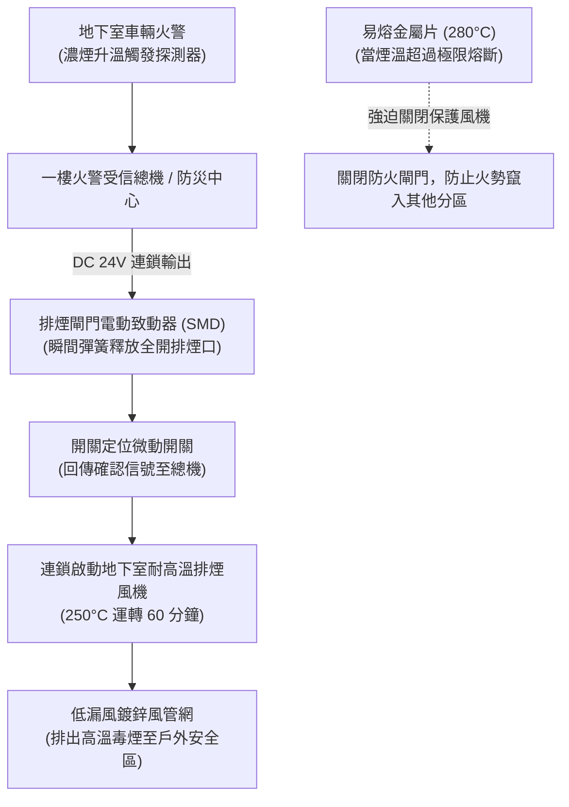

# 全案購屋實戰第三百零三部：中古大樓社區地下室機械通風防排煙風管防火閘門熔斷手動復位卡死微動開關定位失效與風量衰減體檢工序全書

## 壹、核心查驗宗旨與前言

在集合住宅的建築防火山區與地下室安全體系中，「機械防排煙與通風換氣系統（Mechanical Smoke Exhaust & Ventilation System）」是火災發生時迅速排出致命高溫有毒濃煙、為全體住戶爭取黃金逃生時間的「終極生命呼吸機」。而串聯各防火區劃與排煙管道的關鍵樞紐，正是安裝於風管貫穿防火牆處的**「防煙防火閘門（Fire / Smoke Damper, FD/FSD）」**。

然而，在屋齡 15 至 30 年的中古大樓地下室中，防排煙系統往往常年處於「平時不開、開了無風、管委會完全無視」的虛設狀態：
1. **防火排煙閘門之易熔片（Fusible Link, 常用標稱溫度 72°C 或 280°C）長年氧化脆化或受潮斷裂，導致閘門葉片私自閉合卡死**，排煙管道被實體截斷，火警時抽風機即使全力運轉也抽不出半點濃煙；
2. **閘門手動復位機械拉索（Manual Pull Cable）生鏽卡死、扭簧疲勞失效**，消防保養演練觸發後根本無法復位，物業管理員往往私下用鐵絲或木楔強行卡住閘門；
3. **電氣連鎖微動開關（Micro-switch）接點氧化碳化**，閘門閉合或開啟時無法將「開關定位信號（Position Feedback）」正確回傳至中央火警受信總機，導致地下室排煙風機與正壓送風機「連鎖啟動失靈」；
4. **風管法蘭接合處石棉/矽酸鈣密封墊片風化脫落、鍍鋅風管壁電化腐蝕漏風**，導致末端排風量嚴重衰減 50% 以上，無法達到法規規定的換氣次數與排煙風速。

本手冊為買方建構全套由機房至風道末端的「地下室防排煙風管與防火閘門全系統實地體檢工序」，結合現場目視查核、手動復位機制實測、消防安檢申報書覆核、商務砍價話術及特約條款設計，徹底杜絕交屋後承擔高達數十萬元的公設消防改善分攤債務與火場窒息風險。

---

## 貳、防排煙系統技術原理與四大常見致命故障病灶

### 一、集合住宅地下室防排煙與通風核心組件架構
1. **耐高溫排煙風機（High-Temperature Smoke Extraction Fan）**：
   - 通常為軸流式（Axial Fan）或離心式（Centrifugal Fan）風機，法規要求馬達與葉輪必須具備耐受 **$250^\circ\text{C}$ 高溫連續運轉 60 分鐘以上** 之能力。
2. **鍍鋅鋼板防排煙風管（Galvanized Steel Ductwork）**：
   - 板厚標準依風管寬度需達 $0.8\text{mm} \sim 1.2\text{mm}$，法蘭（Flange）接頭以耐火密封膠泥夾心螺栓緊固。
3. **防煙防火閘門（Fire & Smoke Damper）**：
   - **重力式/彈簧式防火閘門（FD）**：利用易熔合金片感溫熔斷，彈簧瞬間釋放強行關閉葉片，阻斷火勢延燒。
   - **電動連鎖排煙閘門（MD / SMD, Motorized Damper）**：配置 DC 24V 旋轉致動器（Actuator），接收火警信號瞬時開啟排煙口。
4. **回饋信號微動開關（Feedback Micro-switch）**：
   - 閘門開啟或關閉到位時，機械凸輪壓迫雙接點開關，送出「動作確認燈（Answer Signal）」至一樓中央防災監控室。

### 二、中古社區常見之四大致命病灶
1. **易熔金屬片氧化熔斷導致閘門「常閉封死」**：
   - 地下室排煙風管常年抽吸汽車廢氣與潮濕酸氣，72°C 或 280°C 鉛錫鉍易熔合金片（Fusible Link）表面嚴重電化腐蝕，合金薄片疲勞斷裂。防火閘門重力下垂關閉，內部風道完全被百葉鋼板堵死。排風機雖然呼呼大轉，但管道形成真空死巷，排煙量直接歸零。
2. **手動復位鋼索卡阻與扭簧鏽蝕斷裂**：
   - 歷年消防安全檢查測試時，技師撥動手動扳手使閘門跳脫關閉；測試完畢後，由於復位鋼索內部缺少黃油潤滑且嚴重鏽蝕，技師無法徒手復位，便私自用木棒或螺絲起子將閘門硬撐在半開狀態，破壞了防火分區完整性。
3. **定位微動開關氧化引發「主機判定未就緒拒絕開機」**：
   - 閘門側面附屬的行程極限微動開關（Limit Switch），內部接點受地下室濕度影響表面結滿綠色銅鏽。當閘門開啟時，接點阻抗過高無法導通信號，火警總機判定「閘門未開啟」，觸發保護互鎖邏輯，導致排煙大馬達「被拒絕啟動」。
4. **風管法蘭墊片風化碎裂引發嚴重漏風（Duct Air Leakage）**：
   - 20 年以上的老舊大樓，鍍鋅風管每 1.2 米一處的法蘭接頭，中間夾襯的石棉橡膠墊片因高溫乾燥與震動全面粉化脫落。風機運轉時，漏風率高達 40% 以上，風力全在機房天花板漏光，真正需要排煙的車道與車位末端排風口幾乎沒有任何抽吸吸力。

---

## 參、買方現場看屋之防排煙風管與閘門五步實戰體檢工序

### 一、步驟一：地下車道與車位上方風管外觀目視
- **風管本體變形與鏽蝕檢驗**：走入地下室停車場，抬頭使用強光手電筒檢驗懸吊於天花板之大型鍍鋅矩形風管：
  - 檢視風管頂面與側面是否有嚴重下陷凹陷、法蘭開縫裂開；
  - 檢視風管表面鍍鋅層是否有大面積白華粉化或赤褐色鐵鏽穿孔；
  - 檢視風管角鐵吊架（Hanger Rods）是否穩固垂直，有無螺帽鬆脫下垂。
- **法蘭接頭密封度**：觀察每處風管接合縫隙，是否有密封膠泥溢出硬化脫落、或運轉時微漏氣吹動灰塵之痕跡。

### 二、步驟二：防火防煙閘門（FD/FSD）箱體與檢視口核查
- **閘門外觀與標示銘牌**：在風管穿越水泥防火分區牆體處，尋找標示「防火閘門」之檢查箱體。
- **手動檢視口（Access Door）開啟**：轉開閘門檢視口的快速蝶形螺栓：
  - 檢視內部百葉葉片（Louver Blades）是處於「完全水平全開」還是「下垂半關」狀態；
  - 檢視易熔片是否完好跨接在拉桿上，合金片表面無裂痕；
  - 檢視復位旋轉彈簧有無生鏽斷裂。

### 三、步驟三：手動復位拉柄與測試開關實動測試
- **手動釋放與復位手柄檢測（需陪同機電人員協助）**：
  - 扳動手動測試拉柄，觀察內部葉片能否在 **1 秒內** 俐落順暢關閉，發出結實的金屬咬合聲；
  - 操作外部復位手柄（Reset Handle）旋轉復位，阻尼手感應順暢清脆，卡掣定位銷能牢固咬入鎖定槽，無虛位滑脫。

### 四、步驟四：排煙機房風機皮帶與排煙風速實測
- **排煙風機傳動皮帶（V-Belt）檢核**：走入地下防排煙風機房：
  - 檢視馬達與風機葉輪之傳動皮帶有無磨損毛邊、龜裂龜裂或鬆弛下垂（手指下壓深度應在 $10 \sim 15\text{mm}$ 內）；
  - 啟動風機時，聆聽有無皮帶打滑尖叫聲或軸承磨損異音。
- **車位排煙口吸力手感驗收**：在看屋車位上方之排煙吸風口處，將一張 A4 影印紙貼近排風格柵：
  - 風機啟動時，A4 紙應能被**強烈吸附牢牢貼在格柵表面**，代表抽吸負壓充足；若紙張滑落或吸力微弱，代表風道嚴重漏風或閘門卡死。

### 五、步驟五：消防安全設備檢修申報書「排煙檢查表」覆核
委請仲介向管委會調閱由消防設備師簽證之最新一期《消防安全設備檢修申報書》：
1. **各分區排風量（Air Volume, m³/min）**：核對申報書實測風量是否符合原設計標準（地下停車場依法規換氣次數每小時應達 **4 至 6 次以上**）。
2. **排煙風速（Velocity, m/s）**：排煙口吸入風速標準應落於 **$5.0 \sim 10.0\text{ m/s}$**。
3. **缺失改善清單**：確認備註欄有無「第 X 區排煙防火閘門故障」、「連鎖信號未回傳」等列管限期改善項目。

---

## 肆、商務談判博弈：防排煙設施缺陷殺價 15 萬元實戰話術

整棟大樓地下室防排煙風管若需進行全區法蘭重新補膠封堵、更換 10 組以上生鏽卡死之防火排煙閘門與電動致動器，並重新校正風機風量平衡，工程款動輒高達 **新台幣 25 萬至 40 萬元**。買方應將此嚴重的公共消防逃生盲區作為議價砍價的重磅武器。

> **實戰談判對話劇本：**
> 「屋主您好、周小姐您好：
> 我們在實地勘查社區地下室排煙系統並調閱消防檢修申報書時，發現非常嚴重的安全隱患：車道與我們車位上方的排煙風管法蘭接頭墊片早已全面風化脫落，風管嚴重漏風；更致命的是，多處防火排煙閘門的易熔片早已斷裂、葉片下垂卡死在半閉狀態，微動開關定位信號根本無法回傳，地下室排風量實測衰減超過一半！
> 機械防排煙是地下室發生火災時唯一的『救命抽風機』。一旦地下室車輛起火，高溫劇毒濃煙若無法在第一時間被強力抽出，濃煙將在 3 分鐘內灌滿整個地下室並沿著電梯井與安全梯向上倒灌至各樓層，直接封死全家人的逃生動線；且閘門卡死屬於消防局重點稽查的重大公安缺失，社區隨時面臨連續罰鍰與公共危險責任。
> 社區管委會若要全面抽換老舊閘門並委託專業風管工程團隊重新密封測風，整棟每戶勢必得分攤大筆修繕特別公費；且這項瑕疵嚴重削弱了物業的安全評價。
> 為了承擔這項重大的公共消防安全風險，並保障我們全家在火災時的生命避難權益，我們堅持在買賣總價中直接扣除 **15 萬元** 作為防排煙設備修復補償款，否則面對一個火災排煙全盲的物業，我們實在難以放心簽約。」

---

## 伍、買賣契約特約防守條款專用字軌

為杜絕買方交屋後承擔公設消防排煙受罰與修繕費用分攤之風險，《不動產買賣契約書》應增列下列防禦條款：

> **【公共機械防排煙與通風設備合格保證與修繕工程清償條款】**
> 1. **防排煙風管與閘門設備正常運作保證**：賣方保證本買賣標的所屬大樓地下室之機械防排煙系統（包含耐高溫排煙風機、風管網、防火防煙閘門、手動復位機構及火警連鎖微動開關），於交屋日前具備正常排煙、換氣與連鎖動作功能，排風量及風速符合現行各類場所消防安全設備設置標準，且無遭消防或建管主管機關列管限期改善或處以罰鍰之情事。
> 2. **交屋前防排煙工程款清償義務**：若於交屋日（含）前，本社區管委會或區分所有權人會議已決議、或經主管機關限期辦理地下室防排煙風管密封檢修、防火閘門全面更換、排煙風機馬達更新等工程者，其所需之一切工程款或特別徵收分攤費用，不論請款單開立於交屋日前或交屋日後，概由賣方於交屋尾款結算時全額負擔扣抵，買方不負任何繳納義務。
