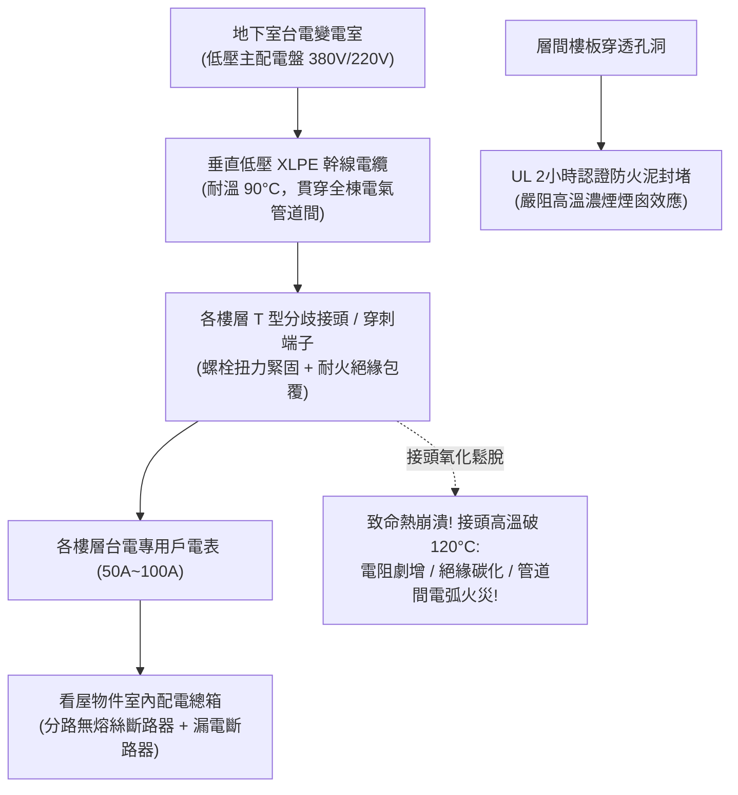

# 全案購屋實戰第三百零九部：中古大樓社區各樓層電氣管道間低壓配電幹線分歧接頭氧化鬆脫熱成像溫升過載跳脫與絕緣包覆體檢工序全書

## 壹、核心查驗宗旨與前言

在現代集合住宅高層建築的電力供應生命線中，由地下室台電配電變電室引出、垂直貫穿整棟大樓直通各樓層的「低壓配電垂直幹線系統（Vertical Low-Voltage Power Riser System）」，肩負著輸送全棟住戶每日冷氣空調、廚房高功率電磁爐、熱水器以及各類家用電器數百千瓦（kW）總用電負載的「供電主動脈」。

然而，在屋齡 15 至 30 年的中古大樓中，各樓層梯廳的電氣管道間（Electrical Shaft / Meter Room）常年緊閉鎖死，成為最隱蔽卻又最危險的「電氣火災重災區」：
1. **各樓層分歧接頭（Tap-Off Connector / T型分歧壓接端子）施工不良、未塗抹導電膏，長年承受大電流負載熱脹冷縮與電化氧化，螺栓鬆脫造成「高接觸電阻（High Contact Resistance）」**，在用電尖峰時接頭溫度暴飆超過 $120^\circ\text{C}$，絕緣膠帶碳化冒煙；
2. **早期大樓垂直低壓配電幹線採用普通 PVC 絕緣電線（非耐熱耐燃材質），線徑規格遠遠落後現代家庭用電需求**，主幹纜線常年處於「滿載甚至過載（Overloaded）」狀態，絕緣層嚴重熱裂解、脆化如餅乾；
3. **電氣管道間貫穿各樓層地板之孔洞（Floor Openings）未依建築技術規則以「防火泥與矽酸鈣板落實防火區劃填塞（Firestopping）」**，一旦某樓層接頭走火，垂直管道間瞬間化身為「立體煙囪」，將毒煙與烈火數分鐘內直竄頂樓；
4. **管道間內部混拉未經防護的弱電寬頻線、對講機線甚至天然氣瓦斯管線**，強電電磁干擾造成網路頻繁斷線，更暗藏電火花引爆天然氣的毀滅性滅頂風險。

本手冊為買方打造一套由外而內的「各樓層電氣管道間與幹線分歧接頭全系統實地體檢工序」，結合紅外線熱成像檢測標準、絕緣阻抗量測法規、管委會機電申報書覆核、商務砍價談判話術與專用買賣契約特約，徹底避免交屋後遭受全家跳電失火、管道間電線走火與分攤數十萬元全棟重新穿線改管之厄運。

---

## 貳、各樓層低壓垂直配電幹線技術架構與四大常見致命病灶

### 一、集合住宅垂直低壓配電幹線技術架構
1. **低壓配電垂直幹線（Vertical Feeder Riser）**：
   - 通常採用三相四線 $380\text{V}/220\text{V}$ 或單相三線 $220\text{V}/110\text{V}$ 銅芯交連聚乙烯電纜（XLPE Cable）或金屬密閉低壓匯流排槽（Busway Trunking），耐溫等級通常需達 $90^\circ\text{C}$ 以上。
2. **穿刺型分歧接頭 / 壓接端子組（Insulation Piercing Connector / C-Crimp Tap）**：
   - 於各樓層管道間內，將垂直主幹線之電力分流（Tap-Off）引接至各戶電表箱與各戶戶內配電總箱。
3. **各樓層電表箱與無熔絲開關（Branch MCCB / Meter Panel）**：
   - 配置台電瓦時電表及各戶專用低壓斷路器，容量常見為 50A、75A 或 100A。
4. **層間貫穿部防火阻火延燒填塞（Firestop Penetration Seal）**：
   - 管道間樓地板開孔周圍，必須使用通過 UL 1479 / ASTM E814 認證之膨脹型防火泥（Intumescent Firestop Putty）、礦棉及防火包，具備至少 **2 小時以上之防火時效（F-Rating）**。

### 二、中古社區常見之四大致命病灶
1. **分歧接頭金屬氧化鬆脫引發「惡性熱崩潰（Thermal Runaway）」**：
   - 早期水電工壓接銅端子時未使用扭力板手，或壓接鉗模具不符；加上銅金屬常年承受夏季冷氣開機大電流所引發的熱脹冷縮循環（Thermal Cycling），端子螺栓逐漸鬆弛。接觸面空氣滲入引發電化氧化，生成高阻抗氧化銅（CuO）。接觸電阻（$R$）劇增，根據焦耳定律 $P = I^2 R$，接頭處產生極端高溫，使 PVC 絕緣膠布碳化導電，引發相間相碰跳火爆炸。
2. **主幹線載流量不足致使「全天候發燙與電壓驟降」**：
   - 25 年前規劃大樓時，每戶用電容量僅預估 30A 至 40A。如今住戶大量安裝變頻冷暖氣、洗碗機、IH感應爐、烤箱及除濕機，垂直主幹線在傍晚 6 點至 10 點尖峰時段電流逼近 120% 額定容量。電纜表皮發燙發軟（溫度超過 $70^\circ\text{C}$），各戶室內電壓驟降至 102V 以下，引發電器馬達抖動受損。
3. **樓板開孔未封堵引發「立體煙囪效應」**：
   - 中古大樓電氣管道間樓板穿透處完全是「大通鋪」，上下樓層間的巨大水泥空隙未塞入任何防火泥。一旦低樓層發生電線走火，垂直管道間形成極強抽吸通風，毒煙與火焰在 60 秒內直接竄至高樓層梯廳，將各樓層住戶活活嗆死於睡夢中。
4. **管道間混雜天然氣管與未接地金屬架**：
   - 許多老舊社區管道間管理混亂，瓦斯公司或水電工將天然氣鍍鋅鐵管、電信跳線甚至第四台纜線全部擠在同一個密閉狹窄空間。強電分歧接頭若因過載產生電弧火花，極易直接擊穿瓦斯管壁或引燃微漏瓦斯，引發全棟立體大爆炸。

---

## 參、買方現場看屋之電氣管道間五步實戰體檢工序

### 一、步驟一：目標戶門外電氣管道間暗門與環境核查
- **電氣管道間位置確認**：走至看屋物件大門旁梯廳，找到標示「電氣管道間」或「電表箱」之金屬防火門。
- **開啟檢視門（需仲介陪同開啟鎖扣）**：
  - **氣味嗅聞**：開啟瞬間將鼻尖湊近，嗅聞是否有絕緣膠皮燒焦味、臭氧味或微弱瓦斯異味；
  - **內部環境整潔度**：檢視內部是否被住戶私堆紙箱、雜物或油漆罐等易燃品（嚴重公安違規）。

### 二、步驟二：紅外線熱成像儀實測分歧接頭溫升（進階驗屋神器）
- **熱像儀無死角掃描**：在傍晚大樓用電高峰期，使用 FLIR 紅外線熱像儀照射管道間內主幹線各相銅排及各戶分歧接頭：
  - **正常溫度標準**：接頭表面溫度應低於環境溫度 $+30^\circ\text{C}$（正常應在 $40 \sim 50^\circ\text{C}$ 之間）；
  - **三相溫差判讀（$\Delta T$）**：三相接頭彼此溫差應小於 **$3^\circ\text{C}$**；
  - **致命異常警報**：若單相接頭熱像呈現耀眼白色或明黃色、溫度突破 **$70^\circ\text{C}$ 以上**，或三相溫差超過 **$10^\circ\text{C}$**，代表該接頭已嚴重接觸不良、隨時有融毀走火風險！

### 三、步驟三：電纜絕緣外皮外觀與接頭包覆目視
- **電纜外皮老化變色檢核**：手電筒照射主幹電纜外觀：
  - 檢視絕緣外皮是否呈現乳白色發黃、黑色塑料龜裂、表面是否有油污粉化；
  - 檢視分歧接頭處包覆之耐熱絕緣膠帶是否有焦黑、捲曲脫落、或裸露出發黑銅端子。
- **線徑規格（AWG / mm²）查核**：核對主幹線與引接至看屋物件之電線規格，入戶線徑標準至少應達 **$22\text{ mm}^2$ 至 $38\text{ mm}^2$**，若仍為早期細小之 $8\text{ mm}^2$ 或 $14\text{ mm}^2$，代表完全無法承載現代高功率家電。

### 四、步驟四：層間樓板穿透孔洞「防火填塞」完整度檢核
- **垂直上下透光檢查**：手電筒向管道間上方與下方地板穿透孔照射：
  - 檢視樓板孔洞是否被粉紅色/灰色防火泥、防火包及密封鋼板嚴密封堵；
  - **嚴格確認是否能「直接看到上下樓層的燈光或管線」**！若無任何防火阻絕、空氣上下對流穿堂，屬於重大消防安全列管瑕疵。

### 五、步驟五：管委會電氣設備大檢申報書與紅外線檢測報告覆核
委請仲介向管委會調閱：
1. **大樓機電顧問年度紅外線熱成像檢驗報告（Infrared Thermography Report）**：合格大樓每年應委託專業機電技師對各樓層配電盤及管道間分歧接頭進行一次熱成像掃描，確認報告內無「接頭過熱列管紅字」。
2. **各樓層配電幹線絕緣電阻測試紀錄（Insulation Resistance Test）**：以 500V 高阻計（Megger）量測，相間及對地絕緣電阻必須大於 **$1.0\text{ M}\Omega$**（法規最低標準為 $0.1\text{ M}\Omega$）。

---

## 肆、商務談判博弈：管道間電氣老化殺價 15 萬元實戰話術

整棟大樓若需進行該樓層電氣管道間分歧接頭重新拆除壓接、重做耐火絕緣包覆、垂直樓板防火泥重新填塞，並抽換入戶老舊老化幹線電纜，水電施工報價高達 **新台幣 3 萬至 6 萬元**；若涉及全棟主幹線容量不足重新抽線，工程款更高達數百萬元。買方應將此嚴重的暗藏火災隱患作為砍價重磅籌碼。

> **實戰談判對話劇本：**
> 「屋主您好、周小姐您好：
> 我們在實地開啟門外電氣管道間並以專業紅外線熱成像儀檢測時，發現極具威脅的暗藏電氣火災隱患：管道間內的主幹線分歧接頭氧化鬆脫嚴重，熱成像實測接頭溫度飆破 72 度，絕緣膠皮已經發黑碳化；且樓板貫穿處完全沒有任何防火泥填塞，形成一個垂直通透的空心大煙囪！更危險的是，入戶線徑規格依然停留在二十年前的老舊細線，根本無法承受現代家庭變頻冷氣與廚房高功率家電的同時運轉！
> 電氣管道間是整棟大樓最危險的『隱形火爐』。接頭異常高溫隨時會產生相間短路爆發巨大電弧火花，一旦起火，由於樓板沒有防火填塞，致命濃煙與火焰會在 60 秒內順著管道間直撲全棟各樓層梯廳，封死全家人的逃生動線；且這屬於嚴重的消防公安違規，管委會隨時面臨消防局連續開罰。
> 我們購屋入住後，為了全家人的生命安全，必須立即自費委託專業甲級電器承裝商，將管道間分歧接頭全部拆開重新壓接塗抹導電膏、更換全新入戶耐燃電纜，並自費施作通過認證的樓板防火泥封堵工程。
> 為了承擔這項嚴重的電氣火災風險與入戶線路更新成本，我們堅持在買賣總價中直接扣除 **15 萬元** 作為電氣安全修復與防護折讓款，否則面對一個隨時可能電線走火的物業，我們全家人實在不敢冒險入住。」

---

## 伍、買賣契約特約防守條款專用字軌

為杜絕買方交屋後承擔管道間電線走火與線路容量不足的修繕責任，《不動產買賣契約書》應增列下列防禦條款：

> **【公共電氣管道間配電系統與入戶線路安全保證條款】**
> 1. **配電幹線與分歧接頭安全合格保證**：賣方保證本買賣標的專有部分入戶電源線路及所屬樓層公共電氣管道間內之低壓配電幹線、分歧接頭、電表箱斷路器，於交屋日前具備正常載流與供電功能，無任何接頭氧化鬆脫、異常過熱發燙（接頭溫升正常無絕緣碳化）、線路絕緣劣化或短路跳脫之情事，且電氣管道間之樓板開孔具備合法有效之阻火延燒防火填塞，符合建築技術規則及用戶用電設備裝置規則。
> 2. **交屋前電氣設備改善工程款清償義務**：若於交屋日（含）前，本社區管委會或區分所有權人會議已決議、或經主管機關限期辦理公共電氣管道間線路重拉、分歧接頭整修、防火泥重新施作或幹線容量擴充工程者，其所需之一切工程款或特別徵收分攤費用，不論請款單開立於交屋日前或交屋日後，概由賣方於交屋尾款結算時全額負擔扣抵，買方不負任何繳納義務。
