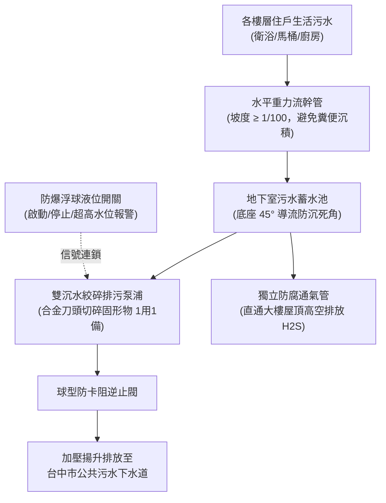

# 全案購屋實戰第三百零二部：中古大樓社區地下室生活污水下水道用戶接管重力流坡度不足回沖逆灌與沉水絞碎泵浦氣化空蝕體檢工序全書

## 壹、核心查驗宗旨與前言

在集合住宅的公共衛生與排污治理體系中，「各戶生活污水排放及地下室污水收集轉壓系統」（Sanitary Drainage & Sewage Sump Pump System），是維繫整棟大樓千百名住戶每日衛浴盥洗、廚房排廢與馬桶沖洗的「地下核心排毒動脈」。隨著台中市都市計畫污水下水道接管工程全面推進，傳統中古大樓逐步進行「化糞池廢除與污水用戶接管改管工程（Sewer Connection Project）」，將生活污水由重力流或機械提升方式匯入公共污水下水道。

然而，在屋齡 15 至 30 年的中古大樓中，地下室污水收集系統與改管管網往往暗藏著最骯髒、最危險且造價極其高昂的致命缺陷：
1. **重力流污水幹管坡度嚴重不足（低於法規標準 $1/100$）**，造成固態糞便與油脂長年沉積黏附，強降雨或尖峰用水時產生「劇烈氣塞（Air Binding）與污水回沖逆灌」，導致低樓層（1~2樓）馬達噴糞、臭氣沖天；
2. **污水池底沉水絞碎型排污泵浦（Submersible Grinder Pump）高硬度合金刀頭磨損鈍化**，遇到濕紙巾、衛生棉等雜物無法有效絞碎，造成刀盤抱死燒毀；
3. **泵浦吸入口安裝高度不當或有效吸入水頭（NPSHa）不足，引發嚴重的「氣化空蝕現象（Cavitation）」**，葉輪被微氣泡撞擊穿孔蜂窩化，出水量驟降並伴隨劇烈金屬撞擊爆鳴聲；
4. **污水池通氣管（Vent Pipe）未獨立直通頂樓或在管道間轉折處破裂**，高濃度劇毒硫化氫（H₂S）與易燃甲烷氣體在地下室蓄積，隨時引發人員中毒昏厥甚至電氣火花引爆之重大工安危機。

本手冊為買方打造一套極具穿透力的「地下室生活污水排放與絞碎泵浦全系統體檢工序」，結合現場地下機房實測、通氣管路檢驗、管委會清淤維護單據覆核、商務砍價話術及特約條款保障，徹底守護家庭居住環境衛生與避免數十萬元公設修繕債務分攤。

---

## 貳、地下室污水排放與絞碎泵浦技術架構與四大常見致命病灶

### 一、集合住宅污水收集與用戶接管技術規格
1. **重力流收集幹管（Gravity Drainage Collector）**：
   - 通常採用厚管壁橘紅色 PVC-U 污水管或無縫鑄鐵排污管，口徑多為 100mm 至 150mm，法規要求最小洩水坡度為 $1/100$ 至 $1/50$。
2. **污水集水槽（Sewage Sump Basin）**：
   - 包含攔污除渣隔網、底部設置 $45^\circ$ 導流斜坡（Sump Hopper Slope，防止死角污泥板結）、防爆人孔蓋與獨立排氣管。
3. **沉水絞碎型污水泵浦（Heavy-Duty Submersible Grinder Pump）**：
   - 配置高鉻合金鋼（Hard Chrome Steel, 55-60 HRC）旋轉刀刃與徑向切削盤，能在 1 秒內將纖維固體物絞碎成 $6\text{mm}$ 以下微細顆粒，採用雙機械軸封（SiC/SiC 碳化矽油浴潤滑）。
4. **雙重防逆流與水錘吸收系統**：
   - 包含球型污水專用逆止閥（Ball Check Valve）與全開型閘閥，避免高壓污水管內積水回流衝擊泵體。

### 二、中古社區常見之四大致命病灶
1. **管線沉陷導致「逆向倒坡（Backfall Slope）」與回沖逆灌**：
   - 地下室頂板懸吊之排污吊管，長年受污水重力與吊架（Clevis Hanger）鏽蝕鬆動影響，管段中段向下彎曲下垂，形成「波浪狀」甚至「反向倒坡」。液體雖然流走，但固態糞便與凝固油脂在此處淤積成堅硬阻抗栓，造成管道排氣受阻，低樓層住戶排水孔出現「咕嚕咕嚕」巨大回冒聲，甚至污水從地排溢出淹水。
2. **絞碎刀盤卡死致使馬達堵轉燒毀（Grinder Jamming）**：
   - 現代住戶大量使用含塑膠纖維之濕紙巾、面膜與貓砂，沉水絞碎泵若缺乏定期維護，旋轉刀頭間隙變大（超過 $0.2\text{mm}$），纖維物無法被剪切反而纏繞在刀軸上，造成刀盤瞬間卡阻抱死。啟動電流飆升引發線圈過熱燒燬，污水池迅速滿溢。
3. **有效吸入水頭不足引發「氣化空蝕（Cavitation）」損毀葉輪**：
   - 污水池設計水深過淺或浮球停止液位設定過低，泵浦運轉時在吸入口產生高速渦流旋渦，將大量空氣吸入；或水溫受廚房熱水影響升高，葉輪進口處局部壓力低於液體飽和蒸汽壓，氣泡在葉輪表面瞬間破裂產生數千大氣壓之微射流衝擊，導致不鏽鋼葉輪如被白蟻蛀蝕般穿孔粉碎。
4. **通氣管路鏽穿洩漏致命硫化氫（H₂S）與甲烷爆燃**：
   - 污水厭氧發酵產生的硫化氫氣體溶於水汽形成具強腐蝕性之硫酸，將鍍鋅通氣鋼管頂部鏽蝕出巨大孔洞。劇毒氣體無法排放至屋頂，而在地下變電室或停車位空間漫延，長期吸入引發住戶神經病變，遇到配電盤開關電弧更極易引發爆燃。

---

## 參、買方現場看屋之污水系統五步實戰體檢工序

### 一、步驟一：地下室天花板吊管坡度與吊架外觀目視
- **幹管吊架間距與水平度**：走入地下停車場，抬頭使用強光手電筒檢驗橘紅色污水懸吊幹管：
  - 吊架間距標準應每 **$1.5 \sim 2.0\text{ 米}$** 設置一處，防震支撐無脫落；
  - 檢視管身是否有明顯肉眼可見的「下垂彎曲段」；用手持式紅外線水平儀投射，確認管身保持平順下傾坡度（無逆坡積水）。
- **管壁接頭滲漏與白華污漬**：檢視 PVC 膠水接頭或鑄鐵法蘭接合處，表面是否有發黑的油水滴漏痕跡或鐘乳石狀結晶白華。

### 二、步驟二：地下污水泵浦機房環境與人孔密封核查
- **機房氣味與通風評估**：打開污水泵浦機房門，正常機房應有機械強制抽風運轉，空氣僅有微弱土腥味；若撲鼻而來的是濃烈臭雞蛋味（硫化氫）或糞臭刺鼻，代表密封不良或通氣管已破孔。
- **人孔蓋密封度**：檢視污水池鑄鐵人孔蓋是否有專用橡膠迫緊密封圈並以螺栓對角鎖緊；人孔蓋邊緣無氣泡冒出。

### 三、步驟三：絞碎泵浦控制箱與自動輪替測試
- **面板指示燈與電流表**：檢視污水控制箱：
  - 兩台泵浦之選擇旋鈕均應位於「自動（AUTO）」；
  - 檢視控制箱面板上的「運轉電流表（Amperage Meter）」，運轉時指針是否落在額定電流綠區；若電流偏高逼近額定值上限，代表刀頭已被異物纏繞阻抗劇增。
- **自動交替運轉控制器（Alternator Relay）**：確認具備「每次啟動交替輪流（1號動完換2號動）」功能，避免一台長年過勞另一台生鏽抱死。

### 四、步驟四：目標戶（尤其是低樓層）衛浴排水負壓實測
- **馬桶沖水流速檢驗**：在看屋物件室內，將馬桶水箱蓄滿後按下大號沖水：
  1. 觀察漩渦水流吸入是否迅猛有力，底排水封能否在 3 秒內平順回補；
  2. 觀察沖水時地排有無「噗哧」空氣噴出或存水彎水封被抽乾現象；
  3. 將耳朵貼近洗手台地排，聆聽管道間是否有劇烈氣塞回鳴聲。

### 五、步驟五：管委會污水下水道接管竣工圖與清淤單據覆核
委請仲介向管委會調閱：
1. **污水下水道用戶接管竣工圖（As-built Sewer Drawing）**：確認社區是否已合法完成市府污水接管並廢除地下化糞池，免除未來自費百萬開挖道路改管的巨額成本。
2. **沉水絞碎泵浦大修保養單**：核對泵浦更換或刀頭翻新記錄，沉水泵浦平均壽命為 **8 至 10 年**，若已超過 15 年未換，隨時面臨斷軸燒毀。

---

## 肆、商務談判博弈：污水設備老舊殺價 15 萬元實戰話術

整棟大樓地下室若需重新吊掛校正污水幹管坡度、清抽污水池底固化油泥沉積、更換 2 台進口高合金沉水絞碎泵浦（如 Flygt 或 Grundfos 品牌）並重做通氣管路防腐，總工程款高達 **新台幣 30 萬至 50 萬元**。買方應將此致命的排污公設隱患作為砍價殺手鐧。

> **實戰談判對話劇本：**
> 「屋主您好、周小姐您好：
> 我們在實地勘查社區地下室污水管線與機房時，發現極具威脅的公共衛生缺失：地下室排污幹管有多處因吊架鬆動嚴重下垂形成積便倒坡，機房內部瀰漫危險的硫化氫惡臭氣體；且調閱管委會工單發現，池底的絞碎排污泵浦運轉電流早已逼近跳脫極限、刀頭嚴重磨損鈍化，管道間更常態性發生排水氣塞負壓異音！
> 污水排放是維持全棟正常生活的排毒神經。幹管下垂與刀盤卡死隨時會引發全棟污水倒灌回冒，首當其衝的就是低樓層地排噴出惡臭糞水，造成家具裝潢全毀與不可逆的衛生浩劫；且硫化氫累積更有引發地下室人員中毒與爆炸的公共危險責任。
> 社區管委會若要全面校正懸吊坡度並更換工業級雙絞碎泵浦，整棟住戶勢必得大筆分攤公設修繕基金；且我們入住後必須自費在專有部分加裝高規防逆流氣壓平衡閥與防溢地排。
> 為了承擔這項嚴重的排污公設維護風險與家庭居住健康保障，我們堅持在買賣總價中直接扣除 **15 萬元** 作為衛生防護與公設修復折讓款，否則面對一個隨時可能噴發污水的物業，我們實在不敢冒險下定。」

---

## 伍、買賣契約特約防守條款專用字軌

為杜絕買方交屋後承擔污水管倒灌淹水與昂貴設備更新攤派費，《不動產買賣契約書》應增列下列防禦條款：

> **【公共生活污水排放系統功能健全保證與修繕工程清償條款】**
> 1. **污水排放順暢與防逆灌保證**：賣方保證本買賣標的專有部分排水管路及所屬大樓地下室生活污水收集幹管、沉水絞碎排污泵浦、防逆流閥門及獨立通氣管系統，於交屋日前具備正常重力流導水與機械排污功能，無任何幹管沉陷倒坡、固形物淤積堵塞、污水倒灌回冒或硫化氫外洩之情事，且符合直轄市公共污水下水道接管技術標準。
> 2. **交屋前污水公設更新工程款清償義務**：若於交屋日（含）前，本社區管委會或區分所有權人會議已決議、或經主管機關限期辦理地下室排污管線重新懸吊校正、化糞池廢除改管、污水池清淤、沉水絞碎泵浦全面抽換等重大工程者，其所需之一切工程款、規費或特別徵收分攤費用，不論請款單開立於交屋日前或交屋日後，概由賣方於交屋尾款結算時全額負擔扣抵，買方不負任何繳納義務。
