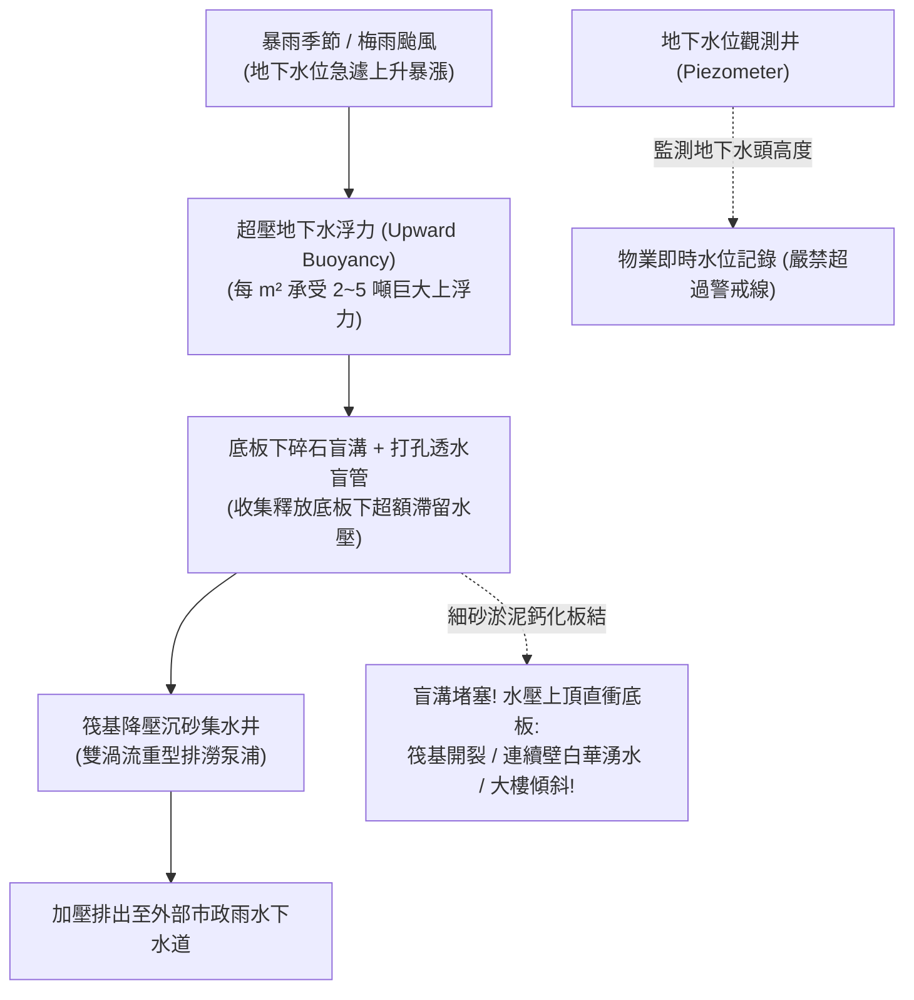

# 全案購屋實戰第三百零五部：中古大樓社區地下室筏基連續壁觀測井地下水位上升浮力超標結構上浮微裂縫與盲溝降壓排水體檢工序全書

## 壹、核心查驗宗旨與前言

在現代集合住宅高層建築的深基礎結構與地下室力學體系中，「筏式基礎（Raft Foundation）」與「地下連續壁（Diaphragm Wall）」是承載整棟數萬噸大樓重量、阻隔周邊高壓地下水土側向推力的「地底鋼鐵之錨」。在台中盆地（如南區、西區、南屯區靠近土庫溪、旱溪或筏子溪流域周邊），地層地下水位（Groundwater Level）極易隨梅雨季、颱風暴雨以及地表開發滲透而劇烈暴漲。

當地下水位上升超過原建築力學設計之「地下水浮力安全極限（Buoyancy Safety Limit）」時，強大的向上水浮力（每平方米承受數噸水壓）將對整棟大樓地下室底板產生巨大上頂力。若大樓地下室之**「水位觀測井（Observation Well）」**、**「抗浮地錨/微型摩擦樁（Anti-Floating Micro-piles）」**或**「筏基底板盲溝降壓排水系統（Sub-slab Relief Drainage System）」**因泥沙淤積或管理怠慢而失效，極易引發災難性後果：
1. **大樓地下室筏基底板與連續壁因整體上浮（Structure Uplift）產生剪力裂縫與貫穿性結構大滲水**；
2. **大樓左右兩側受力不均產生「微幅不均勻沉陷或傾斜（Differential Settlement / Tilt）」**，導致高樓層大門閉合卡塞、樑柱出現 $45^\circ$ 剪力斜裂縫；
3. **盲溝透水管（Perforated Pipe）被細砂淤泥與碳酸鈣結晶完全封死**，底板下層滯留水壓無法釋放，高壓地下水直接頂穿地下三、四樓的水泥地面，噴湧黃泥水；
4. **自動降壓集水井抽水泵浦因高頻過載燒毀**，導致地下室筏基地樑艙房（Cell Compartments）全面積滿臭泥水，侵蝕鋼筋保護層引發不可逆的結構脆化。

本手冊為買方打造一套極具深度的「地下室筏基連續壁、水位觀測井與抗浮力降壓系統體檢工序」，結合現場地下深層勘查、觀測井水位量測、結構裂縫鑑別、商務砍價談判話術與專用買賣契約特約，徹底避免交屋後承擔數百萬元結構補強灌漿債務與結構變形之滅頂之災。

---

## 貳、連續壁地下水浮力與盲溝降壓排水構造原理與四大常見致命病灶

### 一、集合住宅地下室抗浮力與降壓排水技術架構
1. **厚體鋼筋混凝土筏基底板（Mat Foundation Slab）**：
   - 具備足夠的混凝土厚度（通常為 $80\text{cm} \sim 150\text{cm}$）與自重，作為對抗地下水上浮力的主抗力體。
2. **地下連續壁與預埋剪力筋（Diaphragm Wall & Shear Keys）**：
   - 壁厚 $60\text{cm} \sim 100\text{cm}$，深植於地底堅硬卵石層或透水較差之黏土層，阻隔外部地下水側向流動。
3. **底板下盲溝盲管降壓排水網（Sub-slab Filter Trench & Relief Pipes）**：
   - 筏基底板下方鋪設級配碎石（Drainage Gravel）與包覆透水土工布（Geotextile）的打孔透水管，引導超壓地下水匯流至降壓集水井，避免水壓直接頂撞底板。
4. **地下水位觀測井（Piezometer / Groundwater Observation Well）**：
   - 貫穿筏基底板深達地下的 PVC 打孔過濾管，配置管帽與刻度測繩，供物業監測即時地下水頭高度。
5. **筏基抽排水泵浦與水位警戒系統（Relief Dewatering Pumps）**：
   - 雙渦流重載排水泵浦，由高低水位浮球控制，將滲漏水加壓排出至雨水下水道。

### 二、中古社區常見之四大致命病灶
1. **盲溝透水布淤泥板結致使「底板下水壓無法洩壓」**：
   - 地下水流經年累月夾帶微細粉砂，土工布網孔被微細泥粒堵死，加上地下水礦物質析出碳酸鈣（水垢），盲溝濾水石層膠結板結成不透水硬層。降壓功能徹底喪失，地下室底板長期承受額外的超額靜水上頂壓力，導致筏基地樑產生多道張力垂直貫穿裂縫。
2. **地下水位觀測井長年被垃圾雜物堵死淪為「盲管」**：
   - 社區管理員完全不知地下室地面的小鐵蓋是做何用途。洗車污水或沙土灌入觀測井內，井底沉積厚重泥沙，測水繩放下去直接卡住；或者觀測井蓋螺栓生鏽抱死，管委會超過 10 年從未測量過地下水位，對大樓正處於地下水超壓浮力的危機全然不知。
3. **連續壁公母單元接頭（Waterstop Joint）剪力裂縫與白華湧水**：
   - 由於地下水浮力造成大樓微幅上浮扭曲，連續壁單元與單元接合處的止水帶（Rubber Waterstop）被剪斷撕裂。高壓地下水攜帶大量泥沙由接縫處噴湧而出，牆體長出如鐘乳石般的厚重碳酸鈣白華結晶，鋼筋保護層剝落鏽脹。
4. **筏基沉水泵浦燒毀致使地樑格艙成為「死水沼澤」**：
   - 筏基內的水位降壓抽水泵浦故障跳脫，物業無人知曉。地下數十個地樑格艙（Cells）積滿深達 1 米以上的黃泥積水，地下室濕度常年高達 95% 以上，引發嚴重的混凝土中性化腐蝕與地下室霉爛惡臭。

---

## 參、買方現場看屋之筏基與連續壁五步實戰體檢工序

### 一、步驟一：地下最底層連續壁外觀全面巡檢
- **連續壁單元接縫檢核**：走入地下最底層（如 B3 或 B4 停車場），沿著靠外側之四周水泥牆面（連續壁）緩步檢驗：
  - 連續壁單元垂直接合線（每 4 至 6 米一處）是否有大面積濕潤水痕；
  - 檢視接縫處是否有噴濺泥沙痕跡、黃褐色鐵鏽水痕或白色凸起之白華結晶；
  - 用手背觸摸牆面，確認接縫處表面是否冰涼潮濕或有微滲水流。
- **壁體剪力裂縫**：檢視牆面是否有寬度超過 **$0.3\text{mm}$** 之貫穿性斜裂縫或橫向微裂縫。

### 二、步驟二：地下室底板「水位觀測井（Piezometer）」現場查驗
- **尋找觀測井蓋**：在地下最底層地面角落或機房內，尋找標示「地下水位觀測井」之圓形鑄鐵蓋或不鏽鋼蓋。
- **開啟井蓋實地測水（需仲介陪同協助）**：
  - 轉開管帽螺栓，手電筒垂直照射井內；
  - 檢視井管內是否有水面反光；使用量尺或測水繩垂放，測量水面距離地下室地面的深度（安全水頭標準：水面距離底板必須至少保持在 **$1.5 \sim 2.0\text{ 米}$** 以下；若水面已逼近地面不足 50cm 甚至有水溢出，代表地下水浮力嚴重超標！）。

### 三、步驟三：筏基人孔開蓋與內部地樑積水核查
- **筏基檢修孔（Slab Access Hatch）檢驗**：在地下底層尋找通往「筏基內部」之金屬密閉人孔蓋。
- **開蓋照射評估**：打開人孔蓋（切勿冒然進入以防窒息），手電筒照射地底地樑格艙內部：
  - 格艙底部應為乾燥水泥面或僅有微量水窪；
  - 若照射下去全是深黑泥水、水深淹沒地樑一半以上，代表地下盲溝早已失效且抽水泵浦已燒毀。

### 四、步驟四：一樓與高樓層大門門框垂直度與水平儀測量
- **不均勻上浮檢驗**：地下水浮力不均通常會導致大樓局部微幅傾斜扭曲：
  - 檢視看屋物件室內大門、臥室門關閉時，門扇與門框四周縫隙是否均勻平行；有無門扇自動滑開或門框擠壓卡死摩擦地面的現象；
  - 使用雷射水平儀投射牆角踢腳線，檢驗地坪水平高低差（每 10 米高低差不得超過 **$20\text{mm}$**）。

### 五、步驟五：管委會地下水位監測日誌與結構鑑定報告調閱
委請仲介向管委會調閱：
1. **大樓機電保養地下水位觀測月報表**：合格優良社區每月應記錄一次觀測井水位深度，確認水位無持續上升之異常趨勢。
2. **大樓建物結構安全耐震快篩與公安檢查申報書**：確認結構檢查欄中，有無被技師註記「地下室壁體滲漏水列管」、「筏基底板龜裂待修補」之列管項目。

---

## 肆、商務談判博弈：地下水浮力超標瑕疵殺價 20 萬元實戰話術

大樓地下室連續壁若發生接縫滲漏水、盲溝堵塞導致浮力超壓，進行全區高壓灌注親水性聚氨酯止水（PU Injection）、地底化學地錨補強或重新鑽孔施作降壓減壓深井，工程款動輒高達 **新台幣 50 萬至 100 萬元以上**。買方應將此致命的建築基礎結構與安全隱患轉化為殺價攻防的核彈級籌碼。

> **實戰談判對話劇本：**
> 「屋主您好、周小姐您好：
> 我們在實地勘查社區地下最底層連續壁與打開水位觀測井時，發現極度危險的結構與地質安全隱患：地下室四周連續壁接縫處布滿嚴重的滲水白華結晶，水位觀測井實測地下水位居然已經逼近底板不到 60 公分，且筏基地樑內部積滿深黑泥水，盲溝降壓系統顯然已經嚴重泥沙板結堵塞！
> 地下水浮力是高層建築最致命的無形破壞力。地下水浮力超標代表整棟大樓底板隨時承受數千噸向上的破壞上頂力，這不僅會直接頂裂筏基結構造成地下室大淹水，更會引發大樓不均勻沉陷與結構扭曲，導致高樓層樑柱出現結構性剪力裂縫；一旦大樓傾斜，整棟房價將面臨腰斬崩跌的滅頂打擊。
> 社區管委會若要全面施作連續壁深層高壓灌漿補強、重新開挖降壓深井並抽換重載排澇泵浦，整棟每戶勢必得分攤數萬至數十萬元的龐大公設工程款；且買方必須承擔極高的結構耐久性折損風險。
> 為了承擔這項致命的地質力學與基礎結構修繕風險，我們堅持在買賣總價中直接扣除 **20 萬元** 的結構防護折讓款，否則面對一個地基可能上浮開裂的物業，我們全家人實在不敢拿一生血汗錢冒險簽約。」

---

## 伍、買賣契約特約防守條款專用字軌

為杜絕買方交屋後承擔大樓地基連續壁開裂、滲水及結構補強的巨額修繕債務，《不動產買賣契約書》應增列下列防禦條款：

> **【建築物深基礎連續壁抗浮力與地下室結構安全保證條款】**
> 1. **地下室連續壁與筏基結構健全保證**：賣方保證本買賣標的所屬大樓地下室各層連續壁、筏式基礎底板、地下水位觀測井及盲溝降壓排水系統，於交屋日前結構健全，無任何因地下水浮力超標引發之結構上浮開裂、不均勻沉陷、連續壁接縫大量湧水噴砂或筏基嚴重積水未退之重大瑕疵，且無遭直轄市工務或建管主管機關列管限期補強、改善或處以罰鍰之情事。
> 2. **交屋前連續壁止水與結構補強工程款清償義務**：若於交屋日（含）前，本社區管委會或區分所有權人會議已決議、或經結構技師公會鑑定建議辦理地下連續壁高壓止水灌漿、底板抗浮力地錨施工、降壓井重施或筏基清淤等重大工程者，其所需之一切工程款、鑑定費或特別徵收分攤費用，不論請款單開立於交屋日前或交屋日後，概由賣方於交屋尾款結算時全額負擔扣抵，買方不負任何繳納義務。
