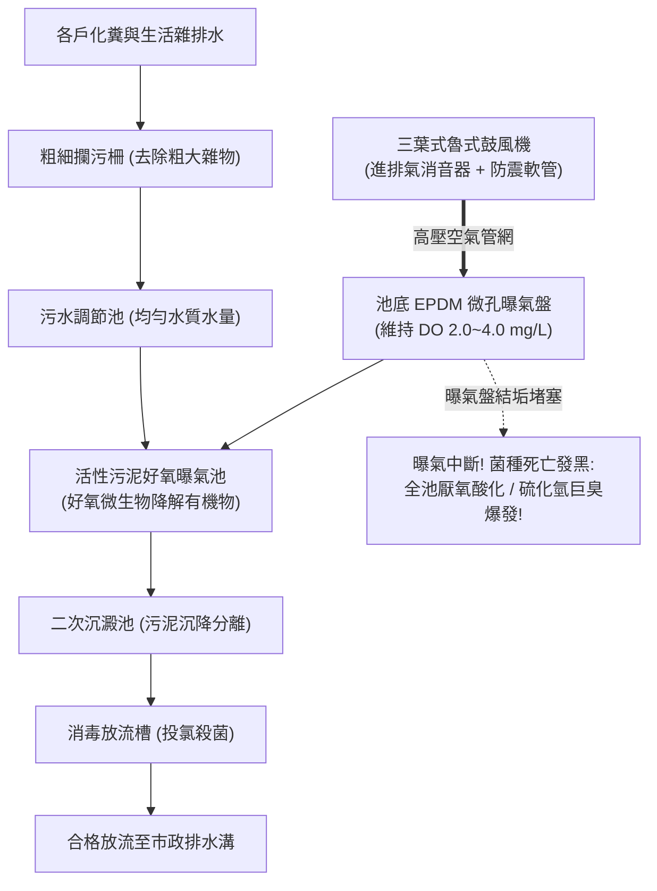

# 全案購屋實戰第三百零六部：中古大樓社區地下室生活污水處理設施鼓風曝氣機軸承磨損消音器破孔與曝氣池厭氧酸化體檢工序全書

## 壹、核心查驗宗旨與前言

在集合住宅的專有部分與公共衛生體系中，尚未完成公共污水下水道接管、或設有專用建築物污水處理設施（Sewage Treatment Facility / Septic Aeration Basin）的中古大樓，其地下室的「生活污水生物曝氣處理系統」是全棟大樓唯一能夠降解有機排泄物、消除惡臭沼氣並達到環保放流水標準（BOD、COD、SS）的「綠色人工肺臟」。而維持這套生化好氧消化程序正常運轉的絕對核心動力，就是配置於地下機房內的**「魯式鼓風機（Roots Blower）或迴轉式空氣壓縮曝氣機」**。

然而，在屋齡 15 至 30 年的中古大樓中，地下室污水曝氣系統往往是管委會最不願撥款保養、機電廠商最常敷衍的「公設惡臭重災區」：
1. **鼓風機葉輪齒輪箱缺油乾磨、軸承嚴重磨損產生劇烈金屬尖叫聲與強烈低頻共振**，噪聲沿著鋼筋混凝土剪力牆一路向上貫穿，造成 1 至 4 樓低樓層住戶夜夜遭受低頻嗡嗡聲折磨；
2. **進排氣消音器（Silencer）內部吸音玻璃棉受潮板結碳化、金屬殼體生鏽破孔**，壓縮空氣脈動噪聲毫無阻隔地直噴地下停車場；
3. **曝氣池底微孔曝氣盤（Diffuser Disc）受污泥重壓逆流鈣化堵塞，鼓風機背壓過高引發馬達熱跳脫**，好氧菌群在 48 小時內因缺氧集體死亡；
4. **整個曝氣池迅速逆向「酸化厭氧發酵（Anaerobic Acidification）」**，黑化污泥翻滾噴發，釋放出高濃度硫化氫（H₂S）、氨氣（NH₃）與甲硫醇惡臭，隨管道間倒灌進住戶衛浴，嚴重威脅全家呼吸道健康。

本手冊為買方打造一套極具深度的「地下室生活污水曝氣設施與鼓風機全系統實地體檢工序」，結合機房噪音分貝量測、池體生化成色氣味鑑別、管委會環保申報書覆核、商務砍價談判話術與專用買賣契約特約，徹底避免交屋後遭受全家受困低頻噪聲、惡臭倒灌與分攤數十萬元環保改善工程款之浩劫。

---

## 貳、污水生物曝氣系統技術原理與四大常見致命病灶

### 一、集合住宅生活污水好氧生化處理技術架構
1. **三葉式魯式鼓風機（Tri-Lobe Roots Blower）**：
   - 採用無油式壓縮容積構造，具備恆定排氣量特性，配置進氣消音過濾器、排氣消音器、釋壓安全閥（Safety Relief Valve）及防震軟管。
2. **活性污泥曝氣池（Activated Sludge Aeration Tank）**：
   - 池深通常為 $3.0 \sim 4.5\text{ 米}$，池底鋪設耐酸鹼三元乙丙橡膠（EPDM）微孔曝氣盤或 ABS 穿孔曝氣管，將微細空氣氣泡均勻散佈於污水中，維持溶氧量（DO）在 **$2.0 \sim 4.0\text{ mg/L}$**。
3. **生化沉澱槽與污泥迴流系統（Clarifier & Sludge Return Airlift）**：
   - 沉澱懸浮固體，並藉由氣提揚水裝置將活性污泥迴流至曝氣池維持微生物菌種濃度。
4. **消毒槽與自動加藥機（Disinfection & Chlorination Unit）**：
   - 投加固體氯錠或次氯酸鈉，殺滅大腸桿菌群後溢流排放。

### 二、中古社區常見之四大致命病灶
1. **軸承缺油咬死與齒輪磨損引發「低頻共振傳導」**：
   - 鼓風機常年 24 小時運轉，社區缺乏專業保養，齒輪油（Gear Oil）乳化漏光。同步雙齒輪劇烈磨損敲擊，主軸承游隙擴大，運轉震動超過 ISO 標準數倍。震動能量未經由防震彈簧阻尼衰減，直接傳導至建築梁柱，使 1 至 4 樓住戶客廳地面與臥室床頭常年感受微震與「嗡嗡」低頻噪音，引發嚴重失眠與神經衰弱。
2. **排氣消音器鏽蝕穿孔引發「高分貝噴射噪音」**：
   - 地下室濕度極高，高溫壓縮空氣冷凝產生弱酸性水汽，將碳鋼消音器內部吸音棉泡爛脫落，消音筒外壁鏽穿破洞。排氣噪音直接飆破 $95\text{ dBA}$，整個地下停車場如同噴射機引擎試車，走進地下室耳膜刺痛。
3. **曝氣盤鈣化板結引發「背壓超載燒馬達」**：
   - 池底 EPDM 橡膠膜片微孔被污水中的油脂與石灰質沉澱物封死。鼓風機排氣壓力表由正常的 $0.3\text{ kgf/cm}^2$ 飆升至 $0.7\text{ kgf/cm}^2$ 以上，安全閥頻繁尖叫洩壓，三相馬達長年超載運轉，線圈絕緣碳化燒毀。
4. **菌種缺氧死亡引發「全池厭氧酸化噴臭」**：
   - 鼓風機故障停機超過兩天未修，曝氣池內的好氧硝化菌大量缺氧死亡，厭氧腐敗菌瞬間佔據主導地位。原本土黃色、帶有泥土清香的健康活性污泥，在數日內轉變為漆黑黏稠的死泥，pH 值跌破 5.5（嚴重酸化），釋放數千 ppm 的劇毒硫化氫氣體，整座大樓瀰漫濃烈死老鼠與腐爛糞便惡臭。

---

## 參、買方現場看屋之污水曝氣系統五步實戰體檢工序

### 一、步驟一：地下污水機房外圍低頻噪音與震動實測
- **機房門外手感震動檢驗**：行至地下室標示「廢水處理機房」或「鼓風機房」門口：
  - 用手掌緊貼機房水泥牆面，感受牆體是否有明顯發麻、高頻顫抖或低頻震顫；
  - 側耳聆聽是否有規律的金屬敲擊聲或「嗚——嗚——」的沈悶共振音。
- **分貝計噪音量測**：使用手機噪音計 App 在機房門外 1 米處量測，背景噪音若超過 **$65\text{ dBA}$**，代表內部設備防震與消音設施早已徹底損壞。

### 二、步驟二：鼓風機機體外觀與潤滑油視窗核查
- **機組外觀成色檢驗**：走入機房，檢視運轉中之魯式鼓風機：
  - 齒輪箱油位透視鏡（Oil Sight Glass）：潤滑油位應維持在紅點中心線，油質應呈清亮金黃色；若油鏡內呈黑褐色焦糊狀、甚至呈乳白色（進水乳化）或空空如也，代表齒輪箱隨時可能咬死炸機；
  - 皮帶輪防護罩與傳動皮帶：皮帶應對齊平順，無劇烈左右擺動或黑色橡膠粉末灑落滿地。
- **排氣壓力表讀數確認**：檢視鼓風機出風口壓力表，指針正常應落在 **$0.3 \sim 0.4\text{ kgf/cm}^2$** 綠區；若指針逼近紅色超壓區（$>0.6\text{ kgf/cm}^2$），代表池底曝氣盤已嚴重鈣化堵塞。

### 三、步驟三：曝氣池池面曝氣均勻度與污泥成色開蓋目視
- **人孔蓋開啟巡檢（需配戴口罩防護）**：請機電人員打開曝氣池水泥人孔蓋：
  - **氣泡翻滾均勻度**：池面應呈現均勻密集細微的「白色微氣泡浪花」（如同沸騰開水）；若池面僅有一兩處巨型大氣泡翻滾、其餘大片區域水面死寂不動，代表底部曝氣盤已大面積破裂脫落或堵死；
  - **活性污泥顏色判讀**：健康的曝氣池混合液應呈現**「黃褐色（Chocolate Brown）」**；若水色呈現**「灰黑色、墨汁黑」**且漂浮大片黑色浮渣（Scum），代表池體早已酸化厭氧！
- **氣味鑑別**：健康的曝氣池應僅有輕微泥土味或潮濕土腥味；若撲鼻而來是強烈嗆鼻的「臭雞蛋味、氨水味或酸腐味」，代表微生物系統已徹底崩潰。

### 四、步驟四：看屋室內低樓層臥室深夜低頻聽音實測
- **低樓層住戶專項檢核**：若買方看屋物件位於 1 至 4 樓，在看屋時務必緊閉所有氣密窗與房門：
  1. 將耳朵貼在臥室主牆或地板上，聆聽是否有隱隱傳來的低頻蜂鳴共振聲；
  2. 走入主衛浴與客衛浴，嗅聞地排與洗臉台排水孔是否有回冒的微弱沼氣臭味。

### 五、步驟五：管委會環保定檢申報書與水質檢驗單覆核
委請仲介向管委會調閱：
1. **環保局污水放流水水質檢驗報告（Discharge Water Quality Report）**：核對最新一期檢驗數據：
   - 生化需氧量（BOD）：必須 $\le 30\text{ mg/L}$；
   - 化學需氧量（COD）：必須 $\le 100\text{ mg/L}$；
   - 懸浮固體（SS）：必須 $\le 30\text{ mg/L}$。
   若報告有紅字超標，管委會面臨環保局按日連續處罰之重大法律責任。
2. **鼓風機大修保養記錄**：確認鼓風機軸承、齒輪與微孔曝氣盤最近一次更換年份（曝氣盤標準壽命為 **5 至 8 年**）。

---

## 肆、商務談判博弈：污水曝氣設施崩潰殺價 15 萬元實戰話術

整棟大樓地下室若需進行曝氣池全面抽乾清淤、換裝全新池底 EPDM 微孔曝氣盤、重置 2 台低噪音三葉魯式鼓風機並重新培養活性污泥菌種，工程款動輒高達 **新台幣 30 萬至 50 萬元**。買方應將此嚴重的環境衛生瑕疵與低頻噪音困擾轉化為議價殺手鐧。

> **實戰談判對話劇本：**
> 「屋主您好、周小姐您好：
> 我們在實地勘查社區地下室污水處理機房並調閱水質檢驗單時，發現極具殺傷力的公設衛生與機電缺陷：地下室鼓風機齒輪箱早已缺油乾磨、運轉發出震耳欲聾的尖銳噪音與劇烈低頻震動，消音器更已鏽蝕穿孔；打開曝氣池一看，池水黑化成墨汁、散發出刺鼻窒息的硫化氫惡臭，池底曝氣盤早已大面積堵塞鈣化，環保放流水質更是多項超標！
> 污水曝氣系統崩潰是整棟大樓的『慢性毒藥』。鼓風機的低頻共振會沿著大樓結構樑柱日夜穿透，引發住戶長期神經衰弱與失眠；而池體厭氧酸化產生的致命沼氣隨時會沿著管道間逆向倒灌入室內，毒害全家老小呼吸道健康；更嚴重的是，放流水質超標一旦被環保局查獲，整棟住戶勢必得分攤數萬至數十萬元的巨額罰鍰與全面開挖翻新的工程公費。
> 為了承擔這項嚴重的公設生化維護風險與低頻噪音瑕疵，並保障我們入住後自費在室內加裝深層防臭逆止閥與空氣淨化設備，我們堅持在買賣總價中直接扣除 **15 萬元** 的環境修復補償款，否則面對一個隨時可能飄散劇毒惡臭與噪音共振的物業，我們實在不敢貿然簽約。」

---

## 伍、買賣契約特約防守條款專用字軌

為杜絕買方交屋後承擔公設污水設施受罰與高額修繕分攤之責任，《不動產買賣契約書》應增列下列防禦條款：

> **【公共生活污水曝氣處理系統功能合格保證與修繕工程清償條款】**
> 1. **污水處理設備正常運轉保證**：賣方保證本買賣標的所屬大樓地下室之生活污水生化處理系統（包含鼓風曝氣機、池底曝氣盤、消音器、沉澱槽及加藥消毒設備），於交屋日前運作健全，放流水質符合直轄市環保局放流水標準，無任何鼓風機異常共振噪音、消音器穿孔、曝氣池厭氧酸化黑化或惡臭氣體外洩之重大瑕疵，且無遭環保主管機關列管限期改善或處以罰鍰之情事。
> 2. **交屋前污水公設整修工程款清償義務**：若於交屋日（含）前，本社區管委會或區分所有權人會議已決議、或經主管機關限期辦理地下室污水曝氣池全面清淤、微孔曝氣盤抽換、鼓風機翻新更換等重大工程者，其所需之一切工程款、水質檢測費或特別徵收分攤費用，不論請款單開立於交屋日前或交屋日後，概由賣方於交屋尾款結算時全額負擔扣抵，買方不負任何繳納義務。
