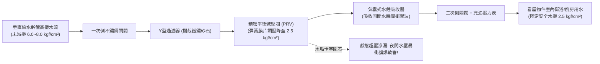

# 全案購屋實戰第三百零四部：中古大樓社區各樓層管道間自來水減壓閥閥芯水垢卡阻超壓震盪水錘消除器氣囊破裂與高樓層水管爆裂體檢工序全書

## 壹、核心查驗宗旨與前言

在高層集合住宅的給水水力工程與水電安全體系中，大樓為了克服地心引力與高層落差，高架水塔或地下室加壓泵浦輸送的水壓隨樓層向下遞增（每下降 10 公尺水壓即增加約 $1.0\text{ kgf/cm}^2$）。若無適當減壓，中低樓層（尤其是 1 至 8 樓）管道間水壓動輒高達 $5.0 \sim 8.0\text{ kgf/cm}^2$ 以上。為保護住戶室內水管、冷熱水龍頭、熱水器與逆滲透濾水器免遭高壓爆裂，建商依法必須在各樓層公共管道間或住戶進水端配置**「自來水減壓閥（Pressure Reducing Valve, PRV）」**與**「水錘消除器（Water Hammer Arrestor）」**。

然而，在屋齡 15 至 30 年的中古大樓中，管道間減壓閥系統常年隱蔽於暗門之內，缺乏定期檢測與保養，極易淪為暗藏毀滅性淹水風險的「定時炸彈」：
1. **減壓閥閥芯（Valve Core）受自來水礦物質鈣化水垢、鐵鏽砂石卡阻，造成「動態減壓失效與靜態超壓滲漏（Pressure Creep）」**，使得戶內水壓在夜間無人用水時飆升至 $6.0\text{ kgf/cm}^2$ 以上，瞬間撐爆衛浴進水金屬編織軟管與濾水器外殼，引發整戶淹水漫流至梯廳與電梯井；
2. **減壓閥內部橡膠隔膜（Diaphragm）老化疲勞破裂**，高壓生水直接由調節螺栓處向外噴射，淹毀垂直管道間內之低壓配電幹線與光纖弱電纜線；
3. **管旁配置之「氣囊式水錘消除器」橡膠氣囊疲勞穿孔、預充氣體漏光**，徹底失去吸收水流動能之彈性緩衝力；
4. **每次關閉龍頭或洗衣機進水電磁閥瞬切，激發毀滅性水錘衝擊波（壓力峰值可達正常工作水壓之 3 至 5 倍）**，將暗埋於水泥牆體內的給水彎頭震裂，造成日後難以查修的暗管結構性大滲水。

本手冊為買方打造一套精確穿透的「管道間減壓閥與水錘消除系統全套體檢工序」，結合現場水壓表量測標準、管道間開箱手動檢視、水錘聽音判讀、商務砍價談判話術與專用買賣契約特約，徹底避免交屋後遭受全屋水漫金山與數十萬元室內翻修及賠償鄰損之浩劫。

---

## 貳、自來水減壓閥與水錘消除系統技術構造與四大常見致命病灶

### 一、集合住宅樓層減壓與防衝擊技術架構
1. **直接作用式/導閥膜片式減壓閥（Direct-Acting / Pilot-Operated PRV）**：
   - 閥體通常採用耐脫鋅黃銅（DZR Brass）或 SUS316 不鏽鋼，內部包含不鏽鋼閥座、EPDM 橡膠平衡隔膜、不銹鋼調壓彈簧及精密濾網。
   - 工作原理：藉由閥後二次側出水壓力反饋至膜片下腔，與上方設定彈簧力平衡，將進口高壓（如 $6 \sim 8\text{ kgf/cm}^2$）穩定降至設定之安全出水水壓（一般住宅標準為 **$2.0 \sim 3.0\text{ kgf/cm}^2$**）。
2. **氣囊式水錘消除器（Piston/Bladder Water Hammer Arrestor）**：
   - 安裝於減壓閥出水端或立管轉折處，內部以耐油丁基橡膠氣囊隔離水室與氣室，預充 $2.0 \sim 3.0\text{ kgf/cm}^2$ 之高壓氮氣，在龍頭急停瞬間吸收數十 bar 之水力衝擊震波。
3. **前後隔離閘閥與由令活接（Union Ball Valves）**：
   - 提供線上拆卸維修與清洗濾網之便利性。
4. **耐震充油壓力表（Oil-Filled Pressure Gauges）**：
   - 監測一次側（進水端）與二次側（出水端）靜態與動態工作水壓。

### 二、中古社區常見之四大致命病灶
1. **水垢石灰沉澱卡塞閥座致使「夜間靜態超壓（Pressure Creep）」**：
   - 自來水中的鈣、鎂離子在高壓水流中析出硬質水垢，緊緊黏附在黃銅錐形閥芯與不鏽鋼閥座密封面之間，使閥門在住戶完全關閉水龍頭時無法「100% 嚴密閉合」。微量高壓水在夜間持續滲漏至戶內管道，使室內管網水壓悄然由 $2.5\text{ kgf/cm}^2$ 飆升至與立管相同的 $7.0\text{ kgf/cm}^2$ 破壞壓力，深夜無人時洗臉台軟管被硬生生撐破爆開。
2. **橡膠彈性膜片疲勞破裂噴水引發電氣短路**：
   - 橡膠隔膜長年承受高頻水壓伸縮疲勞，超過 8 年未換即產生龜裂微孔。高壓水沿著閥桿調節螺絲縫隙向外呈水霧狀噴濺，導致管道間積水沿著樓板開孔下滲至下層電氣配電箱，引發跳電短路甚至火花爆燃。
3. **水錘消除器氣囊穿孔完全「水滿失效」**：
   - 消除器內部橡膠氣囊破孔，預充氣體逸失，整座金屬罐被死水注滿。水是不可壓縮之流體，失去氣墊彈性後，每當快速扳動單槍水龍頭或洗衣機進水閥關閉，管網瞬間產生「金屬敲擊（Ping-Pong）巨響」，強大衝擊波持續拉扯暗埋冷熱水管彎頭，導致牆體內管路鬆脫暗滲。
4. **管道間暗門缺乏排水地排導致「水漫梯廳」**：
   - 早期中古大樓管道間底板未配置排水地排。減壓閥一旦微漏或爆開，管道間迅速積滿水，並沿著管道間防火門縫隙湧入各樓層梯廳，直灌電梯乘場門流入電梯底坑，造成電梯車廂電腦板燒毀、底坑緩衝器淹水泡壞。

---

## 參、買方現場看屋之管道間減壓閥與水錘五步體檢工序

### 一、步驟一：目標戶門外梯廳公共管道間暗門核查
- **管道間位置尋訪**：在看屋物件大門旁或電梯走廊牆壁上，找到標示「水管管道間」或金屬修飾暗門。
- **開啟檢視門（需仲介陪同借鑰匙或一字起子開啟）**：
  - 嗅聞內部空氣是否潮濕、有無霉味或下水道反味；
  - 手電筒照射內部底板是否有積水、潮濕泥濘或地面白華滲漏痕跡。

### 二、步驟二：減壓閥外觀與前後壓力表讀數核查
- **減壓閥本體成色**：檢視黃銅或不鏽鋼減壓閥外觀：
  - 表面是否布滿綠色銅鏽、外殼是否有水珠凝結或持續滴漏；
  - 調壓頂部螺栓是否有生鏽卡死痕跡。
- **靜態與動態壓力表差值實測**：
  - **靜態水壓（全室水龍頭關閉時）**：出水側壓力表讀數必須穩定維持在 **$2.0 \sim 3.0\text{ kgf/cm}^2$** 之間；若指針悄悄爬升超過 $4.5\text{ kgf/cm}^2$ 甚至逼近進口壓力，代表**閥芯已嚴重卡垢漏壓（Pressure Creep）**！
  - **動態水壓（全開室內水龍頭時）**：水壓落差應小於 $0.5\text{ kgf/cm}^2$，且出水壓力不得低於 $1.8\text{ kgf/cm}^2$。

### 三、步驟三：水錘消除器手感與敲擊聲音檢核
- **金屬消除器本體敲擊判別**：使用硬幣或螺絲起子金屬柄，輕輕敲擊安裝在管路上的圓柱狀水錘消除器：
  - 若發出清脆、空心的「噹、噹」金屬回音，代表內部氣室正常具備氣墊緩衝；
  - 若發出沉悶、厚重的「咚、咚」實心鈍響，代表氣囊早已破裂、內部已完全被水灌滿失效！

### 四、步驟四：目標戶室內水龍頭急開急關「水錘聽音驗收」
- **極限水錘測試**：走入看屋物件主衛浴，將面盆單槍陶瓷軸心水龍頭快速扳至全開，隨後在 **0.5 秒內瞬間用力關閉**：
  1. 仔細聆聽牆壁內部暗埋水管是否有「碰！」或「喀拉！」之強烈震動撞擊聲；
  2. 觀察洗臉台下方進水軟管是否有劇烈抽動跳躍現象；若軟管劇烈抖動且伴隨巨響，代表水錘消除器已徹底癱瘓。

### 五、步驟五：管委會管道間減壓閥定期保養更換紀錄調閱
委請仲介向管委會或水電維修廠商調閱：
1. **減壓閥整修/濾網清洗紀錄**：減壓閥內置濾網依法規應每 **1 至 2 年** 拆出清洗雜質水垢；整體閥芯與膜片標準使用壽命為 **8 至 10 年**，若已超過 15 年從未更換，必須全面整組汰換。
2. **大樓歷史水管爆裂出險理賠紀錄**：確認該社區過去是否曾發生過高樓層水管爆裂導致全棟電梯泡水停擺的重大保險理賠案件。

---

## 肆、商務談判博弈：減壓閥老化超壓殺價 15 萬元實戰話術

整棟大樓若需進行該樓層管道間減壓閥組全面抽換（包含進口 DZR 防脫鋅減壓閥、不鏽鋼 Y 型過濾器、前後閘閥與美規水錘吸收器），連工帶料水電施工報價高達 **新台幣 2 萬至 4 萬元**；若加上全棟高樓層管網水壓平衡校正與潛在室內暗管抓漏整修，整修費用超過數十萬元。買方應將此嚴重的淹水爆管風險作為狠砍總價的重磅籌碼。

> **實戰談判對話劇本：**
> 「屋主您好、周小姐您好：
> 我們在實地開啟門外管道間暗門並在室內實測水壓時，發現極具破壞性的供水安全瑕疵：管道間自來水減壓閥閥芯已嚴重水垢卡死，在關閉水龍頭時產生嚴重的靜態超壓滲漏，室內靜水壓飆破 5.5 公斤；且水錘消除器敲擊聲音完全沉悶，內部氣囊早已破裂死透，每次關閉水龍頭牆壁內都發出劇烈撞擊震波！
> 減壓閥超壓與水錘是高樓層大樓最恐怖的『淹水推手』。長期超壓隨時會撐爆衛浴進水軟管與熱水器管接頭，一旦在全家人上班外出或深夜熟睡時爆開，每分鐘數十公升的高壓水將在半小時內將室內裝潢全泡爛，甚至沿著大門灌入公共梯廳與電梯井，造成高達數百萬元的電梯損毀與鄰損賠償責任；且暗管水錘更可能早已震裂牆內管路接頭引發不可逆的暗漏。
> 我們購屋後必須立即委託專業水電工班，將管道間老舊減壓閥、過濾器與水錘吸收器全套砸錢換裝進口高壓耐用規格，並全面抽換室內老舊軟管。
> 為了承擔這項嚴重的爆管淹水風險與室內水電更新成本，我們堅持在買賣總價中直接扣除 **15 萬元** 作為給水防爆修復與安全折讓款，否則面對一個隨時可能水漫金山的物業，我們實在不敢承擔家庭財產毀滅的風險。」

---

## 伍、買賣契約特約防守條款專用字軌

為杜絕買方交屋後遭遇室內水管超壓爆裂及賠償鄰損之法律糾紛，《不動產買賣契約書》應增列下列防禦條款：

> **【公共管道間減壓閥與給水水壓穩定合格保證條款】**
> 1. **減壓設備正常運作保證**：賣方保證本買賣標的專有部分進水端及所屬樓層公共管道間之自來水減壓閥、過濾器、水錘消除器及壓力指示表，於交屋日前功能健全，能維持專有部分室內之工作水壓平穩落於標準安全範圍（靜態水壓不得超過 $3.5\text{ kgf/cm}^2$，且無水垢卡阻滲漏致水壓持續飆升之瑕疵），關閉龍頭時無劇烈水錘震盪異音。
> 2. **交屋前減壓設備修繕責任與爆管損害擔保**：若於交屋日（含）前，本社區管道間減壓閥經檢測有漏水、超壓或水錘失效情事，賣方應於交屋日前自費完成全新閥體及配件之更換修復；若交屋日前因減壓閥故障超壓致發生專有部分室內管路爆裂淹水者，賣方除應無條件修復受損管線及裝潢外，並應全額賠償對公共設施或第三人所造成之一切財產損害，買方不負任何連帶責任。
