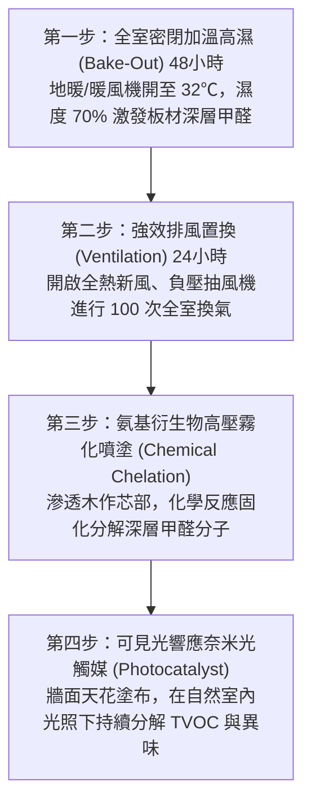

# 全案購屋實戰第九十七部：裝修室內空品淨化與零甲醛除醛除味工序全書

## 一、 核心戰略定位與目標
在中高齡中古大樓（如大安紫金城 13 樓、長億南園 8 樓）全室拆除翻修後，往往引入大量木作板材、系統櫃黏合劑、木地板底層防潮膠、窗簾軟裝與各類填縫矽利康。這些材料在高溫潮濕環境下，會持續釋放甲醛（Formaldehyde, HCHO）、苯系物（Benzene）、總揮發性有機物（TVOC）與氡氣等一級致癌物，釋放週期長達 3 至 15 年。

若家中有長輩或敏感體質成員，新居入住極易誘發呼吸道過敏、慢性咳嗽與免疫系統病變。

本手冊制定裝修源頭材料選型「綠建材標準」、裝修施工期間「低散發工序」、完工後「高溫高濕烘房（Bake-Out）強化催化工序」及「物理光觸媒+氨基除醛深層治理技術」，確保入住前空品達到世界衛生組織（WHO）與台灣環保署一級防護標準。

---

## 二、 室內空氣品質國家標準與 WHO 嚴選極限值

進場檢測與結案驗收必須以精準儀器實測以下四大指標，嚴禁使用未經校準之百元家用簡易感應器：

| 污染物項目 | 台灣環保署室內空品標準 (8小時平均) | 本手冊長輩入住嚴選標準 (1小時密閉檢驗) | 危害等級 |
| :--- | :---: | :---: | :--- |
| **游離甲醛 (HCHO)** | $\le 0.08 \text{ ppm} \; (0.10 \text{ mg/m}^3)$ | $\le \mathbf{0.03 \text{ ppm}} \; (0.04 \text{ mg/m}^3)$ | IARC 一級致癌物、鼻咽癌誘因 |
| **總揮發有機物 (TVOC)** | $\le 0.56 \text{ ppm} \; (1.28 \text{ mg/m}^3)$ | $\le \mathbf{0.20 \text{ ppm}} \; (0.45 \text{ mg/m}^3)$ | 神經毒性、眩暈、肝腎功能負擔 |
| **苯 (Benzene)** | $\le 0.03 \text{ ppm} \; (0.09 \text{ mg/m}^3)$ | $\le \mathbf{0.01 \text{ ppm}}$ | 血液系統毒性、誘發白血病 |
| **細懸浮微粒 (PM2.5)** | $\le 35 \;\mu\text{g/m}^3$ | $\le \mathbf{10 \;\mu\text{g/m}^3}$ | 深入肺泡與微血管，加重心血管負擔 |

---

## 三、 裝修施工源頭材料禁令與綠建材選型

源頭控制優於後續治理，合約估價單必須強制指定以下等級建材：

1. **木作與系統板材**：
   - 嚴格指定 **F1 級（CNS 標準釋出量 $\le 0.3 \text{ mg/L}$）** 或 **日本 JIS F★★★★（四星級）** 木芯板、夾板及密集板。
   - 嚴禁使用市售便宜未達標之 F3 級或無標籤散裝板材。
   - 所有系統板材切鋸裸露邊緣，必須以 **PUR 熱熔膠全封邊** 處理，徹底封死板材芯部甲醛逸散路徑。
2. **木工膠黏劑與矽利康**：
   - 白膠全面採用 **無毒水性聚醋酸乙烯酯（PVAc）無甲醛木工膠**（如太棒 III、南寶無醛膠）。
   - 封邊與玻璃收邊一律使用 **防霉低 VOC 變性矽利康（MS Polymer）或中性水性矽利康**，嚴禁使用酸性或具刺鼻醋酸氣味的低價矽利康。
3. **牆面塗料與批土底漆**：
   - 批土基底嚴禁加入建築用甲醛膠水，必須使用預拌型耐水石膏膩子粉；塗料一律指定 **內政部健康綠建材認證、零揮發有機化合物（Zero VOC）之乳膠漆**。

---

## 四、 完工後深層除醛四步極致工法（Bake-Out + 化學螯合）

完工細清後至正式入住前，必須預留至少 10~14 天實施標準空氣淨化療程：

### 1. 高溫高濕烘房工法（Bake-Out）
- 利用甲醛與有機溶劑「在高溫高濕環境下釋放速度呈指數級上升」的物理特性。
- 開啟全室冷暖變頻空調暖氣（或第 85 部之乾式石墨烯地暖）調升至 **30℃ ~ 32℃**，並在室內擺放加濕器或多盆溫水使相對濕度維持在 **65% ~ 75%**。
- 將全室所有櫃門、抽屜 100% 打開，高溫密閉悶焗 **12~16 小時**，強迫板材深層殘留甲醛迅速逸散至空氣中。

### 2. 強制通風置換工序
- 悶焗結束後，切勿進入室內停留。立即開啟玄關門、各窗戶，啟動大排量軸流風機向外抽風，並全開全熱交換機之「最大排風檔位」，持續強排 **6~8 小時**，將高濃度有害氣體徹底排向戶外。
- 重複執行上述「高溫悶焗 -> 強制強排」循環至少 **3~4 輪**。

### 3. 高壓無氣噴塗氨基高分子除醛劑
- 針對衣櫃內部、床箱、櫥櫃內部未貼皮裸露斷面，使用專業高壓微霧噴槍（噴嘴孔徑 0.2mm），均勻噴塗滲透型氨基高分子活性聚合物。
- 藥劑能深入板材纖維內部 3~5mm，與游離甲醛迅速發生親核加成縮聚反應，生成不可逆、無毒無害的大分子固體聚合物與水分子，徹底終結甲醛的二次釋放。

### 4. 奈米可見光光觸媒成膜防護
- 於全室天花板、牆面噴塗新一代二氧化鈦（$\text{TiO}_2$）摻雜鎢/銅離子的「可見光響應光觸媒」。
- 無需高強度紫外線，在一般室內 LED 燈光照射下即可產生強氧化性的氫氧自由基（$\cdot\text{OH}$），持續 24 小時主動分解空氣中的微量游離 TVOC、異味與細菌，建立全室空氣品質保護罩。

---

## 五、 第三方公正檢測驗收與長輩入住規範

1. **密閉 12 小時靜態取樣**：
   - 驗收前將全室門窗完全緊閉 12 小時，室溫維持在 23℃~26℃。
   - 委託取得環境部認可之第三方檢驗機構，或使用英國 PPM 原廠電化學甲醛分析儀（具備溫濕度自動補償功能），於客廳、長輩房、主臥各取樣 3 點。
2. **長輩入住許可紅線**：
   - 實測甲醛讀數低於 **0.03 ppm** 且 TVOC 低於 **0.20 ppm**，方可簽發入住許可書。
   - 長輩房內全天候配置配備 H13 級醫療 HEPA 濾網與改性活性碳柱之長效型空氣清淨機，確保安心呼吸、百歲長青。
