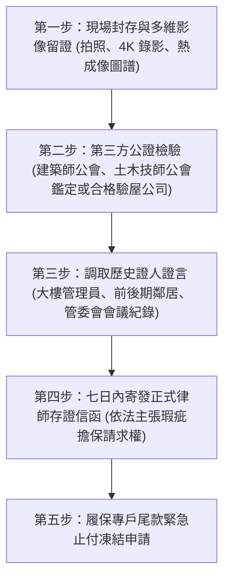

# 全案購屋實戰第九十三部：不動產現況說明書排查與隱瞞瑕疵法律訴訟實務全書

## 一、 核心戰略定位與目標
在購買台中南區 20 年以上電梯大樓（如大安紫金城 13 樓、長億南園 8 樓、歌德堡、靜園 A 區）時，房仲與賣方依《不動產經紀業管理條例》必須提供經賣方親筆簽署的「不動產現況說明書」（標的物現況說明書）。

實務上，許多惡質賣方或消極房仲常利用「勾選不清楚、未曾發現、無滲漏」或以「已現況交屋」為由，企圖掩蓋歷史漏水、鋼筋外露、非自然身故（事故屋）、違法夾層隔間、公共設施爭議或管委會訴訟等重大法律瑕疵。

本手冊制定不動產現況說明書「六大核心欄位地毯式排查法」、隱瞞瑕疵之蒐證存證標準作業流程（SOP），以及依民法行使「減少價金、解除契約、損害賠償」之實體法律訴訟實務。

---

## 二、 不動產現況說明書六大核心欄位排查指標

買方在下斡旋、簽約前，必須逐字逐項比對賣方勾選項目，嚴防模糊帶過：

### 1. 「是否有滲漏水情形及滲漏水處所」欄位
- **陷阱手法**：賣方常勾選「否」，但在備註欄以極小字體手寫「現況點交，買方自行維修」，或於看屋前突擊重新粉刷油漆（俗稱「化妝屋」）。
- **攻防排查**：
  - 嚴格要求房仲出示過去五年內有無報修或鄰損修繕記錄。
  - 明確要求加註：「賣方保證本建物截至簽約日止，並無既存暗管破裂、外牆滲漏或天花板滴水，且過去五年內無發生滲漏水修繕情事。」

### 2. 「建築改良物（房屋）是否有增建或占用情形」欄位
- **大安紫金城 13 樓專項**：
  - 現況隔成學生套房，必須核查是否有「違法敲除承重剪力牆、陽台違法外推、公共管道間擅自改道封閉、或天井違法加蓋」。
  - 勾選欄位若載明「無違建」，而現況有敲打外推，即構成民事詐欺與債務不履行。

### 3. 「是否曾發生兇殺、自殺、一氧化碳中毒致死或其他非自然身故情事」欄位
- **排查指標**：
  - 包含專有部分（室內主建物、附屬建物）以及共有部分（社區中庭、電梯機房、地下室、頂樓平台）。
  - 若賣方僅勾選「專有部分無」，必須由房仲向管委會主任委員、警勤轄區派出所或鄰里長核對「是否有跳樓墜落中庭或大樓其他非自然事故史」。

### 4. 「是否曾做過高氯離子（海砂屋）或輻射鋼筋檢測」欄位
- **排查指標**：
  - 若勾選「未檢測」，買方必須於特約條款保留：「買方得於簽約後 14 日內，自費委託公會認證之檢驗機構實施高氯離子含量檢測，若超過 CNS 3005 標準（0.3 kg/m³），買方得無條件解除契約。」

### 5. 「目前使用現況是否已由他人承租或占用」欄位
- **排查指標**：
  - 勾選「無租賃」但現場有學生居住，必須要求出示所有租客已簽署之「合意提前終止租約協議書」與「限期搬遷騰空承諾書」，嚴防適用民法「買賣不破租賃」導致買方交屋後無法進場裝修。

### 6. 「是否有共用部分重大修繕支出或管委會涉訟案件」欄位
- **排查指標**：
  - 查核管委會是否有進行中的結構維修訴訟、外牆磁磚掉落賠償、電梯更換高額攤提款（如每戶需分攤 10~20 萬）或公基金遭掏空虧損案件。

---

## 三、 發現賣方惡意隱瞞瑕疵之存證蒐證 SOP

交屋前後若發現重大隱瞞瑕疵，買方切勿私自找工人打除破壞現場，必須依序建立「鐵證鏈」：

1. **影像與時間戳留存**：以高解析度相機拍攝瑕疵全景與特寫，開啟 GPS 與時間水印，並使用紅外線熱成像儀紀錄含水量色溫圖。
2. **調取社區管委會修繕紀錄**：向物業管理中心調閱本戶過去 3~5 年訪客登記、修繕報修單或漏水協調會議紀錄。
3. **寄發存證信函（核心法定期間）**：
   - 依《民法》第 356 條規定，買方受領買賣物後，應從速檢查；若發現不能即知之瑕疵，日後發見時應「立即（實務上建議發見後 7 日至 1 個月內）」通知賣方，否則視為承認受領物。

---

## 四、 民法法定權利與實戰訴訟策略

依據中華民國《民法》物之瑕疵擔保與不完全給付規定，買方可主張三大訴訟武器：

### 1. 減少價金請求權（民法第 359 條）
- **適用情境**：瑕疵尚未達房屋結構倒塌危險，但已實質減損房屋市場價值（如壁癌、窗框滲水、地磚大面積空鼓）。
- **求償金額計算**：
  - 以土木技師公會鑑定之「修繕復原費用總額」＋「因瑕疵導致交易價值減損比率（例如減損 5%~10%）」。
  - 訴請法院判令賣方自總價金中返還該差額款項及法定遲延利息（年息 5%）。

### 2. 解除買賣契約並請求全額退款（民法第 359 條但書除外）
- **適用情境**：重大瑕疵達到「契約目的不能達成」或顯失公平（如海砂屋、重大結構樑穿孔斷裂、曾發生非自然身故凶宅、嚴重違建面臨即報即拆且無法居住）。
- **法律效果**：雙方互負回復原狀義務，賣方全額退還全部已收價金及自受領日起計算之利息，買方塗銷所有權移轉登記。

### 3. 不完全給付與侵權行為損害賠償（民法第 227 條、第 184 條）
- **適用情境**：賣方惡意知情隱瞞（明知漏水卻故意油漆遮蓋，或明知隔間非法），構成加害給付。
- **求償範圍**：除房屋修復費用外，買方因修繕延誤入住而產生的外部租屋租金、傢俱搬遷倉儲費、公會鑑定費用均可列入損害賠償範圍。

### 4. 房仲經紀業連帶賠償責任（不動產經紀業管理條例第 26 條）
- 若房仲未善盡調查義務，於現況說明書協助隱瞞或未向管委會查證，房仲公司與經紀人應與賣方負連帶賠償責任，買方並得向地政局檢舉處以 6 萬至 30 萬元罰鍰。

---

## 五、 存證信函法定要件範本（實戰直接套用）

> **【發現漏水隱瞞之買方存證信函範本】**
> 「受件人：○○○ 台端（賣方）
> 副　本：○○房屋仲介股份有限公司
> 
> 本人於民國 ○○ 年 ○○ 月 ○○ 日向台端買受坐落於台中市南區○○段○○地號及同段○○建號（門牌：台中市南區○○路○○號○○樓）之房地。
> 查台端於簽約簽署之『標的物現況說明書』項次○○明確勾選本標的物無滲漏水情事。
> 詎料本人於交屋後進場時，發見主臥室窗框牆面、衛浴天花板存有嚴重滲水剝落及鋼筋鏽蝕痕跡，經專業技師檢測判定係屬交屋前既存之管線破裂暗疾，台端顯有未依債之本旨給付並隱瞞物之重大瑕疵之情。
> 
> 特此函告：請台端於函到七日內出面會同勘驗並提出具體修繕方案；逾期未辦，本人將依民法第354條、第359條及第227條規定，逕行委託第三人修復並向台端請求修復費用及減少買賣價金，或循司法途徑解除契約並追究損害賠償與連帶法規責任，切勿自誤。」
