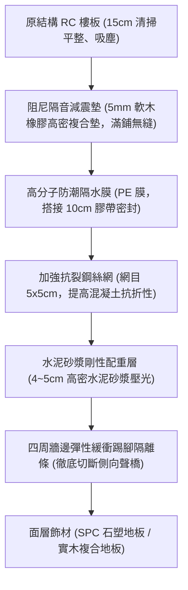
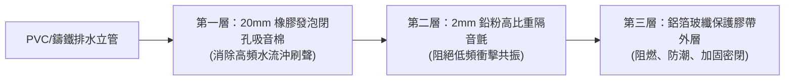

# 全案購屋實戰第九十九部：老屋隔音降噪全維體系與浮築地板阻尼減震全書

## 一、 核心戰略定位與目標
在購買台中南區 20~28 年之中古電梯大樓（如大安紫金城 13 樓、長億南園 8 樓、歌德堡、靜園 A 區）時，絕大多數建築樓板厚度僅為 15 公分（921 震災前普遍規範），遠低於現行新法規之 18~20 公分。

中古大樓最常引發鄰里惡意投訴甚至提告求償的致命問題為：
1. **樓上腳步聲、小孩跑跳衝擊音（重衝擊源）**；
2. **椅子拖拉、物品掉落高頻撞擊音（輕衝擊源）**；
3. **電梯機房鋼索變頻共振、水泵抽水振動固體傳導音**；
4. **戶外文心南路/工學路重車呼嘯之空氣傳導低頻噪音**。

本手冊融合德國與日本聲學工程規範，制定「浮築樓板（Floating Floor）隔音減震工法」、「天花板阻尼雙層隔音吊頂系統」、「排水吊管三層阻尼包覆工藝」與「全頻減噪驗收標準」。

---

## 二、 樓板衝擊音防護：浮築樓板（Floating Floor）隔音減震工法

依內政部營建署《建築技術規則》防音法規，分戶樓板之衝擊音衰減量必須達到 **$\Delta L_w \ge 17 \text{ dB}$**，本手冊直上最高規格 **$\Delta L_w \ge 22 \text{ dB}$**：

### 1. 斷絕側向聲橋（Flanking Transmission）關鍵工藝
- **牆邊隔離條全面環繞**：
  - 在鋪設水泥砂漿壓重層前，全室所有周邊牆腳、柱腳、暗喉管線四周，必須垂直向上黏貼 **8~10mm 厚之高彈性 EPDM 橡膠隔音緩衝條**，高度高於完成面 2 公分。
  - 確保上方水泥配重層與地面飾材與四周牆體「**100% 完全懸浮脫開、零物理硬性接觸**」，徹底杜絕撞擊震動經由 RC 牆體傳導至樓下。

### 2. 減震墊材質選型規範
- 嚴禁使用易受潮發霉粉化之低密度白色保麗龍（EPS）。
- 嚴格指定 **天然高密度軟木複合丁腈橡膠（Cork-Rubber Composite）隔音墊**，密度 $\ge 700 \text{ kg/m}^3$，具備終身抗壓蠕變與抗老化回彈性能。

---

## 三、 天花板雙層阻尼防護：防樓上跑跳噪音吊頂

針對樓上鄰居既有腳步聲與拖拉桌椅噪音，於長輩房與主臥天花板施作阻尼複合隔音吊頂：

### 1. 減震吊鉤（Vibration Isolator Hanger）彈性懸吊
- 傳統輕鋼架吊筋若直接膨脹螺栓固定於 RC 樓板，會將樓上樓板震動直接引入室內。
- 本工法吊筋一律串接 **專業橡膠阻尼減震吊架**（動態彈簧+阻尼橡膠），將高頻振動吸收率提高至 **85% 以上**。

### 2. 雙層錯縫夾心阻尼板構造
- **第一層**：9mm 日本麗仕高密度防焰一級矽酸鈣板。
- **中夾層**：全面滾塗 **高分子綠色隔音阻尼膠（Green Glue / Sound Dampening Compound）**，並滿鋪 **2.0mm 高比重隔音氈（面密度 $\ge 4.2 \text{ kg/m}^2$）**。
- **第二層**：12mm 防焰石膏板，與第一層矽酸鈣板進行「**接縫錯開 30 公分**」雙層自攻螺絲固定。
- **內填吸音棉**：吊頂內部骨架空腔填塞容重 **60 kg/m³ 之高密度離心玻璃棉或憎水岩棉**，吸音係數 NRC $\ge 0.85$。

---

## 四、 排水立管與穿牆孔洞聲學封堵工藝

中古大樓夜間最擾人之「樓上沖馬桶、洗澡水流嘩啦聲」，必須於管道間或吊管進行三層聲學包覆：

- **全封閉扎帶加固**：每隔 15 公分以耐低溫抗老化不鏽鋼自鎖式扎帶綑綁，接縫處搭接 $\ge 5\text{cm}$ 並以純鋁箔膠帶密封，杜絕任何聲漏縫隙（Sound Leaks）。
- **穿樓板孔洞剛性填塞**：立管穿透 RC 樓板處，先以無收縮高密度水泥灌漿固化，再於四周環填 **彈性阻燃聲學密封膠（Acoustic Caulk）**，達到防漏水、防火與隔音三合一。

---

## 五、 門窗系統全頻綜合隔噪性能指標

| 噪音來源 | 採取之對策方案 | 聲學隔音量評估 | 室內安靜度目標 |
| :--- | :--- | :---: | :---: |
| **樓上踩踏衝擊音** | 浮築樓板 + 阻尼天花板吊頂 | 衝擊音衰減 $\Delta L_w \ge 22 \text{ dB}$ | 腳步聲幾乎不可聞 |
| **馬桶排水管流音** | 三層高阻尼包覆 + 管道間防火泥 | 空氣音降噪 $\ge 25 \text{ dB}$ | 夜間沖水音降至 25 dBA |
| **戶外車流道路噪音** | 斷橋鋁合金 + 5+0.76PVB+5 雙層膠合 Low-E | 空氣隔音量 $R_w \ge 38 \text{ dB}$ | 室內環境噪音 $\le 30 \text{ dBA}$ |
| **相鄰戶分戶牆雜音** | 乾式輕鋼架雙層石膏板夾隔音氈 | 分戶牆隔音量 $R_w + C \ge 50 \text{ dB}$ | 隔壁交談與電視聲徹底阻隔 |

> **【聲學終極標準】**
> 長輩房於夜間關閉門窗後，以專業噪音計實測全頻背景噪音值必須達到 **$\le 28 \text{ dBA}$**（圖書館級極度靜謐境界），徹底消除干擾，守護長輩深度睡眠品質！
