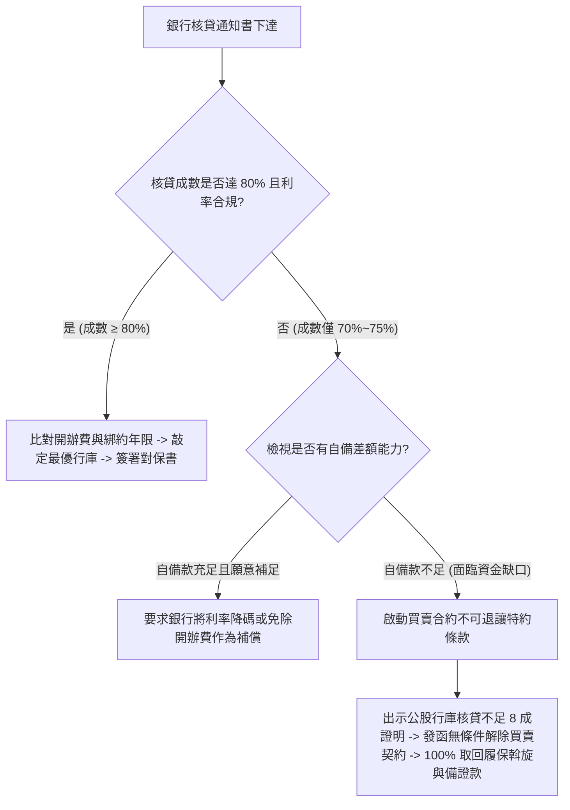

# 全案購屋實戰第九十二部：公股行庫新青安與低利房貸送件審核攻防與鑑價破局全書

## 一、 核心戰略定位與目標
在購買台中南區中古大樓（如大安紫金城 13 樓、長億南園 8 樓、歌德堡、靜園 A 區）的實戰中，簽約後的「銀行貸款核貸成數與鑑價」是決定交易成敗的最致命關卡。許多買方雖簽下「開價打折」的優質合約，卻因銀行鑑價偏低（鑑不到買價）或央行第七波信用管制（限貸令）緊縮，導致自備款突然被迫增加 50~100 萬元，陷入違約風險。

本手冊深入剖析「公股行庫新青安貸款 vs. 首購一般自住方案」、銀行鑑價「成本法與市場比較法」破局技巧、個人信用資產包裝策略，以及「雙行庫並行送件防卡件」之標準作業程序（SOP）。

---

## 二、 公股八大行庫新青安 vs. 商業銀行優利自住貸款全維對比

| 評估維度 | 財政部新青安貸款 (公股八大行庫專辦) | 一般首購型自住房貸 (兆豐/富邦/中信等) |
| :--- | :--- | :--- |
| **最高申貸額度** | 最高上限 **NT$ 1,000 萬元** | 依買賣價與鑑價孰低之 **75% ~ 80%** |
| **最長貸款年限** | 最長 **40 年** (長輩首購視年齡 + 年限 ≤ 75 規範) | 最長 **30 年** (少數銀行可專案申請 35 年) |
| **最長寬限期** | 最長 **5 年** (只繳息不還本) | 最長 **2 ~ 3 年** |
| **利率結構** | 補貼後基準利率（約 1.775% 起，依政府公告浮動） | 一般自住地板價利率（約 2.185% ~ 2.45% 起） |
| **查核門檻限制** | **本人、配偶及未成年子女名下均無自用住宅**；嚴格審查自住切結，嚴禁轉租或營業使用。 | 名下有一戶者受限貸管制（最高 5~6 成），無房者依一般首購審核。 |
| **適用標的戰略** | **大安紫金城 13 樓 / 長億南園 8 樓**（總價 700~800 萬區間，可 100% 吃滿新青安額度）。 | 若總價超過 1,200 萬以上高總價物件，採新青安 1,000 萬 + 一般房貸混搭。 |

---

## 三、 突破銀行鑑價偏低之三大實戰攻防戰術

中高齡大樓（屋齡 20~28 年）常遭遇銀行估價部以「老舊折舊公式」低估，導致鑑價低於實際買賣價。買方與地政士必須採取主動進攻策略：

### 戰術一：提供近六個月同社區與周邊 500 米實價登錄「真實最高成交範本」
- 準備「社區同等棟別/高樓層」近期實價登錄明細，排除特殊關係交易與親友買賣低價，篩選出 3 筆高價案例。
- 標註重大增值亮點：例如鄰近捷運綠線大慶站（雙鐵共構）、工學商圈成熟生活機能、和平國小明星學區、社區電梯全數更新為全新變頻機廂、地下室消防排煙機組全面升級。

### 戰術二：備妥「全室裝修修繕工程合約書與預算估價單」
- 向銀行授信主管主張「自住安全必要修繕」價值增額。
- 將水電管線抽換、浴室防水工程、氣密窗更換之預算書（約 80~100 萬）附於房貸申請書內，證明抵押物未來資產價值將大幅提升，爭取「鑑價追加 5%~10%」或加貸「房屋修繕貸款」。

### 戰術三：地政士（代書）公股通路「指定熟稔分行」與雙件齊送
- **嚴禁單一銀行送件**：簽約當日立即由代書同步向「兩家公股行庫（如土地銀行、台灣銀行）」與「一家積極型民營商業銀行（如永豐或富邦）」送件審查。
- 告知三家銀行「我們正在比對成數與核貸速度，哪一家先達標 8 成且利率合規，我們就第一優先對保」。

---

## 四、 個人授信評分優化與送審資產包裝 SOP

在送件前 30 天，買方必須完成以下信用優化動作：

1. **薪轉帳戶與流水維護**：
   - 確保薪資入帳代碼清晰（需顯示「薪資」或公司統編戶名匯入），每月固定日期入帳，切勿於發薪日當天全數提領一空，帳戶保持至少 10~20 萬元活儲平均餘額。
2. **信用卡使用與信用評分防護**：
   - 聯徵紀錄（JCIC）信用卡近 12 個月內**零循環利息、零遲繳、零預借現金**。
   - 送件前 2 個月將信用卡額度使用率壓低至 30% 以下，送件前 3 個月內嚴禁申辦任何新信用卡、信貸或查詢聯徵（維持「聯徵新業務查詢次數 ≤ 1 次」）。
3. **加分資產清單整理**：
   - 彙整儲蓄險保單價值準備金證明、台股集中保管庫存對帳單（ETF 如 0050/0056/00878 現值）、定存存單影本，作為輔助還款財力佐證。

---

## 五、 核貸結果攻防與合約特約防禦聯動

當收到銀行核貸通知書時，買方按以下步驟進行確認與談判：

> **【作戰核心心法】**
> 任何時候，買方絕不簽署「放棄房貸成數特約」的協議書。銀行如果因為鑑價低落給不出 8 成，錯不在買方，而是代表該中古物件在市場客觀價值上被賣方高估！
> 此時若賣方堅持不降價補貼差額，買方即可從容行使特約安全退場，保全全額資金，轉進下一個性價比更高的目標物件！
