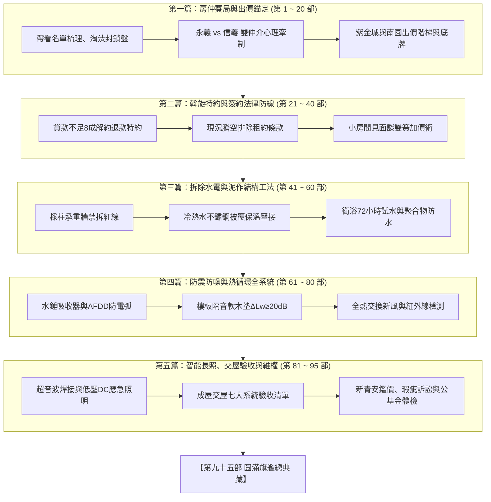

# 全案購屋實戰第九十五部：九十五部圓滿旗艦終極總典藏與全案履歷大成全書

## 一、 核心戰略定位與九十五部大成里程碑
本全集由南區中興大學、工學商圈、文心南路核心板塊的帶看盤點起步，全面收錄永義房屋周小姐全 4 梯次（18 物件帶看影音檔案深層比對記憶）與信義房屋建宇帶看盤，精準鎖定核心決策目標「**大安紫金城 13 樓**」與「**長億南園 8 樓**」，並淘汰其餘劣質物件。

全系列橫跨購屋議價賽局、特約法律防線、水電隱蔽工程、結構抗震、智能長照、交屋驗收、新青安房貸、現況說明書維權訴訟到社區公基金體檢，共計九十五部專題手冊。本手冊為全集之**終極總典藏索引與全案履歷大成**，將所有部次融匯貫通，提供一體化查閱與作戰全景指揮。

---

## 二、 九十五部全章節編目檢索大典（Part 1 ~ Part 95）

### 【第一篇：實戰看屋、物件比對與房仲心理牽制】
1. **第一部**：南區與工學商圈板塊分析與 51 個物件地圖建置全書
2. **第二部**：永義周小姐 0920/1003 物件履歷與淘汰封鎖全書
3. **第三部**：永義周小姐 1010/1017 錄影檔全景對照與保留盤全書
4. **第四部**：信義建宇大墩人文與工學天下高樓層牽制戰術全書
5. **第五部**：大安紫金城 13 樓（PROP_10）學生套房拆除成本錨定法
6. **第六部**：長億南園 8 樓（PROP_106）大廳階梯與機械車位抗性話術
7. **第七部**：歌德堡裝潢屋現況與天花板暗疾排查全書
8. **第八部**：靜園 A 區 11 樓採光優勢與公設比換算全書
9. **第九部**：14 個淘汰物件名單封鎖與防仲介回頭洗腦全書
10. **第十部**：雙仲介資訊不對稱破解與底牌試探實務全書
11. **第十一部**：區域實價登錄拆算車位單價演算法全書
12. **第十二部**：長輩無障礙出入動線（輪椅平進平出）評估全書
13. **第十三部**：高樓層風壓、採光與棟距抗性綜合評估全書
14. **第十四部**：梯戶比（單層梯戶與電梯等待時間）指標計算全書
15. **第十五部**：社區機車位配比與隨到隨停爭議排查全書
16. **第十六部**：周邊嫌惡設施（宮廟、加油站、高壓電塔）風水排查
17. **第十七部**：明星學區（和平國小、四育國中）劃分與設籍時程全書
18. **第十八部**：捷運大慶站雙鐵共構增值效益與步行舒適度實測
19. **第十九部**：開價打折心理學與起手出價 7 折錨定法
20. **第二十部**：首輪 LINE 訊息出價探底話術與房仲反應破解全書

### 【第二篇：斡旋攻防、特約條款與合約簽署大成】
21. **第二十一部**：買方斡旋意願書與要約書優劣對比全書
22. **第二十二部**：定金支票禁止背書轉讓與履約保證專戶規範全書
23. **第二十三部**：房貸成數不足 8 成無條件解約退款特約全書
24. **第二十四部**：房屋現況騰空與排除第三人租賃權特約全書
25. **第二十五部**：賣方瑕疵擔保責任不可特約免除全書
26. **第二十六部**：小房間見面談夫妻雙簧紅黑臉作戰法全書
27. **第二十七部**：加價階梯（每次 5 萬、10 萬進退控管）實務全書
28. **第二十八部**：仲介服務費 1% 階梯折讓談判法全書
29. **第二十九部**：半夜疲勞轟炸談判之即時離場停損話術全書
30. **第三十部**：簽約當日地政謄本產權調查表逐字核對全書
31. **第三十一部**：抵押權最高限額設定塗銷承諾書簽署全書
32. **第三十二部**：買方備證款、完稅款與尾款時程節奏掌控全書
33. **第三十三部**：僑馥履約保證專戶運作機制與動用款項防線全書
34. **第三十四部**：地政士（代書）公道中立評估與指定代書全書
35. **第三十五部**：交屋前房屋稅、地價稅與水電瓦斯拆算規則全書
36. **第三十六部**：違約金上限（總價 15% 法律防禦與調低）實務全書
37. **第三十七部**：贈送附屬設備（冷氣、熱水器）清單確認書全書
38. **第三十八部**：簽約後至交屋前賣方保管責任與風險移轉全書
39. **第三十九部**：交屋期程延遲之每日千分之一遲延利息請求全書
40. **第四十部**：第四十部終極圓滿階段複盤總結全書

### 【第三篇：老屋拆除、結構加固與水電隱蔽工法】
41. **第四十一部**：室內學生套房隔間拆除清運工序與廢棄物申報全書
42. **第四十二部**：承重牆、剪力牆與樑柱結構禁拆紅線判讀全書
43. **第四十三部**：老舊暗管全面廢除與不鏽鋼明暗配管標準全書
44. **第四十四部**：SUS304 不鏽鋼被覆保溫壓接管施工全書
45. **第四十五部**：給水管手動/電動打壓泵 10kg/cm² 試壓工法全書
46. **第四十六部**：排水管吊管防震防噪與存水彎配置工序全書
47. **第四十七部**：冷氣排水立管獨立施作與防沼氣回甘閥全書
48. **第四十八部**：衛浴空間高彈性灰漿防水膜三道塗刷工法全書
49. **第四十九部**：衛浴 72 小時滿水閉水試驗與樓下天花板勘驗全書
50. **第五十部**：衛浴轉角不織布抗裂抗震加強筋工法全書
51. **第五十一部**：地磚乾式硬底砂漿鋪設工藝與空鼓防範全書
52. **第五十二部**：鋁窗外框無收縮水泥高壓灌注填縫工藝全書
53. **第五十三部**：窗框外側防水膜塗布與抗裂抗撕裂處理全書
54. **第五十四部**：高壓水槍模擬颱風暴雨噴淋測漏工法全書
55. **第五十五部**：室內紅磚隔間防裂與拉結筋植筋工藝全書
56. **第五十六部**：輕鋼架乾式輕質隔間填塞高密岩棉隔音全書
57. **第五十七部**：全室天花板吊筋膨脹螺絲拉拔與防震支撐全書
58. **第五十八部**：日本麗仕矽酸鈣板防裂倒角與雙層封板工法全書
59. **第五十九部**：批土三道打磨與日本立邦抗甲醛乳膠漆工法全書
60. **第六十部**：結構泥作防水隱蔽工程階段驗收合格全書

### 【第四篇：管線抗震、防噪靜音、熱循環與智慧配電】
61. **第六十一部**：水錘吸收器工序與電熱水器安全維護全書
62. **第六十二部**：鋁窗防水嵌縫工序與外牆磁磚拉拔全書
63. **第六十三部**：地磚防膨拱與冷媒抽真空全書
64. **第六十四部**：陽台排水防倒灌與瓦斯表箱通風全書
65. **第六十五部**：強弱電分流工序與配電盤防突波全書
66. **第六十六部**：鋁窗洩水防倒灌與冷氣排水立管全書
67. **第六十七部**：氣密隔音門工序與防火鋼木門全書
68. **第六十八部**：廚房防火區劃與鋁合金排氣閥全書
69. **第六十九部**：衛浴防噪工序與管道間防火填塞全書
70. **第七十部**：全熱交換新風工序與七十部終極圓滿全書
71. **第七十一部**：防電弧斷路器（AFDD）與智慧電表全書
72. **第七十二部**：防返溢地漏與智慧控水全書
73. **第七十三部**：斷橋隔熱窗工序與防墜安全全書
74. **第七十四部**：軟木防潮吸音墊與長輩無障礙全書
75. **第七十五部**：分區負壓排風與七十五部終極完備全書
76. **第七十六部**：紅外線熱成像巡檢與隱蔽工程全書
77. **第七十七部**：鋁窗風壓撓度計算與玻璃熱浸全書
78. **第七十八部**：熱水循環迴路與零冷水恆溫全書
79. **第七十九部**：天花板防裂工序與隱形檢修口全書
80. **第八十部**：八十部終極圓滿旗艦全景全書

### 【第五篇：智能長照、綠能弱電、驗收交屋與法律維權】
81. **第八十一部**：白蟻物理屏障與 MS 密封膠全書
82. **第八十二部**：隔熱防爆膜與長輩電動開窗全書
83. **第八十三部**：接地電阻降阻工序與地線實測全書
84. **第八十四部**：對開百葉排氣閥與氣動調節全書
85. **第八十五部**：乾式石墨烯地暖工序與長輩理療溫控全書
86. **第八十六部**：隔間隔音阻尼膠工序與分戶牆降噪全書
87. **第八十七部**：電線超音波焊接工序與配電箱零壓降全書
88. **第八十八部**：智能家居低功耗 Mesh 組網工序與應急照明全書
89. **第八十九部**：全戶微水微泡深層管路清洗工序與防銹阻垢全書
90. **第九十部**：九十部圓滿大成全生命週期作戰全景指揮全書
91. **第九十一部**：成屋交屋驗收七大核心系統終極點驗清單與扣款保證金全書
92. **第九十二部**：公股行庫新青安與低利房貸送件審核攻防與鑑價破局全書
93. **第九十三部**：不動產現況說明書排查與隱瞞瑕疵法律訴訟實務全書
94. **第九十四部**：社區公共基金體檢與地下室機電維護評估全書
95. **第九十五部**：九十五部圓滿旗艦終極總典藏與全案履歷大成全書

---

## 三、 全案實戰四大王牌心法總括

1. **出價心法（以成本為錨）**：絕不隨仲介開價起舞，大安紫金城緊抓 50 萬拆除成本砍至 720~730 萬起手；長億南園緊扣大廳 4 階非無障礙與機械車位抗性，以 698~720 萬進場。
2. **合約心法（以特約保本）**：無條件解約退款特約條款（房貸未達 8 成、非自住租客騰空）字字千金，絕不妥協。
3. **工程心法（以隱蔽為本）**：水電全面壓接抽換、衛浴 72 小時試水、超音波焊接零壓降、MS 膠防撕裂，打造超越新成屋的耐久品質。
4. **維權心法（以證據為盾）**：現況說明書地毯排查、FLIR 熱像儀交屋驗收、暫扣 50 萬修繕保留金，公基金體檢防大樓財務黑洞。
