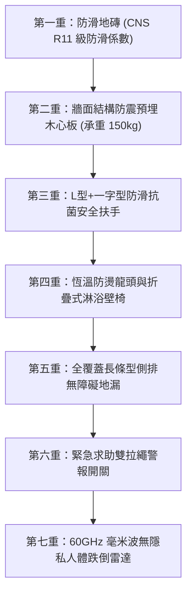

# 全案購屋實戰第九十八部：長輩全齡無障礙全室通用設計與防跌安全工序全書

## 一、 核心戰略定位與目標
在購買台中南區中高齡中古大樓（如大安紫金城 13 樓、長億南園 8 樓）時，購屋的核心目標之一是為家人與長輩打造「安居、防跌、無障礙、尊嚴養老」的永續生活空間。

長輩隨著年齡增長，肌力衰退、視力退化與關節退化，居家最致命的意外為「室內跌倒」，特別是發生在**浴室濕滑地面、臥室至廁所走廊轉角、地面門檻高低差**。

本手冊嚴格遵循內政部《建築物無障礙設施設計規範》與日本通用設計（Universal Design）最高標準，制定「全室零高低差（Zero Threshold）、超寬輪椅動線、動態輔助扶手預埋結構、長輩衛浴全防護與智慧跌倒雷達」施工工藝。

---

## 二、 全室零高低差地面工序與輪椅通道規範

### 1. 「全面平整、零門檻」地坪工程
- **全面打除凸出門檻**：
  - 全室房間門、衛浴門、廚房門及陽台出入口，嚴禁安裝傳統 3~5 公分高之凸出大理石門檻或金屬收邊條。
  - 衛浴乾濕分離門檻改採「無障礙嵌入式地面隱形排水溝」或「軟質防撞可碾壓矽膠止水條」，輪椅或助行器可平順無阻推入。
- **不同材質地坪平整接縫**：
  - 客廳拋光磚/石塑地板與長輩房軟木木地板相接處，必須以水平紅外線抓平，交接處使用「嵌入式扁平 T 型純銅/鋁合金平壓條」，高低落差嚴格限制在 **$\le 2\text{mm}$**。

### 2. 室內門扇與通道淨寬紅線
- **輪椅通行動線寬度**：
  - 室內所有主要走廊淨寬必須 **$\ge 95 \text{公分}$**（容納輪椅迴轉與照護者並行）。
  - 各房門與衛浴門開口淨寬必須 **$\ge 80 \text{公分}$**（輪椅標準寬度 65 公分 + 雙側安全緩衝 15 公分）。
- **橫拉滑門（Sliding Door）替代推拉門**：
  - 長輩房與衛浴門全面採用「懸吊式靜音上軌橫拉滑門」，地面無凹槽軌道（防藏污納垢與絆倒）。
  - 配備雙向軟關閉（Soft-close）阻尼緩衝五金，防止關門夾手與碰撞驚嚇。

---

## 三、 長輩衛浴防跌七重金鐘罩工藝

衛浴是居家跌倒好發率高達 60% 的危險區域，必須施作最高規格防護：

1. **地磚防滑係數**：
   - 衛浴地磚嚴格選用吸水率小於 0.5%、表面具備微細凹凸咬花之石英防滑磚，濕態防滑係數必須達到 **CNS 3299-8 規定之 C.S.R（抗滑係數）$\ge 0.55$ 或德國 DIN 51130 之 R11 級**。
2. **牆體結構扶手預埋加固**：
   - 在輕鋼架或紅磚隔間打底階段，馬桶兩側、淋浴區兩側預先以 **6分（18mm）防腐耐水木心板或不鏽鋼角鐵** 進行內部骨架結構加固。
   - 確保日後安裝安全扶手時，每顆膨脹螺栓抗拉拔力達 **150 kg 以上**，絕不發生扶手扯脫墜落。
3. **安全扶手黃金高度與握持直徑**：
   - 馬桶側配置長度 70cm 之「上掀式可折疊無障礙扶手」（離地高度 70~75cm）；淋浴區配置「L 型多功能扶手」，握管外徑為符合人體工學之 **32~35mm**，表面包覆抗菌防滑抗靜電尼龍材質（冬不冰手）。
4. **洗澡折疊壁椅與恆溫龍頭**：
   - 淋浴區安裝可上折貼牆之鋁合金防滑淋浴坐椅（耐重 150kg，座高 42cm，防長輩久站頭暈跌倒）。
   - 水龍頭全面配備「40℃ 安全防燙鎖扣恆溫陶瓷閥芯花灑」，本體具備冷水包覆防燙隔熱層。

---

## 四、 燈光視覺照明、柔和夜起導引與智能防跌監測

### 1. 長輩退化視覺之照明規劃
- **防眩光與高顯色指數**：
  - 全室主照明色溫選用柔和溫暖的 **3000K ~ 3500K**，顯色指數 **$\text{Ra} \ge 90$**，光線均勻無陰影暗角。
  - 燈具一律選用深防眩（UGR < 19）微晶防眩透鏡筒燈，避免長輩白內障或視力退化引起眩光刺眼。
- **床邊長輩夜起柔光動線**：
  - 長輩床底安裝「低位人體紅外線微光感應燈帶」（腳著地自動感應亮起，照度 10 Lux 柔光不刺眼）。
  - 導引路徑串聯第 88 部之廊道低壓 DC 12V 應急地腳燈，直達衛浴。

### 2. 60GHz 毫米波跌倒雷達（Millimeter Wave Radar）
- **無攝影鏡頭隱私防護**：
  - 於長輩房天花板與衛浴天花板正中央，各安裝一台 60GHz 毫米波雷達感測器。
  - 無光學鏡頭，完全尊重長輩隱私（洗澡與更衣不尷尬）。
- **跌倒秒級智能警報與聯動**：
  - 透過都卜勒微震盪與點雲深度演算法，精準感知人體高度瞬間驟降、躺臥不動超過 30 秒之跌倒狀態（準確率 > 98%）。
  - 一旦判定跌倒，立即執行：
    1. 浴室門外紅色蜂鳴器警報聲響起；
    2. 自動發送推播通知子女手機與緊急聯絡人；
    3. 自動將浴室橫拉門電控磁吸鎖解鎖，方便急救人員第一時間進入救援。
