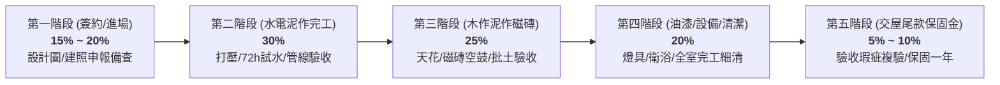

# 全案購屋實戰第九十六部：裝修工程合約法律防線與按階段驗收撥款全書

## 一、 核心戰略定位與目標
在買下中古大樓（如大安紫金城 13 樓或長億南園 8 樓）後，緊接著進入金額高達 100~200 萬的「全室水電泥作翻修工程」。裝修市場長期存在「工班惡意停工勒索、中途加價追加預算、建材以次充好、捲款爛尾逃匿」等嚴重糾紛。

許多屋主在買房時精打細算，卻在裝修階段簽下「統包公司一面倒的定型化霸王條款」，導致血汗錢化為烏有。

本手冊制定專業工程合約核心防禦條款、標準「五階段 3-3-2-1.5-0.5 撥款比例模型」、材料封樣與進場驗收表，以及工期延遲每日罰則標準。

---

## 二、 裝修工程撥款黃金比例：五階段驗收撥款模型

絕不能採用統包常要求的「簽約即拿 30%、拆除再拿 30%」之高風險撥款方式，必須嚴格綁定實體「驗收合格書」：

| 撥款階段 | 撥款比例 | 觸發撥款之唯一法定條件 |
| :--- | :---: | :--- |
| **第一期：開工準備款** | **15%** | 簽署內政部版標準合約、施工圖面全套確認、室內裝修施工許可證（裝修審查）核准掛件並完成管委會施工保證金繳納。 |
| **第二期：隱蔽工程驗收合格款** | **30%** | 全室隔間拆除清運完畢、冷熱水管抽換完成且 **10kg/cm² 試壓 1 小時無掉壓**、衛浴 **72 小時蓄水無滲漏**、電線重拉且紅外線/絕緣測試完成。 |
| **第三期：泥作木作磁磚款** | **25%** | 全室地壁磚鋪設完畢（探針敲擊空鼓率 ≤ 5%）、矽酸鈣板天花板封板完成且吊筋防震達標、鋁窗外框無收縮水泥嵌縫與防水膜驗收合格。 |
| **第四期：完工細清初步驗收驗** | **20%** | 批土三度乳膠漆噴塗完工、木作櫃體五金絞鏈順暢、廚衛設備安裝通水無滲漏、全室專業細清完成。 |
| **第五期：驗收尾款暨保固保證金** | **10%** | 依「工程驗收缺失改善清冊」全數複驗合格，簽署正式結案驗收書，並出具「全室水電防水結構保固書（至少 3 年）」後撥付。 |

---

## 三、 裝修合約不可退讓之五大法律特約條款

在合約中必須手寫或增訂以下補充特約，防堵惡意追加與工期延宕：

### 1. 「總價包工包料包清運、嚴禁未經書面簽署之擅自追加」條款
> 「本工程採總價承包制，工程總價已包含本合約圖說、估價單及工程規範所載之一切人工、建材、耗材、搬運、保護工程、廢棄物合法清運申報及營業稅捐。
> 乙方（統包/設計公司）保證所附估價單已充分評估現場狀況，除經甲方（業主）事前以書面簽署『工程變更追加確認單』並明確載明工期與增減金額外，乙方不得以任何理由要求追加工程款項；凡未經甲方書面簽名確認之工項，甲方一概不予計價付款，乙方不得藉故停工或拖延工期。」

### 2. 「工期延遲每日違約金與逾期解約」條款
> 「本工程約定開工日為民國 ____ 年 __ 月 __ 日，完工日為民國 ____ 年 __ 月 __ 日，總工期為 ____ 日曆天。
> 除天災等不可抗力經雙方書面確認展延外，乙方每逾一日完工，應按工程總價 **千分之一（1/1,000）** 支付甲方逾期違約金，甲方得直接由尚未支付之工程款中逕行扣抵。
> 若逾期超過 **拾肆日曆天（14天）** 仍未完工，或連續停工達五日以上，甲方得逕行以書面通知解除本契約，乙方除應全額退還超額領取之款項外，並應賠償甲方因此支出之外部租屋租金及重新發包差額損失。」

### 3. 「建材品牌規格封樣與以次充好懲罰性賠償」條款
> 「估價單所列各項建材（如電線：太平洋/大亞 2.0mm/5.5mm；冷熱水管：大西洋/美亞 SUS304；矽酸鈣板：日本麗仕 6mm；乳膠漆：得利全效/立邦淨味；防水材：雙液型高彈灰漿），乙方必須使用指定原廠正品並於進場時出具原廠出廠證明。
> 嚴禁使用同等品代替；若經甲方發現使用非約定品牌、規格不符或仿冒品，乙方除應無條件立即打除重做外，並應按該工項金額之 **三倍** 支付懲罰性違約金予甲方。」

### 4. 「廢棄物合法清運與社區管理規約遵守」條款
> 「乙方應嚴格遵守本大樓住戶規約與台中市政府裝修施工規範，施工時間限定為週一至週五上午 8:30 至下午 17:30，例假日嚴禁打石施工。
> 所有拆除廢棄物必須委託具備環保局核發清除許可證之合格清運車輛清運，嚴禁任意堆置於公共梯間或違法傾倒。若因施工造成公設損壞、粉塵污染或遭主管機關開罰，一切修復與罰款全數由乙方承擔。」

### 5. 「防水與水電工程保固承諾」條款
> 「自全案正式驗收合格之日起，乙方就本案之給排水管路、電氣配線及衛浴/窗框防水工程，負 **參年（3年）** 免費保修責任；一般泥作木作油漆工程負 **壹年（1年）** 保修責任。
> 於保固期間內若發生滲漏水或線路短路故障，乙方應於接獲甲方通知後 **48 小時內** 派員到場勘驗，並於 **五日內** 完成無條件修復；逾期未辦理者，甲方得委託第三人修復，修復費用全額向乙方追償或自保固保證金中扣抵。」

---

## 四、 裝修進場建材核對驗收表（Checklist）

| 建材項目 | 查驗核對重點 | 檢驗方式 | 判定標準 |
| :--- | :--- | :--- | :--- |
| **電線電纜** | 太平洋（Pacific）或大亞（Ta-Ya），CNS 認證標章 | 檢視線身印刷字體與標檢局字號 | 嚴禁雜牌、水貨或銅芯截面縮水線 |
| **給水不鏽鋼管** | SUS304 壓接管，外層原廠發泡被覆保溫層 | 磁鐵吸附檢測、游標卡尺測壁厚 | 標示 SUS304，管壁厚度合規 |
| **矽酸鈣板** | 日本麗仕（NewLux）防焰一級綠建材標章 | 檢驗板背原廠防偽印章與出廠證明 | 不含石棉、密度 ≥ 0.8 g/cm³ |
| **防水塗料** | 日本進口或富祿客/金南樹脂單/雙液聚合物高彈灰漿 | 現場拆封包裝、出廠批號與檢驗報告 | 現場加水攪拌無沉澱結塊，成膜強韌 |
| **塗料油漆** | 得利抗甲醛竹炭乳膠漆或立邦淨味全效 | 封條完好、未經調水稀釋之原裝桶 | 環保低 VOC、無刺鼻有機溶劑味 |
