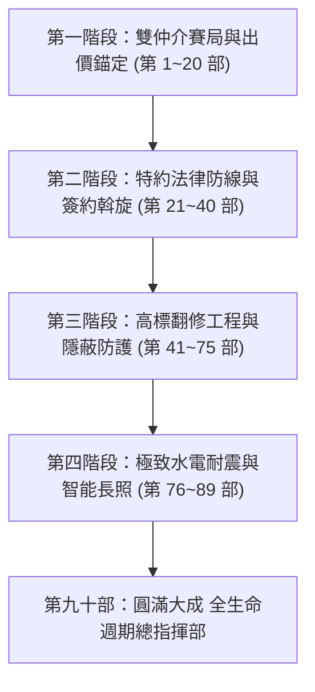

# 全案購屋實戰第九十部：九十部圓滿大成全生命週期作戰全景指揮全書

## 一、 核心戰略定位與九十部大成里程碑
從南區中興大學、工學商圈、文心南路核心板塊的看屋初篩，到鎖定「大安紫金城 13 樓」與「長億南園 8 樓」，再至實體工程工法、材料規格、合約法律及智能水電安全，本全集已歷經完整 90 部全景架構。

本第九十部作為「**全生命週期作戰總指揮指南**」，將全案四階段（仲介談判、簽約避坑、全屋翻修工藝、交屋智能維權）熔鑄為即查即用的作戰總綱，讓屋主掌握 100% 主動權。

---

## 二、 全生命週期四維作戰矩陣速查

### 1. 雙仲介心理牽制與價格錨定實戰
- **錨定主線**：
  - **大安紫金城 13 樓**：以「原屋主隔學生套房需 40~50 萬拆除復原成本」為核心錨點，起手出 **720~730 萬**，預期成交 **768~788 萬**，封頂停損 **818 萬**。
  - **長億南園 8 樓**：以「大廳 4 階非無障礙、長輩進出不便」與「坡道機械車位未來高額保養重置款」為抗性，起手出 **698~720 萬**，預期成交 **745~760 萬**，封頂停損 **788 萬**。
- **牽制副線**：
  - 以信義建宇的大墩人文（950 萬 / 31 坪）壓制永義周小姐長億南園的單價；反向以大安紫金城的坡道平面大車位，打擊信義大墩人文與工學天下的車位劣勢。

### 2. 簽約與特約條款不可退讓三鐵律
1. **貸款特約解約條款**：
   > 「買方申辦金融機構房屋貸款條件，指定以本買賣標的物向公股行庫申貸，若核准成數未達買賣總價之八成（80%）或年利率逾指定上限者，本買賣契約無條件自動解除，賣方及房仲經紀業應於三日內無息全額返還買方已給付之定金、斡旋金及簽約備證款項，雙方均不得向對方請求任何損害賠償或違約金。」
2. **租約排除與現況騰空特約**：
   > 「賣方保證於交屋日前，徹底終止並排除本建物室內一切租賃關係、占用權利及第三人占有事實，並負責於交屋日前全數搬遷騰空；若交屋時仍有租客、遺留物或占有糾紛，買方有權停止撥付尾款，並按日請求買賣總價千分之一之違約罰款至排除為止。」
3. **重大瑕疵與滲漏水賣方修繕擔保**：
   > 「賣方承諾擔保交屋時無非自然身故、海砂屋、輻射鋼筋及結構損害。交屋後半年內若發現既存壁癌、窗框暗管滲漏水，賣方應負完全修繕至乾燥平整責任，不得以現況交屋為由免除瑕疵擔保責任。」

### 3. 老屋翻新隱蔽工程工法精華標準
- **水電篇**：
  - 電線接頭全面採用**超音波冷壓端子與超音波焊接**，配電盤配置 **AFDD 防電弧斷路器**，實測接地電阻小於 **50Ω**。
  - 冷熱水管全面更換 **SUS304 不鏽鋼壓接被覆保溫管**，配置**水錘吸收器**，並於交屋後實施**微泡高頻螺旋脈衝深層洗管**。
- **泥作防水篇**：
  - 衛浴防水施作**日本進口單液型聚合物水泥基防水膜（高彈灰漿）**，轉角鋪設抗裂抗震聚酯抗裂網，試水 72 小時零沉降。
  - 鋁窗四周打除見紅磚/RC，施作**高分子彈性水泥打底 + 高密度水泥無收縮填縫 + 外層抗撕裂 MS 變性聚矽氧樹脂密封**。
- **靜音長照與空調篇**：
  - 鋪設 **5mm 軟木橡膠高密防潮吸音墊**，衝擊音降噪指標超標達到 **ΔLw ≥ 20 dB**。
  - 長輩動線布設 **DC 12V UPS 應急地腳燈**，地震或斷電即刻自動點亮；全室開關配置**零火線 Zigbee 3.0 / Thread 路由器節點**，打造 100% 離線智能安全網。

---

## 三、 九十部圓滿大成里程碑核檢

| 篇章分類 | 核心部次 | 代表性作戰精華 |
| :--- | :--- | :--- |
| **第一部 ~ 第二十部** | 雙仲介博弈與實地評測 | 永義周小姐 4 梯次（18 物件）與信義建宇梯次全面梳理，精確建立篩選與除名決策庫。 |
| **第二十一部 ~ 第四十部** | 議價話術與見面談佈局 | 夫妻唱雙簧紅黑臉、斡旋特約防線、定金託管、服務費 1% 階梯折讓話術。 |
| **第四十一部 ~ 第六十部** | 結構拆除、管線與防水 | 加強磚造/RC 樑柱禁拆紅線、冷熱水分流、衛浴 72 小時閉水、鋁窗高壓水柱防颱測漏。 |
| **第六十一部 ~ 第八十部** | 防震、防噪與熱循環系統 | 水錘消除、強弱電分流、管道間阻火填塞、乾式地暖、玻璃熱浸防自爆、紅外線熱成像檢驗。 |
| **第八十一部 ~ 第九十部** | 綠能安防、弱電與智能長照 | MS 膠防老化、配電箱零壓降、Zigbee 本地化 Mesh、DC 應急照明、深層脈衝微泡管洗。 |

---

## 四、 終極行動方針
您現在手握最完備的台中買房、議價談判、合約防護與工程監工兵書。無論房仲周小姐或信義建宇如何出招試探，依據手冊之價格底牌與特約條款，立於不敗之地！
