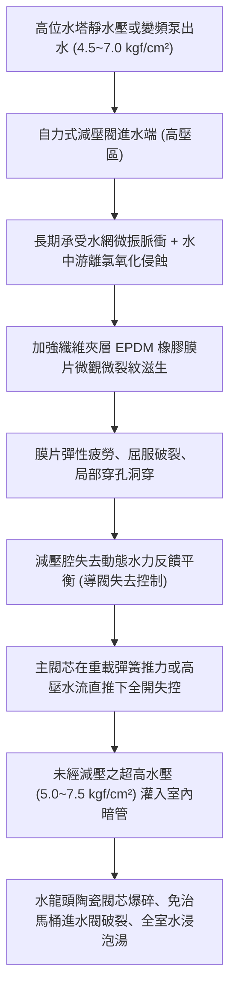
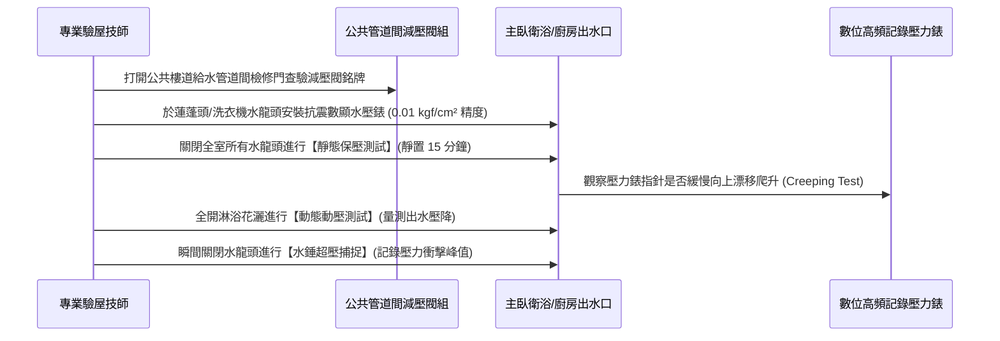

# 全案購屋實戰第九百九十一部：中古大樓高樓層生活給水管路減壓閥組（PRV）膜片疲勞穿孔高壓水流直衝破壞衛浴陶瓷閥芯體檢工序全書

## 導言：高樓給水加壓與水壓平衡的生命之閥

在台灣都會區集合住宅中古大樓中，為了滿足整棟住戶各樓層充足之自來水出水流量與龍頭動態水壓，通常採取「地下室蓄水池由揚水泵強制抽送至屋頂水塔，再依重力位能向下分區供水」，或是配置「頂樓/中繼層變頻加壓雙泵（Booster Pumps）」向下高速送水。

根據流體靜力學公式 $P = \rho g h$（每下降 10 公尺，靜水壓即劇增約 $1.0\text{ kgf/cm}^2 \approx 0.1\text{ MPa}$）：
- 對於樓高 12 至 25 層之高層中古大樓，若未分區減壓，底層與中低樓層之靜態供水壓力將高達 $5.0 \sim 8.0\text{ kgf/cm}^2$ 以上！
- 即使是高樓層（如 8 樓至 13 樓之主力候選物件），在變頻泵浦頻繁起跳增壓或水塔高位供水下，供水立管通常均強制裝設「直接作用式或導閥式自力減壓閥組（Pressure Reducing Valve, PRV）」，將入戶靜水壓精確穩定控制在家庭人體最舒適且設備最安全的 **$1.8 \sim 2.5\text{ kgf/cm}^2$（0.18 ~ 0.25 MPa）** 範圍內。

然而，減壓閥內部的「三元乙丙橡膠（EPDM）或加強纖維夾層橡膠膜片（Diaphragm）」，長年遭受管網微振、高低溫水交變衝擊與水中餘氯化學氧化。當大樓屋齡達到 15 至 25 年以上時，橡膠膜片極易發生微觀微孔老化、疲勞硬化或瞬間穿孔撕裂。一旦膜片穿孔，減壓閥將徹底喪失降壓調節機能，導致高達 $5\sim 7\text{ kgf/cm}^2$ 的狂暴高壓生水毫無阻礙地直衝室內暗管；在水龍頭關閉瞬間，更會激發超過 $10\text{ kgf/cm}^2$ 的劇烈水錘（Water Hammer）。這股超壓衝擊波將瞬間擊碎全室精品水龍頭的精密陶瓷閥芯（Ceramic Cartridge）、震裂免治馬桶電磁進水閥塑膠本體、破壞熱水器防爆水盤，甚至造成牆體內部冷熱水壓接不銹鋼管件卡套脫扣爆裂，釀成全室百萬木地板與精品裝潢泡水全毀之滅頂慘劇！

本全書深入解構減壓閥膜片微觀撕裂機制、高靈敏動態水壓驗屋工序、標準修復更換工藝與四大候選物件實戰議價攻防策略。

---

## 一、自力式減壓閥工作原理與膜片疲勞穿孔失效機理

### 1. 減壓閥之精密動態力學平衡
自力式減壓閥依靠內部感壓膜片、調節彈簧與閥芯組成的閉迴路力平衡系統：
- **力平衡公式**：$F_{\text{彈簧}} = P_{\text{出水}} \times A_{\text{膜片}} + F_{\text{摩擦}}$。
- 當出水端用水量增加、壓力微降時，調節彈簧推動膜片向下位移，帶動閥芯開度增大以補充流量；當用水停止、出水端壓力上升時，出水水壓向上推動膜片壓縮彈簧，帶動閥芯關小，將出口靜態水壓精確鎖定在設定值（如 $2.2\text{ kgf/cm}^2$）。

### 2. 膜片疲勞穿孔之三重微觀誘因
- **餘氯（Free Chlorine）與臭氧之交聯斷裂**：自來水中添加的次氯酸鈉消毒劑分解出的活性游離氯，會對橡膠彈性體高分子聚合物產生持續性強烈氧化，使 EPDM 橡膠交聯密度下降，膠層表面發生微觀硬化、龜裂（Chlorine Degradation）。
- **交變水壓的微彎曲疲勞（Flex Fatigue）**：大樓每日早晚尖峰用水，全棟水壓在短時間內反覆劇烈波動數百次。膜片圓周折疊邊緣（Rolling Convolution）長期承受往復彎曲應力集中，纖維加強層（尼龍布或滌綸織物）與外層橡膠發生微觀脫膠剝離。
- **管網高頻水錘與空化氣蝕（Cavitation）**：當高樓層住戶快速關閉單把手陶瓷龍頭時，產生的反射水錘波在減壓閥下游劇烈震盪，若減壓閥上游未裝設緩衝避震器，局部流速過快導致靜壓低於水飽和蒸氣壓，引發空化微氣泡爆裂，直接衝蝕並擊穿橡膠膜片表面。

---

## 二、現場動態/靜態水壓高精度量測與體檢驗收工序

家庭買方在實地看屋時，管道間給水減壓閥是最容易被忽略卻最具破壞力的「隱形地雷」，必須嚴格落實以下三步檢測程序：

### 1. 靜態水壓漂移測試（Static Pressure Creeping Test）
- **檢驗原理**：若減壓閥膜片微孔穿孔或主閥瓣密封橡膠磨損，在全室停止用水時，高壓生水將透過微孔持續滲漏至室內管網，使出水端壓力由正常的 $2.0\text{ kgf/cm}^2$ 一路緩慢爬升，直至與上游管網高壓完全等同。
- **判定標準**：
  - **優良（綠燈）**：靜態水壓恆定於 **$1.8 \sim 2.5\text{ kgf/cm}^2$**，靜置 15 分鐘內指針完全靜止，壓力漂移量小於 $0.1\text{ kgf/cm}^2$。
  - **危急（紅燈）**：全室關閉龍頭後，水壓錶指針一路攀升至 **$4.5 \sim 6.5\text{ kgf/cm}^2$**，證實減壓閥膜片已穿孔或閥瓣密封面卡渣失效，室內管網隨時面臨爆管威脅！

### 2. 動態水壓與壓降比量測（Dynamic Flow Test）
- **測試流程**：全開廚房水龍頭與主衛淋浴龍頭，觀察水壓錶上的動態水壓。
- **數據極限值判定**：
  - 正常減壓閥之動壓與靜壓差值（壓降）應控制在 **$0.3 \sim 0.6\text{ kgf/cm}^2$** 之間，動態出水壓維持在 $1.5 \sim 1.8\text{ kgf/cm}^2$。
  - 若一開龍頭水壓瞬間歸零或水流細小如涓絲，關閉時又回升至高壓，代表減壓閥內部調節彈簧斷裂或閥軸卡死阻水。

### 3. 水龍頭急關瞬間之水錘動態採樣
- 以手動快速推下單把手冷熱水混合龍頭，使用採樣頻率 1000Hz 之數位壓力記錄儀監控水管內部壓力峰值。
- **標準**：若減壓閥回饋靈敏且管網阻尼正常，水錘超壓峰值應小於靜壓的 **1.3 倍（即 $\le 3.0\text{ kgf/cm}^2$）**；若採樣到超過 **$6.0 \sim 8.0\text{ kgf/cm}^2$** 的劇烈峰值尖峰並伴隨管道「匡、匡」震動，代表水網緩衝防線完全崩潰。

---

## 三、故障修復、標竿減壓閥組配置與材料更換工藝

一旦確認管道間減壓閥膜片老化穿孔，必須依照自來水管網標竿工程標準進行全面翻修：

| 工程階段 | 標竿工程規範與高端用料要求 | 廉價劣質短命工法之後遺症 |
| :--- | :--- | :--- |
| **減壓閥本體** | 選用 **SCS13 / SUS304 全不銹鋼或耐脫鋅黃銅（DZR Brass）** 直動式可調減壓閥，具備 NSF/ANSI 61 飲用水安全認證。 | 選用普通灰口鑄鐵或翻砂生銅閥體，數年內生鏽卡死、重金屬鉛超標析出。 |
| **橡膠膜片選型** | 採用 **三元乙丙橡膠夾雙層高強度芳綸纖維布（Kevlar-Reinforced EPDM）**，厚度 $\ge 3.0\text{mm}$，耐氯、耐老化壽命達 15 年以上。 | 採用普通單層再生丁腈橡膠（NBR），在自來水餘氯侵蝕下 1~2 年內脆裂穿孔。 |
| **調節彈簧配置** | 指定 **SUS302 / SUS316 超高抗疲勞不銹鋼彈簧**，表面經聚四氟乙烯（PTFE）防腐塗層處理。 | 使用普通碳鋼烤漆彈簧，在管道間潮濕水氣下嚴重生鏽斷裂。 |
| **雙錶與過濾器配置** | 減壓閥前後必須配置 **全不銹鋼充油抗震壓力錶（進水、出水各一）**，且前端必須強制安裝 **SUS304 80目 Y型過濾器**。 | 前端未裝過濾器，管中鐵鏽焊渣直接卡死減壓閥密封面導致失靈。 |
| **旁通與活接頭** | 減壓閥組兩端必須配置全通徑銅活接頭與 **旁通檢修管路（Bypass Loop）**，便於日後 30 分鐘內免停水快速更換膜片。 | 無活接頭直接硬焊或死膠黏合，維修時必須大動干戈切鋸主給水立管。 |

---

## 四、四大主力候選物件實戰關聯評估與議價攻防

室內水壓與減壓閥狀態，直接決定昂貴裝潢與全室設備的長治久安：

### 1. 大安紫金城 13 樓 (`PROP_10`)
- **實地重點**：
  - 大安紫金城 13 樓位處高樓層。若社區採取頂樓水塔重力供水，13 樓處於水塔正下方，靜水壓通常偏低（約 $1.0\text{ kgf/cm}^2$ 左右），因此通常會加裝「頂樓獨立加壓馬達」；而若全棟採取加壓供水，則 13 樓給水管網可能面臨變頻泵起跳瞬間之壓力激盪。
- **實戰攻防對策**：
  - 看屋時必須攜帶抗震水壓錶，直接鎖在主衛洗臉盆三角凡爾測試：
    - 若水壓過低（$<1.2\text{ kgf/cm}^2$）：向賣方指出全室淋浴花灑出水量不足，需自費加裝高檔靜音變頻加壓泵浦（預算 3~5 萬）。
    - 若水壓超高（$>4.0\text{ kgf/cm}^2$）：直指減壓系統失效失控，暗管爆管風險極高，必須扣除全戶給水管網減壓閥組重構預算 8 萬元。
  - 結合 35 萬套房拆除款，堅決死守 720~730 萬起手出價，鎖定 768~788 萬目標價。

### 2. 長億南園 8 樓 (`PROP_106`)
- **實地重點**：長億南園本物件位處 8 樓，為標準「中高樓層承壓區」。上游管路若未妥善減壓，靜態水壓往往高達 $4.5 \sim 5.5\text{ kgf/cm}^2$。
- **談判痛點打擊**：
  - 實測長億南園衛浴水壓若出現「靜態壓力向上漂移至 $5.0\text{ kgf/cm}^2$ 以上」，立即向房仲與屋主出示量測紀錄，點出：「管道間減壓閥膜片早已穿孔報廢，全室 32 坪水管長年處於超壓微裂危險中，一旦爆管損失數十萬！」以此致命公設機電隱患，協同機械車位限重 1.6 噸與梯廳 4 階高差，強勢將開價 998 萬大砍 50 萬至 745~760 萬。

### 3. 歌德堡 8 樓 與 靜園 A 區 11 樓
- **歌德堡 8 樓**：全室北歐百萬現代精裝，水龍頭與衛浴五金均為進口精品。實勘時必須確認其裝潢時是否更換過管道間減壓閥組，避免「新裝潢配老舊穿孔減壓閥」引發爆管慘劇。
- **靜園 A 區 11 樓**：11 樓景觀戶水壓通常最適中，若實測靜壓穩定於 $2.0\text{ kgf/cm}^2$ 且無波動，證明水利管網健康，穩坐第一安全保底防線。

---

## 五、全案總結與買方自保查核清單

1. **鎖錶測靜壓**：隨身攜帶水壓錶接上龍頭，全室關閉龍頭靜置 10 分鐘，壓力指針必須死死固定於 $2.0 \sim 2.5\text{ kgf/cm}^2$，嚴禁向上攀升漂移。
2. **開關聽震動**：全開龍頭後迅速關閉，牆壁內部嚴禁傳出「咚！匡啷！」之劇烈水錘管路撞擊聲。
3. **查管道間閥組**：打開梯廳管道間，確認減壓閥外觀無銅綠氧化、無漏水結晶，指針雙錶顯示正常。
4. **驗五金閥芯**：試轉全室水龍頭把手，手感必須均勻滑順；若把手沉重生硬或關閉後龍頭仍微滴水，多為高壓水流擊損陶瓷閥芯之早期徵兆。
