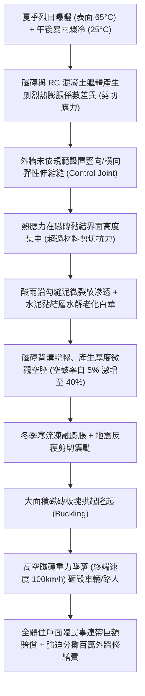
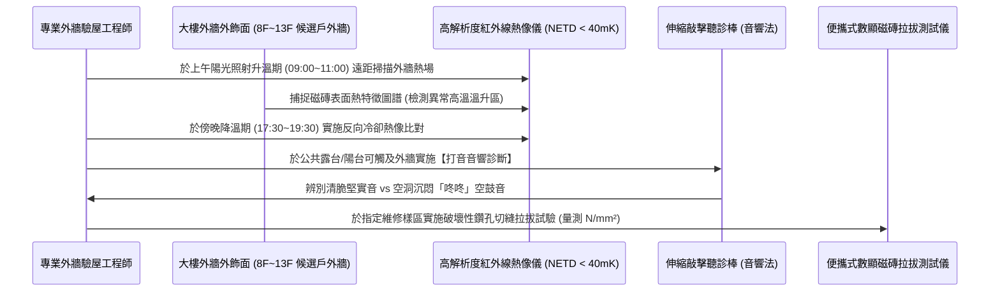

# 全案購屋實戰第九百九十七部：中古大樓外牆磁磚拉拔強度不足空鼓脫落墜落傷人防護與紅外線熱成像檢測工序全書

## 導言：城市高空懸劍與建築外皮結構安全防線

在台灣多地震（處於歐亞板塊與菲律賓海板塊交界）、多颱風豪雨且夏季酷熱冬季濕冷的嚴酷亞熱帶島嶼型氣候下，集合住宅中古大樓之外牆飾面工程（特別是屋齡 15 年至 30 年以上大量採用之二丁掛、方塊磚或花崗石材貼面），長年承受著劇烈的日夜溫差熱脹冷縮（熱應力交變）、大氣碳化與雨水毛細滲透衝擊。

根據材料力學與黏著化學原理，外牆磁磚主要依賴「水泥砂漿打底層（Scratch Coat）」與「高分子聚合物黏著劑（Thin-set Mortar）」與 RC 結構體產生機械咬合與化學黏結力。法定規範外牆磁磚之「拉拔黏著強度（Tensile Adhesion Bond Strength）」必須 **$\ge 0.6\text{ N/mm}^2$（約 $6.0\text{ kgf/cm}^2$）**。

然而，在許多老舊中古大樓中，因早期施工偷工減料（如採用普通水泥膏黏貼、未落實雙面佈膠、未留設伸縮縫）、外牆軀體地震微微裂，或是長年酸雨水氣沿磚縫勾縫泥（Grouting）滲透使黏著層發生「水解乳化剝離」：
1. **外牆大面積空鼓（Hollow Debonding）**：磁磚背溝與黏結砂漿層脫膠，內部形成厚度數微米至數毫米的「空隙夾層」。在外表看似平整的外觀下，背後已形成隨時準備崩落的大面積「隱形脫空層」！
2. **熱脹冷縮爆裂拱起（Buckling / Popping）**：每逢盛夏烈日暴曬，外牆表面溫度可飆升至 $60^\circ\text{C} \sim 70^\circ\text{C}$，午後雷陣雨又使溫度驟降至 $25^\circ\text{C}$。極端熱脹剪切應力無處釋放，導致整片磁磚像地殼板塊擠壓般瞬間隆起、爆裂彈飛。
3. **高空磁磚如雨墜落傷人致死與天價連帶賠償**：一旦數十片重達數公斤的磁磚自 8 樓、13 樓或更高外牆脫落，其終端下墜速度可突破 $80 \sim 100\text{ km/h}$，動能足以擊碎汽車擋風玻璃或造成路過行人當場爆頭死傷！依台灣《民法》第 191 條規定，建築物所有人與全體區分所有權人（即全體住戶）必須承擔「無過失推定之侵權連帶賠償責任」，且主管機關可連續開罰管委會每次數萬至數十萬元罰鍰，並勒令限期自費數百萬至上千萬元全面搭架修繕！

若家庭買方在看屋時未能查明目標大樓外牆磁磚的空鼓劣化程度，入住後恐將面臨「每戶被強迫分攤數十萬元公設外牆拉皮修繕特別管理費」，甚至背負傷人連帶法律官司的慘痛噩夢。

本全書深入解構外牆磁磚界面剝離熱力學機理、紅外線熱成像（FLIR）高空無損體檢工序、現場破壞性拉拔測試標準、標竿工藝與實戰購屋談判籌碼防線。

---

## 一、外牆磁磚界面黏著衰退與空鼓剝落力學機制

### 1. 雙層材料熱物理性質不匹配（Thermal Mismatch）
外牆磁磚與後方 RC 結構體的線性熱膨脹係數（$\alpha$）存在天然物理落差：
- 鋼筋混凝土 RC 軀體：$\alpha_{\text{RC}} \approx 10 \sim 12 \times 10^{-6} /^\circ\text{C}$。
- 陶質/石質外牆磁磚：$\alpha_{\text{Tile}} \approx 5 \sim 7 \times 10^{-6} /^\circ\text{C}$。
- 當外牆表面經歷高達 $\Delta T = 45^\circ\text{C}$ 的劇烈日夜與季節溫差時，界面產生的剪切應力可高達 $\tau = \Delta T \cdot (\alpha_{\text{RC}} - \alpha_{\text{Tile}}) \cdot E_{\text{modulus}} \ge 0.8\text{ N/mm}^2$！若未在每隔 $3\text{m} \sim 5\text{m}$ 樓層接縫處設置耐候矽利康彈性伸縮縫，該剪切應力將直接摧毀剛性水泥砂漿的黏著界面。

### 2. 水泥水化產物之碳化與水解溶出（Eflorescence Leaching）
- 自外牆磁磚微細縫隙滲入的雨水，溶解大氣中的二氧化碳形成弱碳酸，長期與水泥砂漿中的水化矽酸鈣（C-S-H）及游離氫氧化鈣（$\text{Ca(OH)}_2$）發生反應生成碳酸鈣（$\text{CaCO}_3$ 白華）。
- 游離鈣被雨水持續溶出後，水泥黏著層內部微觀孔隙率急遽飆升，抗拉強度與抗折剪切強度喪失逾 60%，磁磚背溝與砂漿之間由原本的密實微觀咬合，退化為鬆散粉化結構，最終全面脫膠空鼓。

---

## 二、現場紅外線熱成像（IR Thermography）無損體檢與拉拔試驗工序

家庭買方在實地踏勘目標中古大樓時，必須在樓下中庭、外圍街道抬頭以專業工具落實以下外牆安全檢驗：

### 1. 主動式/被動式紅外線熱成像（IR）無損檢測標準
- **物理檢驗原理**：
  - 磁磚背面若存在「空氣夾層（空鼓）」，空氣的導熱係數（$\kappa_{\text{air}} \approx 0.026\text{ W/m}\cdot\text{K}$）遠低於密實混凝土（$\kappa_{\text{RC}} \approx 1.5\text{ W/m}\cdot\text{K}$），空氣層形成天然「隔熱保溫層」。
  - **日照升溫期（上午 09:00~11:30）**：空鼓區域的熱量無法向後方 RC 牆體傳導，熱量積聚在磁磚表面，因此在熱像儀上呈現顯著的 **高溫「刺眼熱斑（Hot Spots）」**（溫差 $\Delta T \ge 1.5^\circ\text{C} \sim 3.0^\circ\text{C}$）。
  - **日落降溫期（傍晚 17:30~19:30）**：空鼓區域熱容量小、散熱快，在熱像儀上迅速轉變為 **低溫「冷斑（Cold Spots）」**。
- **數據判定標準**：
  - 若在紅外線熱影像中，候選物件所屬外牆立面出現連續成片、邊界清晰的異常溫差熱斑，且面積超過該立面總面積的 **15% 以上**，證實該外牆已存在大面積三級空鼓，隨時面臨整片崩落脫落之高空墜落風險！

### 2. 伸縮打音聽診檢測（Acoustic Hammer Sounding）
- 在 8 樓、13 樓之專有陽台外牆或梯廳公共走廊外露牆面，以 **專用球型不銹鋼伸縮打音聽診棒** 沿著磁磚表面作「S 型滑行敲擊」：
  - **密實黏結（綠燈）**：傳出高頻、清脆、堅實之「嗒、嗒」金屬敲擊聲。
  - **局部空鼓（黃燈）**：傳出低頻、空洞、沉悶的「咚、咚、喀」聲，手部能感受到微弱空腔共振震動。
  - **嚴重空鼓剝落（紅燈）**：輕微敲擊磁磚即微微晃動，填縫泥粉化剝落，甚至伴隨磁磚邊緣位移碎裂。

### 3. 現地磁磚抗拉拉拔破壞性試驗（Pull-off Test）
- **規範依據**：CNS 12611 或 ASTM C1583 標準。
- **試驗方法**：以水鑽鑽切外牆磁磚邊界穿透黏著層至 RC 軀體深 5mm，使用環氧樹脂將直徑 50mm 鋼製拉拔圓盤黏結於磚面，以油壓數顯拉拔儀垂直均勻施加拉力至破壞。
- **合格極限**：
  - **合格**：拉拔破壞強度 **$f_t \ge 0.6\text{ N/mm}^2$**，且破壞面發生在混凝土基底或磁磚本體（母材破壞）。
  - **不合格（危急）**：拉拔強度 **$< 0.3\text{ N/mm}^2$**，且破壞面直接乾淨俐落地發生在「磁磚背溝黏合界面（界內剝離）」，證明黏結力已全面喪失。

---

## 三、故障修復、標竿外牆高空固化與修繕工藝

一旦查明中古大樓外牆磁磚存在大面積空鼓脫落，管委會必須依據建築物公共安全標竿工序實施徹底修復：

| 工程階段 | 標竿工程規範與高端材料標準 | 廉價劣質短命工法之後遺症 |
| :--- | :--- | :--- |
| **微創低壓環氧注漿** | 針對小面積空鼓（面積小於 1m²），於磁磚磚縫鑽孔（$\phi 4\text{mm}$），埋設注漿針頭，注入 **超低黏度高滲透型無溶劑環氧樹脂灌注膠（黏度 $< 50\text{ cps}$）** 充填空腔。 | 僅用普通矽利康在外表隨意抹平磚縫，內部空鼓未除，數月後整片連帶矽利康一起墜落。 |
| **大面積敲除與重貼** | 空鼓面積大於 2m² 者，必須搭設全包覆防護鷹架與高空防護網，徹底打鑿清除舊磁磚及鬆散砂漿底層至堅實 RC 體。 | 工人未搭防護網直接懸掛蜘蛛人繩索施工，打鑿石塊磚片自高空墜落砸傷路人。 |
| **雙面佈膠與專用黏著劑** | 重貼磁磚必須使用 **C2TES1 級高彈性聚合物改性水泥基磁磚黏著劑（具備抗垂流、延長開放時間與高變形能力）**，落實齒形抹刀雙面佈膠（Butter-Floating）。 | 使用普通 1:3 水泥砂漿加海藻粉黏貼，未留伸縮縫，3~5 年後再度全數空鼓爆裂。 |
| **彈性抗候伸縮縫設置** | 每層樓板水平接縫處及每隔 4 米垂直立面，預留 **10mm 寬伸縮縫**，填塞發泡 PE 圓棒並灌注 **高耐候聚氨酯（PU）或改性矽烷（MS）密封膠**。 | 全立面貼滿死磚無伸縮縫，熱脹應力無法釋放引發二次大規模隆起拱起。 |
| **全棟外牆防墜防護網** | 在尚未全面拉皮大修之過渡期，大樓外牆一樓出入口全線搭建 **鋼構雙層重型防砸防護遮雨棚（承載重力衝擊 $\ge 500\text{ kg}\cdot\text{m}$）** 與高空菱形尼龍防墜網。 | 無任何遮棚防護，任由高空磁磚隨時砸擊進出之住戶與小孩。 |

---

## 四、四大主力候選物件實戰關聯評估與議價攻防

外牆磁磚的安全性，是評估社區公基金是否健全、有無天價攤提負擔的最關鍵公設指標：

### 1. 大安紫金城 13 樓 (`PROP_10`)
- **實地重點**：
  - 大安紫金城本物件為 **13 樓頂層**！高樓層外牆受陽光直射強度最高、風壓最大、日夜溫差最極端。
  - 更重要的是，大安紫金城若外牆磁磚發生高空脫落，直接下墜的區域正是一樓人行道與 **地下停車場車道出入口**！若砸毀出入車輛或傷及路人，全棟住戶均需連帶賠償。
- **實戰攻防對策**：
  - 看屋時在社區一樓外圍與對街，以高倍率望遠鏡與紅外線熱像儀細緻掃描 13 樓外牆立面：
    - 若發現外牆有明顯「水泥修補痕跡、顏色不均、局部脫落、或磚面鼓起」：
    - 立即向房仲與屋主出具檢驗佐證，嚴正指出：「大樓高樓層外牆磁磚空鼓嚴重，管委會面臨建管處開罰與強制外牆拉皮大修之危機，每戶預計需專案攤提外牆修繕費 20~30 萬元！」
    - 結合 35 萬套房拆除款，堅決死守 720~730 萬起手出價，強勢將總價鎖定在 768~788 萬目標區間。

### 2. 長億南園 8 樓 (`PROP_106`)
- **實地重點**：長億南園屋齡較高，社區外觀若有磁磚剝落痕跡或管委會已在樓下張貼「小心磁磚墜落」警示標語，代表外牆老化已進入危急階段。
- **談判痛點打擊**：
  - 將長億南園「外牆磁磚空鼓老舊可能面臨天價拉皮攤提」之硬傷，與其機械車位限重 1.6 噸（無法停休旅車）、梯廳 4 階高差無障礙缺失三者合流捆綁！
  - 向賣方表明：「該物件室內坪數雖大，但公共外牆與機電老化風險極高，買方需預留高額公設維修儲備金！」以此強勢砍價 50 萬元，徹底將 998 萬開價打落至 745~760 萬。

### 3. 歌德堡 8 樓 與 靜園 A 區 11 樓
- **歌德堡 8 樓**：北歐百萬現代精裝，實勘需確認其精裝陽台外側磁磚是否穩固，外觀是否有定期清洗與巡檢修補，確認管委會管理品質。
- **靜園 A 區 11 樓**：外牆若平整完好無空鼓熱斑、樓下無磁磚剝落警示網，印證社區維護極為扎實，鞏固其作為談判破局時第一安全底牌的非凡價值。

---

## 五、全案總結與買方自保查核清單

1. **望遠鏡看立面**：站在對街以高倍雙筒望遠鏡掃描大樓外牆，磁磚縫隙必須平直均勻，嚴禁有凸起拱起、波浪狀變形或水泥砂漿隨意抹平補丁。
2. **查一樓警示網**：社區一樓四周外牆底部嚴禁有拉設「黃色警告封鎖線」或張貼「小心磁磚掉落」之公告牌（若有，證實該大樓已有磁磚掉落前科）。
3. **敲陽台外牆壁**：走進專有陽台，以打音棒或硬幣敲擊外露磁磚，聲音必須清脆緊實，嚴禁有空洞「咚咚」聲。
4. **閱管委會財報**：查閱近 2 年區分所有權人會議紀錄，確認議案中是否有「外牆磁磚掉落砸車爭議」或「討論外牆全面拉皮集資攤提」之巨額支出提案。
