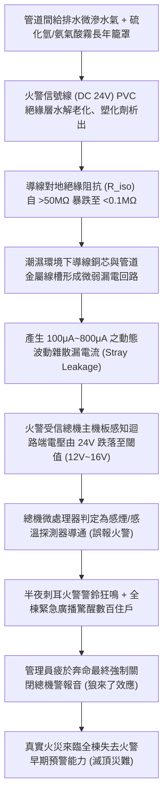
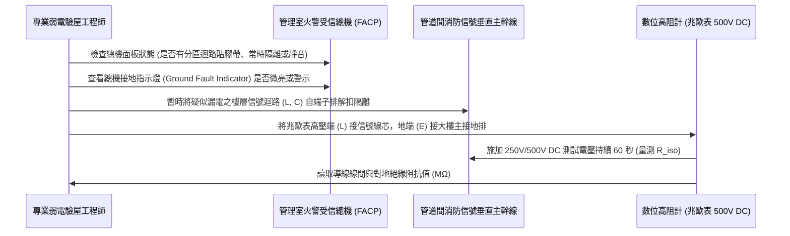

# 全案購屋實戰第九百九十三部：中古大樓社區管道間火警受信總機多迴路信號線對地絕緣阻抗衰退微弱漏電誤報火警體檢工序全書

## 導言：公共消防神經網絡之微安培漏電隱形風暴

在集合住宅中古大樓之全生命週期建築安全體系中，安裝於一樓管理室或地下一樓防災監控中心的「火警受信總機（Fire Alarm Control Panel, FACP）」，是掌握全社區各樓層梯廳、公共走廊、住戶室內、管道間與地下室火災初起徵兆的「最高神經中樞大腦」。

現代中古大樓通常採用 P 型（常規多迴路制）或 R 型（數位定址式）火警系統。數十條甚至上百條火警信號迴路（Zone Loop，電壓通常為 DC 24V），透過公共管道間垂直線槽穿梭於整座大樓，連接全棟上千顆差動式感溫探測器、光電式感煙探測器、手動報警機（Manual Call Point）與水流指示器。

然而，當大樓屋齡跨越 15 至 30 年以上時，長年隱匿於公共管道間的消防弱電信號線路（PVC 絕緣雙絞線），面臨著極為嚴酷的物理與化學劣化考驗：
1. **管道間潮濕冷凝與硫化氫酸霧侵蝕**：管道間與生活污水立管、自來水給水立管同處一室，潮濕水氣長年籠罩，且老舊給排水管接縫常伴隨微滲微漏，使線管內部常年處於 90%~100% 接觸濕度。
2. **絕緣外皮熱裂解與塑化劑析出**：PVC 絕緣層在高溫潮濕下發生水解，增塑劑（DOP）析出導致絕緣電阻（Insulation Resistance, $R_{\text{iso}}$）急遽衰退；原本應大於 $50\text{ M}\Omega$ 的導線對大地絕緣電阻，劣化暴跌至數百 $\text{k}\Omega$ 甚至數十 $\text{k}\Omega$ 以下。
3. **分佈電容微微安培雜散漏電誤報**：當多迴路信號線對地絕緣崩潰時，微弱的微安培（$\mu\text{A}$）級漏電流在潮濕環境中反覆觸發總機內部高靈敏度比較放大器（Operational Amplifier），導致半夜 2 點、3 點火警總機無預警發出刺耳警報、全棟廣播狂響「X 樓火警！請全體住戶疏散！」，全社區住戶驚魂出逃卻發現是「虛驚一場（False Alarm）」。

長期頻繁的誤報火警，將引發極度危險的「狼來了效應」——管理員因不勝其煩而索性「長年關閉火警總機蜂鳴器與分區警報」，導致真正發生火災時全棟毫無警報，數百住戶於睡夢中遭濃煙吞噬！

本全書深入解構火警多迴路信號線對地絕緣衰退之微觀機制、高精度百萬歐姆表（兆歐表）四步檢測工序、標竿修復工藝與家庭買方在看屋時的談判籌碼防線。

---

## 一、火警受信總機信號迴路工作原理與微弱漏電誤報失效機制

### 1. P型/R型火警信號迴路之電氣平衡原理
- **常規 P 型迴路平衡**：火警總機向每條分區迴路提供穩定 **DC 24V 電源**，迴路末端並聯一枚 **終端電阻（End-of-Line Resistor, EOL，通常為 $10\text{ k}\Omega$）**。
  - **監視狀態（正常待命）**：迴路中僅流過極微小之監視靜態電流 $I_{\text{standby}} = 24\text{V} / 10\text{k}\Omega = 2.4\text{mA}$，總機判定迴路完整、無斷線亦無火警。
  - **火警動作狀態**：當感煙探測器動作導通時，迴路電阻幾近短路歸零，電流暴增至 $50\sim 80\text{mA}$，總機端電壓驟降至 $4\sim 8\text{V}$，觸發火警燈亮起與警鈴狂響。
  - **斷線狀態**：若終端電阻開路或線路剪斷，電流歸零，總機發出斷線黃燈警報。

### 2. 對地絕緣阻抗衰退引起之「偽火警導通」
- 當消防信號線長年受潮或外皮被線槽毛邊割破時，信號線正極（$L$ 線）或負極（$C$ 線）對「接地金屬管槽」形成高阻抗並聯洩漏電阻 $R_{\text{leak}}$。
- 當環境濕度在梅雨季或深夜因溫差凝露驟升時，$R_{\text{leak}}$ 瞬間驟降至 $5\text{ k}\Omega \sim 15\text{ k}\Omega$。此時漏電流與終端電阻電流疊加，使總機檢測到的等效阻抗進入「火警判斷臨界區」，微處理器誤判為探測器動作，爆發半夜隨機頻繁誤報！

---

## 二、現場絕緣電阻兆歐表精測與火警總機體檢驗收工序

在陪同家庭買方前往候選中古大樓實地踏勘時，進入管理室與公共管道間必須落實以下標準體檢程序：

### 1. 受信總機面板第一現場「破案式查核」
- **直視面板按鈕與指示燈**：
  - 檢視總機上的 **「主音響（Buzzer）」與「地區音響（Bell）」開關**：若開關處於「停止/靜音（Mute）」狀態，且上方貼有膠帶固定，或「接地故障（Ground Fault）」指示燈閃爍長亮，證實該大樓管道間線路早已存在嚴重漏電，管委會無力修復只能掩耳盜鈴強制關閉聲音！
  - 檢視各樓層火警指示燈：若特定樓層（如 8 樓、13 樓）的號碼燈長年被拔除或貼上貼紙屏蔽，證明該樓層迴路已被線路微漏電摧毀。

### 2. 消防迴路對地絕緣電阻量測（兆歐表標準規範）
- **儀器選型**：符合 IEC 61557-2 標準之數位絕緣電阻測試儀（兆歐表），測試電壓檔位選定為 **DC 250V 或 DC 500V**（量測前必須確保該迴路之探測器與終端電阻已斷開或總機電源隔離，避免擊穿電子晶片）。
- **判定標準（依台灣消防安全設備檢驗基準）**：
  - **優良（綠燈）**：信號線芯線對芯線、線芯對大地金屬管槽之絕緣電阻 **$R_{\text{iso}} \ge 50\text{ M}\Omega$**。
  - **合格（藍燈）**：**$10\text{ M}\Omega \le R_{\text{iso}} < 50\text{ M}\Omega$**（處於正常老化範圍）。
  - **嚴重劣化（黃燈）**：**$0.5\text{ M}\Omega \le R_{\text{iso}} < 10\text{ M}\Omega$**（在潮濕雨天極易產生漏電誤報）。
  - **危急故障（紅燈）**：**$R_{\text{iso}} < 0.2\text{ M}\Omega$（200 kΩ 以下）**。此時迴路漏電流已達百微安培級，總機內部比較器隨時爆發誤報，必須立即全線抽換重拉！

### 3. 動態漏電流夾錶微安培採樣
- 使用解析度高達 **$1\mu\text{A}$（微安培）之交直流微漏電電流鉗表**，在不解扣線路之線上運行狀態下，同時夾住該迴路之正負兩條雙絞線（$L$ 與 $C$ 線）：
  - 向量和正常漏電流應 **小於 $10\mu\text{A}$**。
  - 若實測矢量漏電流大於 **$150\mu\text{A} \sim 500\mu\text{A}$**，證實該迴路在某處管道間正發生對地微弱漏電洩放。

---

## 三、故障修復、標竿耐燃耐熱線纜重構工藝與材料規範

一旦查明管道間消防弱電信號線路對地絕緣衰退，管委會必須依照標竿耐火耐燃弱電工程徹底翻新：

| 工程階段 | 標竿消防弱電規範與材料標準 | 廉價劣質短命工法之後遺症 |
| :--- | :--- | :--- |
| **線纜規格升級** | 全面淘汰老舊 PVC 花線，升級為 **交聯聚乙烯（XLPE）絕緣、低煙無毒（LSZH）護套、耐熱等級達 105°C 之消防專用屏蔽雙絞線（FR-RVVP 2×1.25mm²）**。 | 採用普通廉價 PVC 控制線，無屏蔽層，數年內再次受潮水解破皮。 |
| **金屬管槽封閉與接地** | 管道間信號線必須全程穿入 **熱浸鍍鋅鋼導線管（EMT 管）或全封閉不銹鋼金屬線槽**，線槽每段均以編織銅接地線跨接並確實接地。 | 隨意懸掛於管道間明線拉設，水管滲水直接淋在線上引發短路。 |
| **管道間貫穿防火封堵** | 垂直樓板貫穿孔必須以 **UL 認證 3 小時阻火膨脹型防火填縫泥（Firestop Caulk）與防火枕** 密封，阻止濕氣與濃煙在樓層間串流。 | 貫穿孔大開無封堵，管道間煙囪效應加劇濕氣凝結與火災蔓延。 |
| **總機避雷防突波保護** | 火警總機信號輸入端與電源端，全面加裝 **微型低電壓弱電信號避雷防突波器（SPD，8/20μs 5kA）**。 | 雷雨天感應雷突波直衝主機板，燒毀分區比較晶片引發全盤癱瘓。 |
| **終端電阻抗氧化密封** | 樓層最遠端之終端電阻，必須焊接並封裝於 **IP67 防水熱縮套管** 內，杜絕潮氣腐蝕電阻引腳。 | 隨意扭接裸露於天花板上方，氧化受潮電阻漂移頻發斷線假警報。 |

---

## 四、四大主力候選物件實戰關聯評估與議價攻防

火警受信系統之健康狀態，直接關係全家深夜熟睡時的生命防禦與睡眠安寧：

### 1. 大安紫金城 13 樓 (`PROP_10`)
- **實地重點**：
  - 大安紫金城本物件為 **13 樓頂層**！公共管道間垂直高度最長，受全棟煙囪效應熱濕氣流上升衝擊最劇烈。若管道間火警信號線長年受潮漏電，13 樓往往是信號阻抗最容易衰退的分區。
  - 前屋主改裝學生出租套房時，若曾私自改動室內感煙探測器或將弱電信號線混接於強電線管中，將造成極大電磁雜訊干擾。
- **談判攻防部署**：
  - 看屋時走到一樓管理室，特別檢視總機面板 13 樓火警指示燈是否被隔離或常亮黃燈；若發現總機長年靜音或有接地故障，立刻向房仲與屋主指出：「該大樓公共消防弱電幹線對地漏電嚴重，全棟火警總機形同虛設，且 13 樓分區線路需重新抽換至地下室，整改工程預算高達 12 萬元！」
  - 結合 35 萬套房拆除款，堅決守住 720 萬起手出價，強勢鎖定 768~788 萬目標成交價。

### 2. 長億南園 8 樓 (`PROP_106`)
- **實地重點**：長億南園室內達 32 坪大空間，若公共火警受信總機頻繁深夜誤報，將嚴重摧毀全家身心健康；若總機遭管理員強制關閉，火災預警功能徹底歸零。
- **殺價攻防**：實地抽查長億南園管道間線纜，若發現線纜發霉黏手、總機歷史記錄有頻繁「半夜誤報」條目，將此致命隱患與機械車位 1.6 噸限制合流，直砍 50 萬，將 998 萬開價死死壓制在 745~760 萬。

### 3. 歌德堡 8 樓 與 靜園 A 區 11 樓
- **歌德堡 8 樓**：北歐百萬現代精裝，需檢驗其木作天花板內的感煙探測器底座配線，是否為阻燃線纜且與金屬龍骨完全絕緣隔離，避免精裝木工鎖螺絲貫穿弱電線造成對地短路。
- **靜園 A 區 11 樓**：通風開闊採光極佳，若一樓火警總機所有指示燈全綠、近三年無頻繁誤報紀錄，印證社區管理委員會極為嚴謹，鞏固第一安心保底牌之價值。

---

## 五、全案總結與買方自保查核清單

1. **看總機開關**：管理室火警總機之「主音響」與「分區警報」按鈕嚴禁處於「停止/靜音」或被膠帶封死狀態。
2. **查接地紅燈**：總機面板上的「地絡/接地故障（Earth Fault）」指示燈必須熄滅，確保全棟線路無對地漏電。
3. **訪保全記錄**：禮貌向值班保全詢問：「社區最近半年半夜有沒有經常響火警警報？」若保全苦笑抱怨「常常響很吵」，證實管網線路已嚴重漏電。
4. **測兆歐數值**：專業驗屋時由技師對室內探測器端子量測對地絕緣阻抗，數值必須 $\ge 20\text{ M}\Omega$，嚴禁低於 $1\text{ M}\Omega$。
