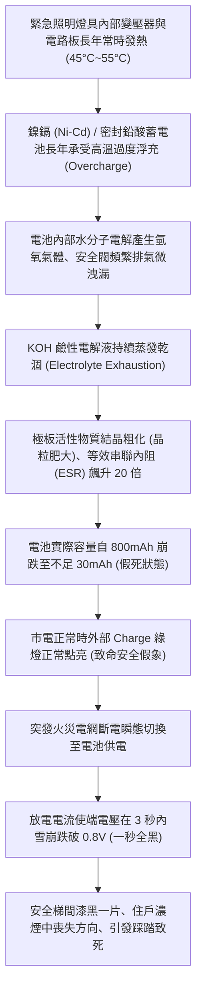
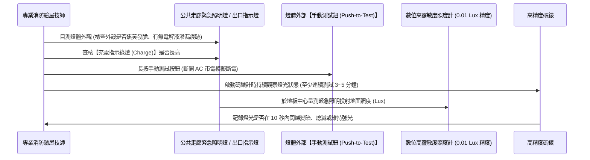

# 全案購屋實戰第九百九十九部：中古大樓公共走廊緊急照明燈與出口避難指示燈鎳鎘蓄電池電解液乾涸斷電續航失效體檢工序全書

## 導言：漆黑火海中的生命燈塔與逃生導引神經

在集合住宅中古大樓之立體消防疏散避難體系中，每當夜間突發強烈地震導致電網斷電、或地下室變電盤電弧火災引發全棟跳電時，全體住戶在瞬間陷入伸手不見五指的絕對黑暗（Zero Visibility）。在濃煙瀰漫、有毒氣體迅速擴散的極度恐慌情境下，安裝於各樓層公共走廊、安全梯間與門廳上方的「緊急照明燈（Emergency Lighting Luminaires）」與「出口避難方向指示燈（Exit & Directional Signs）」，是引導老人、婦孺與全體住戶在黃金逃生時間內正確找到防火門與避難梯的「最後視覺生命燈塔」。

依據台灣《各類場所消防安全設備設置標準》與 CNS 10204 規範，所有緊急照明燈與出口指示燈平時由 AC 110V/220V 市電持續浮充供電；當市電中斷瞬間，燈具內部控制電路必須在 **小於 0.5 秒內瞬態切換至內部備用蓄電池**，並在無外界電力支援下，維持法定額定光通量持續照明 **至少 90 分鐘（早期法規至少 30~60 分鐘）** 以上。

然而，在許多屋齡 15 年至 30 年之老舊中古大樓中，由於長年缺乏真正斷電放電測試：
1. **內部鎳鎘（Ni-Cd）或鉛酸蓄電池電解液乾涸（Electrolyte Dry-out）**：燈具內部常年處於 40°C~50°C 的變壓器整流發熱高溫環境下，蓄電池安全閥微孔長期排氣，水溶性電解液（氫氧化鉀 KOH 水溶液）完全蒸發乾涸；內部極板硫化微觀短路，電池等效內阻（ESR）飆升數十倍，實際儲能容量萎縮至不足新電池的 5%！
2. **「假性亮燈」欺騙性（Zombie Battery Phenomenon）**：在平日有市電供應時，燈具外部的綠色「充電指示燈（Charge LED）」依舊長亮，給管委會與住戶造成「一切正常」的致命假象！
3. **火災斷電瞬間「一秒全黑」引發推擠踩踏悲劇**：一旦火災切斷市電，備用電池在不到 3 至 5 秒內電壓即瞬間崩潰跌破截止電壓，緊急照明燈與出口指示燈瞬間「全數熄滅」！整條逃生走廊陷入死寂般的漆黑，住戶在濃煙中喪失方向感、吸入濃煙昏厥或在樓梯間發生嚴重的盲目推擠踩踏死傷！

若家庭買方在看屋時未能查核公共走廊避難照明的真實蓄電續航力，等同於將全家置身於隨時可能在黑暗濃煙中喪失逃生生路的巨大危險之中。

本全書深入解構緊急照明蓄電池電解液乾涸之電化學劣化機制、高精度斷電續航放電檢測工序、標竿鋰鐵電池升級工藝與實戰購屋談判籌碼防線。

---

## 一、緊急避難燈具工作原理與蓄電池電化學乾涸失效機理

### 1. 緊急照明切換控制電路與浮充特性
標準緊急照明燈具由降壓整流電路、恆壓限流浮充電路、光敏/繼電器瞬態切換開關、LED 發光模組與鎳鎘/鎳氫蓄電池組（通常為 3.6V/4.8V 600~1200mAh）組成：
- **浮充狀態（Standby Floating Charge）**：市電正常時，電路向電池提供小電流（約 $0.05C \sim 0.1C$，即 30~80mA）的涓流浮充，以補償電池自放電損失。
- **瞬態斷電轉換**：當市電電壓跌落至額定值 70% 以下時，切換繼電器釋放或雙極性電晶體迅速導通，在 **小於 5 毫秒（ms）內** 倒灌由蓄電池向高亮度 LED 模組供電。

### 2. 鎳鎘電池（Ni-Cd）電解液乾涸與記憶效應微觀反應
- **熱失控加速之電解液蒸發**：在密閉燈具外殼內部，整流二極體與變壓器溫升使內部環境溫度常態維持在 $45^\circ\text{C}$ 以上。依阿瑞尼斯方程式（Arrhenius Equation），化學反應速率每上升 $10^\circ\text{C}$ 翻倍：
  - 電池正極析出氧氣、負極析出氫氣，在持續微浮充下電池內壓升高，微型安全橡膠帽開啟排氣，水分子隨氣體不斷逸失。
  - 當電解液中水分喪失逾 30% 時，極板間隔膜乾裂，內阻急遽增大；此時若再強制充電，焦耳熱（$I^2 R$）進一步加劇，形成惡性循環之「熱失控（Thermal Runaway）」，直至電解液完全枯竭成乾涸粉末狀。
- **端電壓雪崩現象（Voltage Collapse）**：乾涸後的電池在無負載時仍可測得虛假的 3.6V 靜態開路電壓；但一旦接入 300mA 的 LED 負載電流，內阻壓降 $\Delta V = I \cdot R_{\text{in}}$ 瞬間超過 2.5V，工作端電壓瞬間雪崩跌至 1.0V 以下，LED 晶片立即熄滅。

---

## 二、現場手動斷電開關測試、照度計量測與體檢驗收工序

在陪同家庭買方踏勘候選中古大樓梯廳、逃生安全梯間與門廳公設時，必須攜帶簡易檢測工具落實三步斷電實彈驗收：

### 1. 手動測試按鈕（Push-to-Test）實彈斷電檢驗
- **檢測方法**：
  - 每一盞合規的緊急照明燈與出口指示燈外殼下方或側面，均設有一枚紅色或黑色的 **「測試按鈕（Test Switch）」**。
  - 以手指長按測試按鈕（模擬完全切斷 AC 市電）：
    - **特優（綠燈）**：按住按鈕後，LED 瞬間切換為高亮度冷白光，持續按住 **3 分鐘以上，亮度絲毫無任何衰減**。
    - **瀕危（黃燈）**：按住按鈕後，燈具雖然點亮，但光線在 **30 秒內以肉眼可見的速度迅速昏暗、轉為微弱黃光**，代表電池容量已耗竭 90% 以上。
    - **徹底報銷（紅燈）**：按住按鈕後，燈具「閃爍一下隨即徹底熄滅」，或「完全毫無任何亮光」！證實內部鎳鎘蓄電池電解液已 100% 乾涸死透，成為毫無功能的牆上廢物塑膠殼！

### 2. 地面有效逃生照度量測（Lux Test）
- **規範標準（CNS 10204）**：
  - 緊急照明燈在地板中心線水平面之照度：
    - 一般走廊與門廳地面：**不得小於 $1.0\text{ Lux}$**。
    - 避難安全梯間（轉折階梯處）：**不得小於 $2.0\text{ Lux}$**。
  - 出口避難方向指示燈：標誌面平均亮度必須 **$\ge 15\text{ cd/m}^2$**，在濃煙瀰漫下 20 米外清晰可辨。
- **測試流程**：於夜間或拉下梯廳遮光簾，手動切斷走廊迴路，使用數位照度計量測地面中央最低照度值，確保符合法定逃生標準。

### 3. 公共走廊專用照明分電盤巡檢
- 走到該樓層電氣管道間，檢查「緊急照明與弱電專用分電盤」：
  - 檢視給緊急照明充電之無熔絲斷路器（NFB）是否處於正常的「ON」待命位置。
  - 老舊大樓常因住戶投訴指示燈太亮浪費電，管理員違規私自「將整排緊急照明迴路開關打下 OFF」，導致全樓層緊急燈長年處於未充電的徹底斷電狀態！

---

## 三、故障修復、標竿鋰鐵電池升級工藝與材料規範

一旦查明全棟公共走廊緊急照明燈蓄電池集體乾涸老化，管委會必須依照國家消防標竿規範全面更換升級：

| 工程階段 | 標竿消防工程規範與高端材料標準 | 廉價劣質短命工法之後遺症 |
| :--- | :--- | :--- |
| **燈具核心升級** | 全面淘汰老舊白熾燈泡/螢光燈管與鎳鎘電池燈具，升級為 **高光效 LED 搭配「磷酸鐵鋰蓄電池（LiFePO4, 3.2V 1500mAh）」新型一體化防爆燈具**。 | 僅在光華商場購買廉價雜牌鎳鎘電池包更換，高溫下 1 年內再度電解液乾涸報銷。 |
| **鋰鐵電池之卓越優勢** | 磷酸鐵鋰電池具備 **耐高溫（可達 65°C 不分解）、循環壽命長達 2000 次、無記憶效應、10 年免維護** 之極致安全特性；斷電續航時間高達 **120~180 分鐘**（遠超法規 90 分鐘）。 | 繼續使用廉價鎳氫/鎳鎘電池，記憶效應嚴重，浮充 2 年容量崩跌 80%。 |
| **定時自檢晶片配置** | 選用具備 **微處理器智慧自檢功能（Auto-Test Function）之燈具**：每 30 天自動進行 30 秒功能自檢，每 360 天自動實施 90 分鐘深度放電自檢，故障時自動鳴蜂警示。 | 無自檢功能，全憑人工手動一個個去按按鈕測試，老舊社區 10 年無人檢驗。 |
| **外殼阻燃等級** | 外殼必須採用 **UL94 V-0 最高阻燃等級之聚碳酸酯（PC）或壓鑄鋁合金**，耐衝擊強度達 IK08，高溫 850°C 灼熱絲試驗不燃燒。 | 採用普通廉價 ABS 塑膠，數年內被日光紫外線曬到泛黃發脆，火災時迅速燃燒滴落毒滴。 |
| **逐層換裝與驗收測試** | 實施「逐層整棟全面更換」，完工後由消防專技人員切斷該迴路市電，實施 **滿額 90 分鐘斷電巡檢放電驗收**，合格後張貼消防合格標籤。 | 僅抽換壞掉的 1~2 盞，新舊混雜，其餘老舊燈具在真正火災時依然集體熄滅。 |

---

## 四、四大主力候選物件實戰關聯評估與議價攻防

梯廳與安全梯逃生照明之良窳，直接映射全家長幼在遭遇夜間火災地震時的生存機率：

### 1. 大安紫金城 13 樓 (`PROP_10`)
- **實地重點**：
  - 大安紫金城本物件位處 **13 樓頂樓高樓層**！在火災發生時，頂樓住戶絕對禁止搭乘電梯，唯一的逃生路徑就是「推開安全梯防火門，沿著安全梯一路向下跑 13 個樓層（垂直高度近 40 公尺）」！
  - 若梯間的緊急照明燈與出口指示燈蓄電池早已乾涸死絕，13 樓住戶在斷電瞬間將在陡峭的 13 層樓梯間中摸黑下樓，在濃煙毒氣逼近下，跌落摔傷或迷失方向的死亡風險將呈幾何級數暴增！
- **談判攻防部署**：
  - 走訪 13 樓梯廳與安全梯間，連續按壓 3 盞緊急照明燈之手動測試鈕：
    - 若發現燈光一秒熄滅或全數不亮，立即向房仲與屋主出示檢測影片，嚴正交涉：「大樓高樓層逃生避難照明設施完全癱瘓，頂樓住戶逃生安全面臨極大威脅，管委會長期欠缺公設維護！全棟公共消防避難燈具全面換裝工程每戶需分攤專案工程款 5 萬元！」
    - 結合 35 萬套房拆除款，堅決守住 720 萬起手出價，強勢鎖定 768~788 萬目標成交價。

### 2. 長億南園 8 樓 (`PROP_106`)
- **實地重點**：長億南園梯廳原本即存在「門廳 4 階高差無障礙缺失」！若在夜間突發火災斷電時，走廊緊急照明燈若再度乾涸失靈，住戶在慌亂逃生中極易在這 4 階高差處踩空摔斷骨折，引發嚴重的踩踏阻礙逃生！
- **殺價攻防**：將「門廳 4 階高差硬傷」與「梯廳緊急照明蓄電池全面失效」雙重綁定，協同機械車位限重 1.6 噸痛點，強勢砍價 50 萬，徹底擊潰賣方 998 萬高價防線，壓制在 745~760 萬。

### 3. 歌德堡 8 樓 與 靜園 A 區 11 樓
- **歌德堡 8 樓**：北歐百萬精裝，需檢驗其專有玄關門外之走廊指示燈是否完好，確認社區公共安全管理與其室內高檔裝潢水準一致。
- **靜園 A 區 11 樓**：若梯間緊急照明測試亮如白晝、維持強光不衰減，證明管委會極度盡責，穩坐談判破局時第一安全保底牌。

---

## 五、全案總結與買方自保查核清單

1. **手按測試鈕**：走過梯廳與安全梯，手指按住緊急照明燈上的「TEST 按鈕」至少 10 秒，燈光必須維持刺眼強白光，嚴禁一秒熄滅或暗如燭光。
2. **看充電指示**：燈體上的「Charge」綠色或紅色 LED 指示燈必須穩定長亮；若指示燈熄滅或閃爍，代表內部充電電路或電池已燒毀斷路。
3. **查外殼發黃**：外殼若呈現焦黃色、塑膠起泡發脆、或邊緣有白色粉末結晶（電解液滲漏腐蝕），證實內部電池已嚴重過熱報銷。
4. **驗逃生標誌**：各樓層綠色「EXIT 安全出口指示燈」面板必須均勻發光、字體無缺角暗斑，確保濃煙中清晰指引逃生方向。
