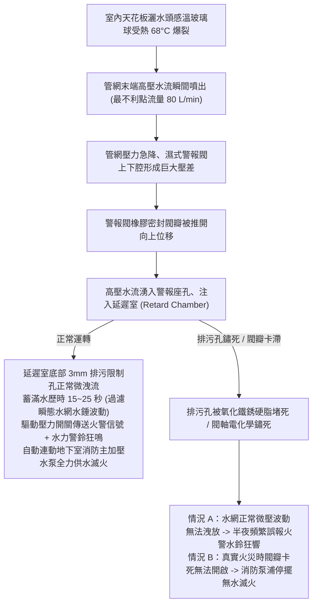
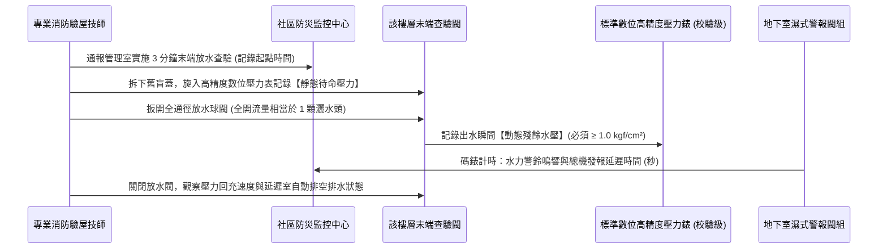

# 全案購屋實戰第九百九十二部：中古大樓社區消防自動灑水系統末端查驗閥壓力錶失準濕式警報閥延遲室排污孔鏽蝕卡死體檢工序全書

## 導言：十萬火急瞬間的生命守護傘與滅火神經中樞

在台灣現行《各類場所消防安全設備設置標準》中，樓高 11 層以上之集合住宅大樓（包含本案四大主力考慮物件之高樓層戶別），依法各戶室內天花板均強制全面配置「閉式自動灑水設備（Automatic Fire Sprinkler System）」。此套系統是火災初起黃金 3 至 5 分鐘內，在消防隊尚未抵達現場前，唯一能夠自動感溫爆裂噴水、壓制火勢、降低高溫濃煙蔓延的「最核心主動滅火防線」。

整套濕式自動灑水系統平時處於「充水保壓（Wet Pipe System）」待命狀態。而維持這套百萬生命安全防線運作有兩大最核心的檢驗與控制元件：
1. **樓層末端查驗閥（Inspector's Test Valve, ITV）**：裝設於各樓層灑水管網最不利點（最遠端），用以定期排放模擬一顆標準灑水頭開放之流量（$80\text{ L/min}$），檢驗管網末端動態水壓與水流訊號。
2. **地下室濕式警報閥（Wet Alarm Valve, AV）與延遲室（Retard Chamber）**：當管網有水流動時，警報閥瓣被推開，高壓水流注入延遲室，在延遲 15 至 30 秒（濾除管網微振波動）後，驅動水力警鈴鳴響與壓力開關發送火警信號至防災中心，並自動聯動啟動消防主加壓泵浦。

然而，在許多屋齡 15 年至 30 年之中古大樓中，因長年缺乏真正帶水放流測試或管內死水產生嚴重電化學腐蝕：
- **末端查驗閥充油壓力錶嚴重失準**：錶芯波登管（Bourdon Tube）塑性形變或內部甘油滲漏、表針卡死在假性「合格壓力」刻度，導致管網早已失壓乾涸或超壓微裂，管委會與買方卻渾然不知。
- **濕式警報閥延遲室排污限制孔（Drain Orifice）鏽蝕淤塞卡死**：當細小排污孔被鐵鏽硬脂卡死時，日常自來水管網的輕微壓力微振便會直接填滿延遲室，造成「半夜無故頻繁誤報火警、消防水鈴狂響驚嚇全社區」；反之，若主閥瓣軸銷鏽死，即使火災爆發灑水頭全開，警報閥也無法開啟，消防加壓泵浦完全無法聯動啟動，釀成全棟住戶葬身火窟的滅頂大禍！

本全書深入解構濕式警報閥與末端查驗閥之失效機理、高規格現地放水動態測試工序、標竿修復升級工藝與看屋實戰談判防線。

---

## 一、濕式自動灑水系統工作原理與延遲室鏽蝕卡死力學機制

### 1. 濕式警報閥之精密水力力平衡
濕式警報閥依靠閥瓣自身重力與上下腔受壓面積差維持常閉：
- 平常靜態時，閥瓣上方管網水壓與下方供水水壓平衡，閥瓣緊密壓在環形橡膠密封座上，完全封死通往延遲室的進水孔道。
- **延遲室（Retard Chamber）防誤報機制**：為防止城市自來水管網或二次加壓泵瞬態水錘脈衝造成閥瓣微開誤報，警報孔引出的水先進入延遲室。延遲室底部設有一枚直徑僅約 **$3.0\text{mm} \sim 3.5\text{mm}$ 的黃銅排污限制小孔（Drain Orifice）**。微弱短暫的水流會自排污孔直接排入排水溝；只有當火災發生持續噴水超過 15 秒以上時，進水量遠大於排污孔洩水量，延遲室才會蓄滿水並建立起驅動壓力。

### 2. 延遲室排污孔鏽蝕卡死之微觀熱力學
- **管網死水缺氧腐蝕（MIC 微生物腐蝕）**：消防管網長年不流動，管內水質為典型缺氧腐蝕環境，硫酸鹽還原菌（SRB）滋生，與碳鋼管壁反應生成大量的黑褐色磁鐵礦（$\text{Fe}_3\text{O}_4$）與氧化鐵淤泥（Sludge）。
- **小孔沉積堵塞效應**：當管內鐵鏽剝落隨水流進入警報閥時，直徑 3mm 的黃銅排污小孔成為流體雜質的「篩網」。鐵鏽粉末與硬水碳酸鈣沉澱在孔口迅速膠結硬化，使排污截面歸零。
- **波登管壓力錶彈性遲滯與指針鎖死**：末端查驗閥壓力錶長期承受靜水壓，其內部的 C 型磷青銅波登管材料發生微觀晶界滑移（Creep），加上充油防震液滲漏乾涸，內部傳動齒輪氧化卡死，使指針永遠停留在虛假的「$3.0\text{ kgf/cm}^2$」正常讀數上，形成極其危險的「安全假象」。

---

## 二、現場末端放水動態量測與體檢驗收工序

在陪同家庭買方前往目標中古大樓進行梯廳與室內公設體檢時，必須嚴格落實標準「末端查驗閥放水動態測試」：

### 1. 末端查驗閥靜態水壓與動態放水殘壓量測
- **檢測儀器**：自帶快接活接頭的 0.4 級高精度充油數位壓力錶（量程 0~1.6 MPa）。
- **量測步驟與標準**：
  - 接入該樓層走廊或管道間末端查驗閥測試口。
  - **靜態壓力標準**：高樓層最不利點靜態水壓必須 **$\ge 1.0\text{ kgf/cm}^2$（0.1 MPa）**；若低於此數值，灑水頭爆裂時將噴不出足夠霧化水花。
  - **動態放水殘壓（Residual Pressure）**：全開末端測試閥（放水孔徑精確為 $\phi 15\text{mm}$），水柱高速噴入排水立管時，動態壓力錶數值必須 **穩定維持在 $1.0 \sim 2.5\text{ kgf/cm}^2$** 之間。若一放水水壓瞬間跌破 $0.5\text{ kgf/cm}^2$，證明消防幹管內部已被鐵鏽瘤嚴重淤塞，過流斷面嚴重縮水！

### 2. 警報閥動作時間與延遲室機能碼錶計時
- 當末端測試閥全開時，現場工程師以碼錶精確同步計時：
  - **合格延遲時間**：地下室水力警鈴（Water Motor Gong）鳴響與防災中心總機火警跳燈之時間，必須在 **$15 \sim 30\text{ 秒}$** 之間。
  - **即時誤報隱患（紅燈）**：若放水 **小於 5 秒** 警報立刻作響，證實延遲室底部的 3mm 排污限制孔已 100% 鏽死堵塞，失去任何防誤報緩衝機能。
  - **完全失效隱患（黑燈）**：放水持續超過 **90 秒**，水力警鈴毫無動靜、防災總機無任何訊號反應、消防泵浦未自動聯動啟動，證實濕式警報閥瓣軸心已嚴重鏽蝕抱死，整棟大樓灑水滅火系統已等同虛設！

### 3. 放水停止後之延遲室自動洩空檢查
- 關閉末端查驗閥後，技師前往地下室警報閥組旁觀察延遲室洩水漏斗：
  - 延遲室內存水應在 **3 分鐘內透過排污孔完全排空**。若洩水漏斗持續滴水超過 10 分鐘以上，代表警報閥橡膠密封座面被管網雜渣卡住無法完全關閉密封。

---

## 三、故障修復、標竿警報閥組翻新工藝與材料規範

一旦查明消防灑水系統存在末端錶失準或警報閥卡死，管委會必須依照標竿消防法規進行徹底大修：

| 工程階段 | 標竿消防工程規範與材料標準 | 廉價劣質短命工法之後遺症 |
| :--- | :--- | :--- |
| **警報閥解體檢修** | 關閉控制閘閥，排空管網，拆開警報閥檢修蓋；以銅絲刷清除閥腔鐵鏽，更換 **EPDM 耐高溫合成橡膠閥瓣密封墊**。 | 僅用砂紙打磨舊橡膠墊直接裝回，密封面微觀凹凸不平持續內漏。 |
| **延遲室與限制孔清理** | 拆卸延遲室總成，以高壓氣槍與除垢酸洗液疏通 **黃銅排污限制孔（Orifice）**，確保 $\phi 3.2\text{mm}$ 內徑光潔無結垢。 | 用鐵絲隨意捅刺小孔，擴大孔徑導致延遲室蓄水過慢、火警反應嚴重滯後。 |
| **末端查驗閥壓力錶升級** | 全面更換為 **SUS304 全不銹鋼防震充油壓力錶（甘油填充）**，量程 0~1.6 MPa，配置黃銅微型針閥（Needle Valve）與自帶阻尼器。 | 採用普通廉價乾式鐵殼壓力錶，數月內在水錘微振下齒輪脫扣卡死。 |
| **水流指示器（Flow Switch）** | 各樓層管道間水流指示器同步校驗微動開關，調整延遲電路至 **10~15 秒** 靈敏響應。 | 延遲開關老化，輕微水流波動頻繁觸發分區誤報。 |
| **全系統放水聯動實測** | 完成後實施 100% 樓層逐層末端放水測試，確保消防主泵浦於 **30 秒內自動聯動起抽**，管網升壓至設計值。 | 僅檢視總機外觀未做帶水聯動測試，系統內部隱患未除。 |

---

## 四、四大主力候選物件實戰關聯評估與議價攻防

室內天花板灑水頭與公共消防管網之健康狀態，直接決定全家長住的生命安全防線：

### 1. 大安紫金城 13 樓 (`PROP_10`)
- **實地重點**：
  - 大安紫金城本物件為 **13 樓頂層高樓層**！依消防法規全室天花板密佈自動灑水頭。高樓層是全棟消防管網的最不利點，水壓最容易不足；同時，若前屋主將其隔間改裝為學生出租套房時，若曾「私自截斷、移位或漆上油漆封死灑水頭」，將構成極嚴重的消防違規與公共危險！
- **實戰攻防對策**：
  - 驗屋時現場測試 13 樓末端查驗閥壓力錶：若指針卡死、放水無壓力或延遲室反應遲鈍，立即出具檢測報告，向賣方嚴肅指出：「全戶灑水頭因前次套房裝潢遭受污染與移位，且大樓高樓層消防末端動壓不足，全室消防管線復原與灑水頭全面更換需花費 15 萬元！」以此作為強大談判籌碼，堅決抵扣 35 萬套房拆除款，鎖定 768~788 萬目標價。

### 2. 長億南園 8 樓 (`PROP_106`)
- **實地重點**：長億南園 8 樓室內實坪達 32 坪大空間，若消防管線年久失修，管內鐵鏽瘤嚴重，一旦發生火災灑水頭噴出的將不是滅火水柱，而是被鏽泥堵死的涓滴細流。
- **殺價攻防**：實測長億南園樓層查驗閥，若發現水流指示器失靈或放水水質呈黑褐色鐵鏽泥水，立即將此公設消防死角與其機械車位限重 1.6 噸（無法停休旅車）雙重捆綁，向賣方大砍 50 萬，迫使其從 998 萬高位退讓至 745~760 萬。

### 3. 歌德堡 8 樓 與 靜園 A 區 11 樓
- **歌德堡 8 樓**：北歐百萬現代精裝，需檢驗其木作天花板施作時，是否有確實預留「灑水頭集熱板（Heat Collector）」與合規露出天花板 3~5cm，防止裝潢木工將灑水頭藏於天花板內導致火災感溫失效。
- **靜園 A 區 11 樓**：11 樓採光優異，若消防末端放水殘壓超過 $1.5\text{ kgf/cm}^2$、警報閥延遲室 20 秒精確響應，則印證公設養護極佳，穩坐安心保底牌。

---

## 五、全案總結與買方自保查核清單

1. **查錶針**：檢視梯廳末端查驗閥壓力錶，指針必須指示在 $1.0\text{ kgf/cm}^2$ 以上，且輕敲錶殼指針無跳脫或晃動卡死。
2. **放末端**：要求房仲陪同開啟末端放水閥，噴出水質必須在 10 秒內轉為清澈，動態殘壓不得低於 $1.0\text{ kgf/cm}^2$。
3. **聽水鈴**：末端放水後 15~30 秒內，必須清晰聽聞地下室水力警鈴鳴響，嚴禁即刻狂響（延遲室孔堵死）或完全無聲（閥軸卡死）。
4. **檢噴頭**：抬頭檢驗室內所有灑水頭，玻璃球內紅色感溫液體必須清澈飽滿無氣泡，金屬本體嚴禁有油漆沾染或氧化銅綠。
