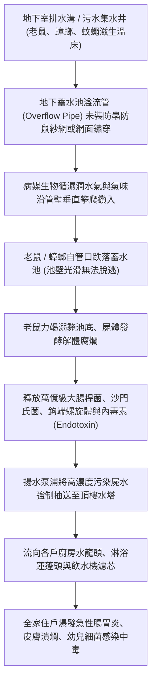
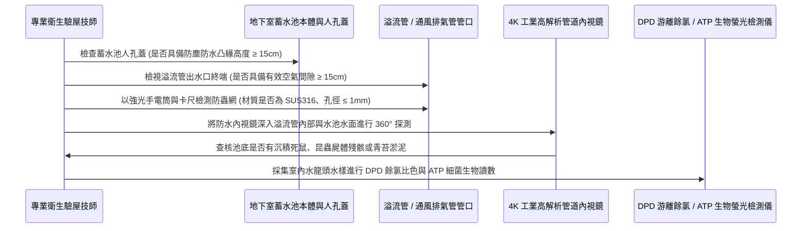

# 全案購屋實戰第九百九十八部：中古大樓地下室蓄水池溢流管未設防蟲防鼠不銹鋼紗網老鼠蚊蟲倒灌生活飲用水池體檢工序全書

## 導言：全棟家庭生命之泉之終極衛生屏障

在集合住宅中古大樓之供水體系中，全體住戶每日清晨刷牙、洗臉、烹飪、煲湯、沐浴以及嬰幼兒沖泡奶粉所依賴的自來水，均非直接來自市政自來水幹管，而是採取「兩段式蓄水二次加壓供水模式」：市政自來水自道路管網引入大樓「地下室防汛蓄水池（Underground Potable Water Cistern）」，再透過二次揚水加壓泵浦抽送至頂樓水塔，最後分區配送至各戶水龍頭。

這座容積達數十公噸至上百公噸的地下室蓄水池，是全棟數百名家庭成員生存與健康的「生命之泉心臟」。為了防止浮球閥或進水電動閥失靈導致自來水持續補水而水滿為患、水壓脹裂水池頂板或淹沒地下室變電機房，蓄水池池壁最高水位上方依法均強制設置「重力溢流管（Overflow Pipe）」與「通風排氣管（Air Vent Pipe）」，將多餘水流直接導引排放至地下室集水坑或排水溝。

然而，在許多屋齡 15 年至 30 年以上之中古大樓中，由於長年欠缺公共衛生防疫意識或歷次洗水塔包商粗暴施工：
1. **溢流管管口防蟲防鼠網缺失或撕裂穿孔**：原本應緊密安裝於溢流管與通風管管口的「高密不銹鋼防蟲防鼠紗網（Fine Stainless Steel Insect Screen，孔徑小於 1.0mm）」，因長年潮濕生鏽脆斷、被老鼠尖牙咬穿破洞，甚至當初建商根本「完全未設置任何防護濾網，任由管口朝天直通直敞」！
2. **老鼠、蟑螂、蚊蟲與壁虎爬入溺斃腐爛**：地下室污水深井與排水溝是老鼠（溝鼠、家鼠）與蟑螂（美洲蜚蠊）的天然滋生溫床。在夜間陰暗環境下，老鼠順著潮濕管壁攀爬鑽入溢流管，蟑螂與蚊蠅更成群循著水氣湧入水池。老鼠一旦失足掉入深達數公尺的清澈蓄水池中，因池壁光滑無法攀爬，在極度掙扎後溺死池底！
3. **生活飲用水源遭受屍毒、細菌與阿米巴原蟲致命污染**：溺斃的老鼠與昆蟲屍體在 20°C~25°C 的自來水中迅速發酵膨脹、內臟潰爛解體，釋放大量的沙門氏菌（Salmonella）、大腸桿菌群（Coliforms）、鉤端螺旋體（Leptospira）與致命的福氏耐格里阿米巴原蟲（Naegleria fowleri）。整座水池淪為「高濃度屍水毒湯」！不知情的住戶長年飲用、漱口，引發全棟集體不明原因急性腸胃炎、皮膚紅腫潰爛、甚至敗血症與腦膜炎！

若家庭買方在看屋時忽視了這項隱蔽卻至關重要的地下水池公設衛生防線，入住後全家長幼的免疫系統與生命健康將長年暴露於不可預測的致命威脅中。

本全書深入解構地下蓄水池溢流管病媒生物倒灌之微觀生物學污染路徑、高規格現地內窺鏡與水質細菌學體檢工序、標竿修復升級工藝與實戰購屋談判籌碼防線。

---

## 一、地下蓄水池溢流管病媒倒灌與生物污染機制

### 1. 蓄水池溢流管與通風管之水力物理特性
- **溢流管功能**：管徑通常為 $\phi 100\text{mm} \sim \phi 150\text{mm}$（4吋至6吋），管底標高高於水池最高控制水位 50mm，採無閥門常開重力排放設計，終端通常懸空朝向地下室排水明溝。
- **空氣間隙（Air Gap）防污染規範崩潰**：依據台灣《建築給水排水設備設計標準》，溢流管終端與排水溝最高可能溢流水位之間，必須維持至少 **管徑 2 倍且不小於 150mm 的「法定有效空氣間隙（Air Gap）」**。若施工時將溢流管直接插死入排水溝或污水井液面下，在暴雨排洪不及污水倒灌時，下水道黑臭糞水將直接自溢流管「虹吸倒灌」吸入自來水飲用水池，引發全棟黑水交叉污染！

### 2. 水體微生物爆發與餘氯耗盡微觀反應
- 自來水中添加的有效游離餘氯（Free Chlorine，法規標準 $0.2 \sim 1.0\text{ mg/L}$）主要用於殺滅微量浮游細菌。
- 當一隻體重 250 克之成鼠溺斃於 $50\text{ m}^3$ 蓄水池中，其肌肉蛋白質、脂肪與腸道細菌分解產生龐大的化學需氧量（COD）與氨氮（$\text{NH}_3\text{-N}$）。水中的微量游離氯在數小時內被有機物全數消耗殆盡（餘氯歸零）；失去消毒屏障後，致病菌以指數級（$2^n$）瘋狂倍增，自來水濁度超標、色度變黃，散發出肉眼難辨但致病性極強的微觀生物毒素。

---

## 二、現場內窺鏡檢測、餘氯與細菌學水質體檢工序

在陪同家庭買方前往候選中古大樓踏勘時，必須徵得管委會同意或由專業驗屋團隊進入地下室蓄水池人孔（Manhole）周邊落實四步嚴格體檢：

### 1. 溢流管與通風孔防蟲紗網實體查驗
- **檢測儀器**：不銹鋼刻度游標卡尺、金屬探針、微距高倍放大鏡。
- **標準判定標準**：
  - **材質規格**：防蟲防鼠紗網必須為 **SUS304 / SUS316 頂級耐腐蝕不銹鋼絲網（Wire Mesh）**，金屬絲徑 $\ge 0.5\text{mm}$，網孔目數必須達到 **16 目至 20 目（孔徑精確小於 $1.0\text{mm}$）**。此孔徑能徹底阻絕體長僅 1.5mm 的搖蚊與幼小德國蜚蠊。
  - **致命隱患（紅燈）**：
    - 溢流管終端「完全無任何紗網，大孔敞開直通水池內部」。
    - 採用普通塑膠尼龍紗網（已被老鼠利齒咬穿巨大破洞）。
    - 採用普通鐵絲網（已嚴重銹蝕斷裂，形成巨大缺口）。

### 2. 空氣間隙（Air Gap）幾何高度量測
- **量測步驟**：量測溢流管管口最低邊緣至下方地下室集水坑格柵板或排水溝溢流邊緣之垂直淨距離。
- **標準**：垂直淨空高度 **必須 $\ge 150\text{mm}$** 且不得直接插死入水溝。若管口埋入水溝內部，暴雨時排水不及直接形成回灌通道，判定為危急公設衛生缺陷！

### 3. 水質現場即時細菌學與游離餘氯快速檢測
- **檢測工具**：
  - DPD（N,N-二乙基-1,4-苯二胺）數位光電餘氯比色計（0.01 mg/L 精度）。
  - ATP（三磷酸腺苷）生物螢光快速檢測儀（RLU 相對光單位）。
- **採樣點**：候選物件室內廚房冷水龍頭（放水 30 秒後採樣）。
- **數據判定標準**：
  - **游離餘氯**：必須在 **$0.2 \sim 0.8\text{ mg/L}$** 之間。若測得餘氯 **$< 0.05\text{ mg/L}$（甚至為 0.00）**，證實大樓給水管網中有大量有機物或微生物將餘氯全數消耗殆盡，水質嚴重受污染！
  - **ATP 生物活菌讀數**：飲用水合格標準必須 **$< 30\text{ RLU}$**。若測得讀數超過 **$150 \sim 500\text{ RLU}$**，證實水體中微生物活菌濃度極高，絕不可直接飲用！

---

## 三、故障修復、標竿給水蓄水池防疫翻新工藝

一旦查明地下室蓄水池溢流管防蟲防鼠網缺失或水質受污染，管委會必須依照國家自來水給水安全標竿工序全面整改：

| 工程階段 | 標竿工程規範與高端材料標準 | 廉價劣質短命工法之後遺症 |
| :--- | :--- | :--- |
| **防蟲網總成升級** | 於溢流管與通風管管口安裝 **SUS316 不銹鋼雙層可拆卸式防蟲防鼠濾罩（外層 6 目粗鋼絲防鼠，內層 20 目微孔不銹鋼網防蚊蠅）**，以不銹鋼管束（Clamp）雙重鎖固。 | 隨意用一塊塑膠紗窗網加橡皮筋綁住，數週內被老鼠咬爛或受潮脫落。 |
| **空氣間隙防回流改造** | 鋸切過長溢流管，嚴格調整出水口標高，維持 **高出水溝完成面 200mm 以上之絕對空氣間隙**；管口加裝不銹鋼 90 度向下彎頭（Elbow）朝下出水。 | 管口朝天或直接插入水溝，灰塵老鼠直接墜入或暴雨黑水虹吸倒灌。 |
| **水池全池抽乾清洗** | 關閉進水，以潛水泵抽乾池水；工程人員穿著全套無菌防護服進入，以 **高壓清水機沖洗池壁，噴灑 200 ppm 次氯酸鈉消毒水浸潤 30 分鐘，再以大量清水徹底沖洗**。 | 僅用拖把隨意擦拭，未做化學消毒，池壁生物膜（Biofilm）持續釋放細菌。 |
| **池體通風管防雨彎頭** | 水池頂板通風管全面更換為 **SUS304 鵝頸型或蘑菇型防雨通風罩**，管口焊接 SUS316 20目 防蟲網。 | 普通直通管朝天敞開，灰塵、鳥糞直接隨風吹入自來水池。 |
| **人孔蓋氣密與防塵升級** | 更換為 **SUS304 密閉防掀防盜高頸人孔蓋（凸緣高出地面 200mm，配置食品級矽膠氣密密封條與雙重安全鎖）**。 | 使用普通鑄鐵蓋板隨意蓋在孔上，地下室洗車污水直接自縫隙流進水池。 |

---

## 四、四大主力候選物件實戰關聯評估與議價攻防

全棟自來水水質與地下蓄水池衛生，是家庭全體成員健康無價的最底層基石：

### 1. 大安紫金城 13 樓 (`PROP_10`)
- **實地重點**：
  - 大安紫金城本物件位處 13 樓頂層，全戶規劃為長期家庭置產並配備珍貴 B2 獨立大平車。高樓層住戶用水完全依賴地下蓄水池抽送至頂樓水塔。
  - 前屋主改裝為學生出租套房時，若出租人口密集、用水量大，水箱頻繁補水。若地下蓄水池防蟲防鼠網缺損，高樓層住戶受水質污染的衝擊最為直接。
- **談判攻防部署**：
  - 看屋時攜帶 DPD 餘氯測試劑與水質比色計，現場採樣 13 樓室內冷水：
    - 若測得餘氯趨近於零或水質微黃發混，立即陪同房仲至地下室機房直擊蓄水池溢流管口：
    - 若發現溢流管無防鼠網、甚至管口有蟑螂爬行痕跡，立即拍照存證向屋主嚴正交涉：「大樓公共生活蓄水池未設防蟲防鼠防護，全棟飲用水源存在重度生物污染隱患，全戶需重新加裝全戶型前置淨水除氯滅菌系統與全室管線高溫清洗（預算 12 萬元）！」
    - 結合 35 萬套房拆除款，堅決死守 720~730 萬起手出價，強勢鎖定 768~788 萬目標成交價。

### 2. 長億南園 8 樓 (`PROP_106`)
- **實地重點**：長億南園室內達 32 坪超大空間，衛浴廚房管路多。若公共蓄水池年久失修未落實每半年清洗檢驗，水管內部早已卡滿生物黏泥。
- **殺價攻防**：結合其機械車位限重 1.6 噸、梯廳 4 階高差無障礙缺失，再補上地下蓄水池溢流管防蟲網缺失之公共衛生重大瑕疵，強勢大砍 50 萬，迫使屋主從 998 萬高位退讓至 745~760 萬。

### 3. 歌德堡 8 樓 與 靜園 A 區 11 樓
- **歌德堡 8 樓**：北歐百萬現代精裝，廚房多配置高檔櫥下淨水設備。需確認該淨水設備濾芯是否因大樓水源過髒而頻繁堵塞，確認大樓源頭水質水準。
- **靜園 A 區 11 樓**：若地下蓄水池管理規範、溢流管雙層 SUS316 濾網完好、水質檢驗報告全數合格，證明管委會管理臻於頂級，穩坐談判破局時第一安全底牌。

---

## 五、全案總結與買方自保查核清單

1. **查溢流管口**：走入地下室蓄水池旁，溢流管終端必須配置細密不銹鋼紗網，嚴禁空洞大開或使用破損塑膠網。
2. **驗空氣間隙**：溢流管口必須距離排水溝水面 15cm 以上，嚴禁插入水溝內。
3. **驗人孔凸緣**：水池頂部人孔蓋必須高出地面至少 15cm，且具備鎖固密封，絕不可與地面齊平使污水流入。
4. **測水龍頭氯**：在室內放水以 DPD 藥劑比色，水質必須呈現淡淡粉紅色（餘氯 $\ge 0.2\text{ mg/L}$），若完全無色且有腥味，水源必有重大生物污染。
