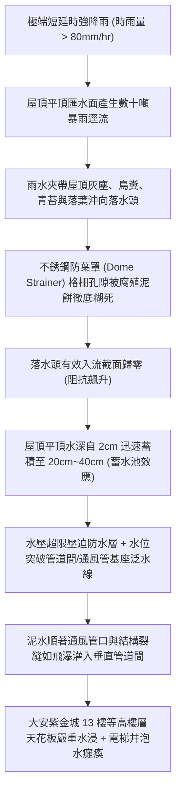
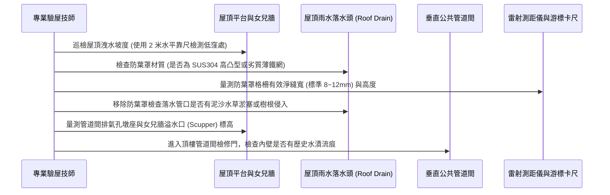

# 全案購屋實戰第九百九十六部：中古大樓社區屋頂雨水落水頭（Roof Drain）不銹鋼防葉罩變形淤塞平頂女兒牆積水倒灌管道間體檢工序全書

## 導言：屋頂天際線之洩洪咽喉與暴雨漫溢防禦戰

在集合住宅中古大樓之全天候防漏水體系中，屋頂平台（Roof Deck）長年直接暴露於烈日曝曬、紫外線照射、酸雨侵蝕以及颱風豪雨的極限氣候衝擊下。每逢夏季午後熱對流或秋季颱風來襲，時雨量往往瞬間突破 80mm 至 120mm，整座大樓屋頂數百平方公尺之匯水面積（Catchment Area），在短短數分鐘內便會產生數十噸的高動量雨水逕流。

這些龐大的雨水洪流，全賴鋪設於平頂各排水低窪分區的「屋頂雨水落水頭（Roof Drain）」與垂直雨水落水立管（Rainwater Leader Pipe）快速排入地面市政雨水下水道。而保護落水頭管徑不被堵死的第一道物理屏障，即為緊密扣鎖於落水頭基座上方的「半球形或平頂高凸型不銹鋼防葉防雜物罩（Dome Strainer / Gravel Guard）」。

然而，在許多屋齡 15 年至 30 年之中古大樓中，由於管委會欠缺高空巡檢維護，防葉罩與屋頂排水系統長年處於極其危險的隱形崩潰邊緣：
1. **防葉罩機械受損變形與位移脫扣**：長年承受工人踩踏、太陽能板施工震動或落葉垃圾重壓，廉價鑄鋁或薄鐵皮防葉罩發生塑性扁平變形，甚至被強烈陣風吹翻脫落。
2. **落葉、青苔、鳥糞與淤泥頑固膠結（Matted Debris）**：防葉罩格柵細縫被腐殖土、鴿糞、落葉與屋頂防水分化碎屑徹底封堵，形成厚度達數公分的「不透水纖維泥餅」，使落水頭之有效進水水力孔隙率自 70% 斷崖式暴跌至 5% 以下！
3. **屋頂平頂「泳池化」漫溢倒灌管道間**：當落水頭完全堵死時，奔騰的暴雨無法宣洩，在屋頂女兒牆（Parapet Wall）內部迅速蓄積成深達 20cm 至 40cm 的「高空懸掛游泳池」（蓄水量可達數十噸至百噸重）！當積水水位超過女兒牆防水層泛水收邊高度（Flashing Height）或管道間通風出風口基座時，混濁泥水將如同瀑布般直接「倒灌淹入垂直管道間與電梯機房井道」，沿著各樓層管道間穿牆縫隙滲入頂樓與高樓層住戶（如 13 樓、8 樓）天花板，造成昂貴木作裝潢、電氣線路與電梯控制板全數泡水報廢！

本全書深入解構屋頂雨水落水頭防葉罩淤塞之水力學機制、積水倒灌管道間微觀滲透途徑、高精度現地檢驗工序、標竿修復升級工藝與家庭買方在看屋時的談判籌碼運用。

---

## 一、屋頂落水頭水力匯流極限與防葉罩淤塞失效機制

### 1. 屋頂落水頭之流體力學孔流（Orifice）與堰流（Weir）轉換
屋頂落水頭的水力排洪容量取決於進水水頭高度（Head of Water, $h$）：
- **堰流狀態（Weir Flow，水深較淺時 $h < 50\text{mm}$）**：排洪量公式為 $Q = \frac{2}{3} C_w \cdot P \cdot \sqrt{2g} \cdot h^{3/2}$，主要依靠防葉罩圓周周長（Perimeter, $P$）溢流入孔。
- **孔流狀態（Orifice Flow，水深淹沒防葉罩 $h > 100\text{mm}$）**：排洪量公式轉換為 $Q = C_o \cdot A \cdot \sqrt{2gh}$，排洪量由落水孔淨截面積（$A$）決定。
- **半球型凸起防葉罩之水力關鍵優勢**：優質防葉罩必須設計為半球型或錐型凸起（高度 $\ge 100\text{mm}$），其作用在於：當底部被飄浮落葉包覆時，上半部的垂直與傾斜格柵仍能保持露出水面進水，避免形成完全堵塞。若被壓扁為「扁平網」，落葉一落便全面封死。

### 2. 女兒牆防水泛水收邊與管道間倒灌之微觀力學
- **泛水高度（Flashing Uplift）設計餘裕崩潰**：建築標準規範屋頂女兒牆防水層上翻高度必須 **$\ge 300\text{mm}$**，設備穿牆管墩座需高出屋頂完成面 **$\ge 250\text{mm}$**。然而老舊中古大樓因歷次屋頂重鋪防水加厚地面，或通風管道間基座原施工高度不足（僅 100~150mm），一旦積水深度超過 150mm，水體即直接自管道間開口頂部翻越倒灌。
- **靜水壓引發的防水層微裂紋「吸水滲透」**：水深 30cm 會在屋頂防水層表面施加高達 $3000\text{ Pa}$（$0.03\text{ kgf/cm}^2$）的持續均勻靜水壓。老舊防水瀝青或 PU 橡膠塗層在常態微濕時雖未漏水，但在持續靜水壓浸泡超過 2 小時後，水分子在壓差驅動下強行穿透毛細裂隙，沿著樓板混凝土冷縫（Cold Joint）橫向漫延數十公尺，最終在樓下各戶室內天花板最脆弱處滴漏噴發。

---

## 二、現場落水頭水力過流與管道間防汛體檢工序

在陪同家庭買方前往候選中古大樓實地踏勘時，進入頂樓露天平台必須嚴格落實以下五步標準體檢程序：

### 1. 防葉罩機械完整度與水力淨開孔率量測
- **檢測儀器**：數顯游標卡尺、金屬厚度規、強光防爆手電筒。
- **判定標準**：
  - **材質與造型**：必須為 **SUS304/SUS316 不銹鋼或熱浸鍍鋅重型球墨鑄鐵**，造型必須為 **半球型高凸型（凸起高度 $\ge 100\text{mm}$）**，以手掌重壓不得有任何變形凹陷。嚴禁使用塑膠菜瓜布或扁平沖孔鐵皮隨意覆蓋。
  - **格柵縫寬**：進水狹縫寬度必須介於 **$8\text{mm} \sim 12\text{mm}$ 之間**。縫隙小於 5mm 極易被灰塵藻類封死；大於 15mm 則無法阻擋落葉樹枝直墜立管造成主幹管地下深層堵塞。
  - **緊固鎖定機構**：防葉罩底座必須具備不銹鋼螺栓或卡扣牢固鎖死於落水頭基座上，以手拉拔不得鬆脫位移。

### 2. 女兒牆緊急溢流口（Secondary Overflow Scupper）設置查驗
- **安全規範**：依現代建築排水防洪標準，屋頂除常規落水頭外，女兒牆必須設置「二次緊急重力溢流口（Overflow Scupper / Weir）」。
- **檢驗要點**：
  - 溢流口底部標高應比屋頂最低落水頭高出 **$50\text{mm} \sim 75\text{mm}$**，且斷面淨寬不得小於 200mm。
  - **致命隱患**：若屋頂女兒牆為封閉式實心混凝土結構，完全「未設置任何緊急溢流孔」，一旦主落水頭被落葉封堵，屋頂水位將無限制上升直至翻過管道間，此社區防汛評級直接判定為紅燈危急！

### 3. 管道間墩座高差與通風帽防雨驗收
- **測量墩座泛水高度**：使用雷射測距儀量測公共管道間排氣孔外緣混凝土墩座頂部相對於屋頂完成面之淨高差：
  - **合格標準**：墩座高度必須 **$\ge 200\text{mm}$**，且管頂必須配置抗強風防雨不銹鋼通風帽（Mushroom Vent Cap）。
  - 若實測墩座高度小於 100mm，或通風管口朝天直通無遮蓋，暴雨積水倒灌管道間風險高達 90% 以上。

---

## 三、故障修復、標竿重載防葉落水系統翻新工藝

一旦查明屋頂落水頭老化變形或管道間泛水不足，管委會必須依照防洪防水標竿工程規範進行全面重構：

| 工程階段 | 標竿防洪工程規範與材料標準 | 廉價劣質短命工法之後遺症 |
| :--- | :--- | :--- |
| **落水頭本體升級** | 敲除破損舊落水頭，更換為 **SUS304 全不銹鋼雙層夾板夾具型屋頂專用落水頭（Clamping Ring Drain）**，將防水毯（SBS）牢牢壓入法蘭夾具內。 | 隨意塞入一支普通 PVC 塑膠管，管壁與混凝土無止水夾具，雨水順管外壁縫隙漏入樓板。 |
| **高凸防葉罩配置** | 安裝 **鑄造 SUS304 高凸半球型防葉罩（高 120mm，壁厚 3.5mm）**，配置 3 點式防拆防風不銹鋼螺栓鎖固。 | 採用市售 50 元薄鋁片沖孔罩，工人踩踏一次即壓扁成平鐵皮，迅速被落葉糊死。 |
| **緊急溢流口加開** | 於女兒牆低窪處，以水鑽洗孔機鑽穿開挖 **$150\times 300\text{mm}$ 喇叭型不銹鋼防汛溢流口（Scupper）**，外側導向建築外牆自由落體滴水。 | 女兒牆完全不開溢流孔，主排水管堵死時屋頂蓄積百噸死水壓垮防水層。 |
| **管道間墩座加高** | 管道間混凝土基座以植筋（$\phi 10\text{mm}$ D10 鋼筋）加高至 **300mm 以上**，外層施作雙道彈性水泥複合防水砂漿與抗裂玻璃纖維網。 | 未加高墩座，僅抹一層薄水泥，積水時水流自冷縫與排氣口洶湧倒灌。 |
| **定期水力清淤制度** | 管委會建立「防汛期（每年 5~10 月）每週定時高壓水槍沖洗落水頭與清除青苔」之標準巡檢 SOP。 | 數年無人上頂樓清理，形成厚厚落葉腐殖土層，甚至長出小樹雜草破壞結構。 |

---

## 四、四大主力候選物件實戰關聯評估與議價攻防

屋頂排水與管道間防汛狀態，是檢驗中古大樓頂樓與高樓層住戶資產價值的生死關卡：

### 1. 大安紫金城 13 樓 (`PROP_10`)
- **實地重點**：
  - 大安紫金城本物件為 **13 樓頂樓高樓層**！頂樓物件最致命的物理風險就是「屋頂漏水」與「管道間雨水倒灌」。
  - 13 樓天花板正上方即為屋頂平台。若屋頂雨水落水頭防葉罩被落葉雜草封死，暴雨時 13 樓住戶天花板將直接承受數十噸積水的浸泡壓力；更危險的是，全棟管道間自屋頂直通地下室，若屋頂管道間通風墩座泛水失效，泥水將順著管道間倒灌進 13 樓各室內吊頂！
- **談判攻防部署**：
  - 實地走上大安紫金城屋頂平台，嚴格檢查 13 樓戶別正上方的落水頭是否通暢、防葉罩是否完好、女兒牆有無開具緊急溢流口。若發現屋頂落水頭周邊積水發黑、長有青苔草木，或管道間通風管口泛水高度不足 15cm，立即出示高清照片向房仲與屋主指出：「屋頂防洪排水系統嚴重失修，頂樓隨時有暴雨滅頂水浸風險，需自費施作全戶天花板防水隔離與屋頂專案排水疏通（報價 15 萬元）！」
  - 結合 35 萬套房拆除款，堅決守住 720~730 萬起手出價，強勢鎖定 768~788 萬目標成交價。

### 2. 長億南園 8 樓 (`PROP_106`)
- **實地重點**：長億南園雖為 8 樓非頂樓戶，但室內實坪達 32 坪大空間，其公共管道間貫穿客廳、廚房與雙衛浴。若屋頂落水頭堵塞導致水灌管道間，8 樓之管道間檢修門與管邊穿牆孔同樣會遭受由上而下的瀑布式滲漏。
- **殺價攻防**：利用長億南園頂樓公設維護狀況（老舊社區常有頂樓落水頭積泥破壞問題），協同機械車位限重 1.6 噸痛點，強勢砍價 50 萬，壓制在 745~760 萬。

### 3. 歌德堡 8 樓 與 靜園 A 區 11 樓
- **歌德堡 8 樓**：北歐百萬現代精裝，需檢驗其全室天花板內管道間外壁是否有乾涸黃色水漬痕跡，確認過去屋頂是否有雨水倒灌管道間之歷史災情。
- **靜園 A 區 11 樓**：高樓三面採光、頂樓防洪與管道間若養護良好無滲水痕跡，更加彰顯其作為第一安全保底防線的非凡含金量。

---

## 五、全案總結與買方自保查核清單

1. **登頂看防葉罩**：屋頂落水頭防葉罩必須為高凸半球型（高 $\ge 10\text{cm}$），嚴禁被踩扁或以塑膠網隨意遮蓋。
2. **查孔隙無泥餅**：防葉罩四周格柵必須清澈透亮，嚴禁被黑褐色落葉腐殖泥餅糊死，周邊不得長有雜草或淤泥堆積。
3. **驗女兒牆溢流孔**：女兒牆低處必須開有金屬溢流方孔（Scupper），確保主管堵塞時雨水能由溢流口排出，絕不在屋頂蓄水。
4. **探管道間通風墩**：屋頂管道間與通風管外壁混凝土墩座高度必須高出地面 20cm 以上，管口必須具備防雨風帽。
