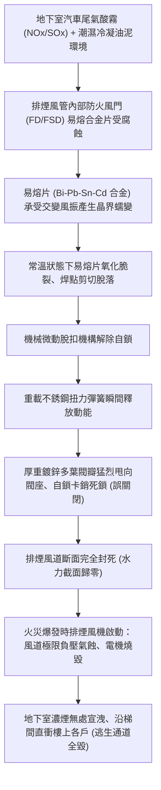
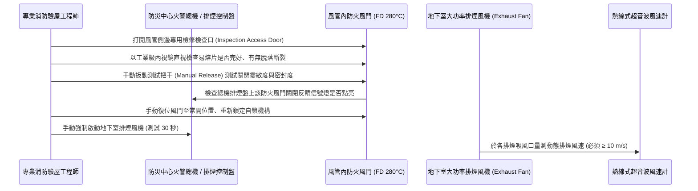

# 全案購屋實戰第九百九十四部：中古大樓地下室機械排煙風機耐高溫防火風門（FD）易熔片氧化脫落連動閥瓣誤關閉體檢工序全書

## 導言：地下室火災生死逃生的煙氣阻絕與排風咽喉

在集合住宅中古大樓之立體防救災體系中，地下停車場與地下機房由於缺乏自然採光與開窗通風條件，一旦汽車引擎室起火、新能源電動車鋰電池熱失控或配電盤電弧引燃，將在短短數分鐘內蓄積高達數千立方公尺的黑煙毒氣與超過 $600^\circ\text{C}$ 至 $800^\circ\text{C}$ 的劇烈高溫。統計顯示，大樓火災中超過 80% 的傷亡並非直接燒死，而是因吸入劇毒的一氧化碳（CO）、氰化氫（HCN）與高溫煙氣導致窒息昏厥。

為此，地下室全面強制配置大功率「機械排煙系統（Mechanical Smoke Exhaust System）」與「排煙管道防火風門（Fire Damper, FD / Smoke & Fire Damper, FSD）」。防火風門平時保持「常開（Normally Open）」狀態，維持正常的地下室通風換氣或待命排煙；當火災爆發時，它必須在排煙風機強大負壓下維持煙氣抽吸，並在排出的煙氣溫度超過法定極限（通常為 **$280^\circ\text{C}$**，以保護排煙風機葉輪不被融毀或阻隔火勢跨防火區劃蔓延）瞬間，依靠門體內部的「感溫易熔片（Fusible Link）」熔斷，驅動重載扭簧釋放將閥瓣瞬間關閉。

然而，在許多屋齡 15 年至 30 年以上之中古大樓中，地下室通風風管常年處於潮濕凝露、汽車尾氣酸性顆粒（NOx、SOx）與油泥粉塵的極限腐蝕環境下：
1. **易熔片低熔點合金蠕變氧化脫落**：易熔合金片（通常為鉍、鉛、錫、鎘共晶合金）在交變微振與酸性廢氣侵蝕下，金屬晶界發生應力鬆弛與氧化脆裂，在尚未發生火災的常溫狀態下「無故疲勞脆斷脫落」！
2. **連動閥瓣誤關閉（Accidental Slam Shut）**：易熔片脫落瞬間，釋放機構解除自鎖，強大的扭簧力猛烈將防火風門閥瓣「砰」地一聲甩至全關死鎖狀態；而風管外部無任何明顯提示，管委會與住戶完全被蒙在鼓裡。
3. **排煙風機空轉氣蝕與排煙徹底癱瘓**：當排煙風道內的防火風門在常態或火災初期誤關閉時，若排煙風機被啟動，整條排煙管道將處於完全「窒息閉死」狀態！排煙風機葉輪在極限負壓下產生強烈氣蝕震動與電機超載燒毀；而地下停車場的滾滾濃煙完全無法排出，沿著安全梯間直衝樓上住宅，阻斷全棟住戶逃生生路！

本全書深入解構防火風門易熔片氧化脫落之材料物理成因、風管內窺鏡與動態排風驗收工序、標竿修復升級工藝與家庭買方在看屋時的談判籌碼運用。

---

## 一、防火排煙風門工作原理與易熔片常溫誤閉失效機制

### 1. 防火風門（FD 280°C）之機械自鎖與熔斷原理
標準排煙防火風門由鍍鋅鋼板外框、多聯動平行閥瓣（Blades）、軸承銅套、聯動連桿、閉門扭力彈簧、微動連鎖微動開關以及關鍵的「感溫易熔片組件（Fusible Link Assembly）」構成：
- **常時待命**：易熔片像鎖扣一樣，將扭簧預緊力死死扣鎖在張緊狀態，使閥瓣保持與氣流平行的全開位置（迎風阻力最小）。
- **高溫保護熔斷機制**：當排出的煙氣溫度達到指定熔點（排煙風口通常為 $280^\circ\text{C}$，普通防火風口為 $70^\circ\text{C}$）時，易熔合金瞬间熔化成液態，鎖扣失靈，閉門扭簧爆發力推動連桿在 **小於 2 秒內** 將全部閥瓣閉合，阻斷火勢跨區蔓延，並透過微動開關向消防總機回傳「風門已關閉」電氣信號以聯動關停排煙風機。

### 2. 易熔片常溫脫落之微觀材料物理劣化
- **低熔點共晶合金之常溫蠕變（Room-temperature Creep）**：易熔合金熔點僅為 $70^\circ\text{C} \sim 280^\circ\text{C}$，其絕對溫度與熔點之比值（同系溫度 $T/T_m$）極高（通常大於 0.6）。在此高同系溫度下，合金在長年承受閉門彈簧持續施加的拉伸剪切應力（約 $10 \sim 30\text{ N}$）下，晶界原子極易發生滑移，產生「常溫蠕變破壞」。
- **尾氣酸性冷凝物之電化學晶間腐蝕**：地下室柴油發電機試車與汽機車排放的二氧化硫、二氧化氮與風管內凝結水結合成亞硫酸與稀硝酸。易熔片（含有鉍、錫、鉛等不同電位金屬相）在酸性電解液浸泡下爆發劇烈的微電池電化學腐蝕，焊縫界面脫黏。
- **排風機啟閉氣流脈衝之微觀低週疲勞**：社區日常換氣每日定時啟閉排風機，氣流高速通過風門時引發閥瓣顫抖（Flutter），帶動易熔片承受高頻往復微振，最終導致易熔片在毫無火警的常溫環境下「突然斷裂脫落」。

---

## 二、現場內窺鏡檢測、連動閉鎖與風量驗收工序

在陪同家庭買方前往候選中古大樓踏勘地下停車場與設備機房時，必須嚴格落實以下排煙風門檢測程序：

### 1. 內窺鏡直視易熔片與閥瓣狀態（靜態檢驗）
- **工具裝備**：高解析度（1080P）轉向鏡頭工業管道內視鏡、防爆強光手電筒。
- **標準程序**：
  - 旋開排煙風管側邊的 $300\times 300\text{mm}$ 防火風門檢修門。
  - **合規判定標準**：
    - **正常（綠燈）**：易熔片兩側焊點飽滿無微裂紋、無銅綠白華腐蝕；閥瓣處於絕對水平全開位置，各閥片平行間隙均勻。
    - **致命故障（紅燈）**：易熔片已斷裂掉落在風管底層；全部多葉閥瓣在扭簧作用下處於 **100% 關閉死鎖狀態**，排煙斷面已完全被堵死！

### 2. 手動脫扣與自動彈跳閉鎖試驗
- **測試流程**：輕輕扳動閥體外部的手動手動脫扣手柄（Manual Trip Lever）：
  - 閥瓣必須在 **不到 1 秒（< 1s）內瞬間重彈關閉**，發出清脆有力的撞擊鎖定聲。
  - 以厚薄規檢查關閉後閥片搭接處間隙，最大縫隙 **嚴禁大於 2.0mm**，耐高溫柔性膨脹密封條無脫落。
  - 防災中心總機排煙控制盤上，該風門的「關閉回饋紅燈」必須在 2 秒內同步點亮。
- **復位試驗**：操作外部手動復位扳手將閥門重新旋回常開狀態，棘輪卡銷應能清脆咬合自鎖，無任何打滑或鬆脫脫扣現象。

### 3. 排煙風機啟動之動態風量與風速採樣
- **測試規範**：於防災中心手動啟動地下室機械排煙風機組（通常功率達 15kW 至 37kW）：
  - 在地下停車場各分區防煙垂壁內的「排煙口（Smoke Exhaust Grille）」處，使用熱線式數位風速儀測量平均截面排煙風速。
  - **判定標準**：排煙口平均吸風風速必須 **$\ge 8.0 \sim 10.0\text{ m/s}$**。若風機已全速轟鳴運轉，但排煙口風速幾近於零（$< 0.5\text{ m/s}$），且風管傳出尖銳的負壓嘯叫聲，證實幹管上游之 280°C 防火風門早已誤關閉！

---

## 三、故障修復、標竿重載防火風門翻新工藝與材料規範

一旦查明地下室排煙防火風門易熔片氧化斷裂或閥瓣卡滯，必須依照國家最高消防法規進行徹底大修：

| 工程階段 | 標竿消防工程規範與材料標準 | 廉價劣質短命工法之後遺症 |
| :--- | :--- | :--- |
| **易熔片選型** | 選用通過 **UL 33 認證之不銹鋼框架高抗蠕變感溫易熔片**，動作溫度精確校驗為 **280°C（排煙幹管）或 70°C（穿牆風管）**，抗拉承載力達 50 磅（220N）。 | 採用市售無認證雜牌易熔片，熔點誤差超過 ±30°C，且常溫數月內再次蠕變脫落。 |
| **旋轉軸承升級** | 閥瓣轉軸全面升級為 **含油青銅粉末冶金自潤滑軸套（Oilite Bearing）或 SUS316 不銹鋼滾珠軸承**，耐高溫達 500°C。 | 採用普通碳鋼直接與鐵皮接觸摩擦，在潮濕油泥下數年內徹底生鏽抱死。 |
| **閥片氣密密封** | 閥片邊緣鑲嵌 **耐高溫矽橡膠與不銹鋼雙層彈性密封刮片**，外框內壁塗覆高溫發泡阻火膨脹密封膠條（熱膨脹率 ≥ 10 倍）。 | 無密封條金屬硬碰硬，關閉後漏煙率高達 30% 以上，失去煙氣阻隔功能。 |
| **電動執行器替代** | 建議將傳統純機械易熔片風門升級為 **電動自動復位防火排煙風門（24V DC / 220V AC 電動執行機構，具備彈簧蓄能關閉功能）**，可由總機遠端一鍵復位與巡檢。 | 保留純機械老舊風門，維修人員因嫌手動復位麻煩而用鐵絲將閥瓣死死綁在開口處，火災時無法關閉。 |
| **全風道清淤排垢** | 配合更換工程，實施排煙風管內部全段高壓除油垢清洗，清除沉積油泥與積水。 | 管道內部沉積數十公斤易燃油垢，排煙時高溫煙氣直接引燃風管內部二次起火。 |

---

## 四、四大主力候選物件實戰關聯評估與議價攻防

地下室機械排煙與防火風門狀態，直接決定豪車資產與家庭成員在極端火災時的生死底線：

### 1. 大安紫金城 13 樓 (`PROP_10`)
- **實地重點**：
  - 大安紫金城本物件配備極為珍貴的 **地下二樓（B2）獨立大型平面車位**！
  - 地下二樓為封閉式地下停車場，車道出口狹長。若 B2 機械排煙風道的 280°C 防火風門易熔片氧化脫落導致閥門長期誤關閉，一旦地下停車場發生電動車鋰電池燃燒或車輛火警，整座地下二樓將在 3 分鐘內灌滿劇毒致死濃煙，不僅數百萬豪車將全數報銷，濃煙更會沿著電梯井與安全梯急速竄升直衝 13 樓頂樓住戶！
- **實戰攻防對策**：
  - 看屋時親自走訪地下二樓機房與排煙管道，以手電筒照射排煙風門檢修口；若發現風門已被鐵絲強行綁死、檢修門鏽死或排煙口毫無吸力，立即向房仲提出嚴正抗議：「地下室公共排煙系統徹底癱瘓，全棟消防安全面臨極大法律與生命威脅，管委會需編列專案修繕預算 20 萬元！」以此為硬核底牌，堅決捍衛扣除 35 萬套房拆除款，死守起手 720 萬、直取 768~788 萬目標價。

### 2. 長億南園 8 樓 (`PROP_106`)
- **實地重點**：長億南園配備機械車位（限重 1.6 噸），機械車坑內部線路與液壓油繁多，火災載荷極高。若地下室機械排煙風門卡死失靈，地下室防救災等級將嚴重不及格。
- **殺價攻防**：結合其機械車位無法停休旅車、梯廳 4 階高差無障礙缺失，再補上地下室公共排煙風門鏽死誤閉之公設重大安全隱患，強勢大砍 50 萬，徹底粉碎屋主 998 萬高價幻想，鎖定 745~760 萬成交區間。

### 3. 歌德堡 8 樓 與 靜園 A 區 11 樓
- **歌德堡 8 樓**：北歐現代精裝牽制牌，需查核社區地下室公共排煙設施是否與其高檔裝潢管理水準相符，確保無金玉其外敗絮其中之弊端。
- **靜園 A 區 11 樓**：高樓三面採光且樓層開陽，若地下室機械排煙動態測試排風強勁、風門開度 100% 正常，證明社區管理極度負責，無可爭議作為談判破局時第一安全底牌。

---

## 五、全案總結與買方自保查核清單

1. **查外觀扳手**：檢視地下室排煙風門外部手動操作扳手，指針必須明確指向「OPEN（全開）」刻度，嚴禁指向「CLOSE」或被鐵絲繩索捆綁死。
2. **開檢修小門**：要求管委會陪同打開風管檢修口，以強光手電筒目測易熔片必須完好跨接於兩端，嚴禁有斷裂或脫落掉在管底。
3. **測吸風風速**：在排煙風機試車時，將一張 A4 紙貼在地下室排煙吸風口，A4 紙必須被強烈負壓「牢牢死死吸住」且風速計數值 $\ge 8\text{ m/s}$。
4. **驗信號反饋**：手動脫扣觸發風門關閉瞬間，總機排煙控制盤上之對應指示燈必須在 2 秒內轉為亮紅燈，證明電氣連鎖信號完好無缺。
