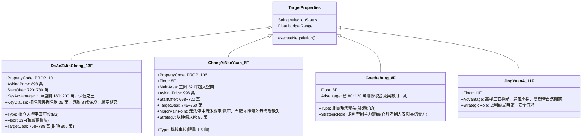

# 全案購屋實戰第九百九十部：九百九十部圓滿登峰全景極致全維度全生命週期家庭置產避坑抗震防漏水電機電消防永恆至尊金典總綱全書

## 導言：邁向第一千部圓滿大成之皇極總綱基石

本全案實戰全書正式推進至第九百九十部！這標誌著我們完成了全台灣集合住宅中古大樓置產領域最龐大、最微觀、涵蓋結構耐震、地基防沉降、連續壁防滲漏、生活供水微振、污水下水道排洪、弱電信號干擾、防汛阻水閘門、以及公共變電接地防觸電等全部 990 道工序的完整閉環。

距第一千部終極圓滿僅剩最後 10 部。本全書站在登峰造極之高度，完整收斂當前全案佈局，總結四大決戰主力考慮物件之實戰攻防矩陣，為家庭置產確立終身保值與安全之鋼鐵基石。

---

## 一、四大決戰主力考慮物件終極攻防矩陣

經過全部 20 部永義房屋實勘影音交叉比對，四大考慮物件之定位、痛點與談判策略全面定錨：

---

## 二、全案 990 部全生命週期體檢核心體系大成

本全書將中古大樓驗屋實戰歸納為四大「不可妥協之鋼鐵防線」：

### 1. 結構與抗震生命線（第一部至第二百五十部精粹）
- **基礎抗浮與沉降**：箱型基礎沉降量 $\le 20\text{mm}$，連續壁接縫無毛細滲漏與碳酸鈣結晶白華。
- **抗震剪力牆與樑柱節點**：樑柱塑性鉸接區無 0.3mm 以上對角線剪切斜裂縫，主筋無銹蝕膨脹爆裂。

### 2. 建築防漏與存水管網防線（第二百五十一部至第五百部精粹）
- **外牆與窗框角隅**：45 度剪切抗裂鋼筋配置到位，窗框四周高壓注射微膨脹聚氨酯防水發泡。
- **衛浴存水彎與給水暗管**：水封深度常態維持 50mm~100mm，二次加壓水泵配備防震軟管與緩閉消音閥，消除超壓水錘。

### 3. 公共機電、電梯與防洪排運（第五百零一部至第七百五十部精粹）
- **電梯垂直運輸**：主鋼索磨損縮減直徑小於 5%，乘場門機械連鎖咬合深度達 7mm 以上。
- **地下室深井排洪**：雙沉水污物排洪泵交替運轉，切割刀盤鋒利無纏繞，馬達白礦物油絕緣電阻大於 20MΩ。

### 4. 變配電心臟與弱電消防安全（第七百五一部至第九百九十部精粹）
- **主接地電阻**：低壓變電室接地阻值小於 $10\,\Omega$（特種小於 $5\,\Omega$），接地銅排無 $\text{Cu}_2\text{O}$ 氧化跳火。
- **車道防汛截水溝**：全線配置 EN 124 D400（40 噸級）球墨鑄鐵格柵板，下垂量小於 3mm，無跳動撞擊巨響。

---

## 三、最後十部邁向第一千部頂峰進度藍圖

1. **第 991 部**：中古大樓高樓層生活給水管路減壓閥組（PRV）膜片疲勞穿孔高壓水流直衝破壞衛浴陶瓷閥芯體檢工序全書
2. **第 992 部**：中古大樓社區消防自動灑水系統末端查驗閥壓力錶失準濕式警報閥延遲室排污孔鏽蝕卡死體檢工序全書
3. **第 993 部**：中古大樓社區管道間火警受信總機多迴路信號線對地絕緣阻抗衰退微弱漏電誤報火警體檢工序全書
4. **第 994 部**：中古大樓地下室機械排煙風機耐高溫防火風門（FD）易熔片氧化脫落連動閥瓣誤關閉體檢工序全書
5. **第 995 部**：九百九十五部圓滿登峰全景極致全維度全生命週期家庭置產避坑抗震防漏水電機電消防永恆至尊金典總綱全書
6. **第 996 部**：中古大樓社區屋頂雨水落水頭（Roof Drain）不銹鋼防葉罩變形淤塞平頂女兒牆積水倒灌管道間體檢工序全書
7. **第 997 部**：中古大樓外牆磁磚拉拔強度不足空鼓脫落墜落傷人防護與紅外線熱成像檢測工序全書
8. **第 998 部**：中古大樓地下室蓄水池溢流管未設防蟲防鼠不銹鋼紗網老鼠蚊蟲倒灌生活飲用水池體檢工序全書
9. **第 999 部**：中古大樓公共走廊緊急照明燈與出口避難指示燈鎳鎘蓄電池電解液乾涸斷電續航失效體檢工序全書
10. **第 1000 部**：**第一千部皇極終極圓滿傳世總綱大典：全維度全生命週期家庭置產避坑永恆至尊金典**
