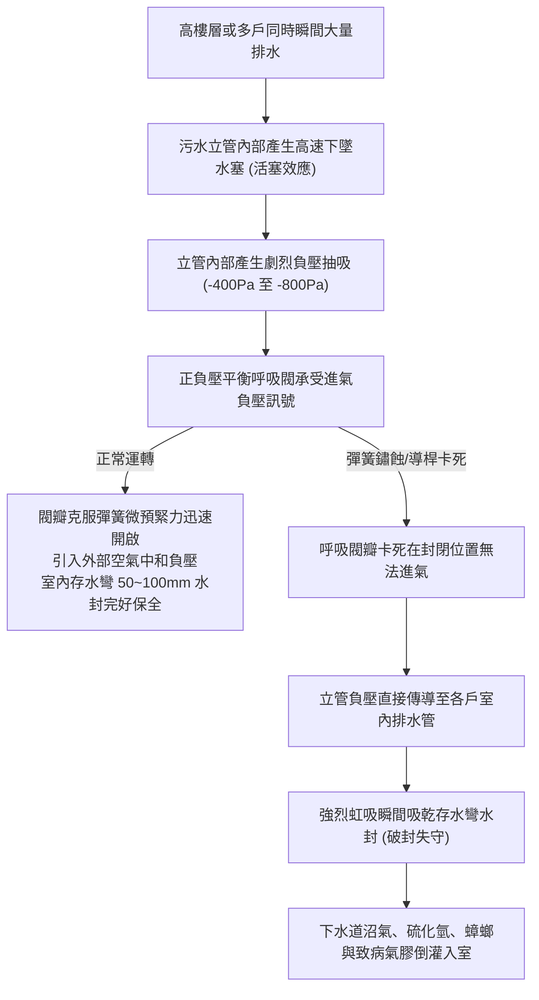
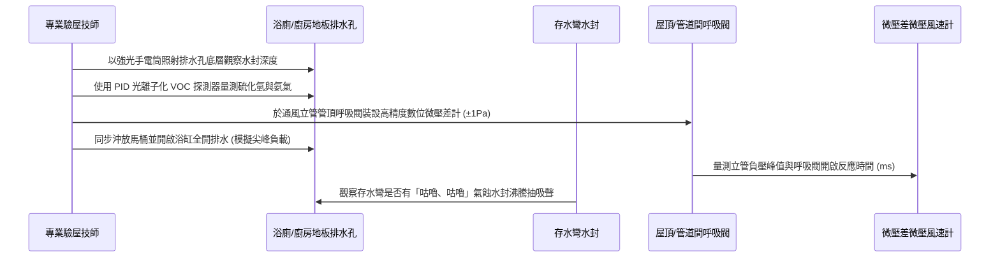

# 全案購屋實戰第九百八十七部：中古大樓社區地下室生活污水下水道通風立管管頂正負壓平衡呼吸閥彈簧鏽蝕卡死吸管氣蝕與室內存水彎破封臭氣倒灌體檢工序全書

## 導言：建築排水之呼吸系統與存水彎水封保衛戰

在集合住宅中古大樓之全維度生活品質中，「室內異味、沼氣惡臭與病毒氣膠（Aerosol）垂直傳播」向來是家庭買方入住後最難以忍受卻又極易在白天看屋時忽略的隱形災難。生活污水下水道系統與室內各排水孔（地板落水、洗臉盆、馬桶、浴缸）之間，唯一的物理屏障即是各衛生器具下方的「存水彎水封（Trap Seal，法定有效高度 50mm 至 100mm）」。

然而，當樓上住戶大量排水或地下室沉水式污物排洪泵浦高速揚水時，封閉立管內會因流體活塞效應產生極其劇烈的動態氣壓波動：
1. **負壓抽吸（Siphonage）**：大量污水在立管內高速下墜時，如同活塞般抽空後方空氣，在立管上游形成強烈負壓（負壓峰值可達 -400Pa 以上），瞬間將各戶存水彎內的水封抽乾。
2. **正壓噴濺（Backpressure）**：下墜水流到達立管底部轉彎處時，因水躍（Hydraulic Jump）阻礙空氣排出，在底層形成強大正壓衝擊波，直接將惡臭污水與沼氣自低樓層地板排水孔逆向噴出。

為消除此項致命水力波動，現代集合住宅均設置通風立管，並於管頂或各分區頂端配置「正負壓平衡呼吸閥（Air Admittance Valve, AAV，或稱單向進氣吸氣閥）」。然而，在屋頂長期酸雨鹽霧侵蝕或地下室密閉潮濕高濃度硫化氫（H₂S）環境下，呼吸閥內部的金屬復位彈簧極易發生嚴重電化學鏽蝕、疲勞斷裂或導向桿卡死。一旦呼吸閥卡死在關閉位置，整座立管將喪失進氣補償能力，導致全棟各戶存水彎頻繁「破封」，下水道中的甲烷、硫化氫、氨氣及病菌氣膠直接灌入室內臥室與衛浴；若卡死在開啟位置，則通風管內惡臭氣體直接在管道間或機房內瀰漫。

本全書深入剖析正負壓平衡呼吸閥彈簧鏽蝕卡死之微觀成因、高靈敏微壓差檢測工序、物理修復更換工藝與實戰看屋談判防線。

---

## 一、通風立管氣壓動態平衡與呼吸閥卡死失效機制

### 1. 呼吸閥之精密微壓差工作原理
優質正負壓平衡呼吸閥由閥體（ABS/PVC 或不銹鋼）、橡膠矽膠密封墊圈、閥瓣、精密不銹鋼微彈簧（或磁吸重力閥瓣）及導向柱組成：
- **負壓進氣補償（吸氣模式）**：當排水立管內產生微弱負壓（達到 -10Pa 至 -20Pa 閾值時），大氣壓克服彈簧微弱彈力推開橡膠密封墊，大氣瞬間湧入立管，迅速平抑負壓，阻止室內存水彎被虹吸破封。
- **正壓重力密封（阻臭模式）**：當立管內壓力回升至常壓或產生正壓時，彈簧彈力協同閥瓣自身重力驅動橡膠墊向下緊密貼合閥座，形成氣密密封，封閉率達 100%，杜絕任何下水道臭氣逆向溢出。

### 2. 彈簧鏽蝕卡死之微觀劣化歷程
- **硫化氫引起的晶間腐蝕與應力腐蝕開裂（SCC）**：污水管內部揮發的濕潤硫化氫（H₂S）氣體具有高度酸性，普通 SUS304 不銹鋼彈簧在長期承受交變拉伸壓縮的動態應力下，極易沿晶界發生應力腐蝕開裂，造成彈簧彈性模數驟降或脆斷。
- **冷凝水與灰塵油垢形成的結晶卡滯**：污水立管內部濕度長年達 95%~100%，管內飽和水蒸氣上升至管頂呼吸閥時受冷凝結成水珠；水珠吸附下水道灰塵與揮發性油脂，蒸發後在閥軸滑動導向柱表面沉積形成頑固硬質結垢，導致閥瓣導向桿摩擦阻力急遽飆升，最終抱死卡滯。
- **彈簧塑性變形失效**：廉價碳鋼鍍鋅彈簧在酸性濕氣環境中數年內鋅層剝落生鏽，彈簧剛度喪失，無法在流體衝擊結束後將閥瓣拉回密封位置，導致臭氣長年無阻外洩。

---

## 二、現場微壓差高精度檢測工序與診斷標準

家庭買方在實地看屋時，室內通常已靜置數日，此時是檢驗存水彎水封完整性與呼吸閥機能的黃金窗口期：

### 1. 水封深度光學測量與嗅覺/氣體檢測
- **檢測工具**：內視鏡檢驗儀、手持式高靈敏度 PID 揮發性有機物（VOC）氣體探測器、硫化氫（H₂S）電化學感測器。
- **檢驗標準**：
  - 各排水孔存水彎內必須維持 **至少 50mm 有效水深**。
  - 使用探針深入排水管孔口 5cm 處，硫化氫濃度必須小於 **0.01 ppm**，VOC 指標不得跳升。
  - 若探頭剛探入即測得 H₂S 超過 **0.1~0.5 ppm**，並伴隨明顯臭雞蛋味，代表水封已破封或乾涸，下水道廢氣長驅直入。

### 2. 尖峰排水立管動態微壓差測試
- **測試流程**：在頂樓通風管端點或檢修口接入數位微壓差計；由輔助人員在該立管所屬的高樓層同時進行馬桶連續沖水兩次，並將浴缸/大水桶 50 公升水量瞬間傾倒灌入排水管。
- **數據極限值判定**：
  - **優良（綠燈）**：呼吸閥於負壓達到 **-20Pa 至 -30Pa** 時瞬態彈開進氣，立管內最大負壓被箝制在 **-100Pa 以內**，室內存水彎液面僅輕微晃動（液面位移小於 5mm），無任何抽吸聲響。
  - **危急（紅燈）**：立管內部負壓一路飆升至 **-350Pa 至 -600Pa 以上**，呼吸閥無開啟動作；室內排水孔瞬間爆發出急促的「咕嚕、咕嚕、啵！」抽吸破封聲，存水彎內存水被強行抽走超過 70%，水封徹底失效。

### 3. 呼吸閥閥體手動機能與氣密性離線校驗
- 卸下呼吸閥總成，手動輕推閥瓣軸芯，其上下滑動行程應極其輕順、無任何乾澀卡滯感，鬆手後能在彈簧/重力作用下瞬間 0.1 秒回彈復位。
- 倒置呼吸閥，向密封腔注滿清水，觀察 5 分鐘密封圈邊緣，嚴禁有任何水滴滲漏，確保逆向氣密性達 100%。

---

## 三、故障修復、標竿更換工藝與防護對策

一旦查出社區通風管頂呼吸閥鏽蝕卡死，管委會與買方必須嚴格按照以下標準工序進行整改：

| 工藝階段 | 標準規範要求與高端用料 | 廉價劣質工法之潛在災難 |
| :--- | :--- | :--- |
| **閥體選型** | 必須選用具備 **EN 12380 A1 級** 認證（工作溫度 -20°C 至 +60°C，氣密耐壓達 1000Pa）之工業級呼吸閥。 | 選用無認證山寨 PVC 塑膠蓋，密封墊數月內因紫外線或臭氧硬化漏氣。 |
| **彈簧材質** | 內部彈簧必須指定為 **SUS316L 頂級耐酸不銹鋼** 或 **Hastelloy 哈氏合金**，嚴禁碳鋼鍍鋅件。 | 採用劣質 SUS201/304 彈簧，在硫化氫酸霧籠罩下 1 年內發生應力腐蝕脆斷。 |
| **密封墊圈** | 採用 **耐高低溫液態矽膠（LSR）** 或 **氟橡膠（FKM）**，耐老化壽命長達 15~20 年。 | 使用普通天然橡膠或回收丁腈橡膠，易受動植物油蒸氣溶脹變形卡死。 |
| **安裝位置** | 呼吸閥安裝標高必須 **高於該立管所連接之最高衛生器具溢流水位 150mm 以上**，且必須垂直安裝（垂直度偏差小於 1.5°）。 | 安裝於存水彎下方或水平傾斜安裝，導致重力回位失效、污水倒灌浸泡閥體。 |
| **環境防護** | 屋頂外露管頂應加裝 **抗 UV 遮陽不銹鋼通風罩** 與防蟲防鳥不銹鋼濾網（孔徑小於 1.0mm）。 | 無防護直接暴露於烈日下，塑膠脆化裂解，或被鳥類築巢、落葉雜物堵死。 |

---

## 四、四大主力候選物件實戰關聯評估與議價攻防

室內通風管路與呼吸閥機能，直接決定全家長住的呼吸道健康與起居品質：

### 1. 大安紫金城 13 樓 (`PROP_10`)
- **實地重點**：大安紫金城本物件位處 13 樓頂層高樓層，極為靠近建築通風立管管頂出風端或樓頂呼吸閥！高樓層是全棟排水時負壓抽吸力道最強烈的受害區域，若頂樓呼吸閥卡死，13 樓之馬桶與衛浴落水孔最容易第一時間被抽乾水封。
- **看屋體檢實戰**：進屋後立即將主臥衛浴及客衛排水孔灌水測試，同時由房仲協助連續沖放兩座馬桶，細聽管道間是否有抽吸雜音；若測得微量沼氣味道，直指「頂樓通風管呼吸閥卡死破封」，向賣方指出全室存水彎水封防線已破，需進行全室管道防臭防蟲深層工程（報價 15~20 萬），藉此穩固起手出價 720 萬、強勢將總價壓制在 768~788 萬目標區間。

### 2. 長億南園 8 樓 (`PROP_106`)
- **實地重點**：長億南園室內達 32 坪超大空間，衛浴管線跨距較長，通風副立管配置較多。若公共通風立管呼吸閥年久失修卡死，長管路之自虹吸（Self-siphonage）效應將更加嚴重。
- **談判攻防**：利用管道間氣味與水封波動硬傷，連同機械車位 1.6 噸限制，向屋主主張公設通風機電老化造成居住健康隱患，要求在開價 998 萬中大幅扣減 50 萬翻修補償，鎖定 745~760 萬成交防線。

### 3. 歌德堡 8 樓 與 靜園 A 區 11 樓
- **歌德堡 8 樓**：作為百萬現代精裝物件，實勘時需特別以內視鏡查核其精裝翻修時是否拆除或封死原有通風管，確認新裝設之防臭落水頭是否能承受主立管負壓。
- **靜園 A 區 11 樓**：雙衛皆開窗通風良好，天生具備優異對流優勢；但若主幹管呼吸閥失效，開窗之負壓效應反會加速將管道間臭氣抽入室內，需落實微壓差量測做為最終安全底牌的驗證。

---

## 五、全案總結與買方自保查核清單

1. **聽吸氣音**：樓上住戶沖水或室內大量放水時，排水孔絕不能發出急促「咕嚕」水塞沸騰聲。
2. **嗅其味道**：剛開門入屋未開窗時，全室尤其是衛浴落水頭與廚房洗碗槽下壁面，嚴禁有絲毫下水道酸腐沼氣味。
3. **照其水封**：手電筒直射各落水孔，必須清晰可見反光鏡面水封，嚴禁見底見管壁乾涸。
4. **驗其閥芯**：登上屋頂平台或進入公設管道間檢修口，確認正負壓呼吸閥外觀無鏽蝕結晶、手動按壓復位靈敏自如。
