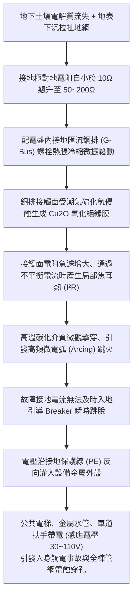
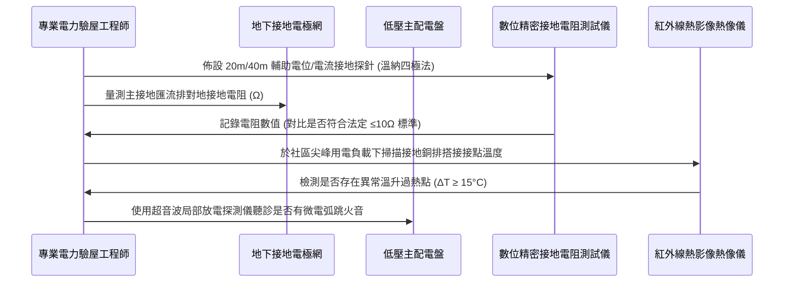

# 全案購屋實戰第九百八十九部：中古大樓社區變電室低壓配電盤接地電阻超標接地銅排微電弧氧化跳火雜散漏電與電氣設備外殼感應觸電體檢工序全書

## 導言：公共機電之心臟守護神與零電位安全基石

在中古大樓全生命週期之公共機電安全體系中，地下室高低壓受變電室（Substation / Electrical Room）與低壓主配電盤（Main Low-Voltage Switchboard），是維繫全棟數百戶家庭照明、烹飪、電梯垂直運輸、自來水加壓揚水與消防排煙生命線的電力中樞心臟。而在這套龐大的 380V/220V/110V 三相四線制強電系統中，「電氣接地工程（Electrical Grounding & Bonding System）」則是保障人身免於觸電致命傷害、抑制雷擊突波超壓、引導短路故障電流快速跳脫保護開關的「最後一道絕對安全防線」。

然而，在許多屋齡 20 年至 30 年以上之中古大樓中，因地下室常年處於潮濕高溫環境、地盤沉降拉扯地底接地網，或是當初施工偷工減料，導致「接地系統」產生不可逆的嚴重劣化：
1. **接地電阻嚴重超標**：法定低壓設備接地電阻標準必須小於 $10\,\Omega$（特種或第一種接地甚至需達 $10\,\Omega$ 以下），但老舊社區往往因接地銅棒電解腐蝕枯竭或土壤乾涸電阻率上升，實測阻值高達 $50\,\Omega$ 至 $200\,\Omega$ 以上。
2. **接地主銅排電化學氧化跳火**：配電盤內銅排螺栓長年受微振鬆動，在潮濕空氣下形成厚度微米的「氧化亞銅（Cu₂O）」高阻抗絕緣膜；在三相負載不平衡或諧波電流湧流下，引發高溫局部過熱、微電弧跳火（Arcing Fault）甚至釀成毀滅性電氣火災。
3. **金屬外殼感應觸電與雜散漏電**：當接地不良時，大樓公共電梯廂體、不銹鋼給水管路、地下室金屬扶手與配電箱外殼將長年帶有 30V 至 110V 的感應懸浮電壓或雜散漏電流（Stray Current），不僅隨時可能使觸碰之住戶與檢修人員遭受致命電擊，更會加速全棟埋地金屬水管的電蝕穿孔漏水。

本全書深入解構變電室低壓配電盤接地系統之劣化機理、國際標準四極法現地檢測工序、標竿修復升級工藝與家庭買方在看屋時的談判籌碼運用。

---

## 一、配電盤接地系統物理機制與微電弧氧化跳火失效機理

### 1. 接地系統之三大安全核心功能
- **人身防觸電保護（間接觸電防禦）**：當電力相線因絕緣老化破皮碰觸金屬設備外殼時，低阻抗接地線能將故障電流迅速導入大地，將外殼對地電壓壓制在人體安全電壓極限（$50\text{V RMS}$）以下。
- **提供低阻抗故障回路以觸發過電流保護器（OCPD）**：接地電阻必須足夠微小，使碰殼短路電流瞬間達到無熔絲開關（NFB/MCCB）額定電流的 5 至 10 倍以上，驅動開關在 **0.1 秒內瞬態跳脫** 切斷電源。
- **等電位聯結（Equipotential Bonding）消除危險電位差**：將全棟建築物鋼筋骨架、金屬水管、瓦斯管、電梯導軌全部以銅導線聯結至主接地排，防止雷擊或故障時不同金屬物體間產生跨步電壓或接觸電壓電弧。

### 2. 氧化銅膜引發微電弧跳火（Arcing Fault）之微觀熱力學
- 銅在乾燥環境下具備優良導電性，但當環境相對濕度超過 75% 且伴隨地下室微量硫化氫及氯離子時，銅表面迅速生成鹼式碳酸銅、硫化銅與氧化亞銅（$\text{Cu}_2\text{O}$）。
- $\text{Cu}_2\text{O}$ 屬於半導體，常溫電阻率比純銅高出數千倍。當銅排搭接面因螺栓預緊力衰退產生微米級空氣間隙時，電流被迫通過極少數微觀「接觸斑點（A-spots）」，電流密度可飆升至 $10^5\text{ A/cm}^2$，斑點局部溫度突破 $1083^\circ\text{C}$（銅熔點），引發局部微電弧放電（Micro-arcing）。
- 微電弧瞬間電離空氣產生臭氧與高溫電漿，高頻電磁噪聲干擾電梯控制電腦，電弧飛濺的銅珠更會引燃盤內聚氯乙烯（PVC）導線絕緣層，釀成全盤燒毀之毀滅性火災。

---

## 二、現場接地電阻精密量測與微電弧檢測工序

專業驗屋工程團隊進入目標中古大樓變電室進行體檢時，必須嚴格落實以下四步量測程序：

### 1. 接地電阻量測（溫納四極法 / 降壓法）
- **儀器規範**：符合 IEC 61557-5 標準之高精度數位接地電阻測試儀，測試頻率避開 60Hz 工頻干擾（通常採用 128Hz 交流訊號）。
- **佈線與量測標準**：
  - 將主接地引下線自配電盤接地排暫時解扣（注意需於離線測試或安全隔離狀態下進行），以被測接地極 $E$ 為基準，電位探針 $P$ 佈設於 20 米處，電流探針 $C$ 佈設於 40 米處，沿直線打入土壤深度 30cm。
  - **合規判定標準**：
    - **特優（綠燈）**：系統接地電阻 **$R_g \le 5\,\Omega$**（設備保護極佳）。
    - **合格（藍燈）**：**$5\,\Omega < R_g \le 10\,\Omega$**（符合台灣電工法規標準）。
    - **危急隱患（紅燈）**：**$R_g > 25\,\Omega$ 至 $100\,\Omega$ 以上**。此時碰殼短路電流不足以觸發大型無熔絲斷路器跳脫，金屬外殼將持續帶電！

### 2. 紅外線熱成像（FLIR）接觸面溫升診斷
- 在傍晚 18:00~21:00 全社區用電尖峰期，以高解析度紅外線熱像儀（NETD < 40mK）對準主配電盤內接地銅排、中性線銅排與各分路接地螺栓：
  - **正常狀態**：接地銅排表面溫度應與配電室環境溫度相近（溫差 $\Delta T \le 5^\circ\text{C}$），各螺栓點無明顯熱斑。
  - **電弧氧化隱患**：若某一螺栓搭接面呈現刺眼白色高溫熱斑，溫度超過 **$70^\circ\text{C}$** 且溫差 $\Delta T \ge 25^\circ\text{C}$，證實內部已嚴重氧化、接觸電阻劇增，處於微電弧跳火臨界狀態。

### 3. 接地保護線（PE）外殼感應電壓與漏電量測
- 以高內阻數位三用電表（Input Impedance ≥ 10MΩ）交流毫伏檔量測：
  - 電梯不銹鋼廂門外框、地下室生活水管與配電盤外殼相對於「真正零電位大地」之電位差。
  - **安全標準**：外殼感應電壓必須 **小於 5V AC**。若實測外殼帶電達 **$24\text{V} \sim 110\text{V AC}$**，且以交直流微安培漏電鉗表夾測接地線測得雜散漏電流超過 **$300\text{mA}$**，代表社區內部有大型機電設備嚴重漏電且主接地完全失效！

---

## 三、故障修復、標竿化學降阻與銅排搭接升級工藝

一旦查明接地系統超標老化，必須執行徹底的物理與電氣改造工程：

| 檢修環節 | 標竿工程規範與高端用料要求 | 廉價劣質短命工法之後遺症 |
| :--- | :--- | :--- |
| **接地極更新** | 於地下室土壤層鑽孔打入 **$\phi 18\text{mm}$ 電解離子接地棒（深打 10~15 米）**，灌注高導電長效物理膨潤土化學降阻劑（電阻率 $< 0.5\,\Omega\cdot\text{m}$，保證 30 年不流失不乾涸）。 | 僅在表土隨意砸入數支 1.5 米短銅棒，遇乾燥季節接地電阻立即飆破 $50\,\Omega$。 |
| **銅排搭接處理** | 拆卸主接地銅排，以 800 號金相砂紙徹底研磨去除黑化氧化層，均勻塗抹 **高純度導電微粒電力複合脂（Contact Grease，防止二次氧化）**；螺栓全面更換為 **8.8 級鍍鎳高抗拉螺栓並配置雙層碟型彈簧墊圈（Belleville Washer）**，使用扭力扳手鎖固至額定扭矩。 | 未除氧化層直接硬鎖，或使用普通平墊圈，數月後因熱脹冷縮再度鬆動跳火。 |
| **等電位匯流排** | 重新佈設 **$40\times 4\text{mm}$ 高純度 T2 紫銅等電位總接地箱（MEB）**，將建築結構主筋、電梯導軌、變壓器中性點、水泵管道以放熱焊接（Cadweld，火泥熔接）或雙螺栓端子壓接。 | 使用細電線亂拉纏繞，接觸不良且截面積不足，突波電流衝擊瞬間燒斷。 |
| **漏電火災監控** | 於主配電盤總出線端加裝 **高靈敏度剩餘電流式電氣火災監控探測器（RCD/GFCI）**，報警閾值設定為 $300\text{mA} \sim 500\text{mA}$。 | 無任何漏電監控設備，電線漏電發熱起火直至引發短路跳大制才被發現。 |

---

## 四、四大主力候選物件實戰關聯評估與議價攻防

配電盤與接地系統是社區所有昂貴電器（冷氣變頻板、電腦、電動車充電樁）的生命守護傘：

### 1. 大安紫金城 13 樓 (`PROP_10`)
- **實地重點**：
  - 大安紫金城位處 13 樓，全戶規劃為高階住宅且配備 B2 獨立大型平面車位。若未來有安裝 **家用電動車充電樁（EVSE，需 220V/32A 7kW~11kW 大功率）** 之需求，充電樁原廠安裝規範均「強制要求接地電阻必須小於 $10\,\Omega$」，否則充電樁漏電保護機制將拒絕啟動送電！
- **談判籌碼打擊**：
  - 實勘社區公設變電室時，若調閱機電保養紀錄發現變電所低壓接地電阻超標（如實測 $28\,\Omega$）且未有降阻改造，立即向賣方提出：「全社區公共接地不良，未來 B2 專屬車位無法合法安裝原廠充電樁，且高樓層變頻家電極易受諧波與微電弧突波擊穿損壞！」以此為硬核理據，強化扣減 35 萬翻修預算與公設升級補償，死守起手 720 萬、促成 768~788 萬目標區間成交。

### 2. 長億南園 8 樓 (`PROP_106`)
- **實地重點**：長億南園室內達 32 坪超大空間，全室插座多，但中古社區老舊配電箱常欠缺專用接地線（PE 綠線）。若地下室主配電盤接地電阻再超標，全室電器等同處於「零防護裸奔狀態」。
- **殺價攻防**：結合機械車位 1.6 噸限制與梯廳 4 階高差，再補上一記「公設電力心臟接地老化無保障，全戶需重新重鋪專用接地線（報價 10 萬元）」，強勢壓迫賣方從 998 萬高點退讓至 745~760 萬。

### 3. 歌德堡 8 樓 與 靜園 A 區 11 樓
- **歌德堡 8 樓**：全室北歐百萬現代精裝，需檢驗其精裝弱電箱與高檔廚電（微波蒸烤爐、IH爐）接地端子是否確實接入大樓主接地排，確認免整理之含金量無瑕疵。
- **靜園 A 區 11 樓**：具備優質開窗與高樓視野，確認變電室接地阻值合規後，可確認其無公共電氣安全死角，安心列為第一保底防線。

---

## 五、全案總結與買方自保查核清單

1. **查數值**：向管委會調閱近 1 年「建築物公共安全檢查申報書」與「高低壓電氣設備定期檢驗報告」，核對主接地電阻數值必須 $\le 10\,\Omega$。
2. **照熱斑**：觀察低壓總配電盤內銅排接頭，表面必須為均勻金黃光澤或鍍錫銀白色，嚴禁有發黑、起泡、絕緣膠帶焦黃微熔等過熱電弧痕跡。
3. **測漏電**：看屋時隨身攜帶三孔插座相序/漏電測試器（Socket Tester），插入各室內插座確認接地極接線正確、無欠相、無火地反接。
4. **摸外殼**：以手背（安全姿勢）輕觸洗手台不銹鋼水龍頭或配電箱金屬門框，絕不能有微弱「酥麻刺痛」之感應漏電觸感。
