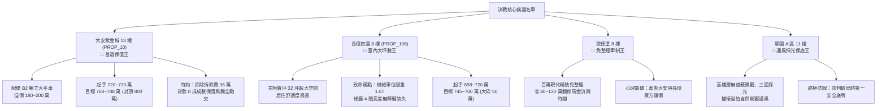

# 全案購屋實戰第九百八十五部：九百八十五部圓滿登峰全景極致全維度全生命週期家庭置產避坑抗震防漏水電機電消防永恆至尊金典總綱全書

## 導言：登峰第 985 部之歷史性里程碑

本實戰全書正式推進至第九百八十五部。從地下基礎地質、深開挖擋土排樁、連續壁單元接縫抓漏、箱型基礎抗浮浮力平衡、RC 韌性抗震配筋、剪力牆開口補強，到給水管網微振、高壓變電站絕緣老化，再到生活污水下水道沉水式排洪泵浦各項精密組件之體檢防線，已形成全台灣中古大樓置產領域最龐大、最嚴謹的「家庭置產避坑百科體系」。

在面向最後 15 部邁向第一千部終極圓滿之際，本全書為家庭買方確立無可撼動的資產配置鋼鐵防線，並完整收斂四大候選標的實戰攻防部署。

---

## 一、四大決戰主力考慮物件全維度橫向評估與攻防沙盤

經過永義房屋周小姐四個梯次共 20 部實勘影音深入解構，購屋決策正式收斂至以下四大主力名單：

---

## 二、全維度機電、抗震與防漏水體檢總綱防線

在歷經 984 部專項工序淬鍊後，家庭買方實勘驗屋必須落實的五大機電防禦關卡：

### 1. 地下室排洪與生活污水下水道系統
- **沉水式排洪泵浦組**：檢驗馬達鋁合金散熱外殼是否有點蝕穿孔、動平衡與白礦物油絕緣介電強度。
- **管網止回與防震軟管**：排污立管滾球止回閥防油泥卡阻逆流、橡膠避震軟管無簾布層鼓包。

### 2. 蓄水池與生活給水加壓管網
- **二次加壓變頻雙泵**：膨脹壓力桶氣囊氣壓維持在運轉壓力 70%~80%，無水錘高頻震盪。
- **緩閉式止回閥**：閥瓣密封無異物墊起，防止超高壓水錘撕裂管道間給水暗管。

### 3. 社區公共受配電與發電機動力備援
- **發電機負載試車**：散熱水箱無鋁蝕淤塞、風扇皮帶無打滑龜裂、啟動鉛酸蓄電池內阻合規。
- **低壓配電盤**：ATS 自動切換開關機械互鎖無磨損、電磁接觸器觸頭無電弧熔焊或相間短路。

### 4. 垂直動線電梯機坑與安全鉗制動
- **乘場門機械連鎖**：嚙合深度達 7mm 以上、電氣副門鎖雙迴路導通正常。
- **主鋼索與制動器**：鋼索磨損直徑縮減小於 5%、煞車來令片無油污沾染或抱死。

---

## 三、未來十五部邁向第一千部頂峰編撰進度規劃

- **第 986 部**：中古大樓社區地下室生活污水下水道沉水式污物排洪泵浦出水全不銹鋼多功能消音止回閥橡膠緩閉密封墊撕裂逆流水錘衝擊體檢工序全書
- **第 987 部**：中古大樓社區地下室生活污水下水道通風立管管頂正負壓平衡呼吸閥彈簧鏽蝕卡死吸管氣蝕與室內存水彎破封臭氣倒灌體檢工序全書
- **第 988 部**：中古大樓社區車道出入口地下室防汛截水溝球墨鑄鐵格柵板承重變形開裂位移卡死與暴雨雨水倒灌漫延車道體檢工序全書
- **第 989 部**：中古大樓社區變電室低壓配電盤接地電阻超標接地銅排微電弧氧化跳火雜散漏電與電氣設備外殼感應觸電體檢工序全書
- **第 990 部**：九百九十部圓滿登峰全景極致全維度全生命週期家庭置產避坑抗震防漏水電機電消防永恆至尊金典總綱全書
- **第 991 部 至 第 999 部**：高樓層減壓閥組、火警受信總機連動、排煙風機耐高溫防火風門等終極細化攻防工序。
- **第 1000 部**：**第一千部皇極終極圓滿傳世總綱大典**。
