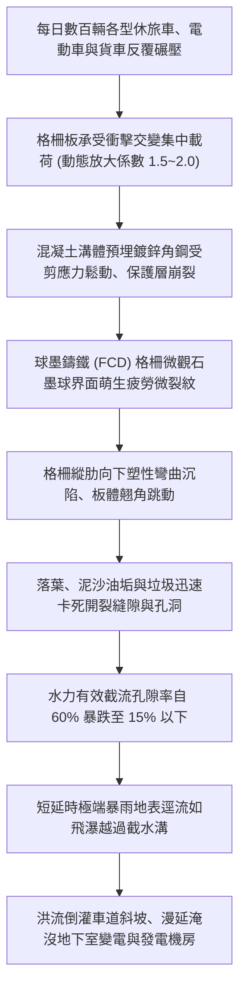
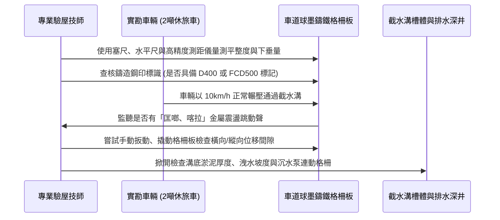

# 全案購屋實戰第九百八十八部：中古大樓社區車道出入口地下室防汛截水溝球墨鑄鐵格柵板承重變形開裂位移卡死與暴雨雨水倒灌漫延車道體檢工序全書

## 導言：地下室防汛第一道物理咽喉防線

在台灣極端氣候頻繁爆發短延時強降雨（時雨量往往突破 80mm 至 120mm）的嚴峻環境下，集合住宅中古大樓地下室車道出入口之「第一道防汛截水溝（Catch Basin / Trench Drain）」與其上方鋪設之「重型球墨鑄鐵格柵板（Ductile Iron Grating）」，是阻絕道路暴雨逕流倒灌漫延地下室的生死咽喉防線。

地下室通常匯聚了整座社區價值數千萬甚至上億元的命脈設備——高低壓變電站、緊急柴油發電機機房、生活蓄水池、消防水泵房以及數百輛住戶私家車（包含昂貴的新能源電動車）。一旦車道截水溝因車輛長年反覆重壓輾壓而發生球墨鑄鐵格柵板金屬疲勞變形、縱梁開裂、支撐角鋼鏽蝕崩解、格柵位移翹起卡死或排水截面嚴重縮減，在極端暴雨來襲瞬間，地表奔騰的雨水洪流將完全無法被攔截導入沉水抽排深井，而是如同瀑布般直接沖刷衝入地下各樓層，引發慘烈的「地下室水浸、配電盤全毀、發電機報銷、全棟斷水斷電癱瘓數月」的滅頂之災。

本全書深入解構車道防汛截水溝球墨鑄鐵格柵板在動態車輛交變重載下的破壞力學、排水水力學截流極限、高精度現地體檢工序、標竿修復工藝與家庭買方在購屋時的議價防衛策略。

---

## 一、車道截水溝重載疲勞破壞與防汛失效力學機制

### 1. 動態車輛衝擊載荷與抗疲勞極限
車道坡道起點與轉折處之截水溝，處於車輛下坡制動（剎車剪力）或上坡加速（輪胎扭矩）之極限應力集中區：
- **動態衝擊放大**：當車重 2.0 至 2.8 噸（如特斯拉、BMW 休旅車等電池底盤重量較大之車款）以 15~20 km/h 通過未緊密貼合的格柵時，懸空跳動產生的高頻衝擊荷載可達到靜載荷的 **1.8 至 2.5 倍**。
- **球墨鑄鐵（Ductile Iron, FCD 500-7）之交變微觀破壞**：優質球墨鑄鐵依靠球狀石墨阻止裂紋擴展；但劣質或老化的灰口鑄鐵（FC 200/250）或承重等級不足（未達 EN 124 D400 等級，即 40 噸承載力）之格柵板，在數十萬次交變剪切彎矩作用下，內部石墨界面極易萌生滑移帶，最終爆發脆性斷裂。

### 2. 預埋角鋼基座之剪應力剝離與電化學腐蝕
- **混凝土基座剪應力開裂**：溝槽兩側預埋的「L 型支撐角鋼」，若原施工時未與結構主筋確實焊接或錨栓深度不足（小於 100mm），在車輪剎車向下的水平推力下，包覆角鋼的無收縮水泥砂漿極易產生平行於溝壁的剪切剪開裂縫。
- **雨水與車輛底盤油水混合電解液滲透**：含有融雪劑鹽分、輪胎橡膠碳粉與機油酸性物的污水滲入角鋼縫隙，引發強烈的電化學縫隙腐蝕（Crevice Corrosion），鏽蝕膨脹體積增大 3~5 倍，將溝體混凝土硬生生脹裂，導致格柵板失去平整支撐，產生嚴重晃動、異響與位移。

### 3. 水力學孔隙率暴跌與跳躍式溢流
- 正常截水溝格柵開孔率應維持在 **50% 至 65%** 以上，溝底坡度需達 **1% 至 2%** 以維持自清流速（Self-cleansing Velocity ≥ 0.9 m/s）。
- 當格柵板受壓彎曲沉陷後，凹陷處形成「集污陷阱」，枯枝落葉、塑膠袋與洗車泥沙迅速積聚板面；在暴雨來臨瞬間，格柵表面被油垢泥沙封堵，高速奔流的地表雨水無法穿透格柵下沉入溝，而是順著水流慣性直接「滑過」格柵板面，沿著車道坡道狂瀉而下直衝地下室。

---

## 二、現場高標準防汛結構與水力體檢檢測工序

家庭買方在踏勘目標中古大樓時，進入社區大門地下車道口時，必須進行五步關鍵體檢：

### 1. 幾何平整度、沉陷量與間隙量測
- **檢測儀器**：2 米鋁合金水平靠尺、高精度厚薄規（塞尺）、數顯游標卡尺。
- **判定標準**：
  - **下垂沉陷量（Deflection）**：跨中最大下垂變形量 **嚴禁超過 3mm**。若跨中已呈肉眼可見的「V 字型」凹陷（變形 > 5mm），證明鑄鐵已進入塑性屈服階段，隨時有受壓斷裂塌陷之危險。
  - **與溝壁水平高低差**：格柵表面應比兩側瀝青/混凝土路面 **略低 3mm~5mm**（以利進水），但嚴禁凸起於路面；格柵板與兩側預埋鋼框之間隙應在 **3mm 至 6mm 之間**。若間隙大於 12mm，板體在車輛剎車時將產生劇烈水平撞擊位移。

### 2. 動態輾壓聲學與跳動位移診斷
- **測試流程**：由技師或房仲駕駛 2 噸休旅車，以 10~15 km/h 速度反覆通過截水溝 3 次，同時於 1 公尺外以高感度分貝計量測輾壓瞬間之碰撞噪聲。
- **數據判定標準**：
  - **優良（綠燈）**：僅傳出低沉的輪胎橡膠滾動音，無任何金屬撞擊聲，噪聲增量小於 5 dB(A)；格柵板四角完全無任何微小跳動位移。
  - **危急（紅燈）**：發出刺耳尖銳「匡啷！喀啷！」金屬跳起重擊基座聲，聲壓級超過 **85 dB(A)**，肉眼可見格柵邊角翹起超過 5mm。此現象證實基座角鋼已脫焊懸空或防跳固定螺栓全部斷裂丟失。

### 3. 截水溝斷面水力排洪容量驗算
- 量測截水溝淨寬（$W$）與淨深（$H$）：集合住宅一類防汛截水溝淨寬不得小於 **400mm**，有效沉泥淨深不得小於 **350mm**。
- 檢查溝底淤塞度：溝底淤泥油垢厚度若已超過溝深的 **1/3（即 > 100mm）**，且排水管口直徑小於 200mm，代表社區長期欠缺防汛清淤維護，極端暴雨時溢流風險高達 90% 以上。

---

## 三、故障修復、標竿重載防汛工藝與材料規範

一旦截水溝格柵變形開裂或溝體崩裂，管委會與工程修復必須依據重載工業標準實施徹底重構：

| 工程階段 | 標竿工程規範與高端用料要求 | 廉價劣質短命工法之後遺症 |
| :--- | :--- | :--- |
| **格柵板選型** | 採用 **球墨鑄鐵 QT500-7 / FCD500**，承重等級達 **EN 124 D400（40 噸級）**；具備專用不銹鋼防跳鎖固螺栓（M12 SUS316）。 | 採用普通灰口鑄鐵 HT200 或鍍鋅扁鋼格柵（承載不足 10 噸），數月即壓彎焊點撕裂。 |
| **溝體基座加固** | 鑿除損壞混凝土，重新植入 $\phi 13\text{mm}$（4分）化學錨栓，焊接熱浸鍍鋅 $75\times 75\times 8\text{mm}$ 加厚角鋼，並澆置 **早強無收縮環氧樹脂高抗壓自流平水泥砂漿（抗壓強度 $\ge 60\text{ MPa}$）**。 | 使用普通 1:3 水泥砂漿抹平，未植筋錨固，通車數週內在震動下再度碎裂剝落。 |
| **防震消音降噪** | 於支撐角鋼與鑄鐵格柵板接觸面上，全線鑲嵌 **氯丁橡膠（Neoprene）抗老化耐磨減震消音膠條（厚度 5mm）**。 | 金屬直接硬碰硬接觸，每日清晨深夜車輛進出爆發巨響，引發一樓與低樓層住戶抗議投訴。 |
| **防堵沉砂過濾** | 截水溝前端配置 **SUS304 可拆卸提籃式不銹鋼沉砂防葉提籠**，孔徑 8mm~10mm，便於保全每日清理。 | 無過濾網，泥沙落葉直衝深井，造成下游客水排洪泵浦葉輪纏繞燒毀。 |

---

## 四、四大主力候選物件實戰關聯評估與議價攻防

地下室截水溝之防護等級，直接映射全棟最重要公設資產的安全底線：

### 1. 大安紫金城 13 樓 (`PROP_10`)
- **實地重點**：大安紫金城本物件之所以具備極高保值與抗跌增值潛力，核心關鍵之一即為「配備地下二樓（B2）獨立大型平面車位」！
- **實戰攻防部署**：
  - 進入地下停車場車道口時，嚴格檢視車道入口截水溝狀況。大安紫金城若車道截水溝平整無聲、排水格柵均為厚重球墨鑄鐵且固定牢固，證實管委會對地下室防汛極度重視，豪車平車位價值穩固。
  - 反之，若發現格柵板變形翹曲、車輛輾過發出巨響、溝底淤泥深厚，立即在看屋筆記中列為「公共防汛二級隱患」，向房仲指出若暴雨倒灌 B2 平車位將面臨泡水滅頂風險，以此要求扣減未來公設專案修繕攤提費用 15 萬元，鎖定成交目標價 768~788 萬。

### 2. 長億南園 8 樓 (`PROP_106`)
- **實地重點**：長億南園配備的是「機械車位（且限重 1.6 噸）」。機械車位之傳動馬達、鏈條、控制電路板與下層車坑均位於地下室最低處！一旦車道截水溝排水不及導致暴雨倒灌，機械車坑必先首當其衝成為蓄水池，機械設備泡水報廢更換需數十萬元。
- **談判痛點打擊**：若實勘發現長億南園車道截水溝角鋼鏽蝕、格柵板晃動，立即將此硬傷與機械車位限重 1.6 噸雙重綁定，向賣方嚴正說明：「該物件車位本已無法停放中大型休旅車，若車道截水溝防汛脆弱，機械車坑隨時面臨淹水報廢之災！」以此強力施壓，堅決將開價 998 萬砍至 745~760 萬。

### 3. 歌德堡 8 樓 與 靜園 A 區 11 樓
- **歌德堡 8 樓**：作為免整理精裝牽制牌，需查核其地下室管理水準是否匹配其精裝品質，確保公共設施無短板。
- **靜園 A 區 11 樓**：作為採光通風底牌，若其地下室截水溝養護完善、防汛閘門配備齊全，將更加鞏固其作為談判破局時最安心底牌的地位。

---

## 五、全案總結與買方自保查核清單

1. **查鋼印**：格柵表面必須具備清淅的承重等級鋼印標識（如 EN 124 D400 或 FCD500），絕不可為單薄的鋼筋焊接板。
2. **壓聽聲**：車輛輾壓截水溝時，除輪胎聲外嚴禁有「噹噹、喀啷」金屬敲擊聲或跳躍翹起現象。
3. **望平直**：格柵中央不得有下垂凹陷，兩側預埋鋼框混凝土不得有縱向開裂或碎屑脫落。
4. **測深溝**：掀開（或手電筒照射）格柵孔隙，溝底淤泥不得超過 5cm，排水管徑不得小於 200mm，確保水力過流斷面暢通無阻。
